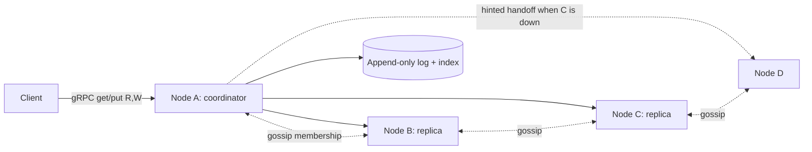

# Mini-KV Store

> [!abstract] Why this project exists
> The Distributed Systems category is the one where reading does not stick: quorums, hinted handoff and read repair are obvious on paper and surprising in a running cluster. Building a three-to-five node store that you can partition on purpose turns [[Design a Distributed Key-Value Store]] from a recited architecture into a set of experiments you have run, and gives every "what happens if a node dies?" question a measured answer.

**Map:** [[Projects MOC]] → [[Engineering Dashboard]]

## Problem being solved

A key-value store that stays writeable when nodes fail or the network splits, scales by adding nodes without rehashing everything, and lets the caller choose, per request, how much consistency to pay for. The [[Dynamo Paper]] describes the shape; the point here is to discover which parts matter at small scale and what each guarantee costs in latency.

## Intended users

- The [[Design a Distributed Cache]] and [[Design a Distributed Key-Value Store]] problem notes — this project is their reference implementation.
- Kunal, as the operator who can say "with N=3, R=2, W=2 a partition made 4% of reads stale, and here is the chart".
- Later projects that want an embedded, partition-tolerant store for experiments ([[Chaos Lab]]).

## Product requirements

- `get`, `put`, `delete` over gRPC with tunable `R` and `W` per request and a cluster-wide `N`.
- Data partitioned by consistent hashing with virtual nodes; adding a node moves only its share of keys.
- A write with `W` acknowledgements succeeds while fewer than `N - W + 1` replicas are down (sloppy quorum with hinted handoff).
- Reads with `R + W > N` return the latest acknowledged write when the cluster is healthy; stale reads are detected and repaired.
- Membership and failure detection by gossip; no central coordinator.
- A crash with uncommitted writes loses nothing that was acknowledged (append-only log + fsync policy).

## Minimum viable version

One Java process per node, a ring built from a static seed list, and a gRPC API. Each node owns an append-only log file with an in-memory hash index (Bitcask style), partitions by a consistent-hash ring with 64 virtual nodes each, and replicates each key to the next `N - 1` distinct nodes on the ring. The coordinator for a request is whichever node receives it; it fans out to the replicas and waits for `W` or `R` responses. Versions are last-writer-wins by a hybrid logical clock in M1; vector clocks are an M4 experiment.

- Storage engine: append-only log, in-memory index, compaction on restart.
- Ring and replica placement; `put` and `get` fan-out with timeouts.
- Static membership from a config file; a `maelstrom`-style CLI client for manual testing.
- Crash-recovery test: kill -9 during writes, restart, verify every acknowledged key.

## Architecture



The improved stage adds gossip-based membership and failure detection, hinted handoff with replay when a node returns, read repair on divergent responses, and Merkle-tree anti-entropy between replicas as a scheduled job.

## Tech stack

- **Java 21 + gRPC (protobuf)** — the node protocol; virtual threads keep fan-out simple.
- **Plain files + `FileChannel.force`** for the log; no embedded database, so the storage trade-offs are visible.
- **Docker Compose + Toxiproxy** to partition the cluster deliberately.
- **A Jepsen-style checker in Java** (or Maelstrom from [[Fly.io Gossip Glomers Challenges]]) to verify linearizability or detect lost writes.

## Data model

```text
Log record:   [len][crc][version(hlc)][keyLen][key][valueLen][value|tombstone]
Index:        key -> (fileId, offset, version)
Ring:         sorted map hash(vnode) -> nodeId   (64 vnodes per node)
Hint:         (targetNode, key, record) persisted locally until the target is reachable
Membership:   nodeId -> { address, heartbeat, incarnation, state: alive|suspect|dead }
```

## APIs

```protobuf
service KV {
  rpc Get(GetRequest) returns (GetResponse);      // key, r
  rpc Put(PutRequest) returns (PutResponse);      // key, value, w, context
  rpc Delete(DeleteRequest) returns (PutResponse);
  rpc Replicate(ReplicateRequest) returns (Ack);  // node-to-node
  rpc Gossip(Digest) returns (Digest);            // membership exchange
}
```

## Relevant HLD concepts

- [[Consistent Hashing]] — the ring and virtual nodes; M2 measures key movement when a node joins.
- [[Quorums]] — `R + W > N` versus `R = W = 1`; the staleness experiment is the heart of the project.
- [[Replication]] — leaderless replication and why every write fans out from the coordinator.
- [[Eventual Consistency]] — what the client observes with weak quorums, measured rather than asserted.
- [[Gossip Protocols]] — membership without a coordinator; convergence time is a number to measure.
- [[Failure Detection]] — heartbeat timeouts and the false-positive rate under injected latency.
- [[Network Partitions]] — Toxiproxy splits the cluster; the checker says whether writes were lost.
- [[Partitioning]] — ownership by hash range; the hot-partition problem appears when one key is popular.
- [[Clocks and Time]] — last-writer-wins needs a clock; the HLC versus vector clock experiment shows what that costs.
- [[Hot Keys]] — one hot key sits on one coordinator path; measure the skew.
- [[gRPC]] — deadlines and cancellation on every node-to-node call.

## Milestones

> [!info] The loop
> 1. Build a working minimal version → 2. Measure its behaviour → 3. Identify bottlenecks and failure modes → 4. Improve the architecture based on evidence → 5. Document the trade-offs (an entry in `04 Projects/Decisions`).

- [ ] M1 — Single node, durable. Exit: 1 million puts then kill -9 and restart with zero acknowledged writes lost; compaction halves the log.
- [ ] M2 — Three nodes, quorum reads and writes. Exit: p50/p99 latency table for (R,W) in {(1,1), (2,2), (3,1), (1,3)} at 5k ops/s; measured stale-read rate under a partition for each.
- [ ] M3 — Failure handling. Exit: hinted handoff and read repair pass a partition-and-heal test with no lost acknowledged writes; gossip converges on a node death in under 5 s.
- [ ] M4 — Improved. Exit: one evidence-driven change (vector clocks, Merkle anti-entropy or vnode count) with before/after data.
- [ ] M5 — Documented. Exit: ADRs for replication factor, default quorum and conflict resolution; a write-up of the stale-read measurements.

## Current tasks

- [ ] Storage engine: append-only log with CRC, in-memory index, restart recovery and compaction.
- [ ] gRPC service and a CLI client.
- [ ] Consistent-hash ring with virtual nodes and replica placement.
- [ ] Coordinator fan-out with per-replica deadlines and R/W wait logic.
- [ ] Compose cluster of three nodes with Toxiproxy between them.

## Technical challenges

- [ ] With `R + W > N`, which specific interleavings still return stale data (hinted handoff landing on a non-replica, clock skew in LWW) and how often do they happen under a 30-second partition?
- [ ] How many virtual nodes are needed before load is within 10% of even across five nodes?
- [ ] What heartbeat interval and suspicion timeout keep false positives under 1% with 100 ms injected jitter?
- [ ] Does read repair on every divergent read add measurable p99 latency, or is scheduled anti-entropy enough?

## Testing strategy

- **Unit** — ring placement, quorum arithmetic, HLC ordering, log encoding: pure functions.
- **Property** — random operation sequences against a single-node model; the store must agree with a map.
- **Cluster** — Compose-based tests that partition and heal, checked by a linearizability checker for `R + W > N` and by a lost-write detector otherwise.
- **Chaos** — kill nodes mid-write, add a node under load, corrupt a log segment and confirm the CRC path.

## Deployment plan

Docker Compose with three to five nodes and Toxiproxy; an optional k3s deployment with a StatefulSet to see what node identity and persistent volumes change. No cloud deployment is needed for the learning goals.

## Monitoring and observability

- Per-operation latency by (R, W) and by outcome (success, quorum-failed, timeout).
- Hints pending per node and hint replay rate.
- Read-repair count and anti-entropy bytes transferred.
- Membership view per node (to see convergence) and false-positive suspicions.

## GitHub repository

*(not created yet — suggested name: kunal/mini-kv)*

## Live demo

*(none yet)* — a terminal split: k6-style load on the left, Toxiproxy partition on the right, the stale-read counter in the middle.

## Performance considerations

The coordinator's fan-out is the critical path: use virtual threads, per-replica deadlines and return as soon as `R` or `W` responses arrive. The storage engine is append-only, so write throughput is bounded by fsync policy — make `fsync` per write versus per batch a measured, documented choice.

## Lessons learned

*(Fill as you go.)*

## Future enhancements

- Vector clocks with client-side reconciliation (the shopping-cart merge) — [[Clocks and Time]].
- Merkle-tree anti-entropy — [[Replication]].
- An LSM storage engine with bloom filters instead of the hash index — [[Relational Database Internals]].
- Snapshot transfer for new nodes — [[Partitioning]].

## Related

### Design problems
- [[Design a Distributed Key-Value Store]]
- [[Design a Distributed Cache]]

### Also exercised
*Concept notes that point at this project but are not discussed above — the long tail of what building it will touch.*
- [[BASE]] · [[Block Storage]] · [[CAP Theorem]] · [[Consensus]] · [[Consistency Models]] · [[Coordination vs Availability]] · [[Distributed Caching]] · [[Eviction Policies]] · [[Fault Tolerance]] · [[Horizontal vs Vertical Scaling]] · [[Leader Election]] · [[PACELC]] · [[Recovery Point Objective]] · [[SQL vs NoSQL]] · [[Scalability]] · [[Service Discovery]] · [[Sharding]]

### Decisions
- *(record ADRs in 04 Projects/Decisions using the Architecture Decision Template)*
