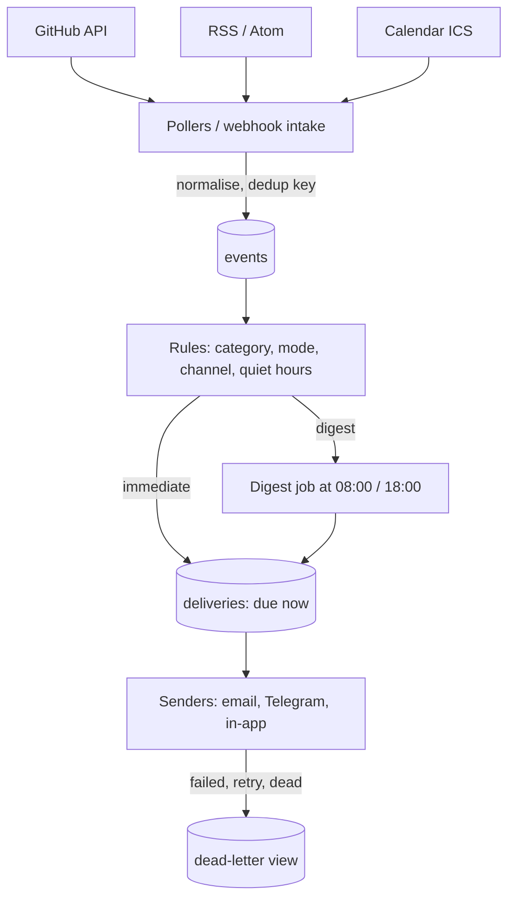

# Personal Notification Hub

> [!abstract] Why this project exists
> [[Design a Notification System]] is usually answered as a fan-out diagram, but the hard parts are product decisions: what counts as a duplicate, what is urgent enough to break quiet hours, how a user says "never again for this". A hub that aggregates your own sources and sends you digests makes those decisions concrete, keeps the architecture deliberately small, and gives the Product Engineering notes a system to point at.

**Map:** [[Projects MOC]] → [[Engineering Dashboard]]

## Problem being solved

Notifications arrive from many sources (GitHub reviews and mentions, calendar changes, RSS and newsletters, the vault's own review reminders) through many channels, with no shared idea of priority, duplication or timing. The hub ingests everything into one normalised stream, deduplicates and groups it, applies per-source and per-channel preferences and quiet hours, and delivers either immediately (urgent) or as scheduled digests — with delivery retried, failures visible, and every rule explainable.

## Intended users

- Kunal, as the only user at first; the preferences model should still generalise to many users.
- The [[Spaced Repetition Review CLI]] and [[Live Ops Dashboard]] projects, which become sources.
- Kunal as the engineer who can explain a notification system's preference, dedup and digest design from a running one.

## Product requirements

- Sources: GitHub (notifications API), a calendar feed (ICS), RSS/Atom, and a generic webhook; each normalised to one event shape.
- Deduplication by a source-specific key (same PR comment thread, same calendar event version) and grouping (five comments on one PR become one item).
- Preferences: per source and category, choose channel (email, Telegram or Slack webhook, in-app list), mode (immediate, digest, mute) and quiet hours in the user's time zone.
- Digests at configured times containing everything not yet delivered, rendered to Markdown and HTML; nothing is lost if a digest fails to send.
- Urgent items (configurable rules) break quiet hours; everything else waits.
- Delivery is at-least-once with retries and a dead-letter view; a "why did I get this?" explanation on every delivered item.
- Users can unsubscribe from a category in one click, and the hub honours it immediately.

## Minimum viable version

A NestJS service with PostgreSQL. Pollers for GitHub and RSS run on a schedule (reuse the [[Durable Job Scheduler]] once it exists; `@nestjs/schedule` until then), writing normalised `events` with a dedup key (`INSERT ... ON CONFLICT DO NOTHING`). A rules engine assigns each event a category and mode from the preferences table. A digest job renders undelivered digest-mode items into one message and sends it by email through an SMTP sandbox; immediate items go to a Telegram bot. Deliveries are recorded with status and retried with backoff.

- Normalised event model and two pollers (GitHub, RSS) with dedup.
- Preferences table and the rule evaluation that sets category, mode and channel.
- Digest renderer and sender; Telegram sender for immediate items; delivery records with retries.
- A `why` field on each delivery listing the rules that matched.

## Architecture



> [!example]- Excalidraw version — the same diagram as an editable canvas
> ![[Personal Notification Hub.excalidraw]]
> [[Personal Notification Hub.excalidraw|Open in Excalidraw]] — needs the Excalidraw plugin (see [[Plugins to Install]]).


At the improved stage a queue (Redis Streams via BullMQ) separates intake from delivery so a slow email provider cannot stall polling, grouping becomes smarter (thread-aware), and a tiny web UI lists in-app items with the "why" explanation and one-click mutes.

## Tech stack

- **TypeScript + NestJS** — pollers, rules and senders in one small service; the work stack.
- **PostgreSQL** — events, preferences, deliveries; a `tsvector` column for searching your own history.
- **BullMQ on Redis (M3)** — delivery queue with retries and backoff; see [[BullMQ]].
- **Nodemailer with a local SMTP sandbox (Mailpit)** and a Telegram bot — real channels without real risk.
- **OAuth device flow for GitHub** — tokens stored encrypted; see [[OAuth]].

## Data model

```sql
sources(id, type: github|rss|ics|webhook, config jsonb, poll_interval, last_polled_at, enabled)
events(id, source_id, dedup_key UNIQUE, category, title, body, url, occurred_at, received_at, group_key, raw jsonb, tsv tsvector)
preferences(user_id, source_type, category, channel, mode: immediate|digest|mute, quiet_from, quiet_to, timezone)
digests(id, user_id, scheduled_for, sent_at, item_count, rendered_md, status)
deliveries(id, event_id, digest_id, channel, status: pending|sent|failed|dead, attempts, next_attempt_at, why jsonb, sent_at)
```

## APIs

```http
POST /v1/intake/webhook/{sourceId}     generic JSON → normalised event
GET  /v1/inbox?since=&category=         in-app items with "why"
PUT  /v1/preferences                    { sourceType, category, channel, mode, quietHours }
POST /v1/mute                           { category | groupKey }
GET  /v1/digests/{id}                   rendered digest
GET  /v1/deliveries?status=dead         dead-letter view, POST /v1/deliveries/{id}/replay
```

## Relevant HLD concepts

- [[Fan-Out]] — one event to several channels; small here, but the shape is the same as at scale.
- [[Message Queues]] and [[Dead-Letter Queues]] — deliveries are a queue with retries and a dead-letter state you can inspect.
- [[Pub-Sub]] — sources publish, rules subscribe; adding a source must not change delivery code.
- [[OAuth]] — GitHub access via device flow, token storage and refresh.
- [[Data Ownership and Lifecycle]] — raw payloads kept for 30 days, events for a year, deliveries forever; stated and enforced.
- [[Designing for Extensibility]] — a new source is one adapter implementing `poll()` or `intake()` and a dedup-key function.
- [[Operational Simplicity]] — one service, one database, until a measurement demands the queue.
- [[Full-Text Search]] — searching your own notification history is the feature you will actually use.
- [[Alerting]] — the hub is where the vault's own alerts (reviews due, project stale) land.
- [[Translating Product Requirements into Technical Requirements]] — "don't bother me at night unless it matters" becomes rules, quiet hours and an urgency predicate.

## Milestones

> [!info] The loop
> 1. Build a working minimal version → 2. Measure its behaviour → 3. Identify bottlenecks and failure modes → 4. Improve the architecture based on evidence → 5. Document the trade-offs (an entry in `04 Projects/Decisions`).

- [ ] M1 — Minimal working version. Exit: a week of real GitHub and RSS traffic delivered as two digests a day plus Telegram for mentions; zero duplicates in the digests.
- [ ] M2 — Measured. Exit: dedup rate per source, digest size distribution, delivery failure and retry counts, poll cost per source.
- [ ] M3 — Queued. Exit: BullMQ delivery queue; a 10-minute SMTP outage loses nothing and the dead-letter view shows exactly the failed items.
- [ ] M4 — Improved. Exit: one evidence-driven change (thread-aware grouping, webhook intake replacing polling, or in-app UI) with before/after data.
- [ ] M5 — Documented. Exit: ADRs for dedup keys, digest timing and the urgency rule; retention policy enforced by a job.

## Current tasks

- [ ] Event model, dedup key per source, GitHub and RSS pollers.
- [ ] Preferences and the rule evaluation producing category, mode, channel and `why`.
- [ ] Digest job and Markdown/HTML renderer; email sender via Mailpit.
- [ ] Telegram sender for immediate items; delivery records with backoff retries.
- [ ] Dead-letter listing and replay.

## Technical challenges

- [ ] What dedup key survives GitHub's notification semantics (updated threads, re-opened PRs) without hiding genuinely new activity?
- [ ] How should a digest handle an item that was also sent immediately — omit, mark, or include for completeness?
- [ ] When quiet hours end, should queued immediate items arrive as a burst, as one grouped message, or fold into the morning digest?
- [ ] At what event volume does polling cost more than webhooks are worth setting up?

## Testing strategy

- **Unit** — rule evaluation, quiet-hour arithmetic across time zones and DST, digest rendering with fixtures.
- **Integration** — Testcontainers PostgreSQL; recorded API fixtures for GitHub and RSS; Mailpit for email assertions.
- **Failure injection** — SMTP down, Telegram 429, poller exceptions; assert retries, dead-letters and no duplicates after replay.

## Deployment plan

Docker Compose on a home server or a small VM: the service, PostgreSQL, Redis (M3), Mailpit. Secrets via environment; GitHub token via device flow on first run.

## Monitoring and observability

- Events ingested per source per hour; dedup rate.
- Deliveries by status and channel; dead-letter count (alert on growth).
- Digest send time versus scheduled time.
- Poll latency and API rate-limit headroom per source.

## GitHub repository

*(not created yet — suggested name: kunal/notify-hub)*

## Live demo

*(none yet)* — this morning's digest, and the inbox view with "why did I get this?" expanded.

## Performance considerations

Volume is tiny; the interesting constraints are provider rate limits and the quiet-hour and digest timing logic. Keep polling adaptive (back off when nothing changes) to stay far from GitHub's limits.

## Lessons learned

*(Fill as you go.)*

## Future enhancements

- Multi-user with per-user sources and OAuth — [[Authentication]].
- Push notifications via web push — [[Fan-Out]].
- Priority inference from history (what you actually open) — [[Event-Driven Architecture]].
- Source for the vault's review queue from the [[Spaced Repetition Review CLI]] — [[Alerting]].

## Related

### Design problems
- [[Design a Notification System]]

### Also exercised
*Concept notes that point at this project but are not discussed above — the long tail of what building it will touch.*
- [[Prioritizing Reliability Performance Cost and Time to Market]] · [[Search Engines]] · [[Search Indexing Pipelines]]

### Decisions
- *(record ADRs in 04 Projects/Decisions using the Architecture Decision Template)*
