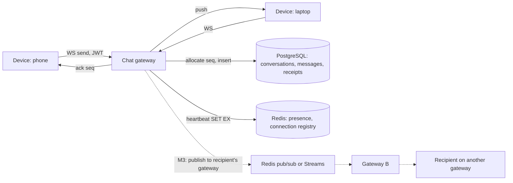

# Presence and Chat Service

> [!abstract] Why this project exists
> Chat is the most-asked real-time problem in SDE-2 rounds, and the follow-ups are always about the edges: ordering within a conversation, a phone that was offline for a day, presence that lies, receipts that arrive before the message. Building the backend — not the UI — with those edges handled and measured turns [[Design a Chat System]] into something you can defend line by line.

**Map:** [[Projects MOC]] → [[Engineering Dashboard]]

## Problem being solved

Users on several devices send messages in 1:1 and group conversations, see who is online, know when a message was delivered and read, and expect every device to converge on the same history after any outage. The hard parts are a stable per-conversation order, cheap multi-device sync, honest presence under flaky connections, and fan-out for groups without a hot path through one process.

## Intended users

- A mobile and web client team that wants a small, well-specified protocol: send, ack, sync, presence.
- The [[Live Ops Dashboard]] project, which reuses the presence component.
- Kunal, to answer "how do you order messages?" and "what happens when the user comes back online?" with a running system.

## Product requirements

- Messages in a conversation have a total order visible identically on every device (a per-conversation sequence, not timestamps).
- Delivery: a message acknowledged to the sender is persisted and will reach every recipient device at least once; clients deduplicate by message id.
- Sync: a device reconnecting after any gap fetches everything it missed with one call per conversation (`since seq`).
- Presence: online/away/offline with heartbeat, last-seen timestamps, and an explicit staleness bound (an "online" badge is at most 30 s wrong).
- Receipts: delivered and read markers per device, collapsed to per-user for display.
- Groups up to 500 members; fan-out must not block the sender's ack.
- Authentication by [[JWT]] on connect; a revoked token is cut off within a minute.

## Minimum viable version

A Spring Boot service with a WebSocket endpoint and a REST sync API over one PostgreSQL database. `send` validates the JWT, allocates the next `seq` for the conversation with `UPDATE conversations SET last_seq = last_seq + 1 RETURNING last_seq`, inserts the message, acks the sender, then pushes to recipient connections held in an in-memory registry on the same instance. Presence is a Redis key per user with a TTL refreshed by client heartbeats. A CLI client simulates several users and devices.

- WebSocket connect with JWT, send/ack, push to connected recipients.
- Per-conversation sequence and `GET /conversations/{id}/messages?since=` sync.
- Presence via Redis `SET EX` heartbeats and a last-seen write on expiry.
- Delivered and read receipts as separate small events.

## Architecture



> [!example]- Excalidraw version — the same diagram as an editable canvas
> ![[Presence and Chat Service.excalidraw]]
> [[Presence and Chat Service.excalidraw|Open in Excalidraw]] — needs the Excalidraw plugin (see [[Plugins to Install]]).


At the improved stage the connection registry moves to Redis (user → gateway), cross-gateway delivery goes through Redis pub/sub or Streams, group fan-out becomes asynchronous, and the messages table is partitioned by conversation and time — the [[Discord - How Discord Stores Trillions of Messages]] case study is the reference for what that looks like at scale.

## Tech stack

- **Java 21 + Spring Boot (WebSocket)** — connection handling with virtual threads; JWT validation reuses the IAM patterns from work.
- **PostgreSQL** — messages with `(conversation_id, seq)` primary key; partitioning by time in M4.
- **Redis** — presence TTLs, connection registry, pub/sub for cross-gateway delivery.
- **TypeScript CLI client** — multi-device simulation and the sync protocol conformance tests.
- **k6 (WebSocket)** — thousands of simulated devices for the measured stage.

## Data model

```sql
conversations(id, type: direct|group, last_seq BIGINT, created_at)
members(conversation_id, user_id, joined_at, last_read_seq)
messages(conversation_id, seq, message_id UUID UNIQUE, sender_id, body, sent_at,
         PRIMARY KEY (conversation_id, seq))
receipts(conversation_id, user_id, device_id, delivered_seq, read_seq)
-- Redis
presence:{userId}            -> "online" EX 30         (heartbeat every 10 s)
lastseen:{userId}            -> timestamp
conn:{userId}:{deviceId}     -> gatewayId
```

## APIs

```text
WS  /chat                   → { op: "send", conversationId, clientMsgId, body }
                            ← { op: "ack", clientMsgId, seq, messageId }
                            ← { op: "message", conversationId, seq, messageId, senderId, body, sentAt }
                            → { op: "receipt", conversationId, deliveredSeq?, readSeq? }
                            → { op: "heartbeat" }
GET /conversations/{id}/messages?since={seq}&limit=100
GET /users/{id}/presence    → { state, lastSeen }
POST /conversations         → create direct or group
```

## Relevant HLD concepts

- [[WebSockets]] — long-lived connections, heartbeats and what proxies and load balancers do to them.
- [[Ordering Guarantees]] — the per-conversation sequence is the whole ordering story; timestamps are display only.
- [[Client State and Reconnection]] — `since seq` sync, idempotent resend by `clientMsgId`, dedup by `messageId`.
- [[Distributed ID Generation]] — `messageId` is a UUID v7 so ids sort by time without coordination; `seq` is the order.
- [[Fan-Out]] — groups of 500; the sender's ack must not wait for 500 pushes.
- [[Failure Detection]] — presence is a heartbeat-based failure detector with all its false positives.
- [[Redis]] — TTL-based presence, the connection registry and pub/sub.
- [[Data Modeling]] and [[SQL vs NoSQL]] — the `(conversation_id, seq)` key and why a wide-column store becomes attractive at scale.
- [[JWT]] and [[Authentication]] — auth on connect, revocation window, token refresh over a live socket.
- [[At-Most-Once Delivery]] — typing indicators are deliberately at-most-once; messages are not.
- [[Real-Time Systems]] — the chain of concepts this project exercises end to end.
- [[Health Checks]] — a gateway with 10,000 sockets must drain, not drop, on shutdown.

## Milestones

> [!info] The loop
> 1. Build a working minimal version → 2. Measure its behaviour → 3. Identify bottlenecks and failure modes → 4. Improve the architecture based on evidence → 5. Document the trade-offs (an entry in `04 Projects/Decisions`).

- [ ] M1 — Minimal working version. Exit: two devices of one user and one peer converge on identical history after random disconnects; presence flips within 30 s.
- [ ] M2 — Measured. Exit: send-to-receive latency p50/p99 at 1k, 5k and 10k simulated devices; sync cost after a 24-hour gap; presence false-offline rate under 500 ms jitter.
- [ ] M3 — Multi-gateway. Exit: two gateways, Redis registry and pub/sub; delivery across gateways within 100 ms added latency.
- [ ] M4 — Improved. Exit: one evidence-driven change (async group fan-out, time-partitioned messages, or receipt coalescing) with before/after data.
- [ ] M5 — Documented. Exit: ADRs for ordering strategy, delivery guarantee per event type and presence staleness bound.

## Current tasks

- [ ] WebSocket endpoint with JWT validation and a per-instance connection registry.
- [ ] Sequence allocation, message insert and sender ack in one transaction.
- [ ] Sync endpoint and the CLI client's reconnect-and-sync logic.
- [ ] Presence heartbeats with Redis TTL and last-seen on expiry.
- [ ] Receipts (delivered, read) and per-user collapsing.

## Technical challenges

- [ ] Is `UPDATE ... last_seq + 1` on the conversation row a bottleneck for a 500-member group at 50 messages/s, and what replaces it?
- [ ] How do receipts for 500 members avoid becoming 500 × 500 events — coalescing window, or per-user summary rows?
- [ ] What does a client do when it receives seq 10 and 12 but not 11: wait, fetch, or display with a gap marker?
- [ ] What is the right presence heartbeat interval for mobile battery versus staleness, and can the server infer "away" without one?

## Testing strategy

- **Unit** — sequence and sync logic, receipt collapsing, presence state machine with a fake clock.
- **Integration** — Testcontainers PostgreSQL and Redis: send, ack, sync, reconnect scenarios with the CLI client.
- **Property** — random interleavings of sends and disconnects across three devices; all converge to the same ordered history.
- **Load** — k6 WebSocket scenario at the M2 device counts; failure injection with Toxiproxy on the Redis link.

## Deployment plan

Docker Compose with two gateways behind nginx, PostgreSQL, Redis and the simulator. A Kubernetes deployment is worth doing once to watch a rolling restart disconnect every client and to design the drain.

## Monitoring and observability

- Send-to-receive latency, sends by outcome, pushes per message (fan-out factor).
- Sync requests by gap size; sync p99 for 24-hour gaps.
- Presence transitions per minute and false-offline rate (measured by the simulator).
- Open sockets per gateway and drain time on restart.

## GitHub repository

*(not created yet — suggested name: kunal/chat-backend)*

## Live demo

*(none yet)* — the CLI simulator with three devices, one of them killed and revived while messages flow, printing the converged history.

## Performance considerations

The per-conversation sequence row is a deliberate serialisation point; measure its ceiling before replacing it. Group fan-out must be asynchronous from the sender's ack. Sync queries are range scans on `(conversation_id, seq)` and should stay index-only.

## Lessons learned

*(Fill as you go.)*

## Future enhancements

- End-to-end encryption envelope with server-blind payloads — [[Encryption at Rest and in Transit]].
- Push notifications for offline devices via the [[Personal Notification Hub]] — [[Fan-Out]].
- Message search with an inverted index — [[Full-Text Search]].
- Wide-column storage experiment for messages — [[SQL vs NoSQL]].

## Related

### Design problems
- [[Design a Chat System]]
- [[Design a Collaborative Document Editor]]

### Also exercised
*Concept notes that point at this project but are not discussed above — the long tail of what building it will touch.*
- [[Consistency Models]] · [[Domain-Driven Design]] · [[Event Sourcing]] · [[Microservices]]

### Decisions
- *(record ADRs in 04 Projects/Decisions using the Architecture Decision Template)*
