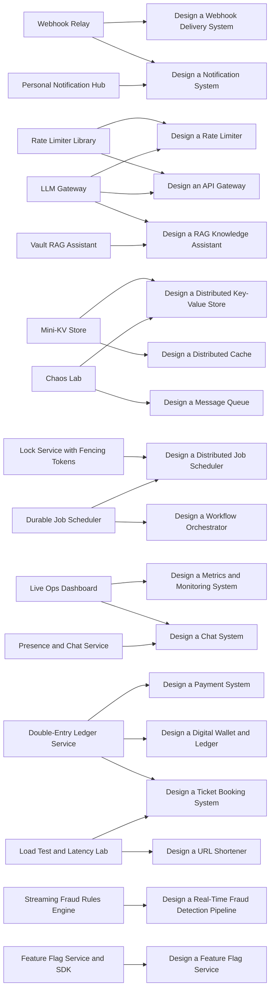

# Practical Projects

> [!abstract] The rule for every project
> Build the smallest version that works end to end → measure it (load, latency, failure injection) → find the bottleneck or failure mode → change one thing because of evidence → write the decision down in `04 Projects/Decisions`. A project that reaches M2 (measured) teaches more than three that stop at M1. Do not add Kafka, Redis or microservices to look impressive; add them when a measurement says you need them.

**Map:** [[HLD MOC]] · [[Problem Bank MOC]] · [[Engineering Dashboard]] · decisions use `Templates/Architecture Decision Template.md`

> [!tip] If you are studying for SDE-2
> Pick **one** project after week 8 of [[Start Here]] — [[Webhook Relay]] or [[Rate Limiter Library]] are the best first picks: small, real, and they exercise idempotency, retries, Redis and rate limiting, which come up in every interview.

## Projects and the problems they implement

*Left: what you build; right: the design problem it answers. Every box is a link.*

## Backend engineering

- [[Webhook Relay]] — A reliable outbound webhook delivery service with signing, retries, DLQ and per-endpoint isolation.
- [[Rate Limiter Library]] — A Java/TypeScript rate-limiting library with token bucket and sliding window, Redis-backed distributed mode and benchmarks.

## Distributed systems

- [[Mini-KV Store]] — A Dynamo-style key-value store: consistent hashing, N/R/W quorums, hinted handoff and read repair.
- [[Lock Service with Fencing Tokens]] — A lease-based distributed lock service exposing fencing tokens, with a client library and a test that proves why tokens matter.

## Real-time systems

- [[Live Ops Dashboard]] — A real-time operations dashboard: events streamed over WebSockets, fan-out, ordering, client state and recovery after disconnect.
- [[Presence and Chat Service]] — A chat backend with presence, delivery receipts and message sync across devices.

## Financial systems

- [[Double-Entry Ledger Service]] — An append-only double-entry ledger with idempotent transfers, holds, balance snapshots and a reconciliation job.
- [[Streaming Fraud Rules Engine]] — A stream processor that scores transactions with windowed features and rules, with a feedback loop and replay.

## AI-powered applications

- [[Vault RAG Assistant]] — A question-answering assistant over this vault: chunking pipeline, embeddings in pgvector, retrieval, streamed answers, evaluation set.
- [[LLM Gateway]] — A gateway in front of LLM providers: routing, token-based rate limits, response caching, cost tracking, fallbacks and streaming.

## Developer tools

- [[Feature Flag Service and SDK]] — A flag service with streaming config updates, targeting rules, an in-process SDK with local evaluation and an audit log.
- [[Durable Job Scheduler]] — A cron-like scheduler with leases, retries, idempotent execution and run history, built on a relational database first.

## Productivity tools

- [[Spaced Repetition Review CLI]] — A CLI that reads this vault's YAML (confidence, next_review), schedules reviews and updates properties — dogfooding the learning system.
- [[Personal Notification Hub]] — Aggregates alerts from GitHub, calendar and RSS into digests with dedup, quiet hours and channel preferences.

## Experimental projects

- [[Chaos Lab]] — A Docker Compose lab that injects latency, partitions and failures with Toxiproxy to observe timeouts, retries, breakers and bulkheads.
- [[Load Test and Latency Lab]] — A harness (k6 or Gatling) that load-tests your services, records p50/p99 and finds the knee, with capacity-planning write-ups.

## Status board

![[Projects.base#All]]

## Decisions recorded

![[Decisions.base#All]]
