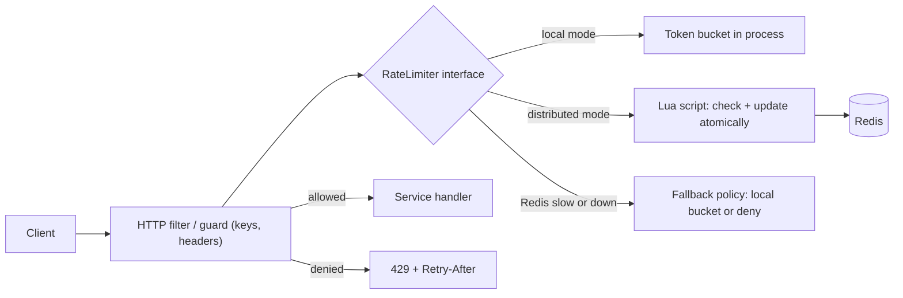

# Rate Limiter Library

> [!abstract] Why this project exists
> Every API you will ever design gets the question "how do you rate limit it across many instances?", and the honest answer depends on numbers most people have never measured: how much a Redis round trip costs per request, how far a sliding-window approximation drifts, what happens when Redis is slow. Build the limiter as a small library with two back-ends, benchmark both, and you will have those numbers and a defensible answer to [[Design a Rate Limiter]].

**Map:** [[Projects MOC]] → [[Engineering Dashboard]]

## Problem being solved

Services need to enforce per-client limits (requests per second, tokens per minute, concurrent calls) consistently across a fleet, without adding noticeable latency or a new single point of failure. Home-grown limiters are usually either per-instance (so a limit of 100/s becomes 100/s *per pod*) or a naive `INCR` counter with no burst handling. A library that offers a correct in-process limiter, a Redis-backed shared limiter and a clear fail-open/fail-closed policy removes the problem from every service that would otherwise reinvent it.

## Intended users

- Backend teams embedding a limiter in a Spring Boot or NestJS service in two lines.
- The [[LLM Gateway]] and [[Webhook Relay]] projects, which consume it as their limiter.
- Kunal as the person who has to say, in an interview, "a sliding-window counter over-admits by at most X% — I measured it".

## Product requirements

- Algorithms: token bucket (burst-friendly), fixed window, sliding window log (exact) and sliding window counter (approximate), selectable per limit.
- Modes: local (in-process, lock-free) and distributed (Redis, atomic via Lua scripts), with the same interface.
- Decision latency: local under 1 µs p99; distributed under 1 ms p99 on a laptop Redis.
- Correctness: a limit of N per window never admits more than N (exact algorithms) or more than N × (1 + bounded error) (sliding counter), proven by test under concurrency.
- Behaviour when Redis is unavailable is explicit and configurable: fail-open with a local fallback bucket, or fail-closed.
- Standard response headers (`RateLimit-Limit`, `RateLimit-Remaining`, `RateLimit-Reset`, `Retry-After`) produced by a Spring filter and a NestJS guard.

## Minimum viable version

A Java module with a `RateLimiter` interface (`tryAcquire(key, permits)` returning allowed/denied plus remaining and reset) and two implementations: an in-process token bucket using `AtomicLong` and nanosecond refill, and a fixed-window Redis counter (`INCR` + `EXPIRE` in one Lua script). A Spring Boot filter maps HTTP requests to keys (API key, then client IP) and emits the headers. A JMH benchmark for the local limiter and a k6 script for the HTTP path.

- `RateLimiter` interface, `TokenBucketLimiter`, `RedisFixedWindowLimiter`.
- Spring Boot filter with header emission and a `429` body.
- Benchmark harness: JMH for the library, k6 against a demo endpoint behind the filter.
- A correctness test that fires 10,000 concurrent calls at a limit of 1,000 and asserts exactly 1,000 admits.

## Architecture



At the improved stage the fixed window becomes a sliding-window counter (two buckets, weighted), hot keys are measured and optionally sharded (`key#0..k`) so one client cannot pin a single Redis slot, and the local fallback bucket is sized from the last known distributed state.

## Tech stack

- **Java 21** for the core library — the work stack, and JMH gives honest microbenchmarks.
- **TypeScript (NestJS guard)** as a second client of the same Lua scripts, to prove the protocol is language-neutral.
- **Redis 7** with Lua (`EVALSHA`) for atomic check-and-update; Redis Cluster in a later milestone for the hot-key experiment.
- **Docker Compose, k6, Testcontainers** for the measured stage.
- **Bucket4j** as the reference implementation to benchmark against — see [[Bucket4j]].

## Data model

```text
Local:        key -> { tokens: long (scaled), lastRefillNanos: long }
Fixed window: rl:{key}:{windowStart}            -> count (EXPIRE = window)
Sliding ctr:  rl:{key}:{currentWindow}, rl:{key}:{previousWindow}
Sliding log:  rl:{key} sorted set (score = timestamp ms), ZREMRANGEBYSCORE + ZCARD + ZADD
Config:       limits[] = { name, algorithm, capacity, refillPerSecond | window, keyExtractor, onBackendFailure }
```

## APIs

```java
interface RateLimiter {
    Decision tryAcquire(String key, long permits);   // Decision { allowed, remaining, resetAt, retryAfter }
}
RateLimiter limiter = RateLimiters.tokenBucket(capacity(100).refill(50, Duration.ofSeconds(1)));
RateLimiter shared  = RateLimiters.redis(client).slidingWindow(1000, Duration.ofMinutes(1)).onBackendFailure(FAIL_OPEN_LOCAL);
```

```http
HTTP 429 Too Many Requests
RateLimit-Limit: 1000
RateLimit-Remaining: 0
RateLimit-Reset: 37
Retry-After: 37
```

## Relevant HLD concepts

- [[Rate Limiting]] — the four algorithms and when each is right; the library makes the trade-offs executable.
- [[Redis]] — Lua scripts for atomicity; the cost of one round trip per decision is the number M2 measures.
- [[Hot Keys]] — a single abusive client is one hot key; sharding the key is the mitigation to test.
- [[Distributed Caching]] — the shared counter is a tiny distributed cache with all the same failure modes.
- [[TTL]] — windows expire by TTL; the sliding counter's correctness depends on the previous window surviving exactly long enough.
- [[Consistent Hashing]] — Redis Cluster slot placement decides which node a key hits; relevant once keys are sharded.
- [[API Gateways]] — the natural home for the filter in a real deployment; see [[Design an API Gateway]].
- [[API Keys]] — the primary limit key; hashed at rest in the demo service.
- [[Hexagonal Architecture]] — the limiter core knows nothing about HTTP or Redis; adapters do.
- [[Graceful Degradation]] — fail-open versus fail-closed is a product decision; the library makes it explicit and measured.

## Milestones

> [!info] The loop
> 1. Build a working minimal version → 2. Measure its behaviour → 3. Identify bottlenecks and failure modes → 4. Improve the architecture based on evidence → 5. Document the trade-offs (an entry in `04 Projects/Decisions`).

- [ ] M1 — Minimal working version. Exit: token bucket and Redis fixed window pass the 10,000-call concurrency test; the Spring filter returns correct headers.
- [ ] M2 — Measured. Exit: table of p50/p99 decision latency for local vs. Redis at 1k, 5k and 20k req/s; over-admission rate of the sliding counter vs. the exact log at window boundaries.
- [ ] M3 — Degraded. Exit: with Redis latency injected to 200 ms, the fail-open policy keeps p99 under 5 ms and the local fallback admits within 10% of the configured limit.
- [ ] M4 — Improved. Exit: one evidence-driven change (sliding counter, key sharding or pipelined `EVALSHA`) with a before/after chart.
- [ ] M5 — Documented. Exit: ADRs for algorithm default, fail-open default and the header format; NestJS guard published.

## Current tasks

- [ ] Implement the in-process token bucket with nanosecond refill and a `tryAcquire(n)` API; JMH benchmark.
- [ ] Write the Lua script for fixed window (`INCR` + conditional `EXPIRE`) and the Redis implementation with `EVALSHA` and script reload on `NOSCRIPT`.
- [ ] Spring Boot filter: key extraction (API key → IP), header emission, 429 body.
- [ ] Concurrency correctness test for both implementations.
- [ ] k6 script and a Compose stack (service + Redis + Toxiproxy).

## Technical challenges

- [ ] How large is the sliding-window counter's over-admission in practice at a window boundary under a burst, and does it match the theoretical bound?
- [ ] Does one Lua call per request saturate Redis before the service saturates, and at what req/s on a laptop?
- [ ] When Redis is slow rather than down, does the client timeout or the breaker decide fail-open first — and which should?
- [ ] Does sharding a hot key into k sub-keys keep the global limit accurate, or does it admit up to k × limit in the worst case?

## Testing strategy

- **Unit** — refill arithmetic, window boundary maths, header formatting: pure functions with a fake clock.
- **Concurrency** — N threads hammer one key; assert exact admits for exact algorithms and bounded admits for the counter.
- **Integration** — Testcontainers Redis for the Lua scripts, including `NOSCRIPT` recovery and TTL expiry.
- **Failure injection** — Toxiproxy between service and Redis: latency, timeout, connection reset; assert the configured policy holds.

## Deployment plan

Published as a Maven artifact and an npm package; the demo service runs under Docker Compose with Redis, Toxiproxy, k6 and Grafana. Two replicas of the demo service prove the shared limit is global.

## Monitoring and observability

- Decisions per second by outcome (allowed, denied, fallback) and by limit name.
- Decision latency p50/p99 split by mode.
- Backend errors and fallback activations (alert on any sustained fallback).
- Hot-key report: top keys by decision count per minute.

## GitHub repository

*(not created yet — suggested name: kunal/ratelimit)*

## Live demo

*(none yet)* — the Compose stack with a Grafana panel of admits vs. denies while k6 ramps is the demo.

## Performance considerations

The local limiter should cost tens of nanoseconds; everything above that is the Redis round trip, so the lever is batching (pipelining decisions for the same key) and avoiding the round trip entirely for keys well under their limit (a local pre-check with a short lease). Measure before adding either.

## Lessons learned

*(Fill as you go.)*

## Future enhancements

- Concurrency limits (semaphore-style) alongside rate limits — [[Bulkheads]].
- Per-tenant limit configuration loaded from the [[Feature Flag Service and SDK]].
- Adaptive limits driven by downstream latency — [[Backpressure]].
- Redis Cluster deployment to measure the hot-key sharding experiment properly — [[Consistent Hashing]].

## Related

### Design problems
- [[Design a Rate Limiter]]
- [[Design an API Gateway]]

### Also exercised
*Concept notes that point at this project but are not discussed above — the long tail of what building it will touch.*
- [[Separation of Concerns]] · [[Write-Back Caching]]

### Decisions
- *(record ADRs in 04 Projects/Decisions using the Architecture Decision Template)*
