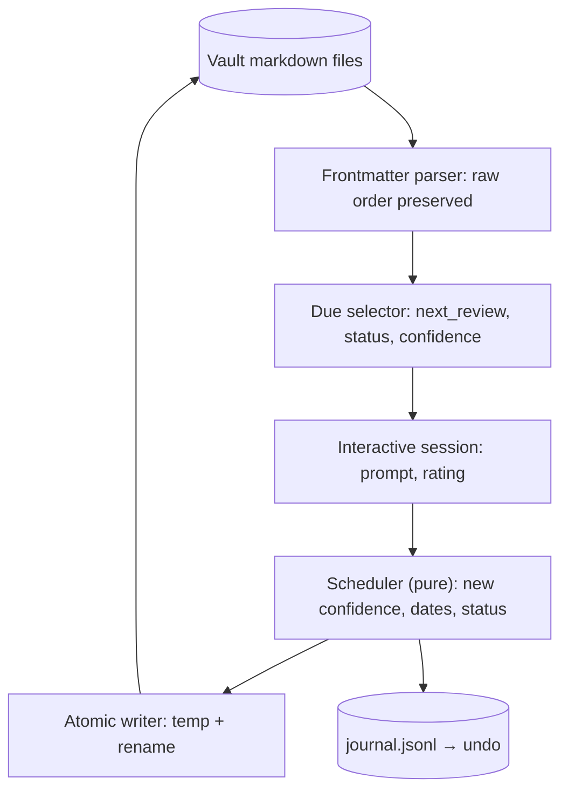

# Spaced Repetition Review CLI

> [!abstract] Why this project exists
> The revision queue in [[Engineering Dashboard]] depends on `next_review` dates that you currently set by hand, which is the kind of chore that quietly stops happening. A small CLI that reads the vault, runs a review session and writes the next dates back removes the chore and gives you a safe, bounded project for a week when the big ones feel heavy. It also forces a careful answer to "how do I edit 250 files idempotently without corrupting one".

**Map:** [[Projects MOC]] → [[Engineering Dashboard]]

## Problem being solved

Concept and problem notes carry `status`, `confidence`, `last_reviewed` and `next_review`. Keeping them honest means, after every review, choosing a new date based on how well you recalled the note — the spaced-repetition loop. Doing that by hand across 200 notes is error-prone and tedious; the Bases views already know what is due, so the only missing piece is a tool that runs the session and updates the properties correctly, never touching anything else in the file.

## Intended users

- Kunal, daily, for the ten-minute review in [[Start Here]]'s routine.
- Anyone using this vault layout (the tool reads conventions from the Workspace Guide, not hard-coded paths).

## Product requirements

- `review` lists due notes (`next_review <= today`, `status: needs-revision`, or `confidence <= 2`), shows the note's one-sentence abstract as the prompt, then asks for a rating 1–5 after you have explained it aloud.
- Rating updates `confidence` (bounded moves), `last_reviewed` (today) and `next_review` (interval doubles on 4–5, holds on 3, resets to 3 days on 1–2); `status` becomes `needs-revision` on 1–2 and clears on 4–5.
- Frontmatter is rewritten byte-for-byte except for the changed keys; order, quoting and the note body are preserved (round-trip tested on every note in the vault).
- Dry-run mode prints the diff; every run writes a journal line so a session can be audited or undone.
- `stats` prints confidence distribution and due counts, matching the dashboard's numbers.
- Runs in under a second on 300 notes; never writes partial files (write temp, rename).

## Minimum viable version

A TypeScript CLI (`vaultrev`) with three commands: `due`, `review`, `stats`. It walks `01 HLD & System Design` and `02 System Design Problems`, parses frontmatter with a tolerant YAML reader that keeps the raw key order, and applies the scheduling rules above. Writes go to a temp file and are renamed into place. A `--dry-run` flag shows diffs; a `.vaultrev/journal.jsonl` records every change.

- Frontmatter parser and writer with a round-trip test over the whole vault.
- Scheduling rules as a pure function with unit tests.
- `due`, `review` (interactive), `stats` commands and `--dry-run`.
- Journal with an `undo --last` command.

## Architecture



> [!example]- Excalidraw version — the same diagram as an editable canvas
> ![[Spaced Repetition Review CLI.excalidraw]]
> [[Spaced Repetition Review CLI.excalidraw|Open in Excalidraw]] — needs the Excalidraw plugin (see [[Plugins to Install]]).


The improved stage replaces the fixed doubling with an SM-2-style interval that uses an ease factor per note, adds a `--category` filter, and exports a small CSV the weekly review template can embed.

## Tech stack

- **TypeScript + Node 22** — fast to write, and the work stack; `commander` for the CLI, no framework.
- **A hand-written frontmatter tokenizer** (not a full YAML library) so round-tripping preserves formatting; `yaml` only for validation.
- **Vitest** for the round-trip and scheduling tests.
- **Git** as the safety net: the vault is a repository, so every session is one commit.

## Data model

```text
Note properties touched: status, confidence (1-5), last_reviewed (YYYY-MM-DD), next_review (YYYY-MM-DD)
Journal line: { ts, path, before: {status, confidence, last_reviewed, next_review}, after: {...}, rating }
Config (.vaultrev/config.json): { folders: [...], minInterval: 3, maxInterval: 90, multiplier: 2 }
```

## APIs

```text
vaultrev due [--category Caching] [--limit 10]
vaultrev review [--limit 5] [--dry-run]        # interactive: shows abstract, waits, asks rating 1-5
vaultrev stats                                 # confidence histogram, due counts, stale counts
vaultrev undo --last                           # reverts the last journal entry
```

## Relevant HLD concepts

- [[Idempotency]] — re-running a review for the same note and rating on the same day is a no-op; the journal makes it so.
- [[Schema Evolution]] — the tool must tolerate notes with missing or extra properties and never invent types.
- [[Data Modeling]] — the properties are a tiny schema; the tool documents it and validates it.
- [[Operational Simplicity]] — no database, no daemon, one binary and a journal file.
- [[Testing Strategies]] — the round-trip test over every real note is the test that matters.

## Milestones

> [!info] The loop
> 1. Build a working minimal version → 2. Measure its behaviour → 3. Identify bottlenecks and failure modes → 4. Improve the architecture based on evidence → 5. Document the trade-offs (an entry in `04 Projects/Decisions`).

- [ ] M1 — Minimal working version. Exit: round-trip test passes on all notes; a review session updates five notes and the dashboard's due table reflects it.
- [ ] M2 — Measured. Exit: run time on the whole vault; a month of journal data showing interval growth per note.
- [ ] M3 — Improved. Exit: SM-2-style ease factor replaces fixed doubling, with a before/after comparison of how many notes become due per week.
- [ ] M4 — Documented. Exit: ADR for the scheduling rule and a section in [[Workspace Guide]] on using the tool.

## Current tasks

- [ ] Frontmatter tokenizer and writer with the vault-wide round-trip test.
- [ ] Scheduling function and its unit tests.
- [ ] `due`, `review`, `stats` commands with `--dry-run`.
- [ ] Journal and `undo --last`.

## Technical challenges

- [ ] Which YAML constructs in the existing notes (quoted lists of wikilinks, empty values) break naive parsing, and can the tokenizer preserve all of them?
- [ ] Should a 3 rating hold the interval or grow it slightly — what does the journal say after a month?
- [ ] How should the tool behave when Obsidian has the file open and rewrites it on save?

## Testing strategy

- **Unit** — scheduler rules with a fake today; tokenizer edge cases.
- **Round-trip** — parse and rewrite every note in the vault with no changes; byte equality.
- **Integration** — a temp copy of the vault, a scripted session, assertions on properties and journal.

## Deployment plan

`npm install -g` or a `npx` alias; runs from the vault root. A git pre-commit hook can run `stats` to keep the weekly review honest.

## Monitoring and observability

- Journal file; `stats` output pasted into the weekly review.
- Notes due per day over time (the number that says whether the intervals are right).

## GitHub repository

*(not created yet — suggested name: kunal/vaultrev)*

## Live demo

*(none yet)* — a recorded terminal session: `due`, `review` three notes, `stats` showing the shift.

## Performance considerations

Parsing 300 small files is trivial; the only care is atomic writes and never holding partially written files.

## Lessons learned

*(Fill as you go.)*

## Future enhancements

- Obsidian plugin version using the same scheduler — [[Designing for Extensibility]].
- Export a review-load forecast chart into the weekly review — [[Metrics]].
- Sync with the [[Personal Notification Hub]] to remind you when more than ten notes are due — [[Alerting]].

## Related

### Design problems
- *(none — a tool for the vault itself)*

### Decisions
- *(record ADRs in 04 Projects/Decisions using the Architecture Decision Template)*
