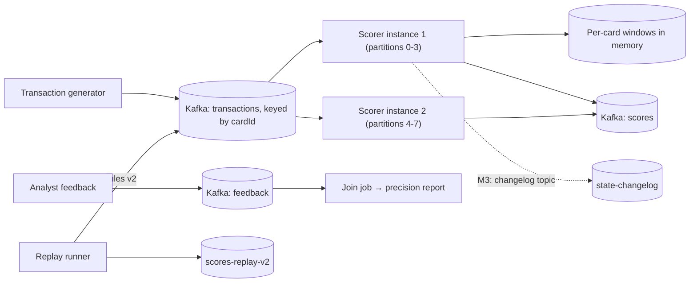

# Streaming Fraud Rules Engine

> [!abstract] Why this project exists
> Stream processing is where Kafka stops being a queue and becomes a database you read forwards: keyed state, windows, replay, exactly-once effects. Fraud scoring is the fintech-shaped version of that problem, with a hard latency budget (the authorisation is waiting) and an honest need for replay (a rule changed; rescore yesterday). Build it and the Messaging category's hardest notes — partitions, consumer groups, exactly-once, backpressure — stop being vocabulary.

**Map:** [[Projects MOC]] → [[Engineering Dashboard]]

## Problem being solved

Each card transaction must be scored in under 100 ms using features computed from the card's recent history (count and amount in the last 1, 10 and 60 minutes, distinct merchants, distance from last location) and a rule set that analysts change weekly. Scores and the rules that fired must be auditable, the pipeline must keep up with bursts without dropping transactions, a crash must not double-count or lose state, and a rule change must be testable against yesterday's traffic before it goes live.

## Intended users

- A risk team that edits rules in a file and wants to see what they would have flagged yesterday before deploying.
- The authorisation service, which needs a score within its latency budget or a safe default.
- Kunal, to answer "how do you compute per-user aggregates over a stream and survive a crash?" with numbers.

## Product requirements

- Score p99 under 100 ms from transaction event to score event at 2,000 transactions/s on a laptop.
- Per-card state (sliding windows) is partition-local, recovered after a crash from a changelog or snapshot without double-counting.
- At-least-once input with exactly-once effect on scores: a transaction is scored once even if its event is redelivered.
- Rules are data (a versioned DSL file), hot-reloadable, and every score records the rule version and the rules that fired.
- Replay: rescore any time range against a new rule version into a separate output topic, without disturbing live scoring.
- Backpressure: a burst of 10× rate degrades latency, never drops or reorders a card's events.
- Analyst feedback (confirmed fraud / false positive) flows back as an event and is joined to scores for a precision report.

## Minimum viable version

A Java consumer in a Kafka consumer group reads `transactions` partitioned by card id, keeps an in-memory sliding-window structure per card (ring of minute buckets), evaluates a rule file (threshold rules over the features), and produces `scores`. Offsets are committed only after the score is produced; state is rebuilt on restart by replaying the last 60 minutes of the partition from Kafka (no changelog yet). A generator produces realistic synthetic transactions with injected fraud patterns, and a feedback CLI marks transactions as fraud or not.

- Generator with seeded fraud patterns (velocity, card testing, impossible travel).
- Consumer with per-card minute buckets, feature computation and rule evaluation.
- Rule DSL (YAML) with version and a dry-run mode.
- Replay tool: rescore a time range into `scores-replay-<version>`.

## Architecture



> [!example]- Excalidraw version — the same diagram as an editable canvas
> ![[Streaming Fraud Rules Engine.excalidraw]]
> [[Streaming Fraud Rules Engine.excalidraw|Open in Excalidraw]] — needs the Excalidraw plugin (see [[Plugins to Install]]).


At the improved stage state goes to a changelog topic with periodic snapshots (Kafka Streams-style), scoring and offset commit become transactional for exactly-once output, and hot cards (a card-testing attack hammers one key) are measured and mitigated.

## Tech stack

- **Java 21 + Kafka clients** (plain consumer/producer first; Kafka Streams in M4 as the comparison) — the point is to see what the framework does for you.
- **Kafka (KRaft) in Docker** — 8 partitions so two instances share work.
- **Avro or JSON Schema with a schema registry** — [[Event Schemas]] and evolution are part of the exercise.
- **Testcontainers Kafka** — integration tests with real partitions and rebalances.
- **Grafana** — consumer lag, score latency and rule hit rates.

## Data model

```text
transactions (key: cardId):  { txnId, cardId, merchantId, amount, currency, mcc, geo, ts }
scores       (key: cardId):  { txnId, score, decision: allow|review|block, rulesFired[], rulesVersion, features{}, scoredAt }
feedback     (key: txnId):   { txnId, label: fraud|legit, analystId, ts }
state-changelog (key: cardId): { cardId, windows: { 1m: ring[60s], 10m: ring, 60m: ring }, lastGeo, lastTs }
rules.yaml:   version: 7; rules: [{ id, when: "count_10m > 8 and amount_1m > 500", score: 40 }, ...]
```

## APIs

```text
Kafka topics as above (the contract is the schema).
POST /rules            → upload a new rules version (validated, dry-run report against the last hour)
POST /replay           → { fromTs, toTs, rulesVersion } → job id; output topic scores-replay-<version>
GET  /cards/{id}/state → current windows (debugging)
GET  /reports/precision?since= → precision/recall from scores ⋈ feedback
```

## Relevant HLD concepts

- [[Kafka]] — the log as the source of truth for both live scoring and replay.
- [[Topic Partitions]] — partition by card id so one card's events are ordered and its state is local.
- [[Consumer Groups]] — two instances share partitions; a rebalance must not lose or duplicate state.
- [[Exactly-Once Semantics]] — produce-then-commit versus transactions; what each costs in M4.
- [[Backpressure]] — the consumer polls; lag is the pressure gauge, and the authoriser's timeout is the budget.
- [[Hot Keys]] — one card under attack is one hot partition key; measure the skew.
- [[Event Schemas]] and [[Event Schema Evolution]] — adding a feature to the score event without breaking the join job.
- [[Partitioning]] — state ownership follows partition ownership; moving a partition moves its state.
- [[Change Data Capture]] — the changelog topic is CDC on the scorer's own state.
- [[Event-Driven Architecture]] — feedback as events, joined later, instead of a synchronous call back.
- [[Throughput]] — transactions per second per instance is the capacity number for scaling.
- [[Write-Back Caching]] — in-memory state with deferred persistence to the changelog is write-back caching with all its loss windows.

## Milestones

> [!info] The loop
> 1. Build a working minimal version → 2. Measure its behaviour → 3. Identify bottlenecks and failure modes → 4. Improve the architecture based on evidence → 5. Document the trade-offs (an entry in `04 Projects/Decisions`).

- [ ] M1 — Minimal working version. Exit: 1 million synthetic transactions scored with the seeded fraud patterns detected; crash and restart rebuilds state from the log with identical scores afterwards.
- [ ] M2 — Measured. Exit: score latency p50/p99 at 500, 2,000 and 5,000 txn/s; recovery time after a crash versus window length; consumer lag during a 10× burst.
- [ ] M3 — Durable state. Exit: changelog topic plus snapshots; recovery under 10 s regardless of window length; rebalance moves state without double-counting (asserted by test).
- [ ] M4 — Exactly-once output. Exit: transactional produce-and-commit versus the M1 approach, with duplicate-score rate under redelivery and throughput cost measured; Kafka Streams comparison.
- [ ] M5 — Documented. Exit: ADRs for state strategy, delivery guarantee and hot-key handling; precision report from feedback.

## Current tasks

- [ ] Transaction generator with seeded fraud patterns and a Compose Kafka.
- [ ] Scorer: per-card minute buckets, feature computation, rule evaluation from YAML.
- [ ] Offset commit after produce; restart recovery by replaying the last 60 minutes.
- [ ] Replay runner into a versioned output topic.
- [ ] Feedback topic and the precision/recall report.

## Technical challenges

- [ ] After a rebalance, how do you prove the new owner's state equals what the old owner had — and what window of events is double-counted without a changelog?
- [ ] At what per-card rate does one hot key saturate a partition while the others idle, and does sub-keying break the ordering the rules depend on?
- [ ] Is transactional exactly-once worth its throughput cost here, or is an idempotent sink (score keyed by txnId) good enough?
- [ ] How do you run a replay at full speed without starving live scoring on the same brokers?

## Testing strategy

- **Unit** — window arithmetic, feature computation and rule evaluation with scripted event sequences and a fake clock.
- **Integration** — Testcontainers Kafka: produce, score, crash, restart; assert score equality and no duplicates.
- **Rebalance** — start a second instance mid-run; assert per-card counts match a single-instance run.
- **Replay** — rescore a fixed range with two rule versions; diff the outputs deterministically.

## Deployment plan

Docker Compose with Kafka (KRaft), schema registry, two scorer instances, the generator and Grafana. AWS MSK is the obvious real target given the work stack; a one-day experiment there is enough to compare broker latency.

## Monitoring and observability

- Consumer lag per partition (the backpressure gauge) and score latency p50/p99.
- Rules fired per minute by rule id; decision mix (allow/review/block).
- State size per instance and recovery time after restart.
- Duplicate scores per txnId (should be zero after M4) and replay throughput.

## GitHub repository

*(not created yet — suggested name: kunal/fraud-stream)*

## Live demo

*(none yet)* — the generator switches on a card-testing attack; the dashboard shows the block rate rising and consumer lag staying flat.

## Performance considerations

Per-event work must be allocation-light: ring buffers, no per-event object graphs. Throughput scales with partitions, so pick the partition count for the target rate up front — repartitioning later is a project of its own.

## Lessons learned

*(Fill as you go.)*

## Future enhancements

- A model-scored feature alongside the rules (the [[Design a Real-Time Fraud Detection Pipeline]] note's ML branch) — [[Event-Driven Architecture]].
- Flink or Kafka Streams implementation as a comparison of operational simplicity — [[Operational Simplicity]].
- Feature store backed by Redis for cross-stream features — [[Redis]].
- Feed from the [[Double-Entry Ledger Service]] outbox instead of a generator — [[Change Data Capture]].

## Related

### Design problems
- [[Design a Real-Time Fraud Detection Pipeline]]

### Also exercised
*Concept notes that point at this project but are not discussed above — the long tail of what building it will touch.*
- [[Data Lakes]] · [[Data Warehouses]] · [[Encryption at Rest and in Transit]]

### Decisions
- *(record ADRs in 04 Projects/Decisions using the Architecture Decision Template)*
