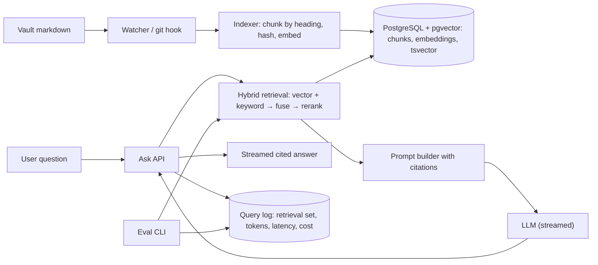

# Vault RAG Assistant

> [!abstract] Why this project exists
> Retrieval-augmented generation is a search system with an LLM at the end, and most of its failures are search failures: bad chunking, stale indexes, no way to tell whether a change helped. Building one over your own vault gives you a corpus you understand, questions you know the answers to, and a reason to build the indexing pipeline, the hybrid retrieval and the evaluation harness that [[Design a RAG Knowledge Assistant]] asks about. It also makes the vault queryable, which is useful on its own.

**Map:** [[Projects MOC]] → [[Engineering Dashboard]]

## Problem being solved

Answer questions like "which problems in my vault use consistent hashing and what did I decide?" with a grounded, cited answer drawn from the notes, kept current as notes change, with latency a person will wait for and a cost you can see. The system must know what it does not know (answer "not in the vault" rather than invent), must not leak notes a user cannot see when multi-user, and must make retrieval quality measurable so that chunking and ranking changes are decisions, not guesses.

## Intended users

- Kunal, asking the vault questions during revision ("explain the difference between my notes on quorums and consensus").
- A small team sharing a documentation corpus, later, with per-user access rules.
- Kunal as the engineer who can say exactly how chunk size changed recall@5 on a 50-question set.

## Product requirements

- Index every markdown note by section; re-index a note within a minute of it changing (file watcher or git hook).
- Hybrid retrieval: vector similarity plus keyword (BM25-style) search, fused and re-ranked; top-k chunks with note and heading citations.
- Answers streamed token by token with citations resolved to note-and-heading wikilinks; "not found in the vault" when retrieval confidence is low.
- Evaluation set of at least 50 question–answer–source triples; a CLI that reports recall@k and answer faithfulness for any configuration.
- Cost and latency per query recorded (tokens in, tokens out, retrieval ms, generation ms).
- Prompt injection from note content (a note that says "ignore previous instructions") is treated as data — tested.

## Minimum viable version

A TypeScript (NestJS) service with a PostgreSQL database and the pgvector extension. An indexer walks the vault, splits each note by `##` heading into chunks of at most ~800 tokens with the note title and heading prepended, embeds them with a configurable model (a local sentence-transformer via an HTTP sidecar, or a hosted embedding API), and upserts `(note, heading, chunk_hash, embedding, text)`. `POST /ask` embeds the question, fetches the top 8 chunks by cosine distance, builds a prompt with citations, streams the answer from the configured LLM, and logs the retrieval set. An evaluation CLI runs the question set and prints recall@5.

- Chunker by heading with overlap and a stable chunk hash (skip unchanged chunks on re-index).
- pgvector table with an HNSW index; vector-only retrieval.
- `POST /ask` with server-sent-event streaming and citation rendering.
- Evaluation set (50 questions) and the recall@k CLI.

## Architecture



At the improved stage retrieval adds keyword search (PostgreSQL `tsvector`) fused with vector results by reciprocal rank fusion, a cross-encoder or LLM re-ranker, query rewriting for follow-up questions, and a response cache keyed by normalised question plus index version.

## Tech stack

- **TypeScript + NestJS** — streaming responses and the indexer in one codebase; the work stack for services.
- **PostgreSQL + pgvector** — one database for chunks, embeddings and keyword search; see [[pgvector]].
- **Embedding model** — local (`bge-small` via a Python sidecar) first, hosted as a comparison on cost and quality.
- **LLM provider behind the [[LLM Gateway]]** — so limits, caching and cost tracking are not re-implemented here.
- **A tiny React chat UI** — optional; the CLI is the primary interface for the measured stage.

## Data model

```sql
notes(path PK, title, mtime, content_hash)
chunks(id, note_path, heading, position, text, token_count, chunk_hash UNIQUE, embedding vector(384),
       tsv tsvector GENERATED, INDEX USING hnsw (embedding vector_cosine_ops), INDEX USING gin (tsv))
queries(id, question, rewritten, retrieved_chunk_ids[], answer, tokens_in, tokens_out, retrieval_ms, generation_ms, cost, created_at)
eval_set(id, question, expected_source_chunk_ids[], expected_answer, tags[])
index_versions(id, embedding_model, chunk_strategy, created_at)
```

## APIs

```http
POST /v1/ask            { question, conversationId? }  → text/event-stream: tokens, then { citations: [{ note, heading }] }
POST /v1/index          { paths?: [] }                  → { indexed, skipped, removed }
GET  /v1/search?q=      → top-k chunks with scores (debugging retrieval without generation)
CLI  rag eval --config hybrid-rerank.yaml → recall@5, MRR, faithfulness, p95 latency, cost per query
```

## Relevant HLD concepts

- [[Search Engines]] and [[Inverted Indexes]] — keyword retrieval is an inverted index; vector retrieval is a different index over the same chunks.
- [[Indexing]] — HNSW versus IVFFlat parameters are a recall-versus-latency trade-off you can measure.
- [[Full-Text Search]] — `tsvector` ranking, stemming and why exact terms (error codes, note titles) need keyword search.
- [[Search Indexing Pipelines]] — chunk, hash, embed, upsert, delete removed chunks; idempotent re-indexing.
- [[Object Storage]] — raw documents and embedding artefacts for larger corpora; the vault fits in PostgreSQL, a company wiki may not.
- [[Change Data Capture]] — the file watcher is CDC on the vault; a real corpus would use a database changelog.
- [[Input Validation]] — treating retrieved note text as untrusted input to the prompt (injection tests).
- [[Tracing]] — one trace per question across retrieval, re-ranking and generation is how you find the slow stage.

## Milestones

> [!info] The loop
> 1. Build a working minimal version → 2. Measure its behaviour → 3. Identify bottlenecks and failure modes → 4. Improve the architecture based on evidence → 5. Document the trade-offs (an entry in `04 Projects/Decisions`).

- [ ] M1 — Minimal working version. Exit: the whole vault indexed; 50-question eval set written; recall@5 and p95 latency reported for vector-only retrieval.
- [ ] M2 — Measured. Exit: recall@5 for three chunk sizes and two embedding models; retrieval versus generation latency split; cost per query.
- [ ] M3 — Hybrid. Exit: keyword plus vector fusion and a re-ranker, with recall@5 improved by a measured margin on the eval set; "not in vault" precision on 10 adversarial questions.
- [ ] M4 — Improved. Exit: one evidence-driven change (query rewriting, response cache, or incremental indexing) with before/after data.
- [ ] M5 — Documented. Exit: ADRs for chunking strategy, retrieval configuration and the no-answer threshold; injection test suite green.

## Current tasks

- [ ] Chunker by heading with overlap, token counting and stable hashes.
- [ ] Embedding sidecar and the pgvector schema with an HNSW index.
- [ ] `POST /ask` with streaming and citation rendering.
- [ ] The 50-question eval set (write it by hand from notes you know) and the recall@k CLI.
- [ ] File watcher for incremental re-indexing.

## Technical challenges

- [ ] Does chunking by heading beat fixed-size chunks on this corpus, and does prepending the note title change recall?
- [ ] At what corpus size does HNSW build time or memory become the constraint on a laptop, and do IVFFlat probes recover recall?
- [ ] How do you set the "not in the vault" threshold without a labelled negative set — and what false-refusal rate is acceptable?
- [ ] Which stage dominates latency — embedding the question, the vector scan, re-ranking or generation — and does caching the question embedding help?

## Testing strategy

- **Unit** — chunker boundaries and hashes, citation rendering, prompt assembly with injection fixtures.
- **Integration** — Testcontainers PostgreSQL with pgvector: index, re-index unchanged (skipped), delete removed.
- **Evaluation** — the eval CLI is the regression test; a configuration change must not lower recall@5 below the recorded baseline.
- **Security** — notes containing instructions are indexed and asked about; the answer must not follow them.

## Deployment plan

Docker Compose with the service, PostgreSQL + pgvector, the embedding sidecar and the LLM Gateway. Runs against the vault folder mounted read-only. No cloud deployment needed; cost shows up as provider tokens.

## Monitoring and observability

- Per-query trace with retrieval, re-rank and generation spans.
- recall@5 and MRR per index version (recorded by the eval CLI).
- Tokens and cost per query; cache hit rate once the cache exists.
- Index freshness: time from note change to chunk upsert.

## GitHub repository

*(not created yet — suggested name: kunal/vault-rag)*

## Live demo

*(none yet)* — ask "what did I decide about fail-open in the rate limiter?" and watch the cited answer stream.

## Performance considerations

Retrieval should be tens of milliseconds; generation dominates. Cache question embeddings and whole responses for repeated questions, keyed by index version so a re-index invalidates them. Keep chunks small enough that the prompt stays within a fixed token budget.

## Lessons learned

*(Fill as you go.)*

## Future enhancements

- Per-user document permissions enforced at retrieval time — [[Authorization]].
- Conversation memory with query rewriting — [[Designing APIs and Contracts]].
- Graph-aware retrieval using the vault's wikilinks as edges — [[Data Modeling]].
- A larger corpus in object storage with a proper ingestion pipeline — [[Search Indexing Pipelines]].

## Related

### Design problems
- [[Design a RAG Knowledge Assistant]]

### Also exercised
*Concept notes that point at this project but are not discussed above — the long tail of what building it will touch.*
- [[Blob Storage]] · [[Data Lakes]]

### Decisions
- *(record ADRs in 04 Projects/Decisions using the Architecture Decision Template)*
