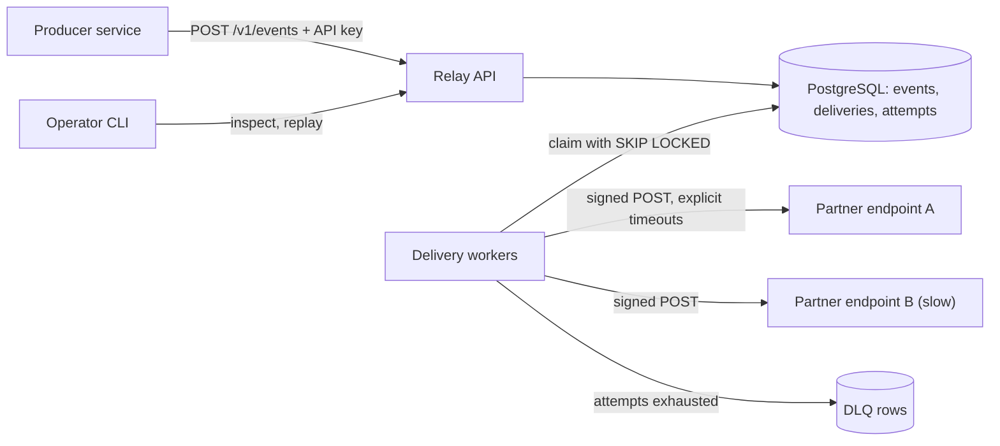

# Webhook Relay

> [!abstract] Why this project exists
> Every fintech platform pushes events to partners, and every home-grown implementation eventually loses events, hammers a dead endpoint, or lets one slow customer stall everyone else. Build the delivery service properly once, measure it against hostile endpoints, and record what each guarantee costs.

**Map:** [[Projects MOC]] → [[Engineering Dashboard]]

## Problem being solved

Internal services need to notify external HTTP endpoints ("payment.settled", "kyc.completed") with at-least-once delivery, verifiable signatures, bounded retries and a place to inspect failures. Doing this inside each service duplicates the hard parts: durable hand-off from the producer's transaction, backoff policy, isolation between endpoints and replay tooling. A shared relay owns those concerns behind one small API.

## Intended users

- Producer teams who want a `POST` plus an idempotency key to be the whole integration.
- Partner developers who need a stable signature scheme, predictable retries and visibility into missed deliveries.
- Kunal as operator: during the measurement phase the DLQ and the dashboard *are* the product.

## Product requirements

- Accept an event exactly once per producer idempotency key, even when the producer retries.
- Deliver every event to each subscribed endpoint at least once, signed with a per-endpoint secret (HMAC-SHA256 over timestamp and body).
- Retry with exponential backoff and jitter; park exhausted deliveries in a dead-letter queue with manual replay.
- Isolation: one endpoint sleeping 10 s per request must not raise healthy-endpoint p99 delivery lag by more than 10%.
- Delivery lag (accepted to first attempt) p99 under 2 s at 200 events/s on a laptop-sized deployment.
- Zero events lost across a relay restart or database failover, proven by test.
- Producers and endpoint owners authenticate with scoped API keys; signing secrets are rotatable.

## Minimum viable version

One Spring Boot service and one PostgreSQL database. `POST /v1/events` stores the event and one `deliveries` row per subscribed endpoint in the same transaction — that table is the outbox and the queue. A worker pool claims due rows with `SELECT … FOR UPDATE SKIP LOCKED`, makes the signed HTTP call with explicit timeouts, records an attempt and either marks success or schedules the next attempt. A separate sink container plays the partner and can be told to be slow, flaky or down.

- Flyway migrations for the tables below; idempotent insert on the producer key.
- Claim-deliver-record loop with a fixed backoff schedule and a maximum attempt count.
- DLQ listing and replay endpoint.
- Sink app with switchable modes and a duplicate counter; k6 script publishing at a fixed rate.

## Architecture



> [!example]- Excalidraw version — the same diagram as an editable canvas
> ![[Webhook Relay.excalidraw]]
> [[Webhook Relay.excalidraw|Open in Excalidraw]] — needs the Excalidraw plugin (see [[Plugins to Install]]).


At the improved stage the single-table queue is what gets measured: if polling and lock contention cap throughput, claiming moves to [[Redis]] Streams or [[Kafka]] while PostgreSQL stays the system of record. Per-endpoint worker pools and [[Circuit Breakers]] replace the one shared pool, and producers can adopt a true outbox in their own database read by a poller or [[Change Data Capture]].

## Tech stack

- **Java 21 + Spring Boot** — virtual threads make thousands of concurrent blocking HTTP calls cheap; matches the work stack.
- **PostgreSQL** — system of record and, in the MVP, the queue; one durable store before earning a second.
- **Flyway + Testcontainers** — schema as code and integration tests on a real database.
- **Node + Express sink** — a throwaway receiver with switchable failure modes.
- **Docker Compose + k6** — the whole lab on one laptop; k6 drives publish rate while the sink misbehaves.
- **Micrometer + Prometheus + Grafana** — the metrics below are the point of M2.

## Data model

```sql
api_keys(id, owner, key_hash, scopes, created_at, revoked_at)
endpoints(id, owner_key_id, url, secret_ciphertext, max_concurrency, status)
subscriptions(endpoint_id, event_type)
events(id, producer_key_id, idempotency_key, type, payload jsonb, created_at,
       UNIQUE (producer_key_id, idempotency_key))
deliveries(id, event_id, endpoint_id, state, attempt_count, next_attempt_at, last_error,
           INDEX (state, next_attempt_at))
attempts(id, delivery_id, status_code, latency_ms, error, started_at)
```

## APIs

```http
POST /v1/events               Idempotency-Key: <uuid>   { "type": "payment.settled", "payload": {...} } → 202 { "eventId" }
POST /v1/endpoints            { "url", "eventTypes": [...] } → 201 { "id", "secret" }
GET  /v1/deliveries/{id}      → state, attempts[]
POST /v1/deliveries/{id}/replay
GET  /v1/endpoints/{id}/dlq?cursor=
Outbound: POST {endpoint.url}
  X-Webhook-Id, X-Webhook-Timestamp, X-Webhook-Signature: v1=<hmac-sha256>
```

## Relevant HLD concepts

- [[Outbox Pattern]] — event and delivery rows are committed together; workers never see a half-accepted event.
- [[At-Least-Once Delivery]] — a timeout after the partner processed the request is retried; duplicates are the partner's problem by contract.
- [[Idempotency]] — producer keys on `POST /v1/events`; `X-Webhook-Id` lets receivers deduplicate.
- [[Duplicate Message Processing]] — the sink counts every id it sees, so the duplicate rate is measured, not guessed.
- [[Retry Strategies]] — exponential backoff with jitter per delivery; `Retry-After` honoured when present.
- [[Retry Storms]] — synchronised retries after an outage are the failure mode jitter exists to prevent.
- [[Dead-Letter Queues]] — exhausted deliveries become inspectable rows with a replay action, not log lines.
- [[Bulkheads]] — per-endpoint concurrency caps so a slow partner cannot occupy the whole pool.
- [[Timeouts and Retries]] — connect, read and total timeouts are explicit; the first experiment removes them to watch the pool fill.
- [[Circuit Breakers]] — improved stage: stop calling an endpoint that is clearly down and probe on a schedule.
- [[API Keys]] — scoped keys for producers and endpoint owners, hashed at rest.

## Milestones

> [!info] The loop
> 1. Build a working minimal version → 2. Measure its behaviour → 3. Identify bottlenecks and failure modes → 4. Improve the architecture based on evidence → 5. Document the trade-offs (an entry in `04 Projects/Decisions`).

- [ ] M1 — Minimal working version. Exit: 10,000 events at 100/s reach a healthy sink with valid signatures and zero loss across one forced relay restart.
- [ ] M2 — Measured. Exit: write-up with lag p50/p99 at 100, 200 and 400 events/s, duplicate rate under induced timeouts, and the rate at which the `SKIP LOCKED` loop stops scaling with workers.
- [ ] M3 — Isolated. Exit: with one endpoint sleeping 10 s per request, healthy-endpoint p99 lag stays within 10% of baseline.
- [ ] M4 — Improved queue. Exit: one evidence-driven change (batched claims, per-endpoint polling or Redis Streams) with a before/after chart.
- [ ] M5 — Documented. Exit: ADRs for queue choice, retry schedule, signature scheme and fail-open behaviour.

## Current tasks

- [ ] Create the Spring Boot skeleton with Flyway migrations for the six tables.
- [ ] Implement `POST /v1/events` with idempotent insert and fan-out into `deliveries`.
- [ ] Implement the claim loop: `SKIP LOCKED` query, signed call with timeouts, attempt record, backoff scheduling.
- [ ] Build the sink with healthy, slow and failing modes plus a duplicate counter.
- [ ] Write the k6 publish script and a restart-under-load test asserting zero loss.
- [ ] Expose Micrometer metrics and a first Grafana dashboard.

## Technical challenges

- [ ] At what publish rate does one `deliveries` table with `SKIP LOCKED` polling become the bottleneck — lock contention, index bloat or poll frequency?
- [ ] Does a per-endpoint concurrency cap protect healthy endpoints, or does the shared poll loop still starve them?
- [ ] What does replaying a DLQ do to ordering for partners that assumed in-order delivery?
- [ ] What is the duplicate rate under 5% induced timeouts, and does honouring `Retry-After` reduce it?

## Testing strategy

- **Unit** — backoff schedule, signature computation, idempotency handling: pure functions, no I/O.
- **Integration** — Testcontainers PostgreSQL: concurrent workers claim each due row once; a restart mid-attempt resumes cleanly.
- **Contract** — outbound request format (headers, signature, body) pinned by a recorded fixture partners can verify against.
- **Failure injection** — sink modes (timeout, 500, 429 with `Retry-After`, connection refused) assert state transitions and that the DLQ fills only when it should.

## Deployment plan

Local `docker compose up` with relay, PostgreSQL, sink, k6, Prometheus and Grafana. Optionally a single-node k3s or small EKS deployment with two relay replicas to confirm the claim loop is safe across pods. No managed queue until M4 earns it.

## Monitoring and observability

- Backlog: pending deliveries and age of the oldest due row (alert above 60 s).
- Delivery lag p50/p99 from event creation to first successful attempt.
- Attempt outcomes per endpoint: 2xx, 4xx, 5xx, timeout.
- DLQ depth and entry rate (alert on any growth outside an experiment).
- Claim-query latency and per-endpoint pool utilisation — the first signals of the database becoming the bottleneck.

## GitHub repository

*(not created yet — suggested name: kunal/webhook-relay)*

## Live demo

*(none yet)* — the Compose stack with the sink's duplicate counter and Grafana panels shows the whole loop in five minutes.

## Performance considerations

Measure delivery lag against publish rate and worker count. The expected bottleneck is the claim query on one hot table as retried rows accumulate; the first optimisation is batched claims and per-endpoint polling, before any separate broker. Outbound connection reuse per endpoint host is the second lever.

## Lessons learned

*(Fill as you go.)*

## Future enhancements

- Producer-side outbox read by CDC so events never need an HTTP hop — [[Change Data Capture]].
- Per-endpoint breaker with half-open probes — [[Circuit Breakers]].
- Shuffle-sharded worker pools so noisy endpoints share blast radius with few others — [[Bulkheads]].
- Redis Streams consumer groups replacing polling once measurements justify it — [[Message Queues]].
- Partner-facing delivery log and signature verification samples — [[Designing APIs and Contracts]].

## Related

### Design problems
- [[Design a Webhook Delivery System]]
- [[Design a Notification System]]

### Decisions
- *(record ADRs in 04 Projects/Decisions using the Architecture Decision Template)*
