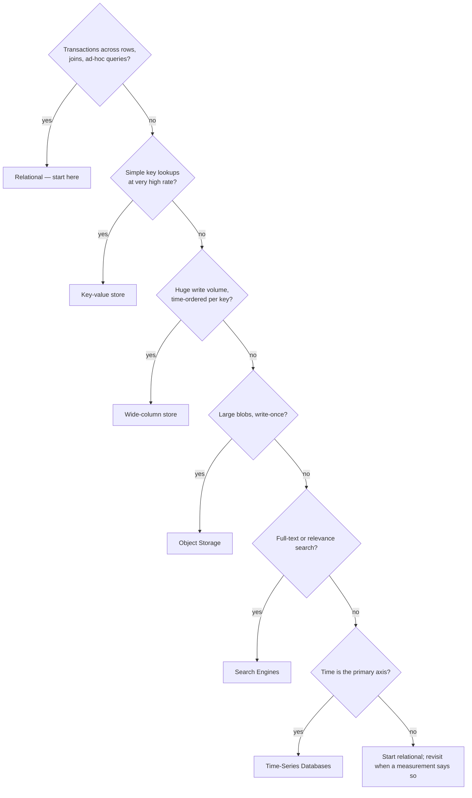
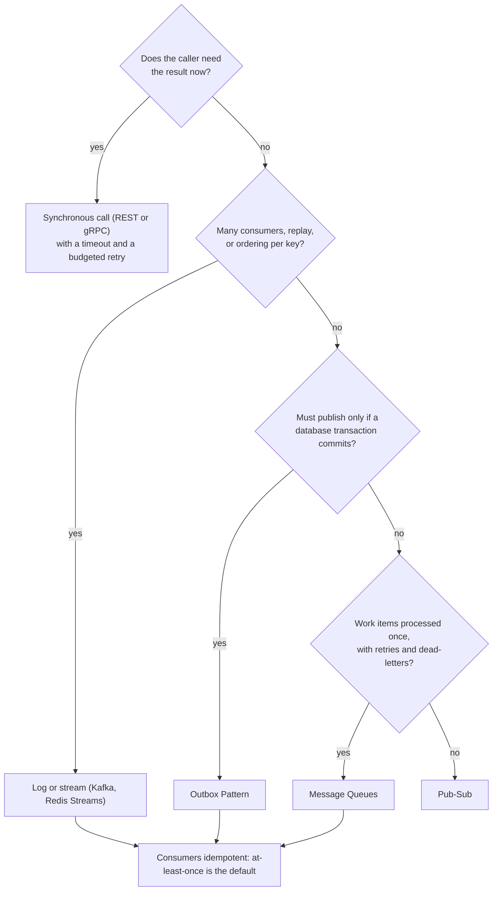

# Component Choice Cheat Sheet

> [!abstract] How to use it
> This is not a menu of technologies; it is a list of **reasons**. In a round you say the reason and the cost ("relational, because transfers need atomicity across accounts; the cost is harder horizontal scaling"), not the brand. Each row names the requirement that justifies the choice, what you give up, and the note that holds the full argument. Before the sprint, read one table a day out loud; during the sprint, use it to check the decision sentences in your mock logs.

**Map:** [[Interview Prep MOC]] · [[SDE-2 Interview Framework]] · [[HLD MOC]]

## Which data store? (decision tree)

> [!example]- Excalidraw version — the same diagram as an editable canvas
> ![[Component Choice Cheat Sheet — Which data store- (decision tree).excalidraw]]
> [[Component Choice Cheat Sheet — Which data store- (decision tree).excalidraw|Open in Excalidraw]] — needs the Excalidraw plugin (see [[Plugins to Install]]).

## Storage

| Pick | When the requirement is | Cost you accept | Defend with |
|---|---|---|---|
| Relational (PostgreSQL, MySQL) | Transactions across rows, joins, ad-hoc queries, moderate scale, strong consistency on the write path | Harder to scale writes beyond one primary; schema discipline | [[SQL vs NoSQL]], [[Transactions]], [[Relational Database Internals]] |
| Key-value (Redis, DynamoDB) | Lookups by key at very high rate, simple values, predictable latency | No joins, limited queries, consistency per key only | [[Distributed Caching]], [[Consistent Hashing]] |
| Wide-column (Cassandra, ScyllaDB) | Huge write volume, time-ordered data per partition key (messages, events), multi-region availability | Query patterns fixed at design time; tombstones and compaction; eventual consistency by default | [[Partitioning]], [[Eventual Consistency]], [[Discord - How Discord Stores Trillions of Messages]] |
| Document (MongoDB) | Flexible, nested records read and written whole; fast iteration on schema | Weaker cross-document guarantees; indexes on nested fields get expensive | [[Data Modeling]], [[Schema Evolution]] |
| Object storage (S3-class) | Large blobs, write-once, cheap, durable; serve via CDN | Tens of ms latency, no partial updates, no transactions | [[Object Storage]], [[Blob Storage]] |
| Time-series DB (Prometheus, Timescale) | Metrics and events with time as the primary axis, downsampling and retention | Poor for point updates and relational queries | [[Time-Series Databases]] |
| Search engine (Elasticsearch, OpenSearch) | Full-text, fuzzy, faceted search; relevance ranking | Not a source of truth; index lag; operationally heavy | [[Search Engines]], [[Inverted Indexes]], [[Search Indexing Pipelines]] |
| Append-only log (Kafka) as storage | Replayable event history, many independent consumers | Not queryable by key; retention costs; compaction semantics | [[Kafka]], [[Event Sourcing]] |

Rule of thumb for SDE-2: **start relational unless a stated requirement forbids it**, say what would make you move, and never pick a store without naming its partition key and its hot query.

## Caching

| Pick | When | Cost | Defend with |
|---|---|---|---|
| Cache-aside (lazy) | Read-heavy, tolerates a miss on first read, data changes occasionally | Stale reads until TTL or invalidation; stampedes on hot misses | [[Cache-Aside]], [[Cache Stampedes]] |
| Write-through | Reads must see writes immediately and the write rate is moderate | Every write pays the cache write; cache becomes a dependency | [[Write-Through Caching]], [[Cache Consistency]] |
| Write-back (write-behind) | Very high write rate where some loss is acceptable (counters, metrics) | Data loss on cache failure; complex flush logic | [[Write-Back Caching]] |
| In-process (Caffeine) | Microsecond reads of small hot sets; per-instance is fine | Incoherent across instances; cold start per deploy | [[Multi-Level Caching]], [[Caffeine Cache]] |
| Distributed (Redis cluster, Memcached) | Shared hot set across a fleet; large memory | Network hop per read (~0.5–1 ms); its own failure modes | [[Distributed Caching]], [[Redis]] |
| CDN / edge cache | Static or cacheable public responses, global users | Invalidation is slow and coarse; costs per GB | [[CDNs]] |
| TTL choice | Short (seconds) for freshness, long (hours) for stability; soft + hard TTL for resilience | Pick a number and defend it | [[TTL]], [[AWS Builders Library - Caching Challenges]] |
| Eviction | LRU by default; LFU for skewed, stable popularity; TTL-based when data expires naturally | Sampled approximations in Redis | [[Eviction Policies]] |

## Which messaging style? (decision tree)

> [!example]- Excalidraw version — the same diagram as an editable canvas
> ![[Component Choice Cheat Sheet — Which messaging style- (decision tree).excalidraw]]
> [[Component Choice Cheat Sheet — Which messaging style- (decision tree).excalidraw|Open in Excalidraw]] — needs the Excalidraw plugin (see [[Plugins to Install]]).

## Messaging and asynchrony

| Pick | When | Cost | Defend with |
|---|---|---|---|
| Synchronous call (REST/gRPC) | Caller needs the result now; simple; latency budget allows | Coupled availability; retries amplify load | [[Synchronous vs Asynchronous Communication]], [[Timeouts and Retries]] |
| Queue (SQS, RabbitMQ, BullMQ) | Work items consumed once, retried, with visibility timeouts and dead-letters | No replay; ordering is per-queue or FIFO-limited | [[Message Queues]], [[Dead-Letter Queues]] |
| Log / stream (Kafka, Redis Streams) | Many consumers, replay, ordering per key, high throughput, event history | Operational weight; consumers must handle duplicates; partition count is a commitment | [[Kafka]], [[Topic Partitions]], [[Consumer Groups]] |
| Pub/sub (Redis pub/sub, SNS) | Fire-and-forget notifications to many subscribers; at-most-once is fine | No durability for offline subscribers | [[Pub-Sub]], [[At-Most-Once Delivery]] |
| Outbox + relay / CDC | Must publish an event iff a database transaction committed | Relay publishes at least once; consumers dedupe | [[Outbox Pattern]], [[Change Data Capture]] |
| Delivery guarantee | At-least-once plus idempotent consumers is the default answer; at-most-once for telemetry; "exactly-once" only as *effect* | A dedup store with retention | [[Delivery Semantics]], [[Idempotency]], [[Exactly-Once Semantics]] |
| Ordering | Per key via partitioning; global ordering only through a single writer or sequence | Hot partitions; single-writer throughput ceiling | [[Ordering Guarantees]] |
| Backpressure | Bounded queues, consumer-paced pull, load shedding at the edge | Rejected work must be visible | [[Backpressure]], [[Graceful Degradation]] |

## Consistency and coordination

| Pick | When | Cost | Defend with |
|---|---|---|---|
| Strong consistency (single primary, transactions) | Money, inventory, bookings, uniqueness | Latency; availability during failover | [[ACID]], [[Consistency Models]] |
| Eventual consistency (async replication, caches) | Feeds, counters, search indexes, analytics — users tolerate seconds of lag | Read-your-writes needs care; conflict handling | [[Eventual Consistency]], [[BASE]] |
| Read-your-writes | A user must see their own change immediately | Route the user to the primary or a fresh replica for a while | [[Consistency Models]], [[Read Replicas]] |
| Quorum reads/writes | Leaderless stores where availability under partition matters | Latency = slowest of W or R; still not linearizable in edge cases | [[Quorums]], [[Dynamo Paper]] |
| Consensus (Raft, etcd, ZooKeeper) | Leader election, configuration, locks — small, critical state | Throughput limited; never put bulk data in it | [[Consensus]], [[Leader Election]] |
| Distributed lock with lease + fencing token | At most one worker at a time *and* the resource can check tokens | A lease without a token is not mutual exclusion | [[Distributed Locks]] |
| Optimistic concurrency (version column) | Conflicts rare; retries cheap | Retry loops under contention | [[Optimistic and Pessimistic Locking]] |
| Pessimistic locking (`SELECT FOR UPDATE`) | Conflicts common; correctness over throughput (seat booking) | Lock waits; deadlock ordering discipline | [[Optimistic and Pessimistic Locking]], [[Isolation Levels]] |
| Saga | A business transaction spans services | Compensations are your job; no isolation | [[Saga Pattern]], [[Distributed Transactions]] |

## The scaling path (say it in this order)

1. **Measure and remove the obvious** — slow query, missing index, N+1 — [[Bottleneck Analysis]], [[Query Execution and Optimization]].
2. **Vertical** — a bigger instance buys time cheaply — [[Horizontal vs Vertical Scaling]].
3. **Cache the reads** — cache-aside with a stated TTL — [[Cache-Aside]].
4. **Read replicas** — for read-heavy loads, with the lag stated — [[Read Replicas]], [[Replication]].
5. **Async the writes that can wait** — queue or log — [[Message Queues]].
6. **Partition** — by the key that keeps hot queries local; consistent hashing for elasticity — [[Sharding]], [[Partitioning]], [[Consistent Hashing]].
7. **Separate the read model** — CQRS only when read and write shapes genuinely diverge — [[CQRS]].
8. **Split the service** — by business capability, when teams or scaling profiles diverge, not before — [[Microservices]], [[Modular Monoliths]].

Say which step the estimate puts you at, and which step you are deliberately not taking yet.

## Edge and networking

| Pick | When | Cost | Defend with |
|---|---|---|---|
| L7 load balancer / reverse proxy | Routing by path and host, TLS termination, health checks | A hop; must be redundant itself | [[Load Balancers]], [[Reverse Proxies]] |
| API gateway | Auth, rate limits, routing and observability at one edge | Risk of becoming a monolith; a new critical dependency | [[API Gateways]] |
| REST | Public APIs, simple CRUD, caching by URL | Over-fetching; weak typing | [[REST]] |
| gRPC | Internal service-to-service, streaming, strict contracts, low latency | Browser support needs a proxy; binary debugging | [[gRPC]] |
| WebSockets | Server push, bidirectional, chat and live updates | Stateful connections; load balancer and scaling implications | [[WebSockets]], [[Client State and Reconnection]] |
| Server-sent events / long polling | One-way push with simpler infrastructure | Less control; proxies and timeouts | [[HTTP and HTTPS]] |
| CDN | Static assets, media, cacheable responses near users | Invalidation; cost; cache keys | [[CDNs]] |
| Connection pooling and keep-alive | Any service calling databases or HTTP dependencies at volume | Pool sizing is a capacity decision | [[Connection Pooling]], [[Keep-Alive Connections]] |

## Identifiers, search and time

| Pick | When | Cost | Defend with |
|---|---|---|---|
| Database sequence | Single writer, strict monotonic ids | A coordination point | [[Distributed ID Generation]] |
| UUID v4 | No coordination, no ordering needed | Random, index-unfriendly, 16 bytes | [[Distributed ID Generation]] |
| Time-ordered ids (UUID v7, Snowflake) | Roughly sortable, generated anywhere, 64–128 bits | Clock dependence; per-node sequence | [[Distributed ID Generation]], [[Clocks and Time]] |
| Database full-text (`tsvector`) | Modest search over your own rows, one fewer system | Limited relevance and scale | [[Full-Text Search]] |
| Dedicated search index | Relevance, facets, large corpora | Index lag and pipeline to maintain | [[Search Engines]], [[Search Indexing Pipelines]] |
| Wall clock timestamps | Display, approximate ordering, TTLs | Never for ordering decisions across machines | [[Clocks and Time]] |
| Logical sequence numbers | Ordering within a partition or conversation | Allocation is a serialisation point | [[Ordering Guarantees]] |

## Resilience defaults (say these without being asked)

| Mechanism | Default you propose | Defend with |
|---|---|---|
| Timeouts | Every call; from the dependency's p99 plus margin; connect and total separately | [[Timeouts and Retries]] |
| Retries | Few, with exponential backoff and jitter, only on idempotent operations, budgeted | [[Retry Strategies]], [[Retry Storms]] |
| Circuit breaker | Per dependency, opens on error rate, half-open probes | [[Circuit Breakers]] |
| Bulkhead | Separate pools per dependency or tenant | [[Bulkheads]] |
| Load shedding | Reject early at the edge when over capacity; protect health checks | [[Graceful Degradation]], [[AWS Builders Library - Load Shedding]] |
| Health checks | Liveness simple, readiness includes dependencies, drain on shutdown | [[Health Checks]] |
| Observability | Four golden signals plus one domain metric; traces across hops | [[Monitoring]], [[Distributed Tracing]] |

## Related

- [[SDE-2 Interview Framework]] — where in the 45 minutes these choices are made.
- [[Knowledge Graph]] — the concept chains behind each table.
- [[Evaluating Architectural Complexity]] and [[Build vs Buy Decisions]] — the two notes that stop you over-choosing.
