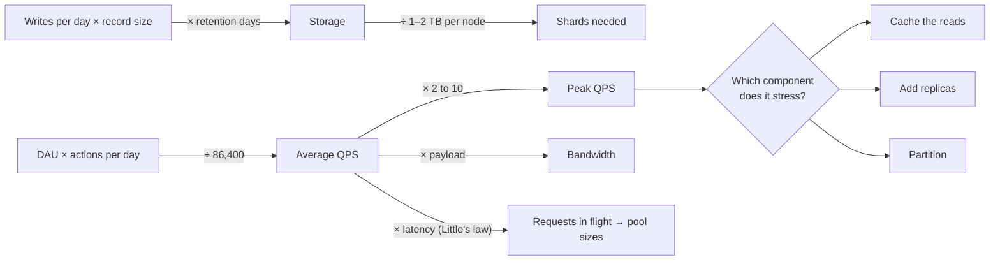

# Estimation Cheat Sheet

> [!abstract] The point of estimation
> Nobody grades the exact number. They grade whether you know that 10 million daily users is about 100 writes per second, that a billion 1 KB rows is a terabyte, and that those two facts together decide whether you need a cache, a replica or a shard. Round to one significant figure, write the numbers where the interviewer can see them, and then **use** them when you choose components. Everything below is in service of that.

**Map:** [[Interview Prep MOC]] · [[SDE-2 Interview Framework]] · [[Back-of-the-Envelope Estimation]] · [[Latency Numbers Every Programmer Should Know]] · [[Capacity Planning]]

## Units and conversions

| Fact | Value | Use it for |
|---|---|---|
| Seconds in a day | 86,400 ≈ **10⁵** (use 100,000) | DAU × actions ÷ 10⁵ = average QPS |
| Seconds in a month | ≈ 2.6 × 10⁶ | monthly volumes to QPS |
| Seconds in a year | ≈ 3.2 × 10⁷ (≈ π × 10⁷) | yearly storage |
| 2¹⁰ / 2²⁰ / 2³⁰ / 2⁴⁰ | KB / MB / GB / TB (≈ 10³ / 10⁶ / 10⁹ / 10¹²) | storage arithmetic |
| 1 million × 1 KB | 1 GB | row counts to storage |
| 1 billion × 1 KB | 1 TB | the "do I need to partition?" line |
| Peak ÷ average | assume **2–3×** for steady products, **5–10×** for bursty (ticketing, sales) | sizing for peak |
| Read ÷ write ratio | feeds, links, search ≈ 10–100 : 1; chat ≈ 1 : 1; logging and metrics ≈ write-heavy | read scaling versus write scaling |

## Sizes of common things

| Thing | Rough size | Note |
|---|---|---|
| Integer / long / UUID / timestamp | 4 B / 8 B / 16 B / 8 B | ids and keys |
| A short string (name, email) | 20–50 B | |
| A URL | ~100 B | URL shortener rows ≈ 500 B with metadata |
| A tweet / chat message with metadata | ~300 B–1 KB | use 1 KB to be safe |
| A log line | ~200 B–1 KB | compresses 5–10× |
| A typical JSON API payload | 1–10 KB | |
| A thumbnail / a photo | 50 KB / 1–5 MB | |
| One minute of 720p video | ~50 MB (≈ 5 Mbps) | 1080p ≈ 2× ; 4K ≈ 4–5× |
| A metric data point (compressed) | ~1–2 B (Gorilla-style); 16 B raw | see [[Gorilla Time-Series Paper]] |

## Latency numbers that matter

From [[Latency Numbers Every Programmer Should Know]], rounded to what you say out loud:

| Operation | Latency | Rule |
|---|---|---|
| L1 cache / main memory reference | 1 ns / 100 ns | memory is "free" |
| Read 1 MB from memory | 250 µs | |
| SSD random read / read 1 MB from SSD | 100 µs / 1 ms | SSDs: ~10⁵ random IOPS, hundreds of MB/s |
| Disk seek / read 1 MB from disk | 10 ms / 20 ms | spinning disks: ~100 IOPS |
| Round trip within a datacenter | 0.5 ms | a Redis call ≈ 0.5–1 ms |
| Same-region cross-AZ | 1–2 ms | |
| Cross-continent round trip | 100–150 ms | geo-replication cost |
| TLS handshake (new connection) | 1–2 round trips | why connection pooling matters |
| Human-perceived "instant" | < 100 ms | UI budgets |

## Per-machine rules of thumb (say them as "order of magnitude")

| Component | Comfortable sustained rate on one well-configured instance | Caveat |
|---|---|---|
| Stateless API service (Java, Node), simple handler | thousands to tens of thousands of requests/s | CPU-bound at serialisation; measure with [[Load Test and Latency Lab]] |
| PostgreSQL / MySQL primary | ~thousands of writes/s; ~10–50k simple indexed reads/s | depends on row size, indexes, fsync; connections are precious (~hundreds) |
| Redis (single instance) | ~100k simple ops/s | single-threaded; big values and `KEYS` kill it |
| Kafka broker | tens to hundreds of MB/s; hundreds of thousands of messages/s | partitions are the unit of parallelism |
| A WebSocket gateway | ~10k–100k idle connections per instance | memory and fan-out CPU bound |
| Object storage (S3-class) | effectively unlimited throughput; ~tens of ms first-byte | not a database |
| Network within a datacenter | 10 Gbps ≈ 1.25 GB/s per NIC | bandwidth rarely the limit; cross-region egress costs money |

These are starting points for the conversation, not facts to defend to the decimal. The [[Load Test and Latency Lab]] project exists to replace them with your own measurements.

## Availability arithmetic

| Target | Downtime per year | Per month | What it implies |
|---|---|---|---|
| 99% | 3.65 days | 7.3 h | single instance, manual recovery |
| 99.9% | 8.76 h | 44 min | redundancy with automated failover |
| 99.95% | 4.4 h | 22 min | |
| 99.99% | 52.6 min | 4.4 min | multi-AZ, no single points of failure, fast detection |
| 99.999% | 5.26 min | 26 s | multi-region, no human in the loop |

Serial dependencies multiply: a service at 99.9% calling three dependencies at 99.9% each is at best 99.6%. See [[Availability]] and [[SLI SLO and SLA]].

## The four standard calculations

> [!example]- Excalidraw version — the same diagram as an editable canvas
> ![[Estimation Cheat Sheet.excalidraw]]
> [[Estimation Cheat Sheet.excalidraw|Open in Excalidraw]] — needs the Excalidraw plugin (see [[Plugins to Install]]).

1. **QPS** — `DAU × actions per user per day ÷ 86,400`, then `× peak factor`. Split reads and writes.
2. **Storage** — `writes per day × record size × retention days`; add indexes (+30–100%) and replication (× replication factor).
3. **Bandwidth** — `QPS × payload size`, in and out separately; the out side is usually what costs money.
4. **Memory for a cache** — `80/20 rule: 20% of daily reads × record size`, or `hot set size` if you know it.

Then one derived number that drives a decision: connections needed (`QPS × average latency`), shards needed (`total storage ÷ comfortable per-node size, usually 1–2 TB`), partitions needed (`peak MB/s ÷ per-partition MB/s`).

## Worked examples

### URL shortener

- Assume 100 million new URLs per month → `10⁸ ÷ 2.6 × 10⁶ ≈ 40 writes/s`; reads 100 : 1 → **4,000 reads/s**, peak 10,000.
- Storage: 500 B per row × 10⁸ per month = **50 GB/month**, 3 TB over five years — fits one database with partitioning by time or hash.
- Cache: 20% of daily reads (≈ 70 million) × 500 B ≈ **35 GB** of hot entries — a few Redis nodes, or one if you accept a lower hit rate.
- Decision the numbers drive: reads dominate, so cache-aside in front of the database and a CDN-cacheable redirect; writes are trivial.

### Chat system

- 50 million DAU × 40 messages per day = 2 × 10⁹ messages/day → **≈ 23,000 messages/s** average, ~70,000 peak.
- Storage: 1 KB per message × 2 × 10⁹ = **2 TB/day**; a year is ~700 TB — this is a sharded, time-partitioned store, not one database.
- Connections: 50 million DAU with, say, 10 million concurrent → at ~50k connections per gateway, **~200 gateway instances**.
- Decision the numbers drive: messages partitioned by conversation (and time), a connection registry so any gateway can route to any user, and fan-out done asynchronously.

### Social feed

- 10 million DAU; each posts 0.5 times and reads the feed 10 times a day → **~60 writes/s, 1,200 feed reads/s**, peak ~5,000.
- Average 200 followers → fan-out on write = 60 × 200 = **12,000 timeline inserts/s**; a user with 10 million followers makes one post cost 10 million inserts — hence the hybrid approach.
- Timeline cache: 10 million users × 500 ids × 8 B = **40 GB** — fits in a Redis cluster.
- Decision the numbers drive: fan-out on write for ordinary users, fan-out on read for celebrities, timelines in memory.

## Drills

Do two a day, out loud, with a timer at three minutes. Answers are in the folded callout; check only after you commit.

1. A ride-sharing app has 1 million active drivers sending a location every 4 seconds. Location write QPS and daily storage at 100 B per point?
2. A logging platform ingests 1 KB lines from 5,000 hosts at 50 lines/s each. Ingest rate in MB/s and storage for 30 days, before and after 8× compression?
3. A ticketing site expects 2 million people for a 10 am sale, 80% arriving in the first minute. Peak page QPS if each person loads 3 pages?
4. A notification system sends one push to 200 million users for an announcement. If one worker sends 500 pushes/s, how many workers to finish in 10 minutes?
5. A video platform receives 500 hours of 720p video per minute. Ingest bandwidth and daily storage before transcoding?
6. A feed has 100 million DAU, 5 reads each, 50 posts/s. With fan-out on write and 300 average followers, timeline inserts/s?
7. An API at 20,000 rps with 50 ms average latency: how many concurrent requests are in flight, and how many database connections if each request holds one for 10 ms?
8. A metrics system has 100,000 hosts × 200 series × 1 point per 10 s. Points/s, and daily storage at 2 B/point versus 16 B/point?
9. A KV store needs 50 TB of data with replication factor 3 and 2 TB comfortable per node. How many nodes?
10. A payment system does 2,000 transactions/s. If each transaction writes 4 ledger rows of 200 B, what is the daily ledger growth and how long until 1 TB?

> [!check]- Answers (one significant figure)
> 1. 10⁶ ÷ 4 = **250,000 writes/s**; × 86,400 × 100 B ≈ **2 TB/day**. (Decision: a write-optimised, time-partitioned store or a log, not a relational primary.)
> 2. 5,000 × 50 × 1 KB = **250 MB/s**; 30 days ≈ **650 TB raw**, ~80 TB compressed. (Decision: tiered storage, index only recent data.)
> 3. 1.6 million × 3 pages in 60 s ≈ **80,000 rps** peak. (Decision: a queue or waiting room in front of the booking path, static pages on a CDN.)
> 4. 200 × 10⁶ ÷ 600 s ≈ 333,000 pushes/s ÷ 500 ≈ **~700 workers**. (Decision: fan-out via a queue with many consumers; provider rate limits become the real ceiling.)
> 5. 500 h × 60 min × 50 MB = 1.5 TB per minute ≈ **25 GB/s** ingest; ≈ **2 PB/day**. (Decision: object storage, upload directly to it, transcode asynchronously.)
> 6. 50 × 300 = **15,000 inserts/s**; reads are 100 × 10⁶ × 5 ÷ 86,400 ≈ 6,000/s. (Decision: fan-out on write is affordable; the celebrity tail is the problem.)
> 7. 20,000 × 0.05 = **1,000 in flight**; 20,000 × 0.01 = **200 connections** — so pools of 20 across 10 instances, and the database has to accept that. (Decision: pooling and a connection budget per instance.)
> 8. 2 × 10⁷ series ÷ 10 s = **2 million points/s**; at 2 B: ~350 GB/day; at 16 B: ~2.8 TB/day. (Decision: a compressing TSDB is an 8× cost difference.)
> 9. 50 × 3 ÷ 2 = **75 nodes** (plus headroom, so ~90). (Decision: consistent hashing with virtual nodes; rebalancing cost matters.)
> 10. 2,000 × 4 × 200 B = 1.6 MB/s ≈ **140 GB/day**; about **a week** to 1 TB. (Decision: partition the ledger by time, snapshot balances, archive old postings.)

## Related

- [[Back-of-the-Envelope Estimation]] — the concept note with the method.
- [[Capacity Planning]], [[Throughput]], [[Latency]], [[Bottleneck Analysis]] — where the numbers go next.
- [[Load Test and Latency Lab]] — the project that replaces rules of thumb with your own measurements.
- [[System Design Primer (GitHub)]] — its powers-of-two and availability tables.
