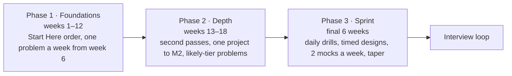

# Interview Preparation — SDE-2 System Design

> [!abstract] What this area is for
> The rest of the vault teaches you to *think* like a product engineer. This area teaches you to *show* it in 45 minutes to a stranger with a rubric. It adds nothing new to learn — every drill points back at a concept note or a problem decision sheet — but it adds structure: a framework for the round, a bank of the probes interviewers use, cheat sheets for the first ten minutes, a readiness checklist, a sprint plan and a log of every mock. Start with the framework; run the sprint when the loop is scheduled.

**Map:** [[Engineering Dashboard]] · [[Start Here]] · [[HLD MOC]] · [[Problem Bank MOC]] · [[Projects MOC]] · [[Reviews MOC]]

## The notes

| Note | What it is | When to use it |
|---|---|---|
| [[SDE-2 Interview Framework]] | The 45-minute structure, what is graded, the decision sentence, the five things to always cover, the mistakes that lose rounds | Read first; reread the night before every mock and every real round |
| [[Interview Probe Questions]] | Follow-up questions by area and per core problem, each with the note that answers it | Daily drill: five probes, out loud, under a minute each |
| [[Estimation Cheat Sheet]] | Units, latency numbers, per-machine rules of thumb, availability maths, three worked examples, ten drills | Memorise before Phase 2; two drills a day in the sprint |
| [[Component Choice Cheat Sheet]] | Storage, cache, messaging, consistency, scaling path, edge, ids — each row a reason, a cost and the note that defends it | One table a day out loud; check mock decision sentences against it |
| [[SDE-2 Readiness Checklist]] | Readiness signals, the 74 must-know concepts at explain/draw/defend level, the problem tiers, live tables | Monthly in Phases 1–2; weekly in the sprint |
| [[Interview Sprint Plan]] | The 4–6 month roadmap and the six-week sprint with daily routine and exit criteria | Plan the calendar from it; adjust when the loop date is known |
| `Templates/Mock Interview Template` | The log for every mock: timeline, probes, rubric, three actions — feeds the dashboard | After every timed design and every mock |

## How an SDE-2 round is graded, in one table

| What they score | The bar | Where you practise it |
|---|---|---|
| Requirements and scope | Functional and non-functional questions before drawing; assumptions written down | [[Functional vs Non-Functional Requirements]], every problem note's first two sections |
| Estimation | Right orders of magnitude in three minutes, and the numbers drive a decision | [[Estimation Cheat Sheet]] drills |
| Architecture | The simplest design that meets the numbers, narrated as a request path | Timed designs on paper from [[Problem Bank MOC]] |
| Deep dive | Two components to the level of data model, concurrency and failure handling | The concept notes' *How it works* and *Failure modes* sections |
| Trade-offs and failure modes | A decision sentence per component; what fails and how you would know | [[Component Choice Cheat Sheet]], [[Interview Probe Questions]] |
| Communication | Think aloud, draw, take hints, manage the clock | Mocks, logged with the template |

## The roadmap (4–6 months)



Exit criteria for each phase are in [[Interview Sprint Plan]]. The single most important rule: **the sprint is for performance, not learning** — anything you still need to learn gets done in Phase 2 or not at all.

## Problem tiers

Every problem note carries `interview_tier`. The tiers reflect how often each design is asked in SDE-2 rounds at product companies and fintechs; they are a planning tool, not a prediction.

**Core — design each twice under time, mock at least once:** [[Design a URL Shortener]] · [[Design a Rate Limiter]] · [[Design a Notification System]] · [[Design a Chat System]] · [[Design a Social Feed]] · [[Design a Distributed Cache]] · [[Design a Ticket Booking System]] · [[Design a Payment System]] · [[Design a Ride-Sharing Service]] · [[Design Search Autocomplete]]

**Likely — design once, know the twists:** [[Design a Distributed ID Generator]] · [[Design a Distributed Job Scheduler]] · [[Design a Message Queue]] · [[Design an API Gateway]] · [[Design File Storage]] · [[Design a Video Streaming Service]] · [[Design a Digital Wallet and Ledger]] · [[Design a Distributed Key-Value Store]] · [[Design a Metrics and Monitoring System]] · [[Design an Inventory Management System]]

**Stretch — for depth, fintech rounds and SDE-3 conversations:** [[Design a Logging System]] · [[Design a Webhook Delivery System]] · [[Design a Feature Flag Service]] · [[Design an IAM Service]] · [[Design a Workflow Orchestrator]] · [[Design a RAG Knowledge Assistant]] · [[Design a Collaborative Document Editor]] · [[Design a Real-Time Fraud Detection Pipeline]]

### Core problems — live status

![[Interview Readiness.base#Core problems]]

### Everything by tier

![[Interview Readiness.base#All problems by tier]]

## Concepts that must be ready

The 74 must-know concepts are listed by level in [[SDE-2 Readiness Checklist]]. The live view below shows every high-priority concept still below confidence 3 — the sprint cannot start while this table is long.

![[Interview Readiness.base#Must-know concepts below 3]]

## Mock interviews

Create a note in `06 Interview Prep/Mocks` from `Templates/Mock Interview Template.md` after every mock (solo, peer or paid). Fill the rubric honestly; the three actions at the bottom are the point.

![[Mock Interviews.base#Latest]]

> [!example]- Rubric trend across all mocks (Dataview)
> ```dataviewjs
> const mocks = dv.pages('"06 Interview Prep/Mocks"').where(p => p.type == "mock" && p.date).sort(p => p.date, "asc");
> if (mocks.length == 0) { dv.paragraph("No mocks logged yet."); } else {
> const dims = ["score_requirements","score_estimation","score_architecture","score_deep_dive","score_tradeoffs","score_communication"];
> dv.table(["Date", "Problem", "Format", "Overall", ...dims.map(d => d.replace("score_", ""))],
>   mocks.map(m => [m.date, m.problem, m.format, m.overall, ...dims.map(d => m[d] ?? "")]));
> const last3 = mocks.array().slice(-3);
> const avg = d => (last3.reduce((a, m) => a + (m[d] ?? 0), 0) / Math.max(last3.length, 1)).toFixed(1);
> dv.paragraph(`**Last three mocks, average:** ${dims.map(d => d.replace("score_", "") + " " + avg(d)).join(" · ")}`);
> }
> ```

## Fintech-specific preparation

Your work context will shape the questions: expect [[Design a Payment System]], [[Design a Digital Wallet and Ledger]], [[Design a Real-Time Fraud Detection Pipeline]] and [[Design an IAM Service]] to come up as "tell me how you would build what you work on". The concepts interviewers probe hardest there are [[Idempotency]], [[Transactions]], [[Isolation Levels]], [[Saga Pattern]], [[Outbox Pattern]], [[Audit Logs]] and [[Exactly-Once Semantics]]. The [[Double-Entry Ledger Service]] project is the fastest way to have real answers.

## Work stories

Interviewers ask "tell me about a system you designed" in the same round. Prepare three stories from work in the decision-sentence shape (what you chose, why, the cost, what you would change), each tied to a concept note. Keep them in your weekly review notes; they are also the raw material for the SDE-3 conversation later.

## Related

- [[Start Here]] — Phase 1 in detail.
- [[Workspace Guide]] — how `interview_tier`, the mock template and the two Bases files fit the rest of the machinery.
