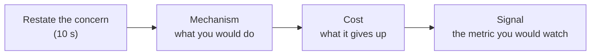

# Interview Probe Questions

> [!abstract] How to use this bank
> Interviewers rarely grade the diagram; they grade what happens when they push on it. Each probe below is one push. Drill: pick a problem, draw your design, then answer five probes from the relevant sections **out loud, in under a minute each**, in the shape *restate the concern → mechanism → cost → signal to watch*. Then open the linked concept note and mark what you missed. Ten minutes a day of this is worth more than an hour of reading.

**Map:** [[Interview Prep MOC]] · [[SDE-2 Interview Framework]] · [[Problem Bank MOC]]

## The shape of a strong answer

## Probes by area

### Requirements and scope

- "What happens if I change this requirement to real-time instead of eventual?" — which components change and why. [[Functional vs Non-Functional Requirements]]
- "Which of your requirements is the hardest, and why?" — the one that forces a consistency or ordering decision. [[Translating Product Requirements into Technical Requirements]]
- "What did you leave out, and what would it cost to add it later?" [[Designing Systems for Changing Requirements]]
- "Who are the users, and what do they do when the system is slow?" — degrade paths. [[Graceful Degradation]]

### Estimation

- "Where did that number come from?" — show the arithmetic; round to one significant figure. [[Back-of-the-Envelope Estimation]]
- "Which component does that QPS actually stress?" — the number must point somewhere. [[Bottleneck Analysis]]
- "How many database instances does that storage need, and when?" [[Capacity Planning]]
- "What is the peak-to-average ratio you assumed, and what if it is 10×?" [[Throughput]]

### Data

- "What is your partition key, and what query does it make impossible?" [[Partitioning]], [[Sharding]]
- "Why relational? Why not?" — transactions, joins, access patterns, the honest cost. [[SQL vs NoSQL]]
- "Which index serves the hot query, and what does it cost on writes?" [[Indexing]]
- "What is the consistency of the read right after the write?" [[Consistency Models]], [[Read Replicas]]
- "How do you change the schema without downtime?" [[Schema Evolution]], [[Versioning and Migrations]]
- "Two users update the same record at once — who wins?" [[Optimistic and Pessimistic Locking]], [[Isolation Levels]]

### Caching

- "What is the hit rate you expect, and what happens when the cache is cold?" [[Cache-Aside]], [[Cache Stampedes]]
- "How does the cache learn the value changed?" [[Cache Invalidation]], [[Cache Consistency]]
- "One key gets 50% of traffic — now what?" [[Hot Keys]]
- "The cache cluster dies. What hits the database?" [[Graceful Degradation]], [[Distributed Caching]]
- "What TTL, and why that number?" [[TTL]], [[Eviction Policies]]

### Messaging and asynchrony

- "The consumer crashes after doing the work but before acknowledging. What happens?" [[At-Least-Once Delivery]], [[Idempotency]]
- "Do you need ordering? Across what?" [[Ordering Guarantees]], [[Topic Partitions]]
- "The queue backs up to a million messages. Then what?" [[Backpressure]], [[Dead-Letter Queues]]
- "How do you publish an event and update the database atomically?" [[Outbox Pattern]], [[Change Data Capture]]
- "Why a queue here and not a synchronous call?" [[Synchronous vs Asynchronous Communication]]
- "Can you get exactly-once?" — no, but exactly-once *effect*. [[Exactly-Once Semantics]], [[Duplicate Message Processing]]

### Failure

- "The primary database goes down. Walk me through the next 60 seconds." [[Replication]], [[Failure Detection]], [[Recovery Time Objective]]
- "A downstream service takes 10 seconds to respond. What happens to your service?" [[Timeouts and Retries]], [[Bulkheads]], [[Circuit Breakers]]
- "Everything retries at once after an outage." [[Retry Storms]], [[Retry Strategies]]
- "Half your nodes can't see the other half." [[Network Partitions]], [[Split-Brain]], [[Quorums]]
- "What data can you lose, and how much?" [[Recovery Point Objective]], [[Backups and Restoration]]
- "Which of these boxes is a single point of failure?" [[Fault Tolerance]], [[Availability]]

### Scaling

- "What breaks first at 10×? At 100×?" [[Scalability]], [[Bottleneck Analysis]]
- "Why not just a bigger machine?" [[Horizontal vs Vertical Scaling]]
- "How do you add a shard without downtime?" [[Consistent Hashing]], [[Database Scaling]]
- "How does a new instance find its peers?" [[Service Discovery]], [[Load Balancers]]
- "What is stateful here, and why?" [[Horizontal vs Vertical Scaling]], [[Client State and Reconnection]]

### Security and correctness

- "How does the service know who is calling?" [[Authentication]], [[JWT]], [[API Keys]]
- "What stops a client from reading someone else's data?" [[Authorization]], [[Least Privilege]]
- "Where are the secrets?" [[Secrets Management]]
- "What is the abuse case, and how do you limit it?" [[Rate Limiting]], [[Threat Modeling]]
- "Who can see that this happened, a year later?" [[Audit Logs]]

### Operations

- "What would you alert on?" [[Alerting]], [[SLI SLO and SLA]]
- "A user says it is slow. Where do you look first?" [[Distributed Tracing]], [[Monitoring User-Facing Performance]]
- "How do you deploy this without downtime? How do you roll back?" [[Deployment and Rollback Strategies]], [[Feature Flags]]
- "What is the most expensive part of this design, and could it be cheaper?" [[Performance vs Cost Trade-offs]], [[Build vs Buy Decisions]]
- "What would make this simpler?" [[Evaluating Architectural Complexity]], [[Operational Simplicity]]

## Probes per core problem

The ten `interview_tier: core` problems and the six probes most often asked on each. The answers live in the problem note's decision lines and the linked concepts.

### [[Design a URL Shortener]]

1. How do you generate short keys without collisions across many instances? ([[Distributed ID Generation]], [[Consistent Hashing]])
2. 301 or 302 — and what does the choice do to your analytics? ([[HTTP and HTTPS]], [[CDNs]])
3. Reads are 100× writes; what is the cache hit rate and what happens on a miss storm for a viral link? ([[Cache-Aside]], [[Hot Keys]])
4. A key expires — how, and what about links already cached at the edge? ([[TTL]], [[Cache Invalidation]])
5. How do you shard a billion rows, and what query does that break? ([[Sharding]], [[Partitioning]])
6. What is the availability target, and which component decides it? ([[Availability]], [[SLI SLO and SLA]])

### [[Design a Rate Limiter]]

1. Token bucket or sliding window — why, and what does each over-admit? ([[Rate Limiting]])
2. Where does the counter live across 50 instances, and what does each decision cost in latency? ([[Redis]], [[Distributed Caching]])
3. Redis is slow — fail open or fail closed? Who decides? ([[Graceful Degradation]])
4. One client is 40% of all traffic; now the key is hot. ([[Hot Keys]])
5. How does the client learn to back off? ([[Designing APIs and Contracts]], [[Retry Strategies]])
6. Where in the request path does the limiter sit, and what does it protect? ([[API Gateways]])

### [[Design a Notification System]]

1. The same event is published twice; does the user get two pushes? ([[Idempotency]], [[Duplicate Message Processing]])
2. A provider (APNs, SMS gateway) is down for an hour; what happens to the backlog? ([[Dead-Letter Queues]], [[Backpressure]], [[Retry Strategies]])
3. How do user preferences and quiet hours get applied without a lookup per message? ([[Cache-Aside]], [[Data Modeling]])
4. Fan-out to 10 million users for one announcement — how long, and what is the bottleneck? ([[Fan-Out]], [[Message Queues]])
5. How do you rate limit per user and per provider? ([[Rate Limiting]])
6. How do you know a notification was actually delivered, and what do you alert on? ([[Monitoring]], [[Alerting]])

### [[Design a Chat System]]

1. How are messages ordered within a conversation, and why not timestamps? ([[Ordering Guarantees]], [[Clocks and Time]])
2. A phone was offline for a day; how does it catch up? ([[Client State and Reconnection]])
3. Where does the WebSocket connection state live, and what happens when a gateway dies? ([[WebSockets]], [[Service Discovery]])
4. Presence: how fresh is "online", and what does it cost? ([[Failure Detection]], [[Redis]])
5. Group of 500 — how does one send become 500 deliveries without blocking the sender? ([[Fan-Out]], [[Synchronous vs Asynchronous Communication]])
6. What is the message storage key, and how does it shard? ([[Data Modeling]], [[Sharding]])

### [[Design a Social Feed]]

1. Fan-out on write or read — and what do you do for the account with 50 million followers? ([[Fan-Out]], [[Hot Keys]])
2. What is the feed's consistency: do I see my own post immediately? ([[Consistency Models]], [[Eventual Consistency]])
3. How is the feed paginated without duplicates or gaps as new posts arrive? ([[Designing APIs and Contracts]], [[Ordering Guarantees]])
4. Where does ranking happen, and how do you keep it under 200 ms? ([[Latency]], [[Multi-Level Caching]])
5. A post is deleted — how does it leave a million cached feeds? ([[Cache Invalidation]])
6. What is the storage for timelines, and how big is it? ([[Back-of-the-Envelope Estimation]], [[Redis]])

### [[Design a Distributed Cache]]

1. How are keys distributed, and what happens when a node is added? ([[Consistent Hashing]])
2. Replication: what does a client see during failover? ([[Replication]], [[Eventual Consistency]])
3. Eviction policy, and why that one for this workload? ([[Eviction Policies]])
4. A hot key saturates one node. ([[Hot Keys]])
5. How does a client know which node to ask — and what about stale cluster maps? ([[Service Discovery]], [[Gossip Protocols]])
6. What are the guarantees after a network partition? ([[Network Partitions]], [[CAP Theorem]])

### [[Design a Ticket Booking System]]

1. Two users pick the same seat in the same second. ([[Optimistic and Pessimistic Locking]], [[Isolation Levels]])
2. The user holds a seat and never pays. ([[TTL]], [[Distributed Locks]])
3. Payment succeeded but your confirmation write failed. ([[Idempotency]], [[Saga Pattern]])
4. A flash sale sends 100× normal traffic at one event. ([[Rate Limiting]], [[Backpressure]], [[Graceful Degradation]])
5. Which reads can be stale, and which cannot? ([[Consistency Models]], [[Read Replicas]])
6. What is the data model for seats, holds and orders? ([[Data Modeling]], [[Transactions]])

### [[Design a Payment System]]

1. The client retries a payment after a timeout. ([[Idempotency]])
2. How do you keep your ledger and the processor's view consistent? ([[Saga Pattern]], [[Distributed Transactions]], [[Outbox Pattern]])
3. What is the source of truth for a balance, and how is it read fast? ([[ACID]], [[Event Sourcing]], [[Data Modeling]])
4. How do you find out that a payment was recorded twice — or not at all? ([[Audit Logs]], [[Production Incident Analysis]])
5. What can be eventually consistent here, and what cannot? ([[Consistency Models]])
6. How is the system kept secure and compliant? ([[Encryption at Rest and in Transit]], [[Secrets Management]], [[Least Privilege]])

### [[Design a Ride-Sharing Service]]

1. How do you find nearby drivers fast, and how is location data indexed? ([[Data Modeling]], [[Indexing]])
2. Drivers send locations every few seconds — what is the write load, and where does it go? ([[Throughput]], [[Time-Series Databases]], [[Kafka]])
3. Two riders are matched to the same driver. ([[Distributed Locks]], [[Optimistic and Pessimistic Locking]])
4. The trip state machine — what are the states, and who can transition them? ([[Event-Driven Architecture]], [[Idempotency]])
5. Surge pricing needs aggregates per area in near real time. ([[Fan-Out]], [[Consumer Groups]])
6. What happens to an in-progress trip when the matching service is down? ([[Graceful Degradation]], [[Fault Tolerance]])

### [[Design Search Autocomplete]]

1. Top-k for a prefix in 20 ms — data structure and where it lives. ([[Inverted Indexes]], [[Multi-Level Caching]])
2. How often is the index rebuilt, and what is stale in between? ([[Search Indexing Pipelines]], [[Eventual Consistency]])
3. A trending query appears — how fast does it show up? ([[Change Data Capture]], [[Cache Invalidation]])
4. How do you shard a trie, and what about prefixes that span shards? ([[Partitioning]], [[Hot Keys]])
5. What is the storage size for a billion queries? ([[Back-of-the-Envelope Estimation]])
6. How do you keep p99 flat when one shard is slow? ([[Latency]], [[Timeouts and Retries]])

## Drill log

Record each drill in your weekly review: problem, five probes attempted, the ones you could not answer in a minute, and the note you opened. Three failed probes on the same concept means that concept note gets `status: needs-revision`.
