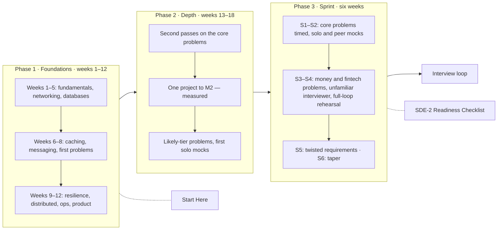

# Interview Sprint Plan

> [!abstract] The shape of the next four to six months
> **Phase 1 — Foundations (weeks 1–12):** the reading order in [[Start Here]], one design problem a week from week 6. **Phase 2 — Depth (weeks 13–18):** second passes on the core problems, one project to its measured milestone, the remaining likely-tier problems. **Phase 3 — Sprint (final 6 weeks):** daily drills, timed designs every other day, two mocks a week, and a taper. If the loop lands early, Phase 2 compresses; the sprint does not.

**Map:** [[Interview Prep MOC]] · [[SDE-2 Readiness Checklist]] · [[SDE-2 Interview Framework]] · [[Engineering Dashboard]]

## The whole plan on one page

## Phase 1 — Foundations (weeks 1–12)

Follow the twelve-week table in [[Start Here]] exactly: about six concept notes a week, first-pass only, three sentences under *Personal understanding* each, and from week 6 one timed design problem a week in the order given there (URL shortener, rate limiter, notification system, distributed cache, chat, social feed, payment system).

**Exit criteria**

- The 74 must-know concepts in [[SDE-2 Readiness Checklist]] all at `status: reading` or better and confidence 2 or more.
- Seven core problems at `status: designing` or better with your decision lines filled.
- Ten estimation drills from [[Estimation Cheat Sheet]] done.
- Weekly reviews written for at least ten of the twelve weeks.

**If you only have four months:** do weeks 1, 2, 4, 5, 6, 7, 8 and 9 (eight weeks), then go straight to Phase 2 with four weeks, then the sprint.

## Phase 2 — Depth (weeks 13–18)

Six weeks that turn "have read" into "can defend".

| Week | Design practice | Build | Revision |
|---|---|---|---|
| 13 | Second pass, timed, on [[Design a URL Shortener]] and [[Design a Rate Limiter]]; compare with the reference pointers; set `status: reviewed` honestly | Start [[Rate Limiter Library]] or [[Webhook Relay]] (pick one) — M1 | Re-explain every concept the dashboard lists as due |
| 14 | [[Design a Ticket Booking System]] and [[Design a Ride-Sharing Service]] (first pass, timed) | Project M1 continues | Probe drill: five probes a day from [[Interview Probe Questions]] |
| 15 | [[Design Search Autocomplete]] and second pass on [[Design a Chat System]] | Project M2 — measure it; write the numbers into the problem note's capacity section | Component tables from [[Component Choice Cheat Sheet]], one a day out loud |
| 16 | Likely tier: [[Design a Distributed ID Generator]], [[Design a Distributed Job Scheduler]], [[Design a Message Queue]] | Project M2 write-up; one ADR in `04 Projects/Decisions` | Draw-from-memory: the 22 "draw" concepts, two a day |
| 17 | Likely tier: [[Design an API Gateway]], [[Design File Storage]], [[Design a Digital Wallet and Ledger]] | [[Chaos Lab]] M1 — four experiments, four charts | Decision sentences for every component of three past designs |
| 18 | Second pass on [[Design a Social Feed]] and [[Design a Payment System]]; first full solo mock with the [[Mock Interview Template]] | Project retrospective; stop building | Close every `gap/*` tag you can |

**Exit criteria**

- All ten core problems at `status: reviewed`, confidence 3 or more.
- One project at M2 (measured) with numbers in your own notes.
- Two solo mocks logged.
- No must-know concept below confidence 3 in the live view.

## Phase 3 — The six-week sprint

The sprint is about performance, not learning. New material is banned except to close a specific gap a mock exposed.

| Week | Timed designs (45 min, paper) | Mocks | Daily drills (20 min) | Weekend |
|---|---|---|---|---|
| S1 | URL shortener, rate limiter, notification system | 1 solo (self-scored) | 2 estimation drills + 5 probes | Weekly review; re-read [[SDE-2 Interview Framework]] |
| S2 | Chat, social feed, distributed cache | 1 peer + 1 solo | 2 estimation + 5 probes | Review mock logs; three actions each |
| S3 | Ticket booking, payment system, ride-sharing | 2 peer | 5 probes + decision sentences | Rewrite your weakest design from scratch |
| S4 | Search autocomplete + two likely-tier problems the mocks exposed | 2 peer (one with an unfamiliar interviewer) | 5 probes + draw two mechanisms | Full-loop rehearsal: two rounds back to back |
| S5 | Any core problem with one requirement changed by a coin flip (real-time ↔ batch, 10× scale, strong ↔ eventual) | 2 peer | Estimation drills only | Read all mock logs; list the three patterns in your misses |
| S6 (taper) | Two designs early in the week, none after Wednesday | 1 peer, early in the week | Cheat sheets out loud, 10 min | Rest; the night-before checklist in the framework note |

**Mock sources:** colleagues who interview for their teams (ask for a real rubric), peers from the vault's problem list, and paid mock platforms for the unfamiliar-interviewer slot in S4. A mock without a filled [[Mock Interview Template]] did not happen.

**Exit criteria (the ones that matter)**

- Last two peer mocks scored 4 or more on trade-offs and communication.
- Every core problem designed twice under time.
- Zero open "could not answer" probes.

## The daily routine during the sprint (60 minutes)

1. **10 min** — one estimation drill from [[Estimation Cheat Sheet]], out loud, timed.
2. **15 min** — five probes from [[Interview Probe Questions]] for yesterday's problem; mark the misses.
3. **30 min** — on design days: the first thirty minutes of a timed design (requirements, estimate, API, high-level); finish the deep dives the next morning. On non-design days: re-explain two concepts from the revision queue and draw one mechanism.
4. **5 min** — update `last_worked`, `confidence` and the mock log; note one thing for the weekly review.

## Tracking the sprint

- The [[Engineering Dashboard]]'s **Interview readiness** section shows core problems by status, the mock log and must-know concepts below 3 — it is the sprint's burndown.
- The weekly review template now lists mocks logged in the period; write the three patterns in your misses there.
- When a mock exposes a gap, tag the concept note `gap/explain` or set `status: needs-revision`; the dashboard picks it up the same day.

## What to do if the loop is scheduled early

Keep the sprint intact and compress what comes before it: Phase 2 shrinks to the second passes on core problems and one project at M1 (skip M2). The six sprint weeks become four by dropping S5 and merging S4's rehearsal into S3's weekend. Never drop the taper week.

## Related

- [[Interview Prep MOC]] — tiers and the full area map.
- [[Start Here]] — Phase 1 in detail.
- [[Reviews MOC]] — the weekly review that keeps all three phases honest.
- [[Projects MOC]] — the one project you build in Phase 2.
