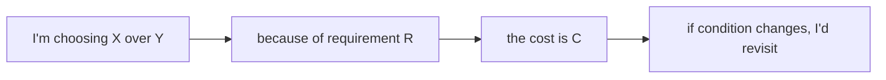

# SDE-2 Interview Framework

> [!abstract] The whole framework in four lines
> **Clarify** what the system must do and how big it is (numbers) → **propose** a simple architecture and narrate one request through it → **go deep** on the two riskiest parts with explicit trade-offs → **break it**: name what fails, what you would do about it, and how you would know. Every minute of the 45 belongs to one of those four, and every answer you give should end with a reason.

**Map:** [[Interview Prep MOC]] · [[Interview Probe Questions]] · [[Estimation Cheat Sheet]] · [[Component Choice Cheat Sheet]] · [[SDE-2 Readiness Checklist]] · [[Problem Bank MOC]]

## What an SDE-2 round actually grades

Interviewers at product companies score four or five dimensions, and most rubrics look like this:

| Dimension | What a pass looks like at SDE-2 | What the SDE-3 bar adds |
|---|---|---|
| Requirements and scoping | Asks functional and non-functional questions unprompted, states assumptions, writes them down, and keeps scope tight | Pushes back on scope, proposes phases, negotiates what to drop |
| Estimation | Produces QPS, storage and bandwidth in two or three minutes with the right orders of magnitude, and *uses* them later | Sizes the fleet and the cost, and revisits the numbers when the design changes |
| High-level design | A clear, simple architecture with the request path narrated; components chosen for stated reasons | Multiple viable alternatives compared on cost, operability and team shape |
| Deep dive | Two components explained to the level of data model, API, concurrency and failure handling | Drives the conversation to the hardest part without being led there |
| Trade-offs and failure modes | Names the single points of failure, the hot spots and the consistency choice on the critical path, with mitigations | Quantifies the trade-offs and ties them to SLOs and operational cost |
| Communication | Thinks aloud, draws as they talk, checks in with the interviewer, handles hints gracefully | Leads; the interviewer mostly listens |

The pattern to notice: SDE-2 is graded on **sound decisions with stated reasons on a system of moderate scope**. You are not expected to produce a novel architecture. You are expected to never say "we'll use Kafka" without being able to say why not SQS, and never draw a database without knowing what happens when it is down.

## The 45-minute plan

```mermaid
gantt
    title The 45 minutes, by phase (axis in minutes)
    dateFormat HH:mm
    axisFormat %M
    todayMarker off
    section Clarify
    Requirements, scale, out of scope        :a1, 00:00, 5m
    section Estimate
    QPS, storage, one derived number          :a2, after a1, 4m
    section API and data
    Endpoints and the key entities            :a3, after a2, 5m
    section High-level design
    Draw, then narrate a write and a read     :a4, after a3, 13m
    section Deep dive
    Two riskiest components                   :a5, after a4, 12m
    section Failures and wrap-up
    What breaks, trade-offs, summary          :a6, after a5, 6m
```

Interviews vary (some are 60 minutes, some give you 10 minutes of pre-reading), but the proportions hold. Practise with a visible clock.

| Minutes | Phase | What you do | What you say |
|---|---|---|---|
| 0–5 | **Clarify and scope** | Ask what the system must do (3–5 functional requirements), who uses it, and the non-functional targets: scale (users, requests), latency, availability, consistency, durability. Agree what is out of scope. Write the list where both of you can see it. | "Before I draw anything, let me make sure I'm solving the right problem. The core flows are A, B and C — is D in scope? What scale are we designing for — tens of thousands of users or hundreds of millions?" |
| 5–9 | **Estimate** | QPS (average and peak), read/write ratio, storage per year, bandwidth, and one derived number that will matter (cache size, number of shards, connections). Use the [[Estimation Cheat Sheet]]. Round aggressively. | "Roughly 10 million daily users, 10 actions each, is about 1,200 requests a second average, say 5,000 at peak. Each record is about 1 KB, so 100 GB a day, 36 TB a year — that is beyond one database within the year, so I'll plan for partitioning." |
| 9–14 | **API and data model** | The 3–5 endpoints or messages that the core flows need, with request and response shapes; the main entities, their keys and the one or two relationships that drive the storage choice. | "The write path is `POST /messages` with an idempotency key; the read path is `GET /conversations/{id}/messages?since=`. The hot entity is messages, keyed by conversation and sequence number." |
| 14–27 | **High-level design** | Draw clients, edge (load balancer, gateway), services, data stores, caches, queues. Then narrate one write and one read through the diagram. Choose each component with a one-line reason. Keep it to the simplest thing that meets the numbers. | "A request comes in through the load balancer to a stateless API service; it writes to the primary database and publishes an event through an outbox; readers hit the cache first. I'm starting with one relational database because the numbers fit and transactions matter for this flow." |
| 27–39 | **Deep dive on two components** | Pick the two riskiest parts (ask the interviewer if unsure: "I'd like to go deep on ordering and on the fan-out — or would you prefer the storage layer?"). For each: data layout, concurrency, consistency, failure handling, scaling. Use the decision sentence (below) for each choice. | "For ordering I'll use a per-conversation sequence allocated in the database transaction rather than timestamps, because clocks drift across instances; the cost is a hot row per conversation, which is fine at 50 messages a second per conversation but would need a different approach for a broadcast channel." |
| 39–44 | **Failure modes, scaling and trade-offs** | What breaks first at 10× load; the single points of failure; the hot keys; what happens when the cache, the queue, or a downstream is down; how you would know (metrics, alerts). State the two or three trade-offs you made and what would make you reverse them. | "The first thing to break is the sequence row for very large groups; the mitigation is batching or moving to a log per group. The single point of failure is the primary database, so it needs a replica with automated failover, and I'd alert on replication lag." |
| 44–45 | **Wrap up** | Summarise the design in three sentences, name what you would build first and what you deferred, and ask whether there is an area they want more on. | "To summarise: stateless API, relational primary with read replicas, a cache for the read path and an outbox for events. I'd build the write path and sync first and defer presence. Is there a part you'd like me to go further on?" |

If the interview is 60 minutes, the extra time goes to a third deep dive or to the alternatives discussion, never to a longer high-level design.

## The decision sentence

> [!example]- Excalidraw version — the same diagram as an editable canvas
> ![[SDE-2 Interview Framework — The decision sentence.excalidraw]]
> [[SDE-2 Interview Framework — The decision sentence.excalidraw|Open in Excalidraw]] — needs the Excalidraw plugin (see [[Plugins to Install]]).

Every component and every setting you choose should be said in this shape, out loud, even when the interviewer did not ask:

> "I'm choosing **X** over **Y** because of **requirement R**. The cost is **C**. If **condition** changed, I'd revisit it."

Examples:

- "I'm choosing a relational database over a key-value store because transfers must be atomic across two accounts. The cost is a harder path to horizontal scaling. If we outgrew a single primary I'd shard by account with a saga for cross-shard transfers."
- "I'm choosing fan-out on write for the feed because reads are 100× writes. The cost is write amplification for users with millions of followers. For those accounts I'd fall back to fan-out on read and merge."
- "I'm choosing at-least-once delivery with idempotent consumers rather than trying for exactly-once, because exactly-once needs coordination across the broker and the consumer's own database. The cost is a dedup table and a retention policy for it."

Interviewers are listening for the *because* and the *cost*. A design with three decision sentences beats a bigger design with none.

## The five things to always cover

Whatever the problem, these come up, and an SDE-2 candidate is expected to raise them before being asked:

1. **Idempotency wherever there are retries** — any write that a client or a queue might repeat needs a key; say where the key lives and how long it is kept ([[Idempotency]]).
2. **The single points of failure** — the primary database, the one coordinator, the one queue; say what replaces each and how failover is detected ([[Fault Tolerance]], [[Replication]]).
3. **Hot keys and uneven load** — the celebrity, the flash sale, the one tenant; say how you detect and spread it ([[Hot Keys]], [[Partitioning]]).
4. **Consistency on the critical write path** — which operation must be strongly consistent, which can be eventual, and what the user sees in the gap ([[Consistency Models]], [[Eventual Consistency]]).
5. **How you would know it is broken** — the three or four metrics you would alert on, and the first thing you would look at during an incident ([[Monitoring]], [[Alerting]]).

## Whiteboard conventions that help

- Name boxes by responsibility, not technology ("Order service", then "(PostgreSQL)" underneath) so the interviewer can ask why.
- Put the protocol on arrows (HTTP, gRPC, WebSocket, event) and the number on the hot ones ("5k rps", "100 MB/s").
- Draw the write path and the read path as two separately numbered sequences; narrate them in order.
- Keep a corner for assumptions and numbers; add to it as the conversation reveals more.
- When you change your mind, cross out and redraw — do not erase. The interviewer wants to see the reasoning trail.

## Probes you should expect, and how to take them

The interviewer will push on the design. Treat each probe as a gift: it tells you which deep dive they want. The full bank is in [[Interview Probe Questions]]; the shape of a good response is always the same — **restate the concern, give the mechanism, give the cost, give the signal you would watch**.

| Probe | What they are checking | Shape of a strong answer |
|---|---|---|
| "What if the database goes down?" | Do you know your single points of failure and failover | Replica with automated failover, what is lost (replication lag, RPO), what the client sees during the 30–60 s, and the alert |
| "How does this scale to 10×?" | Whether your numbers led your design | Which component saturates first (from the estimate), the next lever (cache, replicas, partitioning), and what you would *not* do yet |
| "What happens if two requests arrive at once?" | Concurrency on the critical path | Where the serialisation point is (transaction, lock, unique constraint, sequence) and what the loser sees |
| "Why not use X instead?" | Whether your choice had a reason | The decision sentence; concede the case where X wins |
| "How would you monitor this?" | Operational maturity | Golden signals for the service plus the one domain metric (queue lag, delivery rate, stale reads) |
| "We have five minutes left" | Prioritisation | Summarise, name what you would build first, stop drawing |

## Mistakes that lose SDE-2 rounds

- Drawing before asking. Thirty seconds of silence while you think is fine; five minutes of architecture for the wrong problem is not.
- Numbers that are never used. If you estimated 5,000 rps, say which component that number stresses.
- Reciting a known design (the YouTube version) instead of deriving one from the requirements the interviewer gave. Interviewers change one requirement to catch this.
- Over-engineering: Kafka, microservices and a CDN for a system with 100 users. Start with the simplest design that meets the numbers and say what would make you add each piece.
- Hand-waving the data model. "We store it in a NoSQL database" is not a design; the key, the partition and the access pattern are.
- Ignoring hints. When the interviewer asks "are you sure about that?", they are not making conversation.
- Going silent during deep dives. Narrate the mechanism, then pause and ask if they want more.
- Never saying what fails. A design with no failure modes discussed is a design you have not operated.

## Pre-interview checklist (the night before)

- [ ] Reread this note and [[Estimation Cheat Sheet]]; redo two estimation drills.
- [ ] Pick one core problem from [[Interview Readiness.base#Core problems]] and run the 45 minutes on paper, timed.
- [ ] Skim [[Component Choice Cheat Sheet]] — one sentence per row, out loud.
- [ ] Reread your last two [[Mock Interview Template|mock logs]] and the actions you wrote.
- [ ] Prepare three decision sentences for things you have actually built at work (they are the best answers to "tell me about a design decision").
- [ ] Sleep. The round rewards clear thinking far more than one more note read.

## Related

- [[Interview Prep MOC]] — the roadmap and problem tiers.
- [[Interview Sprint Plan]] — the final six weeks.
- [[Start Here]] — how the vault is meant to be read before any of this matters.
- [[Translating Product Requirements into Technical Requirements]], [[Functional vs Non-Functional Requirements]], [[Back-of-the-Envelope Estimation]], [[Evaluating Architectural Complexity]] — the concept notes behind the first ten minutes.
