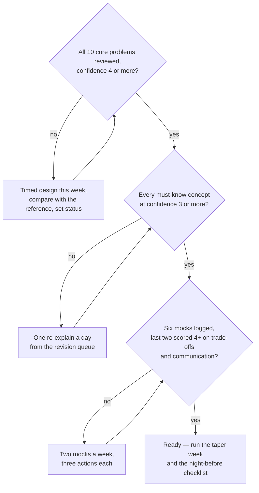

# SDE-2 Readiness Checklist

> [!abstract] What "ready" means
> You are ready for an SDE-2 system design round when you can run the 45 minutes in [[SDE-2 Interview Framework]] on any **core** problem without notes, produce the estimate in three minutes, say a decision sentence for every component, name three failure modes per component, and answer five probes from [[Interview Probe Questions]] in under a minute each — and when two mock interviewers have scored you 4 or more on trade-offs. Everything below is a way to check those claims rather than feel them.

**Map:** [[Interview Prep MOC]] · [[Engineering Dashboard]] · [[Start Here]]

## Am I ready? (the decision flow)

> [!example]- Excalidraw version — the same diagram as an editable canvas
> ![[SDE-2 Readiness Checklist.excalidraw]]
> [[SDE-2 Readiness Checklist.excalidraw|Open in Excalidraw]] — needs the Excalidraw plugin (see [[Plugins to Install]]).

## Readiness signals

Tick these honestly; each one is observable, not a feeling.

- [ ] I have run a timed 45-minute design on paper for **every core problem** at least once, and the second time on three of them.
- [ ] I can produce QPS, storage and one derived number for an unfamiliar system in **under three minutes** ([[Estimation Cheat Sheet]] drills: at least 10 done).
- [ ] For each of the 74 concepts below I can give the **definition and the problem it solves** without opening the note (confidence 3 or more).
- [ ] For the 22 concepts marked **draw** I can sketch the mechanism from memory (replication topology, consistent-hash ring, token bucket, outbox flow, sequence-based ordering).
- [ ] For the 18 concepts marked **defend** I can state the alternative and the trade-off in one decision sentence (confidence 4 or more).
- [ ] I have logged **at least six mock interviews** ([[Mock Interview Template]]), the last two scored 4+ on trade-offs and communication.
- [ ] Every "could not answer" probe from my mocks has been turned into a `needs-revision` note or a drill, and closed.
- [ ] I can tell three **work stories** as decision sentences: a design choice I made, a failure I handled, a trade-off I would make differently.

## The 74 must-know concepts

The reading order from [[Start Here]], with the level each concept is typically tested at in an SDE-2 round. *Explain* = definition and problem solved; *draw* = you can sketch the mechanism; *defend* = you can compare it with its alternative and state the cost. Target confidence: 3 for explain, 4 for draw and defend.

| Theme | Explain | Draw | Defend |
|---|---|---|---|
| Fundamentals | [[Latency]] · [[Throughput]] · [[Availability]] · [[Scalability]] · [[ACID]] · [[SLI SLO and SLA]] | [[Back-of-the-Envelope Estimation]] | [[Horizontal vs Vertical Scaling]] · [[CAP Theorem]] · [[Consistency Models]] |
| Networking | [[HTTP and HTTPS]] · [[REST]] · [[Reverse Proxies]] · [[CDNs]] · [[Connection Pooling]] | [[Load Balancers]] · [[WebSockets]] | [[Timeouts and Retries]] |
| Databases | [[Relational Database Internals]] · [[Transactions]] · [[Data Modeling]] · [[Database Scaling]] | [[Indexing]] · [[Replication]] · [[Read Replicas]] · [[Consistent Hashing]] | [[Isolation Levels]] · [[Optimistic and Pessimistic Locking]] · [[Partitioning]] · [[Sharding]] |
| Caching | [[TTL]] · [[Redis]] | [[Cache-Aside]] · [[Cache Stampedes]] | [[Cache Invalidation]] · [[Hot Keys]] |
| Messaging | [[Message Queues]] · [[Delivery Semantics]] · [[Dead-Letter Queues]] | [[Kafka]] · [[Topic Partitions]] · [[Consumer Groups]] · [[Outbox Pattern]] | [[Synchronous vs Asynchronous Communication]] · [[Ordering Guarantees]] · [[At-Least-Once Delivery]] · [[Idempotency]] · [[Retry Strategies]] |
| Resilience patterns | [[Retry Storms]] · [[API Gateways]] | [[Circuit Breakers]] · [[Bulkheads]] · [[Rate Limiting]] | [[Graceful Degradation]] |
| Distributed systems | [[Network Partitions]] · [[Eventual Consistency]] · [[Distributed ID Generation]] | [[Quorums]] · [[Leader Election]] · [[Distributed Locks]] | — |
| Observability and security | [[Metrics]] · [[Logging]] · [[Alerting]] · [[Health Checks]] · [[Authentication]] · [[Authorization]] | [[Distributed Tracing]] · [[JWT]] | — |
| Product engineering | [[Backward Compatibility]] · [[Feature Flags]] · [[Deployment and Rollback Strategies]] | [[Designing APIs and Contracts]] | [[Functional vs Non-Functional Requirements]] · [[Evaluating Architectural Complexity]] |

Beyond these 74, the Knowledge Graph chains for **real-time systems** ([[Fan-Out]], [[Backpressure]], [[Client State and Reconnection]]) and **money** ([[Saga Pattern]], [[Event Sourcing]], [[Exactly-Once Semantics]]) are the ones most worth adding for fintech interviews.

### Live view: high-priority concepts still below confidence 3

![[Interview Readiness.base#Must-know concepts below 3]]

## The problems

Ten problems carry `interview_tier: core`; a strong SDE-2 candidate has designed every one of them twice. The *likely* tier is what a second or third round draws from; *stretch* problems are for depth and for fintech-specific rounds.

### Core problems and where each stands

![[Interview Readiness.base#Core problems]]

### Likely and stretch

![[Interview Readiness.base#All problems by tier]]

For each core problem, the bar is: `status: reviewed` (your design compared against a reference or a person), `confidence` 4, and at least one mock. The [[Interview Sprint Plan]] schedules exactly that.

## Mock interview record

![[Mock Interviews.base#Latest]]

A mock counts when it was timed, had an interviewer (a person, or you reading probes from [[Interview Probe Questions]] in interviewer mode), and produced a filled [[Mock Interview Template]] with three actions.

## Scoring yourself without an interviewer

Use the rubric in [[Mock Interview Template]] after every timed solo design. Be harsh on two dimensions in particular: **trade-offs** (did every component get a decision sentence?) and **failure modes** (did you name what breaks and how you would know?). Solo mocks consistently score a point higher than real ones on communication; adjust.

## When the checklist says "not yet"

- Concepts below 3 in the live view → they go on the revision queue; one re-explain per day.
- A core problem not yet `reviewed` → schedule a timed design this week, then compare with the reference solution pointer in the note.
- Fewer than six mocks → book two per week for the next three weeks; peers from work or a mock platform both count.
- Trade-off scores below 4 → drill decision sentences: for each component in your last design, write the sentence, then say it.

## Related

- [[Interview Prep MOC]] · [[Interview Sprint Plan]] · [[SDE-2 Interview Framework]] · [[Interview Probe Questions]] · [[Estimation Cheat Sheet]] · [[Component Choice Cheat Sheet]]
