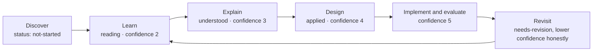
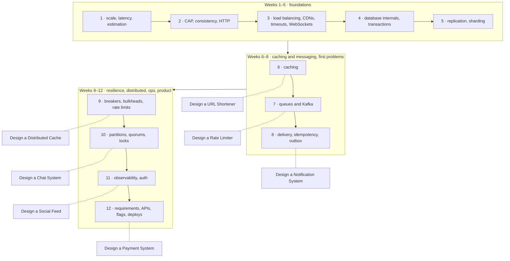

# Start here — a reading guide for SDE-2

> [!abstract] The short version
> You do not need all 166 notes. You need about 70 of them, in the order below, read the right way: **definition → problem it solves → how it works → trade-offs → failure modes**, then three sentences in your own words. Everything else in this vault exists so that those 70 stick and so you can find the rest when a real design needs it.

**Map:** [[HLD MOC]] (the full curriculum) · [[Engineering Dashboard]] (what to do today) · [[Interview Prep MOC]] (the SDE-2 interview layer) · [[Workspace Guide]] (how the machinery works) · [[HLD Vault Status]] (what is in the vault and what changed)

## What system design is, in one paragraph

A system design is a set of decisions about where data lives, how requests reach it, what happens when something is slow or broken, and what you are willing to give up (money, consistency, simplicity) to get what the product needs. Interviewers and senior engineers are not checking whether you know the "right" architecture. They are checking whether you ask what the system must do, put rough numbers on it, pick components for reasons you can say out loud, and know how each one fails. Every note here is written to feed exactly those four habits.

## How to read one concept note (20 minutes)

Each note has seventeen sections. On a **first pass read only six**:

1. The one-sentence abstract at the top.
2. **Definition** — if you cannot repeat it after reading it twice, stop and reread; the rest will not land.
3. **Problem solved** — this is the part worth memorising. If you remember what broke before the idea existed, you can re-derive the idea.
4. **How it works** — read it once, then cover it and sketch the mechanism (the diagram in *Architecture* is there to check yourself against, not to copy).
5. **Trade-offs** — the table. Say one row out loud as a sentence: "I gain X, I pay Y."
6. **Failure modes** — pick the one you find scariest and remember it; it is the one interviewers ask about.

Then, before closing the note, write **three sentences under *Personal understanding*** without scrolling up, tick what you can in the *Mastery checklist*, and set two properties at the top: `status: reading` and `confidence: 2`. That is a finished first pass. *Performance, Scalability, Operational impact, Alternatives, Real-world examples* and the *Practical exercise* are for the second pass, weeks later, when a design or a work problem brings you back.

> [!tip] The deep-dive pointer
> Many notes point to a longer note in your `system-design` vault. Read that **after** you have written your own explanation, not instead of it — the point is to find out what you missed.

## The learning loop the properties track

| Stage | What it looks like | Property |
|---|---|---|
| Discover | You have heard the term and know which category it belongs to | `status: not-started` |
| Learn | First pass done, three sentences written | `status: reading`, `confidence: 2` |
| Explain | You explained it to someone (or to the empty room) without the note | `status: understood`, `confidence: 3` |
| Design | You used it, on purpose, in a design problem | `status: applied`, `confidence: 4` |
| Implement / Evaluate | You built or measured it in a project and know when *not* to use it | `confidence: 5` |
| Revisit | The dashboard says it is due, or you got it wrong at work | `status: needs-revision`, lower `confidence` honestly |

Confidence is not completion. A note can be `applied` with `confidence: 2` if the design made you realise you did not understand it. Lowering a number is progress.

## The 12-week SDE-2 order

*The shape of the twelve weeks; the problem boxes are links. The table below has the exact notes per week.*

Roughly six notes a week, one design problem a week from week 6. Each line is a reading order, not just a list — the earlier ones are prerequisites for the later ones.

| Week | Read, in order | Design problem |
|---|---|---|
| 1 | [[Scalability]] · [[Latency]] · [[Throughput]] · [[Availability]] · [[Horizontal vs Vertical Scaling]] · [[Back-of-the-Envelope Estimation]] | — |
| 2 | [[CAP Theorem]] · [[Consistency Models]] · [[ACID]] · [[SLI SLO and SLA]] · [[HTTP and HTTPS]] · [[REST]] | — |
| 3 | [[Load Balancers]] · [[Reverse Proxies]] · [[CDNs]] · [[Connection Pooling]] · [[Timeouts and Retries]] · [[WebSockets]] | — |
| 4 | [[Relational Database Internals]] · [[Indexing]] · [[Transactions]] · [[Isolation Levels]] · [[Optimistic and Pessimistic Locking]] · [[Data Modeling]] | — |
| 5 | [[Replication]] · [[Read Replicas]] · [[Database Scaling]] · [[Partitioning]] · [[Sharding]] · [[Consistent Hashing]] | — |
| 6 | [[Cache-Aside]] · [[TTL]] · [[Cache Invalidation]] · [[Cache Stampedes]] · [[Hot Keys]] · [[Redis]] | [[Design a URL Shortener]] |
| 7 | [[Synchronous vs Asynchronous Communication]] · [[Message Queues]] · [[Kafka]] · [[Topic Partitions]] · [[Consumer Groups]] · [[Ordering Guarantees]] | [[Design a Rate Limiter]] |
| 8 | [[Delivery Semantics]] · [[At-Least-Once Delivery]] · [[Idempotency]] · [[Retry Strategies]] · [[Dead-Letter Queues]] · [[Outbox Pattern]] | [[Design a Notification System]] |
| 9 | [[Circuit Breakers]] · [[Bulkheads]] · [[Rate Limiting]] · [[Graceful Degradation]] · [[Retry Storms]] · [[API Gateways]] | [[Design a Distributed Cache]] |
| 10 | [[Network Partitions]] · [[Eventual Consistency]] · [[Quorums]] · [[Leader Election]] · [[Distributed Locks]] · [[Distributed ID Generation]] | [[Design a Chat System]] |
| 11 | [[Metrics]] · [[Logging]] · [[Distributed Tracing]] · [[Alerting]] · [[Health Checks]] · [[Authentication]] · [[Authorization]] · [[JWT]] | [[Design a Social Feed]] |
| 12 | [[Functional vs Non-Functional Requirements]] · [[Designing APIs and Contracts]] · [[Backward Compatibility]] · [[Feature Flags]] · [[Deployment and Rollback Strategies]] · [[Evaluating Architectural Complexity]] | [[Design a Payment System]], then redo weeks 6 and 7's problems from memory |

If you only have six weeks, do weeks 1, 4, 5, 6, 7 and 8 and the first three problems. That is the core an SDE-2 round grades.

## What to skip for now

- Anything marked *Vocabulary* in a category map (low priority) — read the definition, link it, move on.
- All of [[Storage & Search MOC]] except [[Object Storage]].
- [[Security MOC]] beyond the three notes in week 11.
- [[Product Engineering MOC]] beyond the six in week 12 — these matter for SDE-3 conversations, not SDE-2 rounds.
- Projects: pick **one** ([[Webhook Relay]] or [[Rate Limiter Library]]) and only after week 8. Building one thing you measured beats starting four.

## A daily and weekly routine that fits around a job

**Daily, 45 minutes:** one note first-pass (20) · write the three sentences and set the properties (10) · open [[Engineering Dashboard]] and re-explain one note from the revision queue without opening it (10) · if you got it wrong, set `status: needs-revision` (5).

**Weekly, 90 minutes:** one design problem from the table above on paper, timed to 45 minutes, using the decision format in the problem note (questions to settle → options → *my decision and why*) · then a weekly review from the template in `Templates/Weekly Review Template.md` — what you can now explain, what surprised you, three priorities for next week.

**In the design problem notes**, do not read the *Reference solution* pointer until your own design is written. The notes are decision sheets on purpose: a design you can defend is worth more than a design you can recite.

## When you sit the interview

The twelve weeks above are Phase 1 of a 4–6 month plan; [[Interview Sprint Plan]] adds a depth phase and a final six-week sprint, [[SDE-2 Interview Framework]] gives the 45-minute structure, and [[SDE-2 Readiness Checklist]] tells you when you are ready. Four things get graded, and all four are practised above: clarify requirements before drawing anything (week 12's first note), put numbers on the design (week 1's last note), choose components for reasons you say out loud (every trade-off table), and name what fails and what you do about it (every failure-mode section). The vault cannot do the saying-out-loud for you — that is the part to practise with another person.
