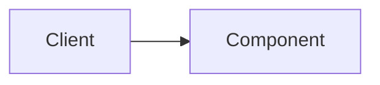

# {{title}}

> [!abstract] In one sentence
> *(What is it, and what does it buy you?)*

## Definition

*(Simple, precise language. If you cannot define it in two sentences you do not understand it yet.)*

## Problem solved

*(Why does this exist? What broke, or what was too slow or too expensive, before it?)*

## How it works

*(The underlying mechanics — the thing you must be able to re-derive at a whiteboard.)*

## Architecture

## Use cases

*(When should you reach for it? What signals in a requirement point here?)*

## Limitations

*(When is it a poor choice? What does it assume that may not hold?)*

## Trade-offs

| You gain | You sacrifice |
|---|---|
|  |  |

## Failure modes

*(What goes wrong in production, how you notice, what the blast radius is.)*

## Performance

*(Effect on latency, throughput, memory, CPU, network, cost.)*

## Scalability

*(How does it behave as load, data or team size grows by 10x?)*

## Operational impact

*(Deploy, monitor, debug, upgrade, on-call burden.)*

## Alternatives

*(Other approaches to the same problem and when each wins.)*

## Real-world examples

*(Production systems and engineering write-ups that use it.)*

## Practical exercise

*(The smallest experiment that would let you see this behaviour yourself.)*

## Related concepts

### Prerequisites
- 

### Related
- 

### Builds on this
- 

### Design problems where it applies
- 

### Projects where it can be implemented
- 

### Resources
- 

## Personal understanding

> [!question] Explain it without the source
> Write your own explanation here, from memory. Then compare it with the sections above and note what you missed.

### Mastery checklist
- [ ] I can explain it without the original resource
- [ ] I can describe the problem it solves
- [ ] I can compare it with its alternatives
- [ ] I can name its limitations and failure modes
- [ ] I can recognise when it is appropriate in a real system
- [ ] I have applied it in a system design
- [ ] I have validated my assumptions with an experiment or implementation

## Open questions

- [ ] 
