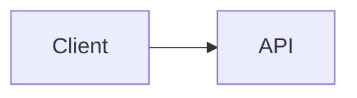

# {{title}}

> [!abstract] The product in one sentence
> 

> [!tip] How to use this note
> Every section below has **questions to settle** and **options with trade-offs**. Write *My decision and why* under each before looking at a reference solution. The goal is a design you can defend, not a design you can recite.

## Problem statement

## Product context and intended users

## Functional requirements

- 

## Non-functional requirements

- 

## Constraints and assumptions

- 

## Capacity estimation

| Quantity | Assumption | Result |
|---|---|---|
| Users |  |  |
| Requests per second (avg / peak) |  |  |
| Storage per year |  |  |
| Bandwidth |  |  |

## API design

```http
```

## Data model

## High-level architecture



## Component responsibilities

| Component | Owns | Does not own |
|---|---|---|
|  |  |  |

## Database selection and rationale

## Caching strategy

## Messaging and asynchronous processing

## Scaling strategy

## Consistency requirements

## Failure scenarios

| Failure | Impact | Detection | Mitigation |
|---|---|---|---|
|  |  |  |  |

## Security considerations

## Observability

## Cost considerations

## Architectural trade-offs

| Decision | Chosen | Rejected | Why |
|---|---|---|---|
|  |  |  |  |

## Alternative designs

## What I would implement first

## What I would defer

## Related

### Concepts
- 

### Projects
- 

### Resources
- 

## What I learned

## What I would improve in a second iteration
