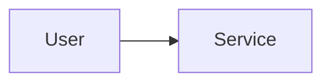

# {{title}}

> [!abstract] Why this project exists
> 

## Problem being solved

## Intended users

## Product requirements

- 

## Minimum viable version

*(The smallest thing that works end to end. Build this first, measure it, then improve.)*

## Architecture

## Tech stack

## Data model

## APIs

## Relevant HLD concepts

- 

## Milestones

> [!info] The loop
> 1. Build a working minimal version → 2. Measure its behaviour → 3. Identify bottlenecks and failure modes → 4. Improve the architecture based on evidence → 5. Document the trade-offs (an entry in `04 Projects/Decisions`).

- [ ] M1 — Minimal working version
- [ ] M2 — Measured: load test, latency profile, failure injection
- [ ] M3 — Improved: one evidence-driven architectural change
- [ ] M4 — Documented: decisions, trade-offs, lessons

## Current tasks

- [ ] 

## Technical challenges

- [ ] 

## Testing strategy

## Deployment plan

## Monitoring and observability

## GitHub repository

## Live demo

## Performance considerations

## Lessons learned

## Future enhancements

## Related

### Design problems
- 

### Decisions
- 
