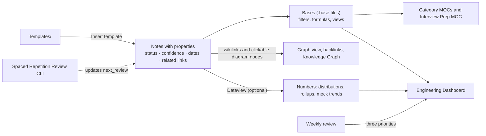

# Workspace Guide

> [!abstract] One-line summary
> Notes carry properties; Bases turn properties into live tables; the dashboard and the maps are just views over those tables. Keep the properties honest and the rest takes care of itself. For *how to study*, read [[Start Here]]; this page is about *how the machinery works*.

## How the machinery fits together

> [!example]- Excalidraw version — the same diagram as an editable canvas
> ![[Workspace Guide.excalidraw]]
> [[Workspace Guide.excalidraw|Open in Excalidraw]] — needs the Excalidraw plugin (see [[Plugins to Install]]).

## Folder structure

| Folder | What lives there | Entry point |
|---|---|---|
| `00 Dashboard/` | [[Engineering Dashboard]] and the nine `.base` files that power every table | [[Engineering Dashboard]] |
| `01 HLD & System Design/` | 166 concept notes in eleven category folders, each with its own MOC, plus [[HLD MOC]] and [[Knowledge Graph]] | [[HLD MOC]] |
| `02 System Design Problems/` | 28 design problems as decision sheets, each tagged `interview_tier: core`, `likely` or `stretch` | [[Problem Bank MOC]] |
| `03 Resources/` | 79 resource notes (every link verified on 2026-11-03), each linked both ways to the concepts and problems it supports | [[Resources MOC]] |
| `04 Projects/` | 16 project notes; `Decisions/` holds architecture decision records | [[Projects MOC]] |
| `05 Reviews/` | Weekly reviews | [[Reviews MOC]] |
| `06 Interview Prep/` | The SDE-2 interview layer: framework, probe bank, cheat sheets, readiness checklist, sprint plan; `Mocks/` holds mock-interview logs | [[Interview Prep MOC]] |
| `Templates/` | Concept, Design Problem, Project, Resource, Weekly Review, Architecture Decision, Mock Interview | — |
| `Excalidraw/` | 244 Excalidraw drawings: `Maps/` (the eleven category concept maps and the HLD category map, hand-laid-out as rooms with a reading order), `Concepts/`, `Problems/`, `Projects/`, `Guides/` (one canvas per Mermaid diagram, generated from it). Each is embedded in the note it belongs to. | [[HLD Category Map.excalidraw]] |
| `Start Here.md`, `Workspace Guide.md`, `HLD Vault Status.md`, `Plugins to Install.md` | Reading guide, this page, [[HLD Vault Status]] (inventory, conventions, changelog) and [[Plugins to Install]] (setup checklist) | [[Start Here]] |

The `system-design` vault next to this one stays untouched; concept and problem notes point to its deep-dive notes by path in a tip callout.

## Note types and their properties

Every note has a `type` and a matching tag, which is what the Bases views filter on.

| Type | Tag | Tracking properties | Status values |
|---|---|---|---|
| concept | `concept` + category tag | `priority`, `status`, `confidence` (1–5), `date_started`, `last_reviewed`, `next_review`, `related` | `not-started` → `reading` → `understood` → `applied`; `needs-revision` |
| problem | `problem` + category | `priority`, `interview_tier` (core / likely / stretch), `status`, `confidence`, `last_worked`, `next_review`, `related_concepts`, `related_projects` | `not-started` → `exploring` → `designing` → `implementing` → `reviewed`; `needs-revision` |
| project | `project` + category | `status`, `priority`, `current_milestone`, `next_task`, `blocker`, `repo`, `demo`, `related_concepts`, `related_problems`, `started`, `updated` | `idea` → `planned` → `active` → `shipped`; `paused`, `archived` |
| resource | `resource` + resource type | `resource_type`, `url`, `author`, `status`, `priority`, `related_concepts`, `related_problems` | `unread` → `reading` → `reviewed` |
| review | `review` | `week`, `period_start`, `period_end` | — |
| decision | `decision` | `project`, `status`, `related_concepts` | `proposed` → `accepted`; `superseded`, `rejected` |
| mock | `mock` | `problem`, `date`, `format` (solo / peer / paid), `duration_min`, six `score_*` properties (1–5), `overall` | — |

**Confidence scale** (track it separately from status): 1 unfamiliar · 2 understand the basic idea · 3 can explain the mechanics · 4 can apply it independently · 5 can evaluate alternatives and defend design decisions.

**Knowledge-gap tags**: add `gap/explain`, `gap/decision`, `gap/internals` or `gap/hands-on` to a concept's `tags` and it appears in the dashboard's gap table; remove the tag when the gap closes.

## Which features depend on which plugin

| Feature | Needs | Notes |
|---|---|---|
| All tables on the dashboard, in the MOCs and in the interview area (`![[Concepts.base#View]]`, `![[Interview Readiness.base#View]]`, `![[Mock Interviews.base#View]]`) | **Bases** — core plugin, Obsidian 1.9+ | Enabled by default; nothing to install. Date filters such as `next_review <= today()` need the date properties to be typed *Date*, which `.obsidian/types.json` already declares. |
| Templates (`{{title}}`, `{{date:YYYY-MM-DD}}`) | **Templates** — core plugin | Settings → Core plugins → Templates; folder is preset to `Templates` in `.obsidian/templates.json`. Use *Insert template* in a new note. |
| Diagrams | **Mermaid** — built in | Every concept note's *Architecture* section, every problem's *High-level architecture*, every project's *Architecture*, and the maps on the MOCs, Start Here and the dashboard — with note-titled nodes clickable. |
| Editable canvases | **Excalidraw** — community plugin | Every one of those diagrams also exists as a drawing in `Excalidraw/`, embedded under the Mermaid block in a folded *Excalidraw version* callout; the category MOCs and [[HLD MOC]] embed a richer hand-laid-out map (rooms, reading order, one concrete example per room) with every box linked to its note. Install and enable Excalidraw — see [[Plugins to Install]]; until then the embeds render as text. |
| Properties panel, tags, graph colours | Core | `.obsidian/graph.json` colours nodes by folder; `types.json` sets property types. |
| Open tasks across projects, confidence distribution, per-category table, "problems and projects" counts on the dashboard; the automatic sections in weekly reviews | **Dataview** — community plugin | Pre-placed in `.obsidian/plugins/dataview/` (v0.5.70). Turn on community plugins (Settings → Community plugins → *Turn on community plugins*) and enable it; JavaScript queries are enabled in its settings. Without it those panels show as code blocks and everything else still works. |
| Quick creation of concept/problem/project notes with the right template in the right folder | **QuickAdd** — optional | Not required. If you want it: three *Template* choices (Concept → `01 HLD & System Design/<category>`, Problem → `02 System Design Problems`, Project → `04 Projects`) each pointing at the matching template. |
| Computed `next_review` dates in templates | **Templater** — optional | The core Templates plugin cannot do date arithmetic, so `next_review` is set by hand. With Templater, replace the property line with `next_review: <% tp.date.now("YYYY-MM-DD", 7) %>` in the concept template. |
| Task management with due dates | **Tasks** — optional | The Dataview task rollups cover the dashboard's needs; add Tasks only if you want due dates and recurrence on project tasks. |

Everything that matters works with core plugins only. Dataview is the one community plugin worth enabling, because it is what turns the dashboard from "lists" into "numbers".

## Reading and navigation conveniences

- **Clickable diagrams.** Every Mermaid node whose label is a note title is an internal link (`class X internal-link`), so the category maps, the Knowledge Graph chains, the problem and project maps and the roadmap can be navigated by clicking. Keep this working by using exact note titles as node labels in new diagrams.
- **Diagram sizing.** Mermaid normally shrinks a wide diagram to the pane width, which makes long chains unreadable in a 700px reading pane. The `hld-workspace` snippet keeps diagrams at natural size and lets them scroll sideways instead; long linear chains were also redrawn top-to-bottom so nothing in the vault is wider than about 900px. Prefer `flowchart TB` for chains of more than five nodes.
- **Wide pages.** Table-heavy pages carry `cssclasses: [wide]` so tables and Bases views use the full width when the `hld-workspace` CSS snippet is enabled (Settings → Appearance → CSS snippets; it is pre-enabled in `.obsidian/appearance.json`). Remove the property from any page you prefer narrow.
- **Bookmarks.** `.obsidian/bookmarks.json` pins the dashboard, Start Here, the maps and the interview notes in the Bookmarks pane (core plugin), grouped by activity.
- **Graph colours.** `.obsidian/graph.json` colours nodes by folder, including `06 Interview Prep`, and greys the drawings in `Excalidraw/`; filter the graph with `tag:#concept` for the curriculum alone, `path:"02 System Design Problems"` to see which concepts a problem pulls in, or `-path:Excalidraw` to hide the drawings.
- **Excalidraw canvases.** Open any drawing from its note's callout, or the maps from `Excalidraw/Maps/`. Boxes whose label is a note title carry a link: Ctrl/Cmd-click opens the note. To test recall, duplicate the drawing, delete the arrows and redraw them from memory, then compare with the original. New drawings you make go in `Excalidraw/` too (set as the plugin's folder).
- **Jump links.** The dashboard has an *On this page* line; long MOCs rely on the Outline pane (core plugin) — open it with the sidebar's list icon.

## Adding and maintaining notes

- **New concept**: create the note in the right category folder, insert *Concept Template*, set `category` (exact category name) and the category tag, fill the six first-pass sections, then add one line to that category's MOC and to [[HLD MOC]]. The Bases tables pick it up from the tag and category automatically.
- **New design problem / project / resource**: same pattern with the matching template; add a line to the section MOC. Resources must link to at least one concept and the concept should link back under *Resources*.
- **Renaming**: use Obsidian's rename (it rewrites links). Note names are unique across the vault on purpose — keep them so.
- **Reviewing**: when you re-explain a note, set `last_reviewed` to today and `next_review` to a date (double the previous gap if it went well; three days if not). The revision queue is driven entirely by those two dates, `status: needs-revision` and `confidence ≤ 2`.
- **Weekly**: create the review note from the template; set `period_start`/`period_end`; the Dataview sections fill themselves (including the mocks logged in the period).
- **Mock interviews**: after every timed design or mock, create a note in `06 Interview Prep/Mocks` from the *Mock Interview Template*, set `problem` (a link), `date`, `format` and the six `score_*` properties; the dashboard's interview section and `Mock Interviews.base` read them. Three failed probes on one concept → set that concept to `needs-revision`.
- **Interview tiers**: `interview_tier` on a problem note is a planning label (core / likely / stretch); change it if your target companies ask different things. The sprint burndown is the *Core problems* view in `Interview Readiness.base`.
- **Decisions**: whenever a project changes direction because of a measurement, add a note in `04 Projects/Decisions` from the *Architecture Decision Template* and link it from the project's *Decisions* section. The dashboard counts them — that count is the single best proxy for "engineering judgement developed".
- **Git**: the vault lives inside the `learn-system-design` repository; commit after each study session (`git add HLD && git commit`). `.obsidian/workspace.json` is per-machine state — add it to `.gitignore` if it starts showing up in diffs.

## Daily and weekly workflow

**Daily (45 min):** open [[Engineering Dashboard]] → *Today's three moves* → one first-pass read from *High-priority not started* (or the current week in [[Start Here]]) → write three sentences under *Personal understanding* → set `status`/`confidence` → re-explain one item from the revision queue without opening it → update `last_reviewed`/`next_review`.

**Weekly (90 min):** one timed design problem from [[Problem Bank MOC]] → fill its decision lines → weekly review note → three priorities copied to the dashboard.

**During the interview sprint (final six weeks):** the 60-minute daily routine in [[Interview Sprint Plan]] replaces the daily routine above — drills from [[Estimation Cheat Sheet]] and [[Interview Probe Questions]], timed designs every other day, two mocks a week logged with the template.

**Monthly:** glance at the *Stale* view in `Concepts.base`, prune `gap/*` tags that no longer apply, and move one project forward a milestone or archive it honestly.

## Limitations and manual steps

1. **Open `HLD` as its own vault** (Obsidian → *Open folder as vault*). It is self-contained; links do not cross into `system-design`, which is referenced by path only.
2. **Enable community plugins** once to activate the pre-placed Dataview; Obsidian asks on first open. Until then the Dataview panels render as code.
3. **Property types**: if a date filter ever shows nothing, check Settings → Properties that `next_review`, `last_reviewed`, `last_worked`, `date_started`, `updated`, `period_start`, `period_end` are typed *Date* and `confidence` is *Number*.
4. **Bases inside callouts** are not supported by Obsidian, so the dashboard embeds `.base` views as top-level embeds and folds only the Dataview panels into callouts.
5. **Mermaid rendering** was validated with the Mermaid parser, but Obsidian's renderer is occasionally stricter about labels; if a diagram fails, the error message names the line — quoting the label fixes nearly every case.
6. **The vault does not grade you.** Statuses and confidence are self-reported; the weekly review is where honesty happens.

## Recommended next improvements

- Redraw one category map a week from memory in Excalidraw (duplicate `Excalidraw/Maps/<Category> Concept Map`, delete the arrows, redraw) and keep the attempts in `Excalidraw/Redraws/`.
- Once ten or more decisions exist, add a `Decisions` section to the dashboard grouped by project.
- Write a tiny script (or the [[Spaced Repetition Review CLI]] project) that bumps `next_review` based on confidence, so the queue needs no manual dates.
- After the first interview loop, add an `asked: true` property to the problems you were actually asked and a Bases view for them; adjust `interview_tier` from the evidence.
- Once ten mocks exist, add a per-dimension trend chart to the interview section (the Dataview table in [[Interview Prep MOC]] already has the numbers).
