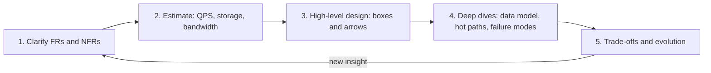
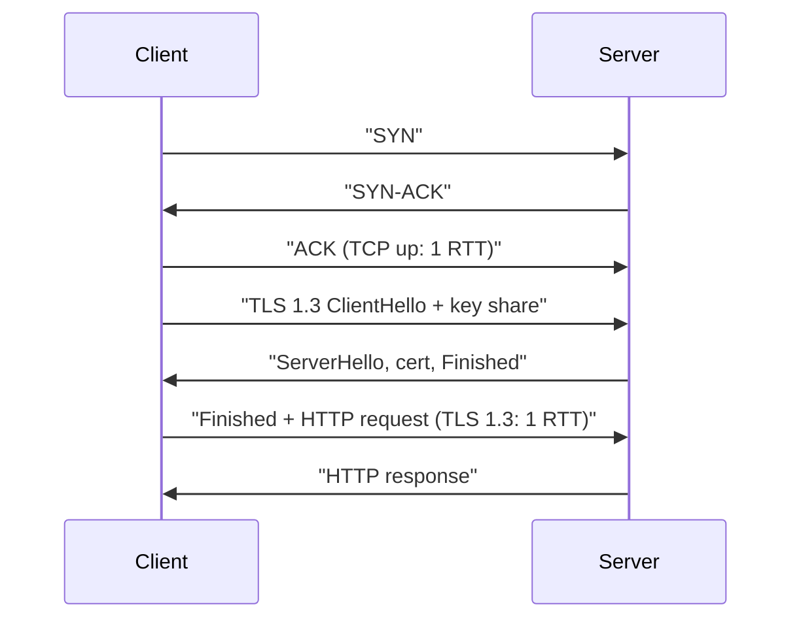
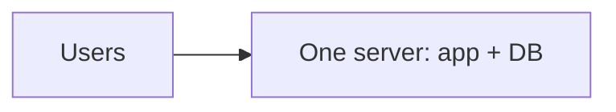
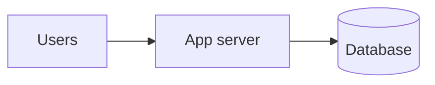
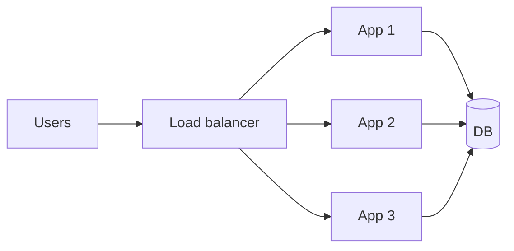
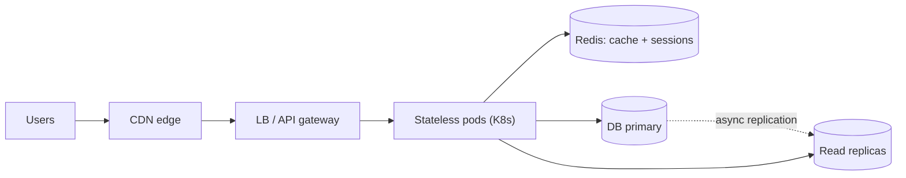
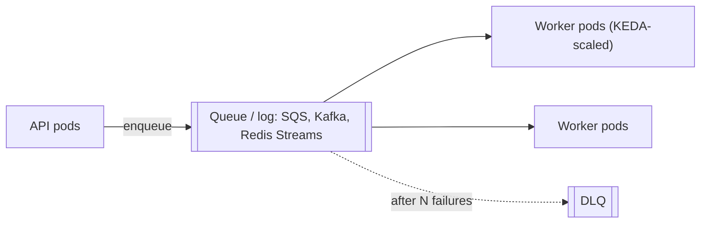
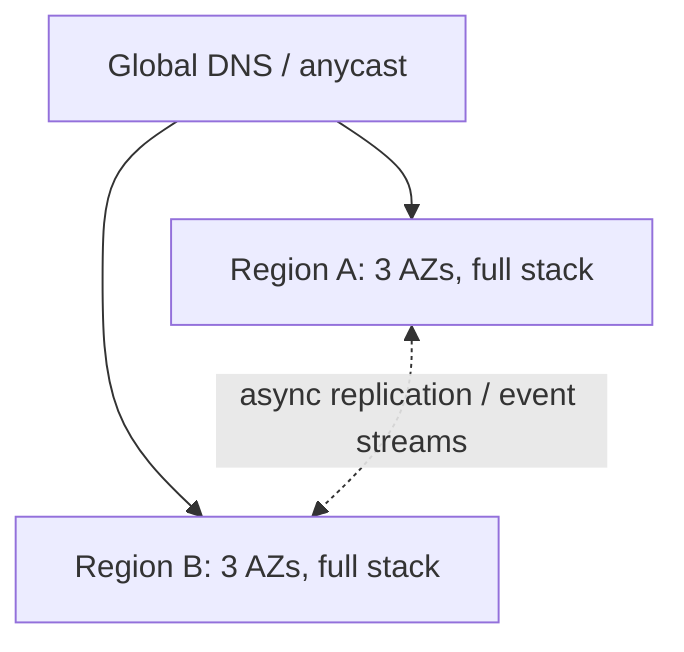
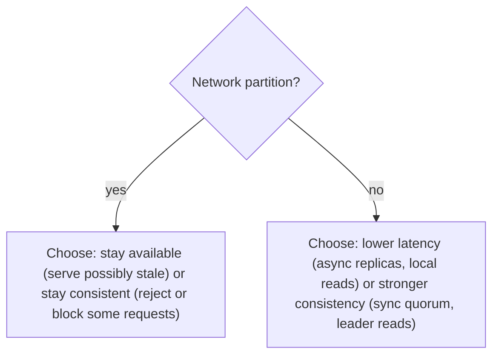

# System Design From Scratch — Master Roadmap + Module 1 (Foundations), for Kunal

Kunal, the plan is 10 phases, 9 to 10 months at 6 hrs/week, and it builds on systems you already run. The order is: foundations, then building blocks (load balancing, Redis, databases, sharding), then messaging (RabbitMQ → Kafka → SQS → Redis Streams), then architecture, security (JWT/IAM), distributed-systems theory, planet-scale case studies, the 1M RPS module, resilience, and finally design practice. Each later module explains one or more of your own systems. Module 1 is written in full below as Obsidian notes.

## TL;DR
- **The plan:** about 250–300 study hours over 10 phases. At 6 hrs/week that is about 9–10 months. Each module starts from "what broke without this component" and ends with a lab on your own stack: Redis, JWT/IAM, the queue migration, and Kubernetes.
- **Your misconceptions, corrected:**
  - "MySQL doesn't scale" is the wrong framing. Meta's MySQL deployment "includes thousands of machines running over several regions and data centers across multiple continents" and "powers the social graph along with many other services, like Messaging, Ads, and Feed" (Meta Engineering, "Building and deploying MySQL Raft at Meta", 16 May 2023). It scales through sharding, caching (memcache/TAO) and replication tooling (MySQL Raft). No single MySQL server scales without limit.
  - Google's MySQL story is AdWords moving off sharded MySQL onto F1/Spanner, plus YouTube's Vitess.\[1\]
  - Chaos Monkey terminates VM instances *and containers* through Spinnaker.\[2\] It is not a Kubernetes-native pod killer. Chaos Mesh and LitmusChaos fill that role on Kubernetes.
- **Do first:** measure your real RPS, p99 latency, error rate and saturation from ingress/ALB metrics plus app histograms (note 01.07). Then size pods with `pods = ceil(peak_RPS × safety_factor / measured_RPS_per_pod_at_target_utilisation)`, not guesses. Everything at 1M RPS builds on these measurements.

---

# PART A — MASTER ROADMAP

## A.1 Phases at a glance

| Phase | Module | Hours | Explains in your stack |
|---|---|---|---|
| 0 | M1 Foundations (this pass) | 30 | Everything; how to measure your RPS |
| 1 | M2 Networking, proxies, LB, DNS/GSLB, API gateways | 15 | ALB/NLB, ingress/Gateway API, IAM gateway |
| 1 | M3 Caching & Redis deep dive | 25 | All Redis usage, JWT denylists, rate limits |
| 1 | M4 Database fundamentals (B-tree/LSM, indexes, isolation) | 20 | Your SQL/NoSQL stores |
| 1 | M5 Replication | 10 | Read replicas, Redis replication, Kafka ISR |
| 1 | M6 Partitioning/sharding + hot keys | 15 | Kafka partition keys, Redis Cluster slots, DynamoDB |
| 1 | M7 Case studies: Meta MySQL, Google (Vitess, F1, Spanner) | 10 | "Does MySQL scale?" |
| 2 | M8 Messaging fundamentals (queue vs log, semantics, idempotency, DLQ, backpressure) | 12 | All four of your brokers |
| 2 | M9 RabbitMQ deep dive | 10 | Your RabbitMQ era |
| 2 | M10 Kafka deep dive + deployment (self-managed / Confluent / MSK) | 25 | Confluent, self-managed, MSK |
| 2 | M11 SQS + SNS deep dive | 8 | Current SQS |
| 2 | M12 Redis Streams + SQS→Redis Streams decision framework | 10 | Planned migration |
| 2 | M13 Event-driven patterns (outbox, CDC, sagas, CQRS, schemas) | 15 | Cross-service consistency |
| 3 | M14 Service architecture (monolith ↔ microservices, DDD, comms, mesh) | 15 | Your service boundaries |
| 4 | M15 AuthN/AuthZ: JWT, OAuth/OIDC, IAM design, Zanzibar, mTLS/SPIFFE, rate limiting | 20 | JWT + IAM service |
| 5 | M16 Distributed systems theory (clocks, consistency, consensus, quorums, CRDTs) | 25 | etcd, KRaft, quorum queues |
| 6 | M17 Planet-scale case studies (Dynamo/DynamoDB, S3, GFS/Colossus, Bigtable, Spanner, Chubby, Borg, TAO, Cassandra, Kafka@LinkedIn) | 20 | Mental models for scale |
| 7 | M18 Scale & performance to 1M RPS | 20 | K8s HPA/KEDA, Node/Go/Java runtimes |
| 8 | M19 Resilience, chaos engineering, observability/SLOs | 20 | Probes, PDBs, Chaos Mesh, SLOs |
| 9 | M20 Applied design practice + capstone ADR | 25 | Redesign of your stack |
| | **Total** | **≈ 350 incl. labs (≈ 280 reading)** | |

## A.2 Module details

For each module: **Objectives / Prereqs / Problem that forces it / Your systems / Labs / Canonical reading.**

**M1 Foundations (Phase 0, 30 h).** Written in full in Part B.
- Objectives: requirements, estimation, vocabulary, networking, the evolution story, CAP/PACELC.
- Prereqs: none.
- Problem: without shared vocabulary and numbers, every design debate is opinion.
- Labs: instrument one service with a latency histogram; compute Little's Law for it.
- Reading: DDIA 2nd ed. ch. 1–2; Google SRE book ch. 4 & 6.

**M2 Networking, proxies, load balancing (15 h).**
- Objectives: L4 vs L7; LB algorithms (round robin, least-connections, power-of-two-choices, consistent hashing); health checks; DNS/GSLB; anycast; API gateways.
- Prereqs: M1.04.
- Problem: one server can't take all traffic. Once there are many servers, something must spread load and route around dead ones.
- Your systems: ALB/NLB, Kubernetes Services/kube-proxy, Gateway API (ingress-nginx was retired in March 2026; see 01.07).
- Labs: run Envoy or HAProxy in kind with two backends; kill one and watch health-check ejection.
- Reading: AWS Builders' Library "Implementing health checks"; the Envoy docs.

**M3 Caching & Redis deep dive (25 h).**
- Objectives:
  - Cache patterns: cache-aside, read-through, write-through, write-behind.
  - Cache failure problems: invalidation, stampede, hot keys, big keys, eviction policies.
  - Redis internals: data structures, the single-threaded event loop plus I/O threads, RDB/AOF persistence, replication, Sentinel, Cluster's 16,384 hash slots.
  - Locks: distributed locks and the Redlock debate (Kleppmann's "How to do distributed locking" vs antirez's "Is Redlock safe?").
  - Rate limiting with Lua.
  - Licensing: in 2024 Redis moved to the source-available RSALv2/SSPLv1. The Linux Foundation then forked Valkey (BSD-3) from Redis 7.2.4. Since May 2025, Redis 8 also offers AGPLv3, alongside RSALv2/SSPLv1.\[3\]
- Problem: databases are slow and expensive per read. Caching hot data cuts latency and load but introduces staleness.
- Your systems: all your Redis use, token denylists, sessions.
- Labs: a Redis token-bucket limiter in Go/Node; reproduce a stampede and fix it with request coalescing.
- Reading: Redis docs; Facebook's "Scaling Memcache" (NSDI 2013).

**M4 Database fundamentals (20 h).**
- Objectives: B-tree vs LSM-tree; indexes; transactions; isolation levels and anomalies (dirty read, lost update, write skew, phantoms); relational vs document vs wide-column vs graph models.
- Problem: you must choose a store and an isolation level, and wrong defaults corrupt data silently.
- Labs: reproduce write skew under READ COMMITTED in Postgres/MySQL.
- Reading: DDIA 2e ch. 3–4, 8; Kleppmann's Hermitage.

**M5 Replication (10 h).**
- Objectives: single-leader, multi-leader, leaderless; sync vs async; replication-lag anomalies (read-your-writes, monotonic reads).
- Problem: one copy of data means one failure loses it, and one machine caps reads.
- Your systems: DB read replicas, Redis replicas, Kafka ISR.
- Lab: read-after-write against a lagging replica.
- Reading: DDIA 2e replication chapter.

**M6 Partitioning/sharding & hot keys (15 h).**
- Objectives: range, hash, consistent hashing, directory-based partitioning; rebalancing; secondary indexes across shards.
- Hot keys/partitions: what they are; mitigations: key salting/write sharding, caching, request coalescing, DynamoDB adaptive capacity; examples in DynamoDB, Kafka partition keys, Redis Cluster.
- Problem: data or write rate exceeds one machine. Splitting it creates skew, where one shard gets most of the traffic.
- Lab: produce to Kafka with a skewed key and watch one partition's lag grow; then salt the key.
- Reading: DDIA 2e partitioning chapter; DynamoDB paper (USENIX ATC 2022).

**M7 Case studies: MySQL at Meta & Google (10 h).**
- Meta: Scaling Memcache (NSDI 2013); TAO (USENIX ATC 2013); MyRocks; MySQL Raft (Meta blog, May 2023; MyRaft paper, EDBT 2024).\[4\]\[5\]
- Google: Vitess from YouTube; F1 (VLDB 2013), which replaced AdWords' sharded MySQL with a SQL layer on Spanner.\[1\]\[6\]
- Problem: correcting "MySQL doesn't scale."
- Reading: the papers above.

**M8 Messaging fundamentals (12 h).**
- Objectives:
  - Why queues: decoupling, buffering, load leveling.
  - Queue vs log vs pub/sub.
  - Delivery semantics: at-most-once, at-least-once, and the real scope of "exactly-once".
  - Ordering, idempotency, retries with backoff, DLQs, poison messages, backpressure.
- Problem: synchronous chains fail together and can't absorb spikes.
- Lab: an idempotent consumer with a dedupe table; inject duplicates.
- Reading: Enterprise Integration Patterns; AWS Builders' Library on retries and avoiding queue backlogs.

**M9 RabbitMQ (10 h).**
- Objectives: AMQP 0-9-1 model (exchanges, bindings, queues), acks, prefetch/QoS, quorum queues (Raft), streams.
- 4.x changes:
  - Classic queue mirroring removed and AMQP 1.0 made a core protocol (4.0).\[7\]
  - Khepri became the default metadata store for new deployments in 4.2.0 (Oct 2025) and the only store in 4.3, with Mnesia removed.\[8\]\[9\]\[10\]
  - Latest as of Sept 2026: 4.3.6.\[11\]
- Lab: a quorum queue on 3 nodes; kill the leader.
- Reading: RabbitMQ docs ("Quorum queues", "Consumer prefetch").

**M10 Kafka (25 h).**
- Core model: log, partitions, offsets.
- Durability and correctness: replication/ISR, `acks`, idempotent producer, transactions/EOS.
- Consumers: consumer groups and rebalancing.
- Platform evolution:
  - Kafka 4.0 (18 March 2025) removed ZooKeeper (KRaft only) and made the KIP-848 consumer protocol GA (`group.protocol=consumer`).\[12\]\[13\]
  - Tiered storage (KIP-405).
  - Share groups (KIP-932): early access in 4.0, preview in 4.1, production-ready in 4.2.\[14\]\[15\]\[16\] Kafka 4.2.1 fixes a critical share-group deadlock (KAFKA-20505).
- Deployment choices:
  - Self-managed vs Confluent Platform/Cloud vs MSK.
  - MSK Provisioned with Standard or Express brokers. Express launched November 2024; AWS claims "up to three times more throughput per-broker" and 20× faster scaling.\[17\]\[18\]
  - MSK Serverless: up to 200 MBps write / 400 MBps read per cluster.\[17\]
- Labs: rebalancing experiments, classic vs `consumer` protocol; kill a broker with `acks=all` and `min.insync.replicas=2`.
- Reading: Kafka NetDB 2011 paper; Kafka docs "Design"; Confluent's KIP-848 material.

**M11 SQS + SNS (8 h).**
- Standard vs FIFO; visibility timeout; long polling; DLQ/redrive.
- Current quotas:
  - Max message 1 MiB since Aug 2025 (was 256 KiB).\[19\]\[20\]
  - In-flight: the AWS SQS Developer Guide's standard-queue quotas say "For most standard queues (depending on queue traffic and message backlog), there can be a maximum of approximately 120,000 in flight messages"; the FIFO quotas page says "FIFO queues support a maximum of 120,000 in-flight messages" (raised from 20,000 in Nov 2024). One older AWS page still says 20,000; treat it as stale.
  - FIFO: 300 TPS per partition per API action, 3,000 msgs/s with batches of 10.
  - High-throughput FIFO: up to 70,000 TPS / 700,000 msgs/s in us-east-1, us-west-2 and eu-west-1; lower elsewhere.
- SNS fan-out; SNS also moved to 1 MiB payloads.
- Lab: tune visibility timeout vs processing time; observe duplicates.
- Reading: SQS Developer Guide quotas pages.

**M12 Redis Streams + migration decision (10 h).**
- Objectives: XADD/XREADGROUP, consumer groups, PEL (pending entries list), XACK, XAUTOCLAIM, MAXLEN/MINID trimming. Durability caveats: async replication can lose acknowledged writes on failover, and AOF fsync policy matters.
- Decision framework for SQS → Redis Streams. Weigh durability needs, ordering needs, ops ownership, fan-out, retention, cost, and whether Redis is already a critical dependency.
- Reading: Redis Streams docs.

**M13 Event-driven patterns (15 h).**
- Event notification vs event-carried state transfer vs event sourcing; CQRS.
- Transactional outbox; CDC (Debezium); sagas, choreography vs orchestration.
- Schema evolution and schema registries.
- Lab: outbox + Debezium → Kafka in docker-compose.
- Reading: Fowler "What do you mean by Event-Driven?"; Debezium docs; Garcia-Molina & Salem "Sagas" (1987).

**M14 Service architecture (15 h).**
- Monolith vs modular monolith vs microservices; Conway's law; distributed monolith; DDD bounded contexts; strangler fig.
- Case studies: Segment "Goodbye Microservices"; Prime Video monitoring consolidation (2023); Shopify's modular monolith.
- Communication: REST/gRPC/async, API gateway, BFF, service discovery, service mesh.
- Data: database-per-service; 2PC vs sagas.
- Reading: Newman *Building Microservices* 2e; *Monolith to Microservices*.

**M15 Security, AuthN/AuthZ (20 h).**
- How JWT works:
  - JWS/JWE, structure, claims.
  - HS256 vs RS256/ES256/EdDSA.
  - JWKS and key rotation.
  - Pitfalls (`alg=none`, algorithm confusion) per RFC 8725; JWT access-token profile RFC 9068.
- Sessions vs tokens; refresh tokens; revocation (short TTLs, Redis denylists, introspection per RFC 7662).
- Protocols:
  - OAuth 2.0 (RFC 6749), PKCE (RFC 7636), OIDC; RFC 9700 security BCP (Jan 2025).
  - OAuth 2.1 is still an Internet-Draft (draft-ietf-oauth-v2-1-16, Sept 2026), not an RFC.\[21\]\[22\]
- IAM service design:
  - AuthN vs AuthZ; RBAC/ABAC/ReBAC.
  - Zanzibar (USENIX ATC 2019) and descendants (SpiceDB, OpenFGA); OPA.
  - Where to enforce: gateway vs service vs sidecar.
  - Service-to-service auth (mTLS, SPIFFE/SPIRE) and multi-tenancy.
- Rate limiting algorithms: token bucket, leaky bucket, sliding window, and distributed rate limiting.
- Lab: validate JWTs with JWKS rotation in NestJS and Go; break it with algorithm confusion.

**M16 Distributed systems theory (25 h).**
- Clocks: physical vs logical (Lamport, vector clocks, HLC, TrueTime).
- Consistency models from linearizability to eventual; session guarantees; Jepsen findings.
- Consensus: Paxos intuition and Raft in depth, and where they run (etcd, KRaft, quorum queues, Spanner, Chubby).
- Replication mechanics: quorums (R+W>N), anti-entropy/Merkle trees, hinted handoff, gossip, failure detection.
- CRDTs and distributed transactions.
- Labs: MIT 6.5840 Raft labs (Go); Fly.io Gossip Glomers on Maelstrom (Go).
- Reading: Raft paper; Paxos Made Simple; Lamport 1978; Kleppmann's Cambridge lecture series.

**M17 Planet-scale case studies (20 h).**
- Amazon: Dynamo 2007 vs DynamoDB 2022. S3: durability, erasure coding, strong read-after-write consistency since Dec 2020, ShardStore (SOSP 2021).
- Google: GFS → Colossus, Bigtable, Spanner, Chubby, Borg.
- Meta: TAO/memcache. Also Cassandra, and Kafka at LinkedIn.
- Latest scale figures:
  - S3, March 2026: >500 trillion objects and >200M requests/s.\[23\]\[24\]
  - DynamoDB, Prime Day 2025: peak of 151M requests/s.\[25\]

**M18 Scale to 1M RPS (20 h).**
- Theory and testing: capacity planning, load testing (k6), Little's Law, Universal Scalability Law.
- Latency at scale: "The Tail at Scale" (Dean & Barroso, CACM 2013), fan-out, hedged requests.
- Edge and topology: CDN, active-active vs active-passive.
- Kubernetes autoscaling: HPA, KEDA (SQS/Kafka/Redis Streams scalers), node autoscaling (Cluster Autoscaler/Karpenter).
- Runtimes: Node.js event loop; Go 1.25 container-aware GOMAXPROCS; Java thread pools vs virtual threads (JDK 21+).\[26\]\[27\]
- A worked 1M RPS architecture.

**M19 Resilience & observability (20 h).**
- Request level: timeouts, retries with backoff and jitter, retry budgets, circuit breakers, bulkheads, load shedding, graceful degradation.
- System level: metastable failures (HotOS 2021), cells, shuffle sharding, static stability.
- Chaos engineering: Chaos Monkey (verified in 01.08), Simian Army, ChAP/FIT, Principles of Chaos; Chaos Mesh, LitmusChaos, AWS FIS, GameDays.
- Kubernetes primitives: probes, PDBs, SIGTERM/preStop, topology spread.
- Observability: OpenTelemetry, RED/USE/golden signals, SLOs and burn-rate alerts.
- Lab: Chaos Mesh pod-kill in kind during a k6 run.
- Reading: Google SRE workbook "Alerting on SLOs"; AWS Builders' Library.

**M20 Applied design (25 h).**
- Classic designs: rate limiter, URL shortener, ID generator, notifications, chat, news feed, distributed cache, message queue, KV store, object store, payments.
- Capstone: an ADR redesigning your Redis + JWT/IAM + queue stack.
- Reading: Alex Xu vol. 1–2 (useful for practice; not a primary source).

## A.3 Labs: availability check
- **MIT 6.5840** (formerly 6.824): labs are public on the course site, Raft in Go.
- **Fly.io Gossip Glomers**: Maelstrom-based, Go.
- **k6, Chaos Mesh, LitmusChaos, kind**: all active CNCF/Grafana projects.
- **Kafka rebalancing**: use Kafka ≥ 4.0 to compare `group.protocol=classic` vs `consumer`.
- Check a course term's URL before you start; MIT rotates them every semester.

## A.4 Reading list (verified editions)
- **Books:**
  - *Designing Data-Intensive Applications*, 2nd ed. (Kleppmann & Riccomini, O'Reilly). O'Reilly lists Feb 2026; Kleppmann's own site says March 2026.\[28\]\[29\] Buy the 2nd edition.
  - Google *SRE* book and *SRE Workbook* (free online).
  - *Database Internals* (Petrov).
  - *Building Microservices* 2e (Newman).
- **Papers:** Dynamo (SOSP 2007); DynamoDB (ATC 2022); GFS (SOSP 2003); Bigtable (OSDI 2006); Spanner (OSDI 2012); F1 (VLDB 2013); Chubby (OSDI 2006); Raft (ATC 2014); Paxos Made Simple (2001); Lamport "Time, Clocks" (CACM 1978); Kafka (NetDB 2011); TAO (ATC 2013); Scaling Memcache (NSDI 2013); MyRocks (VLDB 2020); Zanzibar (ATC 2019); The Tail at Scale (CACM 2013); Metastable Failures (HotOS 2021); ShardStore (SOSP 2021); Gilbert & Lynch (2002); Brewer (2012); Abadi PACELC (2012).
- **Other:** AWS Builders' Library; jepsen.io analyses; Kleppmann's distributed systems lectures (YouTube).

## A.5 Pacing
- At about 6 hrs/week: Phase 0 takes weeks 1–5; Phase 1 weeks 6–21; Phase 2 weeks 22–35; Phase 3 weeks 36–38; Phase 4 weeks 39–42; Phase 5 weeks 43–47; Phase 6 weeks 48–51; Phases 7–8 weeks 52–58; Phase 9 weeks 59–62.
- At 8 hrs/week, the whole program takes about 11 months.
- Weekly rhythm: 2 sessions of reading notes plus self-check, 1 lab session, and 15 minutes drawing the Excalidraw sketch from memory.

## A.6 Vault structure
```
System Design/
  00 MOC.md
  01 Foundations/ 01.01 … 01.09
  02 Building Blocks/   (M2–M7)
  03 Messaging/         (M8–M13)
  04 Architecture/      (M14)
  05 Security/          (M15)
  06 Distributed Theory/(M16)
  07 Case Studies/      (M17)
  08 Scale/             (M18)
  09 Resilience/        (M19)
  10 Design Practice/   (M20, ADRs)
  Excalidraw/  Templates/  Labs/
```

## A.7 MOC note — `System Design/00 MOC.md`
```yaml
---
tags: [system-design, moc]
aliases: [System Design MOC]
---
```
- **Foundations:**
  - [[01.01 How to Approach a System Design]]
  - [[01.02 Core Vocabulary and Metrics]]
  - [[01.03 Back-of-the-Envelope Estimation]]
  - [[01.04 Networking Essentials]]
  - [[01.05 From One Server to Planet Scale]]
  - [[01.06 The RPS Scaling Ladder]]
  - [[01.07 Measuring Your Own RPS]]
  - [[01.08 Distributed Systems Realities and CAP]]
  - [[01.09 Module 1 Glossary and Question Bank]]
- **Building blocks:** [[02.01 Load Balancing]] · [[02.02 Redis Deep Dive]] · [[02.03 Database Fundamentals]] · [[02.04 Replication]] · [[02.05 Sharding and Hot Keys]] · [[02.06 MySQL at Meta and Google]]
- **Messaging:** [[03.01 Messaging Fundamentals]] · [[03.02 RabbitMQ]] · [[03.03 Kafka]] · [[03.04 SQS and SNS]] · [[03.05 Redis Streams and Migration]] · [[03.06 Event-Driven Patterns]]
- **Architecture/Security:** [[04.01 Monolith vs Microservices]] · [[05.01 JWT and OAuth]] · [[05.02 IAM Service Design]]
- **Theory/Scale/Resilience:** [[06.01 Consistency and Consensus]] · [[07.01 Planet-Scale Case Studies]] · [[08.01 Scaling to 1M RPS]] · [[09.01 Resilience and Chaos]] · [[09.02 Observability and SLOs]]
- **Practice:** [[10.01 Classic Designs]] · [[10.02 Capstone ADR]]

---

# PART B — MODULE 1: FOUNDATIONS

---

## 📄 `System Design/01 Foundations/01.01 How to Approach a System Design.md`
```yaml
---
tags: [system-design, foundations, process]
aliases: [Design process, Requirements]
prerequisites: []
---
```
> [!tldr] A system design maps requirements to components under constraints, and every choice is a trade-off you can name. Work in this order: requirements → estimates → high-level design → deep dives → trade-offs.

### Key ideas
- **Functional requirements (FRs)** are what the system does: "user logs in and receives a JWT".
- **Non-functional requirements (NFRs)** are how well it does it: latency targets, availability, durability, consistency, security, cost.
- **Constraints** are what you can't change: team size, AWS-only, existing IAM service, compliance.
- The NFRs, not the FRs, decide the architecture. A todo app at 10 RPS and one at 1M RPS have identical FRs and totally different designs.

### The problem
Without a process, engineers jump to components ("let's add Kafka") before knowing the load, the consistency needs or the failure budget. You end up with over-engineering or a design that falls over at the first spike.

### How it works: the five-step loop

1. **Clarify.** Ask: who are the users? What is the read:write ratio? What may be stale, and for how long? What must never be lost?
2. **Estimate** (see [[01.03 Back-of-the-Envelope Estimation]]). The point is the order of magnitude: 100 RPS vs 100K RPS.
3. **High-level design.** Clients → edge/LB → stateless services → data stores, caches, queues.
4. **Deep dives.** Pick the 2–3 riskiest parts, such as the hot key, the cross-service write, or token revocation.
5. **Trade-offs.** For each decision write "we chose X over Y because NFR Z; cost: W". This is an ADR (Architecture Decision Record).

### Trade-offs & failure modes
- Over-indexing on hypothetical scale. Design for 10× current load and plan for 100×, but don't build for 100× on day one.
- Under-specifying failure behaviour. Every arrow in your diagram can time out; decide what happens when it does.

### Common misconceptions
- "There is a correct design." There are only designs that fit stated requirements better or worse.
- "System design means interviews." Interview formats compress this loop; real design adds cost, migration paths and team topology.

### In my stack
Your queue migration (SQS → Redis Streams) is a design problem.
- FR: deliver jobs.
- NFRs that matter: message-loss tolerance, ordering, throughput, ops burden.
- Constraint: Redis is already everywhere, which is both a reason to choose it and a concentration-of-risk argument against it.

### Excalidraw prompt
Draw the five-step loop as a circle. Next to each step, write one question you'd ask about your IAM service.

### Self-check
> [!question]- Why do NFRs drive architecture more than FRs?
> Because the same features can be met by a single server or by a global fleet. Load, latency, availability and consistency targets decide which.

> [!question]- What makes something a constraint rather than a requirement?
> A constraint is fixed context you can't trade (budget, cloud vendor, existing systems). A requirement is a target you design toward.

### Sources
DDIA 2e ch. 1 ("Trade-offs in Data Systems Architecture").

### Related
[[01.02 Core Vocabulary and Metrics]] · [[01.03 Back-of-the-Envelope Estimation]]

---

## 📄 `System Design/01 Foundations/01.02 Core Vocabulary and Metrics.md`
```yaml
---
tags: [system-design, foundations, metrics, availability]
aliases: [Latency, Throughput, Percentiles, Nines, SLO]
prerequisites: ["[[01.01 How to Approach a System Design]]"]
---
```
> [!tldr]
> - **Latency** is how long one request takes. **Throughput** is how many requests complete per second.
> - Report latency as **percentiles**, never averages.
> - **Availability** is the fraction of time or requests served successfully. Serial dependencies multiply availabilities down; redundancy multiplies failure probabilities down, but only if failures are independent.

### Key ideas: definitions
- **Latency.** The time from request sent to response received. **Response time** is what the client sees and includes queueing and network; **service time** is processing only.
- **Throughput.** Completed work per unit time. **RPS/QPS** (requests/queries per second) and **TPS** (transactions per second) are throughput units; TPS usually means multi-step units of work.
- **Concurrency.** Requests in flight at an instant. It is linked to the other two by Little's Law, L = λW (see [[01.03 Back-of-the-Envelope Estimation]]).
- **Percentiles.** p99 = 250 ms means 99% of requests took ≤ 250 ms and 1% took longer.
- **Tail latency** is the high percentiles (p99, p99.9).

### Why averages lie: a worked example
Take 100 requests: 98 at 10 ms and 2 at 2,000 ms.
- **Mean** = (98×10 + 2×2000)/100 = 49.8 ms. That sounds fine.
- **p50** = 10 ms.
- **p99** = 2,000 ms. One user in fifty waits 2 seconds.

The mean describes no actual user. Fan-out makes it worse: if a page calls 100 backends in parallel and each has a 1% chance of being slow, then P(at least one slow) = 1 − 0.99^100 ≈ 63%. This is the core argument of Dean & Barroso's "The Tail at Scale" (CACM 2013).

> [!warning] You cannot average percentiles
> The mean of per-pod p99s is not the fleet p99. Aggregate the histogram buckets first, then compute the quantile (PromQL pattern in [[01.07 Measuring Your Own RPS]]).

### Availability and "nines"
Availability = successful time (or requests) / total.

| Availability | Downtime/year | Downtime/month (30.44 d) | Downtime/week |
|---|---|---|---|
| 99% | 3.65 days (87.7 h) | 7.31 h | 1.68 h |
| 99.9% | 8.77 h | 43.8 min | 10.1 min |
| 99.95% | 4.38 h | 21.9 min | 5.04 min |
| 99.99% | 52.6 min | 4.38 min | 60.5 s |
| 99.999% | 5.26 min | 26.3 s | 6.05 s |

**Serial math** (all components must work): A = A₁ × A₂ × … Gateway 99.99% × IAM 99.9% × service 99.95% × DB 99.95% = about 99.79%, which is roughly 18.4 h/year down. Every synchronous hop, your IAM call included, lowers the ceiling.

**Parallel math** (any one replica suffices): A = 1 − ∏(1 − Aᵢ). Two independent 99% replicas give 1 − 0.01² = 99.99%.

> [!warning] The independence assumption
> Parallel math assumes failures are independent. Real failures are correlated: same AZ, same bad deploy, same config push, same expired certificate, same retry storm. Two replicas in one AZ behind one bad config give you one failure domain, not 99.99%. This is why multi-AZ, staged rollouts and cell architectures exist ([[09.01 Resilience and Chaos]]).

### Reliability vs availability vs durability
- **Reliability.** The system works correctly over time: right answers, no corruption. A system can be "up" (available) yet unreliable, for example returning stale or wrong data.
- **Availability.** It responds successfully when asked.
- **Durability.** Acknowledged data is not lost. S3 is *designed* for 11 nines of durability. That is a design target about loss probability, not an uptime figure. AWS states the system is built "so that objects aren't lost".

### Scalability, elasticity, fault tolerance
- **Vertical scaling (scale up):** a bigger machine. Simple, no distribution problems, but hard ceilings and a single failure domain.
- **Horizontal scaling (scale out):** more machines. Close to unbounded, but requires statelessness or partitioning, and brings network failure modes.
- **Elasticity:** scaling *automatically* with load (HPA, KEDA, Karpenter).
- **Fault tolerance:** continuing correct operation despite component failure, through redundancy plus detection plus failover.

### SLI / SLO / SLA
- **SLI** (indicator): a measured ratio, e.g. good requests / total requests, where good = status < 500 and latency < 300 ms.
- **SLO** (objective): the internal target, e.g. 99.9% over 28 days. The **error budget** = 1 − SLO = 0.1%, about 40 min/28 days.
- **SLA** (agreement): an external contract with penalties. Set it looser than the SLO.

### Common misconceptions
- "High throughput means low latency." They are coupled. Pushing utilisation toward 100% makes queueing time explode, so latency rises sharply near saturation.
- "Our uptime is 99.99% because each pod is 99.9% and we have 3." That only holds with independent failures; see the warning above.

### Caveats
Nines tables assume uniform measurement windows. Request-based and time-based availability can differ a lot.

### In my stack
- Your IAM service sits in series with every authenticated request unless services validate JWTs locally with cached JWKS. Local validation is exactly how JWT removes IAM from the critical path ([[05.01 JWT and OAuth]]).
- Redis used as a token denylist puts Redis back in series.

### Excalidraw prompt
Draw a request path with 4 boxes and write each availability on its box. Then draw the same path with a redundant pair and an "AZ outage" lightning bolt hitting both replicas.

### Self-check
> [!question]- Four serial dependencies each at 99.9%. Overall availability?
> 0.999⁴ ≈ 99.6%, about 35 hours/year of downtime.

> [!question]- Why can't you average per-pod p99s?
> Percentiles are not linear. You must merge the underlying distributions (histogram buckets) and then compute the quantile.

> [!question]- Durability vs availability?
> Durability is "the data is not lost". Availability is "I can access it now". S3 can be briefly unavailable without losing data.

### Sources
Dean & Barroso, "The Tail at Scale" (CACM 2013); Google SRE book ch. 4; AWS "Twenty years of Amazon S3" (Mar 2026).

### Related
[[01.03 Back-of-the-Envelope Estimation]] · [[09.02 Observability and SLOs]]

---

## 📄 `System Design/01 Foundations/01.03 Back-of-the-Envelope Estimation.md`
```yaml
---
tags: [system-design, foundations, estimation, capacity]
aliases: [Napkin math, Little's Law, Pod sizing]
prerequisites: ["[[01.02 Core Vocabulary and Metrics]]"]
---
```
> [!tldr] Estimation gets you to the right order of magnitude. Three tools cover most cases:
> - latency numbers (relative costs);
> - Little's Law, L = λW (concurrency = arrival rate × time in system);
> - DAU-driven QPS/storage formulas.
>
> Size pods from **measured** per-pod throughput, not folklore.

### Latency numbers every engineer should know
**Lineage:** Peter Norvig's "Teach Yourself Programming in Ten Years" listed the original timings. Jeff Dean popularised the expanded list in Google talks (around 2009). Colin Scott (UC Berkeley) built an interactive version that projects the numbers by year.

| Operation | Approx. (≈2020 projections) |
|---|---|
| L1 cache reference | ~1 ns |
| Main memory reference | ~100 ns |
| Compress 1 KB (Snappy) | ~2 µs |
| SSD random 4K read | ~16–150 µs (varies by device) |
| Read 1 MB sequentially from memory | ~3–250 µs (sources disagree widely) |
| Round trip within a datacenter | ~500 µs |
| Disk seek (HDD) | ~2–10 ms |
| CA → Netherlands → CA packet | ~150 ms |

> [!warning] Hardware-dependence
> These are rough, partly *projected* figures, not measurements of your hardware. Published versions disagree (e.g. "read 1 MB from memory" appears as 250 µs in 2012 lists and about 3 µs in newer projections). Remember the **ratios**: memory is about 1000× faster than a network round trip, and a cross-continent round trip costs about 300 same-DC round trips. Speed of light in fibre (about 200,000 km/s) puts a hard floor on cross-region latency that no hardware upgrade removes.

**Powers of two:** 2¹⁰ ≈ 1 thousand (KiB), 2²⁰ ≈ 1 million (MiB), 2³⁰ ≈ 1 billion (GiB), 2⁴⁰ ≈ 1 trillion (TiB). Handy: 1 day ≈ 86,400 s ≈ 10⁵ s; 1 month ≈ 2.6 × 10⁶ s.

### Little's Law
**L = λ × W**: average items in the system = arrival rate × average time each spends in it. It holds for any stable system (arrivals = departures over the long run), whatever the distribution.

- **Example 1: 1M RPS × 50 ms.** L = 1,000,000 × 0.05 = **50,000 requests in flight**. If each pod holds 200 concurrent requests comfortably, you need ≥ 250 pods just for concurrency, before CPU limits.
- **Example 2: DB connections.** A service does 2,000 queries/s at 5 ms each. L = 2,000 × 0.005 = 10 connections busy on average. Size the pool well above average for bursts, e.g. 20–30, and check the DB's global connection cap across *all* pods.
- **Example 3: queue consumers** (SQS/Kafka). 3,000 msgs/s at 200 ms processing each means L = 600 messages concurrently in processing. With 20 concurrent handlers per pod that is 30 pods. This is the number KEDA should converge on.

> [!tip] Latency rises → concurrency rises
> If a dependency slows from 50 ms to 500 ms at constant RPS, in-flight requests rise 10×. Threads, connections and memory exhaust, and the slowdown spreads upstream. That is the mechanics of cascading failure, and the reason for timeouts ([[09.01 Resilience and Chaos]]).

### Estimating from DAUs
- **Average QPS** = DAU × actions per user per day / 86,400.
- **Peak QPS** = average × peak factor. The factor is often 2–10×; measure yours ([[01.07 Measuring Your Own RPS]]).
- **Storage/day** = writes/day × average object size × replication factor.
- **Bandwidth** = QPS × average response size.

*Worked:* 10M DAU × 20 requests/day = 2 × 10⁸/day ÷ 86,400 ≈ 2,300 RPS average. With a ×5 peak, ≈ 11,600 RPS. If 10% are writes of 2 KB: 2 × 10⁷ × 2 KB = 40 GB/day raw, × 3 replicas = 120 GB/day, ≈ 44 TB/year. At an average 10 KB response, 11,600 RPS × 10 KB ≈ 116 MB/s ≈ 0.93 Gbps of egress at peak.

### How many pods? (formulas, not fixed sizes)
Let:
- `R_pod` = measured sustainable RPS per pod at your target utilisation u (e.g. CPU 60–70%), meeting your p99 SLO. Get it from a k6 load test against one pod with production-like CPU/memory limits.
- `R_peak` = observed peak RPS (from 01.07).
- `H` = headroom factor (e.g. 1.3–1.5 for spikes and deploys).
- `N_fail` = pods lost to the largest failure domain you must survive (e.g. one AZ out of 3 means ×1.5 capacity).

Then:
```
pods_throughput = ceil( R_peak × H / R_pod )
pods_az_safe    = ceil( pods_throughput × AZs / (AZs − 1) )   # survive one AZ loss
pods_concurrency= ceil( R_peak × W_p99 / C_pod )             # C_pod = safe concurrent requests/pod
pods            = max(pods_az_safe, pods_concurrency, min_replicas)
```
CPU check: `R_pod ≈ u × cpu_limit_cores / cpu_seconds_per_request`. Measure `cpu_seconds_per_request` as `rate(container_cpu_usage_seconds_total)/rate(requests)`.

Memory check: `mem_limit ≥ baseline_mem + C_pod × mem_per_inflight_request` (+ GC headroom for JVM/Go).

> [!warning] R_pod changes with pod size, runtime, payload and code version
> Re-measure after major releases.
> - Node.js is single-threaded per process, so extra cores in one pod don't raise R_pod unless you run cluster/worker threads.
> - Go before 1.25 needed automaxprocs. Go 1.25+ sets GOMAXPROCS from the cgroup CPU **limit** (not the request) and updates it if the limit changes.
> - JVM: check `-XX:ActiveProcessorCount` and heap ratios (`-XX:MaxRAMPercentage`).

### Common misconceptions
- "Little's Law needs Poisson arrivals." It doesn't; it needs only a stable long-run system.
- "Double the pods, halve the latency." Latency falls only if you were queueing. Shared bottlenecks (DB, a hot key) cap gains; this is the subject of the Universal Scalability Law ([[08.01 Scaling to 1M RPS]]).

### Caveats
All numbers are illustrative. Your measured R_pod overrides anything here.

### In my stack
Java (Micrometer) and Go/Node handlers each give you request rate and duration histograms. That is everything Little's Law needs: λ from the rate, W from the duration.

### Excalidraw prompt
Draw a pipe with water flowing in at λ and taking W seconds to cross, with L litres inside. Then double W and draw the pipe overflowing.

### Self-check
> [!question]- 1M RPS, 50 ms mean latency: how many requests in flight?
> 50,000.

> [!question]- A pod sustains 800 RPS at 65% CPU within SLO. Peak 12,000 RPS, headroom 1.3, 3 AZs. Pods?
> 12,000 × 1.3 / 800 = 19.5 → 20. AZ-safe: 20 × 3/2 = 30 pods.

> [!question]- Why is a mean latency of 50 ms not enough to size a connection pool?
> Bursts and tail latency raise momentary concurrency well above L = λ × mean W. Size for p99 W and burst λ.

### Sources
Norvig "Teach Yourself Programming in Ten Years"; Jeff Dean talks; Colin Scott's interactive latency page; Little (1961); Go 1.25 release notes.

### Related
[[01.02 Core Vocabulary and Metrics]] · [[01.07 Measuring Your Own RPS]] · [[08.01 Scaling to 1M RPS]]

---

## 📄 `System Design/01 Foundations/01.04 Networking Essentials.md`
```yaml
---
tags: [system-design, foundations, networking]
aliases: [DNS, TCP, TLS, HTTP2, HTTP3, QUIC, Proxies]
prerequisites: ["[[01.02 Core Vocabulary and Metrics]]"]
---
```
> [!tldr] Every remote call pays for name resolution, connection setup, encryption setup and protocol overhead before any work happens.
> - Connection reuse (keep-alive, pooling, HTTP/2 multiplexing) and fewer round trips (TLS 1.3, QUIC) are the main levers.
> - Proxies, L4 or L7, are where routing, TLS and load balancing live.

### The problem
A naive client opening a fresh TCP + TLS connection per request across regions pays several round trips (RTTs) of 50–150 ms each before sending a byte of application data.

### How it works
**DNS.** The client asks a recursive resolver, which walks root → TLD → authoritative servers and caches the answer for its **TTL**.
- Low TTLs (e.g. 30–60 s) allow fast failover but add more lookups.
- Some clients cache longer than the TTL (the JVM's `networkaddress.cache.ttl` is a classic trap).
- In Kubernetes, CoreDNS resolves `svc.cluster.local`. The default `ndots:5` can cause several lookups for external names.

**IP & transport.** IP routes packets best-effort; they can be lost, reordered or duplicated.
- **TCP** adds ordered, reliable byte streams, flow control and congestion control. It costs a 3-way handshake (1 RTT) and head-of-line blocking: one lost packet stalls everything behind it.
- **UDP** is fire-and-forget datagrams. QUIC builds reliability on top of it in user space.



**TLS.** TLS 1.2 needs 2 RTTs for a full handshake; TLS 1.3 (RFC 8446) needs 1 RTT, and 0-RTT resumption is possible. 0-RTT data can be **replayed**, so allow it only for idempotent requests.

**HTTP versions:**

| | HTTP/1.1 | HTTP/2 | HTTP/3 |
|---|---|---|---|
| Transport | TCP | TCP | QUIC over UDP |
| Concurrency per connection | 1 request at a time (pipelining rarely used) | Many multiplexed streams | Many streams, independent loss recovery |
| Head-of-line blocking | Application and TCP level | TCP level remains | Removed at transport level |
| Setup (new connection) | TCP + TLS | TCP + TLS | Combined 1-RTT (0-RTT on resume) |

**Keep-alive & pooling.** Reusing connections amortises the handshakes.
- HTTP clients (Java's HttpClient, Go's `http.Transport` with `MaxIdleConnsPerHost`, Node's `http.Agent({keepAlive:true})`) and DB/Redis clients all pool connections.
- Pitfall: an idle-timeout mismatch. If the LB idle timeout is shorter than the client's, the client reuses a connection the LB already closed and gets resets. Set the client's idle timeout below the LB's.
- gRPC over HTTP/2 holds long-lived connections. An L4 load balancer then pins all of a client's requests to one pod. You need L7 (per-request) balancing or client-side balancing.

**Proxies.**
- A **forward proxy** acts for clients (egress control).
- A **reverse proxy** acts for servers: TLS termination, routing, caching, rate limiting (Envoy, NGINX, HAProxy, ALB).
- **L4** balances TCP/UDP connections without reading HTTP (NLB, kube-proxy). It is fast but blind to paths and headers.
- **L7** parses HTTP, so it can route by path or header, retry, and inject auth (ALB, Envoy, gateways).

**Interaction styles:**
- **Short polling:** repeated requests.
- **Long polling:** the server holds the request until data arrives or a timeout fires. SQS `WaitTimeSeconds` up to 20 s is long polling.
- **SSE:** a server → client stream over HTTP.
- **WebSockets:** full-duplex over one upgraded connection. It is stateful, so it needs sticky routing and connection-draining plans.

**API styles (intro):** REST (resource-oriented, cacheable, ubiquitous); gRPC (Protobuf over HTTP/2, typed contracts, streaming; good for service-to-service); GraphQL (client-shaped queries; watch N+1 queries and caching).

### Trade-offs & failure modes
- Low DNS TTLs mean resolver load; high TTLs mean slow failover.
- L7 costs CPU but gives visibility.
- Long-lived connections (gRPC/WebSockets) make scaling uneven, because new pods get no traffic until clients reconnect.

### Common misconceptions
- "UDP is unreliable so HTTP/3 is unreliable." QUIC implements reliability and congestion control.
- "HTTP/2 removes head-of-line blocking." Only at the HTTP layer; TCP-level blocking remains until HTTP/3.

### In my stack
- NestJS/Express behind an ALB: enable keep-alive and set `server.keepAliveTimeout` above the ALB idle timeout (default 60 s). AWS's re:Post Knowledge Center guide to ALB HTTP 502 errors names this mismatch directly: "If keep-alive timeout on the target is shorter than idle timeout on the load balancer, then the target closes the connection too early", and advises making "the value for keep-alive timeout … longer than idle timeout value."
- Kafka, Redis and RabbitMQ clients are all long-lived TCP connections. Their counts multiply with pod counts, so watch broker connection limits when you autoscale.

### Excalidraw prompt
Draw a timeline of RTTs: TCP + TLS 1.2 + request (3 RTT) vs TCP + TLS 1.3 (2 RTT) vs QUIC (1 RTT).

### Self-check
> [!question]- Why does an L4 LB balance gRPC poorly?
> gRPC multiplexes many requests on one long-lived HTTP/2 connection. L4 balances connections, so one pod gets all of that client's requests.

> [!question]- Why is TLS 1.3 0-RTT restricted to idempotent requests?
> Early data can be replayed by an attacker.

### Sources
RFC 8446 (TLS 1.3); RFC 9000 (QUIC); RFC 9114 (HTTP/3); RFC 9113 (HTTP/2).

### Related
[[02.01 Load Balancing]] · [[01.05 From One Server to Planet Scale]]

---

## 📄 `System Design/01 Foundations/01.05 From One Server to Planet Scale.md`
```yaml
---
tags: [system-design, foundations, evolution]
aliases: [Scaling story, Evolution of architecture]
prerequisites: ["[[01.04 Networking Essentials]]"]
---
```
> [!tldr] Each component in a modern architecture exists because the previous stage broke in a specific way. Learn the pain, then the fix, then the new cost each fix brings.

### Stage 1: single server
Everything (app, DB, files) runs on one box.
- **Pain:** one failure takes everything down, and the DB and app fight over CPU and RAM.



### Stage 2: separate DB tier
- **Fix:** move the DB to its own machine, so each tier can be sized independently.
- **New cost:** a network hop (~0.5 ms same-DC), connection pooling now matters, and there are two failure points.



### Stage 3: vertical scaling hits its ceiling → horizontal + load balancer
Bigger boxes get exponentially pricier, have a maximum size, and remain a single failure domain.
- **Fix:** N app servers behind an LB, which health-checks them and spreads requests.
- **New cost:** servers must be **stateless**.



### Stage 4: statelessness with externalised sessions
In-memory sessions break when the LB sends a user to another server.
- **Fix:** store sessions in Redis, or make the request carry its own state with a **JWT**: a signed token that any pod can verify with the IAM's public key (JWKS) without calling IAM.
- **New costs:**
  - Redis becomes a critical dependency.
  - JWTs can't be revoked instantly without a denylist or short TTLs (trade-off explored in [[05.01 JWT and OAuth]]).

### Stage 5: read replicas
The DB primary saturates on reads.
- **Fix:** replicas receive the primary's change log asynchronously and serve reads.
- **New cost: replication lag.** A user updates their profile, reads from a replica, and sees the old value. Mitigate with read-your-writes routing ([[02.04 Replication]]).

### Stage 6: caching
Repeated reads of hot data still hit the DB.
- **Fix:** cache-aside in Redis. Read the cache; on a miss, read the DB and populate the cache with a TTL.
- **New costs:** stale data, invalidation bugs, stampedes when a hot key expires, and hot keys overloading one Redis shard.

### Stage 7: CDN
Static assets and cacheable responses travel across oceans.
- **Fix:** edge caches near users.
- **New cost:** cache-control discipline and purge latency.



### Stage 8: async work via queues
Slow work (emails, PDFs, webhooks) inside the request path ties up threads, and spikes overwhelm downstream systems.
- **Fix:** a queue. The producer enqueues and returns; consumers drain at their own pace (load leveling).
- This is your RabbitMQ → Kafka → SQS → Redis Streams history.
- **New costs:**
  - Delivery is at-least-once, so consumers must be **idempotent**.
  - Ordering is limited to partitions or message groups.
  - Poison messages need DLQs.
  - "Done" now means eventually done.



### Stage 9: sharding
Writes or data size exceed one primary.
- **Fix:** partition data by key across many DBs (this is what Meta does with MySQL).
- **New costs:** cross-shard queries and transactions, resharding, and hot partitions ([[02.05 Sharding and Hot Keys]]).

### Stage 10: service decomposition
One codebase and one deploy for 100 engineers creates coordination drag.
- **Fix:** split along bounded contexts into services owning their data (IAM is a good example).
- **New costs:** network failures between services, distributed transactions (sagas/outbox), and observability needs ([[04.01 Monolith vs Microservices]]).

### Stage 11: multi-AZ → multi-region
A datacenter or AZ fails, and distant users suffer latency.
- **Fix:** spread replicas across AZs (synchronous replication is feasible at sub-ms to ms inter-AZ latency), then across regions (usually async, active-passive or active-active).
- **New costs:** cross-region consistency (CAP/PACELC in [[01.08 Distributed Systems Realities and CAP]]), data residency, and cost.



### Common misconceptions
- "Microservices are a scaling technique." They are mostly an *organisational* scaling technique. A modular monolith with horizontal scaling serves enormous RPS.
- "Add a cache and you're done." Caches shift the problems to invalidation and hot keys.

### In my stack
Map yourself onto the stages: you are at Stage 10 with parts of 6 and 8.
- Redis covers Stages 4 and 6, and your future queue (Stage 8).
- JWT/IAM is Stage 4.
- Kubernetes provides Stage 3 and elasticity.

### Excalidraw prompt
Draw all 11 stages as a comic strip. Each panel gets a red "pain" note and a green "fix" note.

### Self-check
> [!question]- What property must app servers have before you can add a load balancer freely?
> Statelessness. Any request can go to any instance because the state lives in Redis, the DB or the token.

> [!question]- What new obligation do queues put on consumers?
> Idempotency, because at-least-once delivery produces duplicates.

### Related
[[01.06 The RPS Scaling Ladder]] · [[03.01 Messaging Fundamentals]] · [[02.02 Redis Deep Dive]]

---

## 📄 `System Design/01 Foundations/01.06 The RPS Scaling Ladder.md`
```yaml
---
tags: [system-design, foundations, scale]
aliases: [1M RPS, Scaling tiers]
prerequisites: ["[[01.03 Back-of-the-Envelope Estimation]]", "[[01.05 From One Server to Planet Scale]]"]
---
```
> [!tldr] Each 10× in RPS removes a class of "it's fine" shortcuts.
>
> **Thresholds depend heavily on:** request cost (CPU ms), payload size, read/write ratio, cacheability, and fan-out.
>
> A cacheable GET can reach 1M RPS on a CDN; a write that fans out to 5 services may struggle at 10K.

| Tier | What typically breaks | Techniques demanded |
|---|---|---|
| ~1K RPS | Little: one well-indexed DB and a few pods. Breakage is slow queries, missing indexes, N+1, no pooling | Indexes, connection pools, basic caching, timeouts, 2+ replicas across AZs |
| ~10K RPS | DB CPU/connections; per-pod limits; synchronous dependencies (IAM calls); GC pauses | Read replicas, Redis cache-aside, local JWT validation, HPA, async queues for side effects, load tests |
| ~100K RPS | Single primary write ceiling; hot keys in Redis/Kafka; LB/NAT/conntrack limits; retry storms; DB connection count across hundreds of pods | Sharding/partitioning, request coalescing, Redis Cluster, proxies for connection pooling (e.g. PgBouncer/ProxySQL), retry budgets, circuit breakers, load shedding, CDN |
| ~1M RPS | Everything shared: coordination, cross-AZ bandwidth cost, tail latency from fan-out, deploy blast radius, observability cost (metrics cardinality) | Cell-based architecture, shuffle sharding, multi-region, hedged requests, edge caching, per-tenant isolation, adaptive concurrency limits, sampling of traces |

**Worked example at 1M RPS.**
- If 90% of traffic is cacheable at the edge, origin sees 100K RPS.
- If Redis serves 95% of the remainder, the DB sees 5K RPS.
- The architecture is therefore dominated by **cache hit ratio**. A 1-point drop from 95% to 94% raises DB load 20% (5K → 6K).

For scale reference, AWS reported DynamoDB peaking at 151 million requests/s across Amazon's Prime Day 2025 traffic. That is an aggregate over many tables, not one table, and a vendor-reported, point-in-time figure.

### Common misconceptions
- "1M RPS needs microservices/Kafka." It needs **partitioning of every bottleneck** and very high cache efficiency; architecture style is secondary.

### Self-check
> [!question]- Why can't you state a universal threshold for when sharding is needed?
> Write cost, row size, hardware and the read:write ratio vary by orders of magnitude between workloads.

### Related
[[08.01 Scaling to 1M RPS]] · [[02.05 Sharding and Hot Keys]]

---

## 📄 `System Design/01 Foundations/01.07 Measuring Your Own RPS.md`
```yaml
---
tags: [system-design, foundations, observability, prometheus, kubernetes]
aliases: [How many RPS do we serve, PromQL RPS]
prerequisites: ["[[01.02 Core Vocabulary and Metrics]]"]
---
```
> [!tldr] Measure at three layers: edge (ALB/ingress/Gateway), mesh (if any), and app (histograms).
> - Report **peak** (p99 of 1-minute rates over 30 days) and **per-endpoint** numbers.
> - Compute headroom = measured capacity / peak.
> - Use the **golden signals**: traffic, latency, errors, saturation.

### Sources of truth
1. **AWS ALB (CloudWatch, `AWS/ApplicationELB`):** `RequestCount` (use Sum per 60 s ÷ 60 = RPS), `TargetResponseTime` (use p99 statistics), `HTTPCode_Target_5XX_Count`, `HTTPCode_ELB_5XX_Count`, `RejectedConnectionCount`.
2. **Ingress/Gateway controller.** The community **ingress-nginx was retired in March 2026**; SIG Network now provides no releases or security fixes. If you still run it, migrate to a Gateway API implementation (Envoy Gateway, Istio, Cilium, NGINX Gateway Fabric, etc.). Most expose Envoy-style metrics such as `envoy_http_downstream_rq_total`. Check with `kubectl get pods -A --selector app.kubernetes.io/name=ingress-nginx`.
3. **Service mesh** (if used): Istio's `istio_requests_total` and `istio_request_duration_milliseconds_bucket`.
4. **App-level instrumentation:** the most precise source, per route.

### App instrumentation
- **OpenTelemetry HTTP semantic conventions:** `http.server.request.duration` is a histogram in **seconds**, stable since semconv v1.23.0 (Nov 2023), with attributes `http.request.method`, `http.route`, `http.response.status_code`. Exported to Prometheus it typically becomes `http_server_request_duration_seconds_bucket`.
- **Java (Spring Boot + Micrometer):** `http_server_requests_seconds_count/_bucket` with labels `uri`, `status`. Enable histograms with `management.metrics.distribution.percentiles-histogram.http.server.requests=true`.
- **Go (prometheus/client_golang):**
```go
var dur = prometheus.NewHistogramVec(prometheus.HistogramOpts{
  Name: "http_server_request_duration_seconds",
  Buckets: []float64{.005,.01,.025,.05,.1,.25,.5,1,2.5,5},
}, []string{"method","route","status"})
// wrap handler: start := time.Now(); ...; dur.WithLabelValues(m, route, code).Observe(time.Since(start).Seconds())
```
- **Node.js (prom-client, Express/NestJS middleware):**
```js
const h = new client.Histogram({ name: 'http_server_request_duration_seconds',
  help: 'HTTP duration', labelNames: ['method','route','status'],
  buckets: [0.005,0.01,0.025,0.05,0.1,0.25,0.5,1,2.5,5] });
app.use((req,res,next)=>{ const end=h.startTimer();
  res.on('finish',()=>end({method:req.method, route:req.route?.path ?? 'unmatched', status:res.statusCode})); next(); });
```
> [!warning] Label the **route template** (`/users/:id`), never the raw URL. Raw URLs create unbounded cardinality, which can take down Prometheus.

### PromQL
```promql
# Total RPS (Micrometer)
sum(rate(http_server_requests_seconds_count[1m]))
# Per-endpoint RPS, top 10
topk(10, sum by (uri) (rate(http_server_requests_seconds_count[5m])))
# Fleet p99 latency (aggregate buckets first!)
histogram_quantile(0.99, sum by (le) (rate(http_server_request_duration_seconds_bucket[5m])))
# Error ratio (5xx)
sum(rate(http_server_requests_seconds_count{status=~"5.."}[5m])) / sum(rate(http_server_requests_seconds_count[5m]))
# Peak over 30 days (max of 1m-rate)
max_over_time(sum(rate(http_server_requests_seconds_count[1m]))[30d:1m])
# Saturation: CPU throttling ratio per pod
sum by (pod) (rate(container_cpu_cfs_throttled_periods_total[5m])) / sum by (pod) (rate(container_cpu_cfs_periods_total[5m]))
```
Also watch the Node.js event-loop lag (`nodejs_eventloop_lag_seconds` from prom-client's default metrics), JVM GC pause and thread-pool metrics, and the Go `go_goroutines` gauge.

### Analysis
- **Peak vs average.** Compute peak/avg. Plan on peak (or p99 of 1-minute rates) and keep the ratio as your "peak factor" for estimation.
- **Per-endpoint.** Usually 3–5 routes carry 80% of traffic and of CPU. Optimise those.
- **Headroom.** Capacity comes from a load test (pods × R_pod at SLO). Headroom = capacity / peak. Below 1.5 is risky; also check that headroom survives the loss of one AZ.

### Common misconceptions
- "ALB RequestCount equals my service RPS." It includes health checks? No: ALB health checks aren't counted in RequestCount. But it does include requests routed to *all* targets behind the LB. Split by target group.

### Caveats
Metric names vary by library version. Verify with your `/metrics` endpoint.

### Excalidraw prompt
Draw request flow edge → mesh → app, with a "meter" icon at each layer labelled with its metric name.

### Self-check
> [!question]- Why `sum by (le)` before `histogram_quantile`?
> Quantiles must be computed on the merged distribution. Summing buckets across pods merges them correctly.

> [!question]- What's the risk of labelling metrics with the raw path?
> Cardinality explosion: one time series per distinct ID.

### Sources
Kubernetes blog (Nov 2025 and Jan 2026) on ingress-nginx retirement; OpenTelemetry HTTP metrics semconv; AWS ALB CloudWatch metrics docs.

### Related
[[09.02 Observability and SLOs]] · [[01.03 Back-of-the-Envelope Estimation]]

---

## 📄 `System Design/01 Foundations/01.08 Distributed Systems Realities and CAP.md`
```yaml
---
tags: [system-design, foundations, cap, pacelc, consistency]
aliases: [CAP theorem, PACELC, Fallacies of distributed computing]
prerequisites: ["[[01.05 From One Server to Planet Scale]]"]
---
```
> [!tldr]
> - In distributed systems, parts fail while others keep running (**partial failure**), messages get delayed or lost, and clocks disagree.
> - **CAP** says that *during a network partition* a system cannot be both linearizable and available. It is not "pick 2 of 3".
> - **PACELC** adds that even without partitions you trade **latency** against consistency.

### Partial failure & unreliable networks
A timeout cannot tell "server dead" from "server slow" from "reply lost". Your request may have been executed even if you got no answer. This is why retries need **idempotency**.

**Clocks:** wall clocks drift and NTP can jump them backwards, so never order events across machines by timestamp alone. Logical clocks are covered in [[06.01 Consistency and Consensus]].

**Fallacies of distributed computing.** L. Peter Deutsch drafted seven at Sun in 1994. According to Arnon Rotem-Gal-Oz's "Fallacies of Distributed Computing Explained" (citing JDJ 2004), "In 1997 James Gosling added another such fallacy": "The network is homogeneous."
1. The network is reliable.
2. Latency is zero.
3. Bandwidth is infinite.
4. The network is secure.
5. Topology doesn't change.
6. There is one administrator.
7. Transport cost is zero.
8. The network is homogeneous.

### CAP, stated correctly
- **History:** Brewer's conjecture (PODC keynote, 2000). Gilbert & Lynch proved it in 2002, defining C as **linearizability** (each operation appears to take effect atomically at one instant, consistent with real-time order) and A as **every request to a non-failed node receives a response**.
- **Statement:** in an asynchronous network that can partition, no system provides both.
- **"2 of 3" is misleading** (Brewer, "CAP Twelve Years Later", IEEE Computer 2012):
  - Partitions are rare, and without them you can have both.
  - The choice can be made per operation or subsystem.
  - Consistency and availability are spectra.
  - "CA" isn't a real option for a distributed system, because you don't get to choose whether partitions happen.
- **Kleppmann's critique** ("Please stop calling databases CP or AP", 2015): most real systems are neither CAP-consistent nor CAP-available under the formal definitions. ZooKeeper by default is "really just P". The labels hide what matters: which consistency model, at what latency.

### PACELC (Abadi, IEEE Computer 45(2), 2012)
*If **P**artition: choose **A** or **C**; **E**lse: choose **L**atency or **C**onsistency.*
- Dynamo-style systems (Cassandra, default DynamoDB eventual reads) are PA/EL.
- Spanner-style systems are PC/EC: they pay coordination latency all the time.
- The ELC half matters every day, while partitions are occasional.



### First map of consistency models (strong → weak)
Linearizable → sequential → causal → session guarantees (read-your-writes, monotonic reads) → eventual. Depth in [[06.01 Consistency and Consensus]].

### First look at delivery semantics & idempotency
- **At-most-once:** may lose messages.
- **At-least-once:** may duplicate (SQS standard, Redis Streams with XACK, RabbitMQ with manual acks).
- **Exactly-once:** achievable only *within a bounded system*, e.g. Kafka transactions for read-process-write within Kafka. Anywhere external side effects are involved, you need at-least-once delivery plus **idempotent processing** (dedupe key, upsert, conditional write).

### Common misconceptions
- "MongoDB/Cassandra is AP, Postgres is CP." These are configuration- and operation-dependent; describe the consistency model instead.
- "Eventual consistency means it's eventually correct soon." Eventual guarantees no bound on staleness unless the system states one.

### In my stack
- Redis primary/replica uses async replication: a failover can lose acknowledged writes. That is relevant to using Redis Streams as a queue.
- SQS standard is at-least-once with possible out-of-order delivery. FIFO adds ordering per message group and deduplication within a 5-minute window.
- Netflix's Chaos Monkey exists precisely because of partial failure. It "randomly terminates virtual machine instances and containers" and runs through Spinnaker (supporting AWS, GCP, Azure, Kubernetes, Cloud Foundry). Its "Configuring behavior via Spinnaker" docs give a default "mean time between terminations of two (2) days", so "on average Chaos Monkey will terminate an instance every two days for each group". The "minimum time between terminations … defaults to one (1) day", and kills happen "at a random time between 9AM and 3PM" on weekdays. On Kubernetes the native equivalents are Chaos Mesh/LitmusChaos pod-kill ([[09.01 Resilience and Chaos]]).

### Excalidraw prompt
Draw two nodes with a cut line between them and a client on each side. Annotate the two choices: "reject" (C) vs "serve stale" (A).

### Self-check
> [!question]- What does C mean in CAP vs in ACID?
> CAP C is linearizability (single-copy recency). ACID C is preserving application invariants. They are different concepts.

> [!question]- Why isn't "CA" a meaningful choice for a distributed database?
> Partitions are not optional. A system that assumes none simply behaves undefinedly or unavailably when one occurs.

> [!question]- What does PACELC add?
> The latency-vs-consistency trade-off during normal operation.

### Sources
Gilbert & Lynch (SIGACT News 2002); Brewer (IEEE Computer, Feb 2012); Abadi (IEEE Computer, Feb 2012); Kleppmann blog (11 May 2015); Deutsch/Gosling fallacies; Netflix chaosmonkey docs.

### Related
[[06.01 Consistency and Consensus]] · [[03.01 Messaging Fundamentals]]

---

## 📄 `System Design/01 Foundations/01.09 Module 1 Glossary and Question Bank.md`
```yaml
---
tags: [system-design, foundations, glossary]
aliases: [M1 Glossary]
---
```
### Glossary
- **ADR:** Architecture Decision Record.
- **Availability:** fraction of successful service.
- **CAP:** no linearizability + availability under partition.
- **Concurrency (L):** requests in flight.
- **Durability:** acknowledged data isn't lost.
- **Elasticity:** automatic scaling.
- **Error budget:** 1 − SLO.
- **Fan-out:** one request triggering many sub-requests.
- **Headroom:** capacity / peak.
- **Idempotent:** repeating has the same effect as doing once.
- **L4/L7:** transport- vs application-level proxying.
- **Linearizability:** operations appear atomic, in real-time order.
- **Little's Law:** L = λW.
- **PACELC:** CAP plus the latency/consistency trade-off.
- **Partition (network):** nodes can't communicate. **Partition (data):** a shard.
- **Percentile (pXX):** the value below which XX% of samples fall.
- **RPS/QPS/TPS:** throughput units.
- **SLI/SLO/SLA:** indicator / objective / agreement.
- **Tail latency:** high-percentile latency.
- **TTL:** time-to-live.

### Mixed question bank
> [!question]- p50 is 20 ms, p99 is 900 ms. What would you investigate?
> Tail causes: GC pauses, lock contention, cold caches, slow dependency calls, CPU throttling (check `container_cpu_cfs_throttled_periods_total`), noisy neighbours.

> [!question]- Your API calls IAM synchronously on every request. Name two designs to remove it from the critical path.
> Local JWT verification with cached JWKS; or a short-lived local cache of introspection results.

> [!question]- 50K RPS, p99 200 ms, each pod handles 100 concurrent requests safely. Minimum pods for concurrency?
> 50,000 × 0.2 / 100 = 100 pods.

> [!question]- Why do correlated failures break parallel availability math?
> The formula multiplies independent failure probabilities. Shared causes make the joint failure probability far higher.

### Further reading (curated)
DDIA 2e ch. 1–2 & 9; Google SRE book ch. 3–6; "The Tail at Scale"; Brewer 2012; Abadi 2012; Kleppmann's "Please stop calling databases CP or AP"; AWS Builders' Library "Timeouts, retries and backoff with jitter".

---

## Caveats for the whole pass
- **Figures are point-in-time, vendor-reported and workload-dependent.** Examples: S3's ">500 trillion objects, >200M requests/s" (AWS, March 2026) and DynamoDB's 151M requests/s (Prime Day 2025). Latency tables are partly projections.\[30\]
- **Version facts verified as of Sept–Oct 2026.** Kafka 4.2 share groups GA; RabbitMQ 4.3.6 with Khepri as the only metadata store; SQS 1 MiB messages and 120K in-flight for FIFO; OAuth 2.1 still a draft; Redis 8 tri-licensed including AGPLv3; ingress-nginx retired. Re-check before relying on them in production decisions.
- **Remaining conflicts:** the DDIA 2e publication month differs between O'Reilly (Feb 2026) and the author's site (March 2026).\[28\] One AWS SQS FIFO page still lists the old 20,000 in-flight limit.\[31\]

## Sources

1. [F1: A Distributed SQL Database That Scales](https://paperswelove.org/papers/f1-a-distributed-sql-database-that-scales-8c2e0b72/)
2. [Running Chaos Monkey on Spinnaker/Google Compute Engine (GCE)](https://blog.spinnaker.io/running-chaos-monkey-on-spinnaker-google-compute-engine-gce-155dc52f20ef?gi=0142276ce593)
3. [Redis vs Valkey After the License Drama](https://sumguy.com/redis-vs-valkey-2026/)
4. [Building and deploying MySQL Raft at Meta - Engineering at Meta](https://engineering.fb.com/2023/05/16/data-infrastructure/mysql-raft-meta/)
5. [MyRaft: High Availability in MySQL using Raft](https://openproceedings.org/2024/conf/edbt/paper-199.pdf)
6. [F1: A Distributed SQL Database That Scales](http://muratbuffalo.blogspot.com/2023/07/f1-distributed-sql-database-that-scales.html)
7. [What's New in RabbitMQ 4.0](https://blog.rabbitmq.com/docs/4.0/whats-new)
8. [Release RabbitMQ 4.2.0 · rabbitmq/rabbitmq-server](https://github.com/rabbitmq/rabbitmq-server/releases/tag/v4.2.0)
9. [RabbitMQ 4.3 Highlights](https://www.rabbitmq.com/blog/2026/04/23/rabbitmq-4.3-release)
10. [RabbitMQ 4.2 - What's New, Support Lifecycle & EOL — VersionLog](https://versionlog.com/rabbitmq/4.2/)
11. [Releases · rabbitmq/rabbitmq-server](https://github.com/rabbitmq/rabbitmq-server/releases)
12. [Kafka 4.0 Changes Streaming Platform Operations](https://iceberglakehouse.com/posts/2026-05-24-kafka-streaming-operations/)
13. [Kafka 4.0: What Changed and What It Means for Your Cluster](https://kafkabackup.com/blog/kafka-4-0/)
14. [Apache Kafka Release Notes](https://axonops.com/docs/data-platforms/kafka/release-notes/)
15. [Kafka Queues: Share Groups Explained](https://www.conduktor.io/glossary/kafka-share-groups)
16. [Upgrading](https://kafka.apache.org/42/getting-started/upgrade/)
17. [Fully Managed Apache Kafka](https://aws.amazon.com/msk/faqs/)
18. [AWS News Blog](https://aws.amazon.com/blogs/aws/introducing-express-brokers-for-amazon-msk-to-deliver-high-throughput-and-faster-scaling-for-your-kafka-clusters)
19. [SQS adapter still defaults to the old 256 KiB payload cap; AWS raised it to 1 MiB · Issue #38 · mariotoffia/gobridge](https://github.com/mariotoffia/gobridge/issues/38)
20. [Amazon SQS increases maximum message payload size to 1 MiB](https://aws-news.com/article/2025-08-05-amazon-sqs-increases-maximum-message-payload-size-to-1-mib)
21. [6 OAuth 2.1 Changes That Will Break (and Fix) Your B2B Authentication Stack](https://ssojet.com/blog/oauth-21-changes-b2b-authentication)
22. [feat: OAuth 2.1 (draft-ietf-oauth-v2-1-16) compliance fixes and adversarial tests by Zenithar · Pull Request #126 · zntrio/solid](https://github.com/zntrio/solid/pull/126)
23. [Twenty years of Amazon S3 and building what’s next](https://aws.amazon.com/blogs/aws/twenty-years-of-amazon-s3-and-building-whats-next/)
24. [AWS S3 turns 20 and reaches ‘hundreds of exabytes’](https://www.theregister.com/off-prem/2026/03/16/aws-s3-turns-20-and-reaches-hundreds-of-exabytes/5219872)
25. [AWS services scale to new heights for Prime Day 2025: key metrics and milestones](https://aws-news.com/article/2025-08-26-aws-services-scale-to-new-heights-for-prime-day-2025-key-metrics-and-milestones)
26. [Container-Aware Resource Management in Go: The Problem, Go 1.25’s Fix, and What’s Still Missing - DEV Community](https://dev.to/prasadekke/container-aware-resource-management-in-go-the-problem-go-125s-fix-and-whats-still-missing-5gjm)
27. [Go 1.25: GOMAXPROCS Finally Works in Containers](https://byteiota.com/go-1-25-gomaxprocs-containers/)
28. [Martin Kleppmann’s website](https://martin.kleppmann.com/)
29. [Designing Data-Intensive Applications, 2nd Edition \[Book\]](https://www.oreilly.com/library/view/designing-data-intensive-applications/9781098119058/)
30. [Latency Numbers Every Programmer Should Know (2012)](https://news.ycombinator.com/item?id=24674239)
31. [Quotas - Amazon Simple Queue Service](https://docs.aws.amazon.com/AWSSimpleQueueService/latest/SQSDeveloperGuide/quotas-fifo-queues.html)
