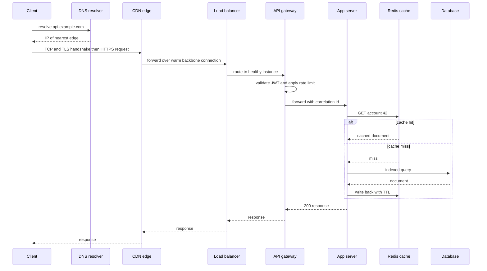

# Anatomy of a Web Request

Before designing systems, you need a precise mental model of what happens when a client calls an API — because every component you will ever add (CDN, load balancer, gateway, cache) is inserted somewhere on this path, and every latency budget is spent along it. This note walks one HTTPS request from a phone to a backend and back, naming each hop, what it does, and what it costs. Almost every "why is this endpoint slow?" investigation is a walk down this list.

## Why this matters

- **Every architecture diagram is a variation of this path.** Once you know the canonical journey, new components slot into known positions: [[CDN]] before the origin, [[Load Balancers|load balancer]] before the app tier, [[Caching Strategies|cache]] beside the database.
- **Latency budgets are additive.** A "200 ms p99" target is spent hop by hop; knowing the typical cost of each hop ([[Latency Numbers Every Engineer Should Know]]) tells you where optimization is worth it and where it is noise.
- **Each hop is a failure domain.** DNS misconfiguration, an exhausted connection pool, a cold cache — each produces a distinct symptom. Debugging distributed systems is largely mapping a symptom back to a hop.

## How it works

The canonical path for `GET https://api.example.com/v1/accounts/42`:

### 1. DNS resolution — name to IP

The client asks a resolver for `api.example.com`. If cached (device, OS, or resolver cache), this is near-free; a cold recursive lookup walks root → TLD → authoritative servers and can cost tens of milliseconds. TTLs control cache lifetime, which is why DNS doubles as a crude failover and traffic-steering tool. Details in [[How DNS Works]]. For a global service, DNS often returns the IP of the nearest edge location (latency-based or geo routing).

### 2. Transport setup — TCP and TLS handshakes

The client opens a TCP connection (1 round trip for SYN/SYN-ACK/ACK) and negotiates TLS (1 more round trip on TLS 1.3; 2 on TLS 1.2). **Handshake cost scales with round-trip time (RTT)**, which is why distance matters so much: at ~1 ms RTT inside a region these are invisible; at ~200 ms cross-continent RTT a cold TLS 1.2 connection burns ~600 ms before the first byte of the request is sent. Persistent connections (HTTP keep-alive) and session resumption exist precisely to amortize this — see [[TLS and HTTPS]] and [[TCP vs UDP]]. HTTP/3 over QUIC folds transport and TLS setup together ([[HTTP 1.1 vs HTTP 2 vs HTTP 3]]).

### 3. CDN / edge — terminate close to the user

For global services the connection usually terminates at a [[CDN]] edge point-of-presence (CloudFront in your world) near the user. The edge can (a) serve cached static content outright, (b) terminate TLS so the expensive handshake happens over a short RTT, and (c) forward dynamic requests to the origin over pre-warmed backbone connections. Even for uncacheable API traffic, edge termination alone can save a large fraction of connection-setup latency.

### 4. Load balancer — pick a healthy server

The request reaches the origin's [[Load Balancers|load balancer]] (an ALB, in AWS terms). An L4 balancer forwards TCP flows; an L7 balancer parses HTTP and can route by path or header. It spreads load across instances, health-checks them, and quietly removes dead ones — the first building block of horizontal scaling ([[Vertical vs Horizontal Scaling]]) and high availability ([[Availability Reliability Durability]]). Cost: typically well under a millisecond of added latency.

### 5. API gateway — the policy layer

Behind (or merged with) the load balancer sits an [[API Gateway]] — Kong, in your stack. It authenticates the caller (validating a JWT — [[How JWT Works]]), applies [[Rate Limiting]], routes to the right backend service, and attaches metadata such as a correlation ID. The gateway is where *cross-cutting* concerns live so that individual services don't reimplement them. Cost: typically single-digit milliseconds, dominated by auth logic.

### 6. Application server — your code, finally

The request lands on an app server (a Spring Boot pod on EKS, behind a Kubernetes Service that performs one more internal load-balancing step). The handler runs business logic and almost always needs data, which triggers the next hops. If the service is [[Stateless vs Stateful Services|stateless]], *any* replica could have served this request — that property is what made steps 4–5 free to pick an arbitrary pod.

### 7. Cache lookup — try to avoid the database

The app checks a cache first — typically Redis under a cache-aside policy ([[Caching Strategies]]). A hit costs a sub-millisecond network round trip within the datacenter plus lookup time: call it ~1 ms. A miss costs the same *plus* the full database query *plus* a write-back. Cache hit ratio is therefore one of the highest-leverage numbers in the whole path ([[Why Caching Works]]).

### 8. Database — the floor of your latency

On a miss, the app queries the database (MongoDB in your world). An indexed point read from a warm database typically costs single-digit milliseconds; a query missing an index, hitting disk, or scanning large ranges can cost hundreds ([[Database Indexes]], [[How Databases Store Data]]). The app may also call other services here — each one recursively repeating steps 4–8 of this journey, which is how microservice latencies compound ([[Communication Patterns Between Services]]).

### 9. The response walks back

The app serializes a response; it flows back through gateway → load balancer → edge → client over the already-open connections (no new handshakes). Large payloads add transfer time proportional to size and bandwidth ([[Latency vs Throughput vs Bandwidth]]).

### Where the latency actually accumulates

| Hop | Typical cost (warm path) | Worst case / cold path |
|---|---|---|
| DNS | ~0 ms (cached) | tens of ms (cold recursive lookup) |
| TCP + TLS handshake | ~0 ms (reused connection) | 2–3 × RTT — hundreds of ms cross-continent |
| CDN edge forward | a few ms | tens of ms if poorly routed |
| Load balancer | < 1 ms | — |
| API gateway | 1–10 ms | more if auth calls out to another service |
| App logic | 1–10 ms | unbounded (bad code, GC pauses, thread-pool waits) |
| Cache hit | ~1 ms | — |
| DB indexed read | 1–10 ms | 100 ms+ (missing index, cold buffer pool, lock waits) |
| Downstream service calls | each repeats hops 4–8 | fan-out multiplies tail latency — [[Latency vs Throughput vs Bandwidth]] |

Two structural lessons fall out of the table. First, **on the warm path, the database and your own code dominate** — the networking layers are cheap once connections exist. Second, **the cold path is dominated by round trips**, so the levers are fewer round trips (persistent connections, HTTP/2 multiplexing, session resumption) and shorter ones (edge termination, regional deployment). All the numbers above are order-of-magnitude figures, not benchmarks — calibrate against [[Latency Numbers Every Engineer Should Know]].

## Common misconceptions

- **"The network inside the datacenter is the slow part."** Same-DC round trips are ~0.5 ms. The slow parts are disk-bound database work, lock contention, and fan-out to other services. Cross-*region* networking is the exception — that genuinely is slow.
- **"DNS happens on every request."** It is cached at several layers; most requests never touch it. But when TTLs expire during an incident or a failover changes records, DNS suddenly matters a great deal ([[How DNS Works]]).
- **"HTTPS is expensive."** The handshake is; steady-state encryption is cheap on modern CPUs. The fix is connection reuse, not dropping TLS.
- **"A CDN only helps static sites."** Edge termination of TLS and warm origin connections speed up pure API traffic too — see [[CDN]].

## In your stack

- Your concrete path is: client → CloudFront → ALB → Kong on EKS → Spring Boot service pod → Redis → MongoDB. Mapping any production latency complaint onto those hops, in that order, is a reliable triage method.
- The `x-correlation-id` header your services attach at the first hop is what lets you reconstruct this entire journey from logs — one ID stitching together gateway, service, and downstream entries ([[Distributed Tracing]]).
- Kubernetes adds a hidden extra hop: the Service/kube-proxy layer load-balances pod-to-pod traffic *inside* the cluster, and readiness probes decide which pods receive traffic at all ([[Health Checks and Service Discovery]]).
- Services pinned at 1 replica make step 4 degenerate: the balancer has no healthy alternative during a pod restart or node drain, so deploys and evictions appear in this path as connection errors rather than as rerouted traffic.
- CORS, TLS termination, and coarse rate limiting live at CloudFront/ALB/Kong in your fleet — keeping them at the edge keeps every Spring Boot service simpler, at the price of trusting edge configuration.

## Interview angle

- "Walk me through what happens when you type a URL" is a classic screening question; the API-request variant is the system-design warm-up. Interviewers listen for *ordering*, for knowing what each hop is *for*, and for latency intuition at each step.
- **60-second version**: "DNS resolves the name, usually from cache. The client does TCP and TLS handshakes — round-trip-bound, so edges and connection reuse matter. The request hits a CDN edge, then the origin load balancer, then an API gateway doing auth and rate limiting, then an app server. The app tries cache first, falls back to the database on a miss, and the response returns over the open connections. Warm-path latency is dominated by the database and app logic; cold-path latency by round trips."
- Classic follow-ups: "Where would you add caching?" (edge for static, Redis for hot reads, and note [[Cache Invalidation]] costs); "What fails if DNS is misconfigured vs if the LB dies?"; "Why is the first request after a deploy slow?" (cold connections, cold caches, JIT warm-up); "How does this change for WebSockets?" ([[WebSockets Server-Sent Events and Long Polling]] — the connection becomes long-lived and stateful).

## Check yourself

> [!question]- Q: Explain why the first request to a cross-region API can take over half a second even when the server processes it in 5 ms.
> The cold path is round-trip-bound: a cold DNS lookup, then a TCP handshake (1 RTT) and TLS negotiation (1 RTT on 1.3, 2 on 1.2), each costing a full cross-region round trip of roughly 150–250 ms. Three round trips at ~200 ms is ~600 ms before the request is even sent. Server time is a rounding error; the fix is edge termination, connection reuse, and session resumption rather than faster server code.

> [!question]- Q: What happens if Redis becomes unreachable in the path above? Trace the symptom from the user's point of view.
> Every request that would have hit cache now either fails fast (if the app treats Redis errors as a miss) or hangs on connection timeouts (if it doesn't — much worse). Misses all land on MongoDB at once, multiplying its load exactly when there's no cache to absorb it; DB latency climbs, app threads block, the pool saturates, and users see timeouts — a mini [[Cache Stampede and Thundering Herd|stampede]]. Correct behavior is treating cache failure as a miss with a short timeout, plus load shedding if the DB can't take full traffic ([[Load Shedding and Graceful Degradation]]).

> [!question]- Q: Your p99 for one endpoint is 800 ms but p50 is 30 ms. Using the hop table, where do you look first and why?
> A healthy median with a bad tail points at conditional costs, not fixed ones: cache misses falling through to slow DB queries, queries that occasionally miss an index or hit lock contention, GC pauses, connection-pool exhaustion under bursts, or a slow downstream dependency hit by a fraction of requests. Check cache hit ratio, DB slow-query logs, and per-hop timings from tracing. Fixed-cost hops (LB, gateway) can't produce a 25x p50-to-p99 gap — see [[Latency vs Throughput vs Bandwidth]] on tail latency.

> [!question]- Q: Mini design prompt — you must cut p99 from 400 ms to 150 ms for a read-heavy endpoint serving users in India from a US-hosted backend. Which hops do you attack, in what order?
> First the physics: ~200 ms+ India↔US RTT makes the target impossible while every request crosses the ocean, so either serve reads from an India region (read replica or regional deployment — [[Replication]]) or cache aggressively at a CloudFront edge in India. Second, eliminate handshakes with edge TLS termination and keep-alive. Third, warm-path work: Redis cache-aside for the hot reads, verify DB indexes. Order matters — no backend tuning can beat a 200 ms geographic floor ([[Latency Numbers Every Engineer Should Know]]).

## Sources

- *High Performance Browser Networking*, Ilya Grigorik (O'Reilly, free online at hpbn.co) — the definitive treatment of DNS, TCP, TLS, and HTTP latency costs.
- Alex Xu, *System Design Interview Vol. 1* — ch. 1 builds this same path incrementally from a single server.
- Cloudflare Learning Center — accessible, accurate explainers on DNS resolution, TLS handshakes, and CDN mechanics.
- AWS documentation: "How CloudFront delivers content" and ALB request-routing docs — the concrete behavior of the edge and LB hops in your stack.
