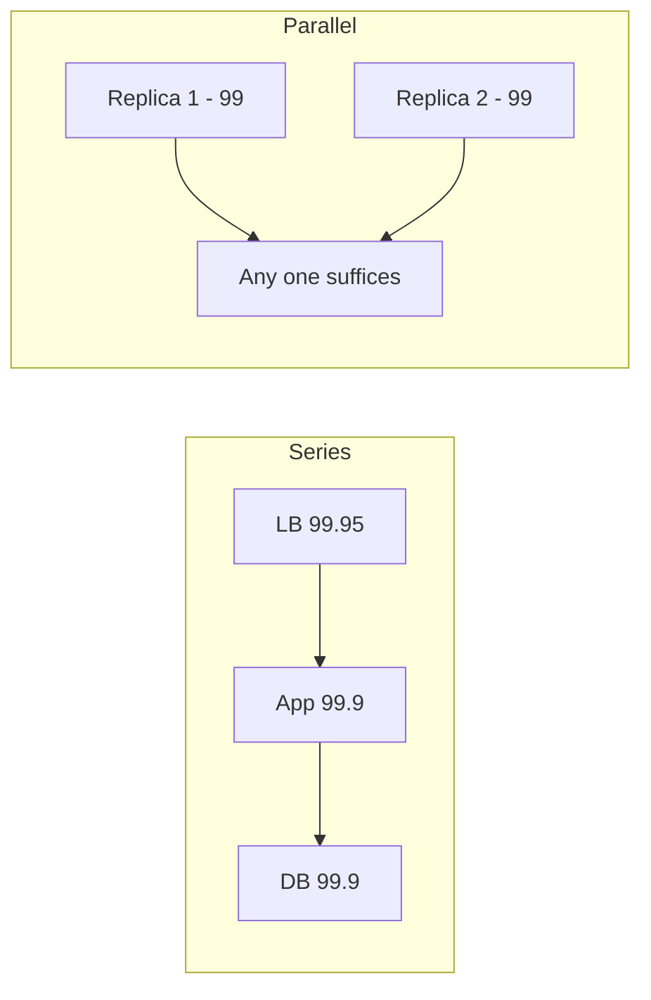

# Availability Reliability Durability

Three different promises that get collapsed into the word "reliable": **availability** — is the system answering right now?; **reliability** — does it keep working correctly over time, without failures?; **durability** — once data is acknowledged, will it still exist later, no matter what crashes? A system can be any combination: a cache is available but not durable; a tape archive is durable but barely available; a flaky service that corrupts 0.1% of responses may be "up" and still unreliable. Designing means choosing a target for each — and paying for each separately.

## Why this matters

- **Each property has a different price and a different mechanism.** Availability is bought with redundancy and [[Failover|failover]]; durability with [[Replication|replication]], write-ahead logs, and backups; reliability with correctness engineering, testing, and [[Chaos Engineering|failure injection]]. Budgeting "reliability" as one line item produces systems that are up but wrong, or durable but down.
- **The math is unforgiving and composable.** Availability of chained components multiplies *down*; redundancy multiplies failure probabilities *down*. Knowing the two formulas lets you compute, not vibe, your architecture's ceiling.
- **In fintech the hierarchy is explicit**: durability of the ledger > correctness > availability > latency. An outage is an incident; a lost or wrong transaction is a regulator conversation ([[What Is System Design]]).

## How it works

### Definitions, precisely

- **Availability** — the fraction of time (or of requests) the system is able to serve correctly. Measured as uptime/total time, or better, successful-requests/total-requests over a window ([[SLA SLO SLI and Error Budgets]] covers measurement).
- **Reliability** — the probability the system performs its intended function, correctly, for a duration. Classical metrics: **MTBF** (mean time between failures) and **MTTR** (mean time to repair). The two connect: *availability = MTBF / (MTBF + MTTR)* — you raise availability either by failing less often (MTBF) or recovering faster (MTTR). Modern practice leans hard on MTTR: failures are assumed, recovery speed is engineered ([[Failure Modes in Distributed Systems]]).
- **Durability** — the probability that data, once acknowledged as written, is never lost — across crashes, disk deaths, even datacenter loss. Mechanisms: fsync + write-ahead logs ([[How Databases Store Data]]), multi-node/multi-AZ [[Replication]], erasure coding ([[How S3 Works]]), and backups ([[Disaster Recovery]]).

### The nines table (computed, not folklore)

"Nines" express availability as 99.…%. Downtime per year = (1 − availability) × 8,760 hours (365 × 24):

| Availability | Downtime/year | Downtime/30-day month | Downtime/day (avg) |
|---|---|---|---|
| 99% ("two nines") | 87.6 h | 7.2 h | ~14.4 min |
| 99.9% ("three nines") | 8.76 h | 43.2 min | ~1.44 min |
| 99.95% | 4.38 h | 21.6 min | ~43 s |
| 99.99% ("four nines") | 52.56 min | 4.32 min | ~8.6 s |
| 99.999% ("five nines") | 5.26 min | 25.9 s | ~0.86 s |

Reading the table honestly: **three nines allows almost nine hours a year** — a bad deploy and two incidents; most well-run single-region services live here. **Four nines allows under an hour a year** — no human can detect+respond that fast consistently, so it requires automated [[Failover]], [[Health Checks and Service Discovery|health-checked]] redundancy, and careful [[Deployment Strategies|deployments]]. **Five nines allows five minutes a year** — effectively no room for *any* human-in-the-loop process; it's telecom/core-infrastructure territory and enormously expensive. Each nine costs roughly an order of magnitude more engineering ([[SLA SLO SLI and Error Budgets]] asks whether users can even tell).

### Composition math — series kills, redundancy saves

**Series (chain) — multiply availabilities.** If a request needs every one of N components, overall availability = product of each:

> Gateway (99.95%) × Service (99.9%) × Database (99.9%) × Cache (99.95%)
> = 0.9995 × 0.999 × 0.999 × 0.9995 ≈ **99.7%** ≈ 26 hours/year.

Four individually respectable components chain into something notably worse than any of them. Every box added to the critical path in [[Anatomy of a Web Request]] taxes availability — the quantitative argument against long synchronous chains of microservices ([[Communication Patterns Between Services]], [[Why Async Messaging Exists]]).

**Redundancy (parallel) — multiply unavailabilities.** If any one of N independent replicas can serve, unavailability = (1 − A)^N:

> Two independent 99% nodes: 1 − (0.01)² = **99.99%**.
> Three: 1 − (0.01)³ = **99.9999%**.

Two mediocre machines beat one excellent machine on this axis — the availability half of the argument for [[Vertical vs Horizontal Scaling|horizontal scaling]] and [[Replication]], the cost curve being the other half. But the formula's fine print is where real systems fail:

- **"Independent" is the load-bearing word.** Replicas sharing a power feed, AZ, bad deploy, config push, or certificate expiry fail *together* — correlated failure makes the exponent a lie. Hence multi-AZ placement, staggered rollouts, and [[Chaos Engineering]].
- **The redundancy mechanism itself must work**: detection + [[Failover]] takes time and can itself fail ([[Split Brain and Fencing]]). Real availability = ideal math minus failover misadventures.

**Putting a number on "independent."** Model the shared cause as a floor. Suppose each replica is independently 99% available *and* some common cause — a bad config push, an AZ event, an expired certificate — takes every replica down 0.05% of the time. Then total unavailability ≈ (1 − A)ᴺ + c, and the shape of the investment changes completely:

| Replicas | Ideal, fully independent | With a 0.05% shared-cause floor | What the marginal replica bought |
|---|---|---|---|
| 1 | 99% | 98.95% | — |
| 2 | 99.99% | 99.94% | +0.99 points |
| 3 | 99.9999% | 99.9499% | +0.01 points |
| 4 | 99.999999% | 99.95% | nothing measurable |

The model is crude — it treats the shared cause and the independent failures as non-overlapping — but no refinement changes the conclusion: **past two replicas the ceiling is set by the correlated term, not the count.** The second replica is transformative; the third is a rounding error; the fourth is a line item. The engineering that actually moves the number past N=2 is attacking the shared cause — separate AZs, staggered rollouts, independent certificate renewal alarms, limited blast radius ([[Bulkheads and Isolation]], [[Chaos Engineering]]) — not buying more copies of the same correlated thing.

### Durability vs availability — the S3 lesson

The sharpest illustration that these are different promises: **Amazon S3 is designed for 99.999999999% (11 nines) durability of objects, but offers ~99.99% availability design / 99.9% SLA** (S3 Standard, as of 2026). Eleven nines durability means statistically ~1 object lost per 10 million objects per 10,000 years — the arithmetic being a per-object annual loss probability of 10⁻¹¹ applied to 10⁷ objects, giving an expected 10⁻⁴ losses per year, i.e. one every ten thousand years — achieved by [[How S3 Works|erasure-coding each object across devices in ≥3 AZs]]. Yet on any given day S3 can be unreachable for minutes without breaking that promise: **your data exists; you just can't reach it right now.**

The decoupling works both ways:

- **Durable but unavailable**: S3 during an outage; a tape vault; a database whose only node is down but whose disk and backups are intact.
- **Available but not durable**: Redis serving from memory (an [[Redis Internals|RDB snapshot]] loses recent writes on crash); any system acknowledging writes before fsync/replication.

### What an "acknowledged write" actually promises

"Durable" is not a property a database has; it is a setting you chose, often by not choosing. Each row below is a real, commonly-deployed acknowledgement policy, and they differ by orders of magnitude in what survives:

| Ack policy | Survives process crash | Survives machine or disk loss | Survives AZ loss | Survives a bad `DELETE` | Write cost |
|---|---|---|---|---|---|
| In memory only, no flush before ack | No | No | No | No | microseconds |
| Written to OS page cache, no fsync | Yes | No | No | No | memory copy |
| fsync to local disk, single node | Yes | No | No | No | one disk flush |
| Replicated to ≥1 node, same AZ | Yes | Yes | No | No | one network round trip |
| Majority across ≥2 AZs — Mongo's `w:majority` | Yes | Yes | Yes | No | cross-AZ round trip |
| The above plus point-in-time backups kept off the write path | Yes | Yes | Yes | **Yes** | above, plus backup lag as your RPO |

Two readings. First, moving down the table buys survival against progressively rarer and larger failures, and each step costs latency on every single write — which is why the choice belongs to the *data class*, not to the database. Second, only the last row survives the failure that actually destroys companies: a syntactically valid, correctly replicated, instantly propagated destructive statement. Replication is a durability mechanism against hardware; backups are the only durability mechanism against people and bugs ([[Disaster Recovery]]).

Design rule: decide **per data class**. A ledger entry needs maximum durability (synchronous multi-AZ replication before ack) and merely good availability. A session token needs availability and near-zero durability. Paying durability costs (sync replication latency) for throwaway data — or vice versa — is a classic resource misallocation ([[Caching Strategies]], [[Disaster Recovery]] for RPO/RTO vocabulary).

### What actually buys each property

A quick reference mapping each promise to its mechanisms — useful because proposals routinely claim one property while funding another:

| Property | Primary mechanisms | What it costs |
|---|---|---|
| Availability | Redundant replicas in independent failure domains; [[Load Balancers|health-checked routing]]; automated [[Failover]]; [[Timeouts Retries and Exponential Backoff|retries]]; [[Load Shedding and Graceful Degradation|degradation paths]] | Spare capacity, failover complexity, consistency tension |
| Reliability (correctness over time) | Testing, [[Idempotency]], reconciliation jobs, [[Chaos Engineering|failure injection]], gradual [[Deployment Strategies|rollouts]], monitoring for *wrong answers* not just errors | Engineering discipline, slower releases |
| Durability | WAL + fsync before ack ([[How Databases Store Data]]), majority/multi-AZ [[Replication]], erasure coding, versioning, point-in-time backups kept *offline from the write path* | Write latency, storage multiple, backup ops |

Two composition notes worth internalizing: a **dependency you call synchronously donates its unavailability to you** (series math), while a **dependency you call asynchronously donates only staleness** — converting a sync call to a queued one ([[Why Async Messaging Exists]]) is often the cheapest availability purchase in the catalog. And MTTR is usually the better investment than MTBF: you control detection and rollback speed far more than you control the universe of possible faults ([[Alerting and On-Call Design]], [[Deployment Strategies]]).

That last claim is an identity, not a rule of thumb. Since A = M / (M + R), halving the repair time gives M / (M + R/2) = 2M / (2M + R) — algebraically the same availability as doubling MTBF. Worked through: a service that fails once every 30 days (MTBF = 720 h) and takes an hour to recover is 720 / 721 = **99.861%**, about 12.2 hours of downtime a year. Halve recovery to 30 minutes and you get 720 / 720.5 = **99.931%**, about 6.1 hours. Double MTBF to 60 days instead, keeping the one-hour recovery, and you get 1,440 / 1,441 = **99.931%** — the identical number. One of those two projects is "add a rollback button and an alert"; the other is "make the universe stop producing faults."

## Common misconceptions

- **"We have five nines" (said casually).** Five nines is 5.26 min/year *including* deploys, dependency outages, and cert expiries. Almost nobody has it end-to-end; claiming it without per-component math and automated failover is marketing. Compute the chain product first.
- **"Redundancy = availability."** Only against *independent* failures, and only if failover actually works. A 2-replica system behind one misconfigured load balancer, in one AZ, on one bad config push, is a 1-replica system with extra cost.
- **"Durable because replicated."** Replication copies deletes and corruption too — `DROP TABLE` replicates at light speed. Durability against *operator error and bugs* requires point-in-time backups/versioning, not just replicas ([[Disaster Recovery]]).
- **"Availability is about servers."** Users experience the *whole chain* — DNS, CDN, LB, app, DB ([[Anatomy of a Web Request]]). Measuring server uptime while requests fail at the gateway is measuring the wrong thing ([[SLA SLO SLI and Error Budgets]]).
- **"Reliability = availability."** A service returning HTTP 200 with wrong balances is 100% available and 0% reliable. Correctness is a separate engineering track (testing, idempotency, reconciliation) from uptime.

## In your stack

- Services pinned at 1 replica make the redundancy formula explicit: N = 1, so there is no (1 − A)ᴺ term at all — availability is just that pod × its node × its AZ. Deploys are the part people state too broadly: a surge-then-terminate rolling update can be gapless even at one replica ([[Graceful Shutdown and Deployment Safety]]), so the real exposure is **unplanned** loss — eviction, OOM kill, node drain, AZ event — where nothing covers the gap and MTTR is "how long a new pod takes to become ready". The honest statement is "this service targets ~99.5–99.9%, by design, for cost", which is fine *if* chosen per service; a 1-replica service sitting synchronously in a money-movement path donates its entire ceiling to the whole flow by series math.
- Your chain through CloudFront → ALB → Kong → service → Mongo is five components in series, and the product is worth computing once rather than arguing about. Taking illustrative but plausible figures — CloudFront 99.99%, ALB 99.99%, Kong 99.95%, the service 99.9%, Mongo 99.95% — the product is 0.9999 × 0.9999 × 0.9995 × 0.999 × 0.9995 ≈ **99.78%**, about **19.3 hours a year**, before anyone deploys anything. Now add one synchronous call to a downstream 99.9% service: the product falls to ≈ **99.68%**, about **28.0 hours a year**. That single hop cost **8.7 hours annually** — the 0.1% × 8,760 h rule of thumb landing exactly where the formula predicts.
- Making that same downstream call asynchronous — publish to SQS, let a consumer do the work — removes it from the series product entirely and the chain returns to ~99.78%. The dependency now donates *staleness* instead of *unavailability*. For anything that does not have to be resolved inside the user's request — notifications, downstream KYC propagation, analytics writes — this is the cheapest availability in the catalogue ([[Why Async Messaging Exists]], [[The Outbox Pattern]]).
- MongoDB replica sets buy both durability (majority write concern = data on 2+ nodes before ack) and availability (automatic [[Failover|primary election]]) — but only if ledger-class writes actually run at `w:majority` (the implicit default since MongoDB 5.0, except in replica sets with an arbiter where data-bearing voters do not exceed the voting majority — there it is `w:1`); a `w:1` override in a connection string or driver config trades durability back for latency silently ([[MongoDB Architecture]], [[Replication]]).
- Durability tiering you already live: Redis = available, not durable (cache only — anything that must survive goes to Mongo); S3 for documents/KYC artifacts = durable, with availability handled by retry logic; RBI audit expectations push ledger data to the top durability tier with immutable/backup copies ([[Disaster Recovery]]).

### Quick reference — composition formulas

- **Series (all must work)**: A_total = A₁ × A₂ × … × Aₙ. Adding a 99.9% dependency to any path costs ~8.76 h/year of expected unavailability.
- **Parallel (any one suffices)**: A_total = 1 − (1 − A)ⁿ for n independent replicas. Each added independent replica multiplies residual unavailability by (1 − A).
- **Mixed systems**: reduce the diagram — collapse each redundant group to its parallel availability, then multiply along the chain. The weakest *serial* element dominates; redundancy anywhere else is cosmetic.
- **Availability from recovery**: A = MTBF / (MTBF + MTTR). Halving MTTR buys the same availability as doubling MTBF — and is usually far cheaper.

## Interview angle

- Interviewers probe whether you (a) know the nines-to-downtime conversions cold, (b) can do series/parallel math on a proposed diagram, and (c) distinguish durability from availability without prompting — S3 is the canonical example they expect.
- **60-second version**: "Availability: fraction of time it serves correctly — 99.9% is 8.76 hours down a year, 99.99% is 52 minutes. Reliability: working *correctly* over time — MTBF/MTTR. Durability: acknowledged data is never lost. They're bought separately: chained components multiply availability down — four 99.9% components give ~99.6% — while N independent redundant replicas multiply unavailability: two 99% nodes give 99.99%, if failures are truly independent and failover works. S3 is the classic decoupling: 11 nines durability via erasure coding across AZs, but only ~4 nines availability — your data survives outages it's unreachable during."
- Classic follow-ups: "Our 3-tier app has 99.9% per tier — end-to-end?" (≈99.7%, ~26 h/yr); "How do you get four nines from three-nines components?" (redundancy per tier + automated failover + remove serial dependencies); "What breaks the independence assumption?" (shared AZ/config/deploys/certs — correlated failure); "Backup vs replication?" (replication propagates mistakes; backups travel in time).

## Check yourself

> [!question]- Q: Explain availability, reliability, and durability with one system that has each property but lacks another.
> Redis cache: highly available, not durable — crash loses recent data, by design. Tape or a deep-archive storage class: extremely durable, barely available — retrieval is measured in hours, by design. A service with a bug corrupting 1 in 1,000 responses: fully available, unreliable. S3 in a regional outage: durable (objects intact across AZs) but unavailable. The triad decouples because each is produced by a different mechanism: redundancy+failover, correctness engineering, and replicated/backed-up persistence respectively.

> [!question]- Q: Compute: a request path chains Kong (99.95%), a service (99.9%), MongoDB (99.9%), and a downstream service (99.9%). What's the best-case end-to-end availability, and what does it mean per year?
> 0.9995 × 0.999 × 0.999 × 0.999 ≈ 0.9965 → ~99.65%, i.e. ~30.6 hours of expected unavailability per year — despite every component being "three nines or better". And that's optimistic: it assumes failures never overlap with peak traffic and ignores deploys. Lesson: every serial dependency taxes the product; shorten chains or make hops async.

> [!question]- Q: What happens if you "add a second replica for availability" but both replicas run in the same AZ, deploy from the same pipeline within minutes of each other, and share one certificate?
> The redundancy formula assumes independent failures; these replicas share their top failure causes — AZ outage, bad deploy, cert expiry — so they fail together exactly when redundancy was supposed to pay off. Measured availability improves only against uncorrelated events (single-pod OOM, node hardware). Fixes: spread AZs, stagger rollouts ([[Deployment Strategies]]), independent cert renewal alerts, and test the failover path ([[Chaos Engineering]]).

> [!question]- Q: Your team wants "five nines" for a new service. Walk through the reality check you'd run before agreeing.
> First convert it: 99.999% = 5.26 minutes/year total, including deploys, dependency outages, cert renewals, and cloud events. Then the chain: multiply the realistic availability of every serial dependency (gateway, DB, downstream services, DNS) — if the product is below five nines, the target is arithmetically impossible without removing dependencies. Then the mechanism: five nines requires automated failover faster than human response, multi-AZ (likely multi-region) redundancy, and near-zero-downtime deploys — each a project, not a setting. Usually the honest counter-proposal: three-and-a-half to four nines on the critical user journey, bought with redundancy where the math says it pays ([[SLA SLO SLI and Error Budgets]]).

> [!question]- Q: You run two replicas of a 99%-available service and a colleague proposes a third "for another nine". When are they right, and when are they buying nothing?
> They are right only if the dominant remaining failures are *independent* — single-pod OOM, one bad node, one hardware fault. Under the ideal formula a third replica moves 99.99% to 99.9999%, which is a genuine nine. They are buying nothing if a shared cause dominates: with even a 0.05% correlated-failure floor, two replicas give 99.94% and three give 99.95% — a hundredth of a percentage point, where the second replica had bought a full point. The diagnostic is to look at the last ten incidents: if most took out every replica at once (a config push, an AZ event, a certificate, a dependency), the third replica is dead money and the budget belongs in separating failure domains and limiting blast radius instead.

> [!question]- Q: A team proposes halving the frequency of production incidents as this year's reliability goal. What cheaper alternative gives identical availability, and prove it?
> Halving MTTR gives exactly the same availability as doubling MTBF, because A = M/(M+R) and M/(M + R/2) = 2M/(2M + R) algebraically. Concretely: failing once every 30 days with a one-hour recovery is 720/721 = 99.861%, roughly 12.2 h/year. Recover in 30 minutes instead and you get 720/720.5 = 99.931%, roughly 6.1 h/year; fail only once every 60 days with the same one-hour recovery and you get 1,440/1,441 = 99.931% — the same figure. The difference is cost and controllability: faster recovery is rollback automation, better alerting, rehearsed runbooks and automated [[Failover]], all of which you own; fewer faults means eliminating causes you often do not control, like a cloud provider's hardware or a partner bank's API ([[Alerting and On-Call Design]]).

> [!question]- Q: Mini design prompt — for a payments ledger write, choose and justify settings along the durability/availability/latency triangle.
> Durability first: acknowledge only after the write is on a majority of replicas across ≥2 AZs (`w:majority` in Mongo terms) and in the WAL — a crash or AZ loss must not lose an acknowledged debit. This costs latency (tens of ms) — acceptable, correctness beats speed in money movement. Availability: automatic failover with [[Split Brain and Fencing|fencing]] so a partitioned old primary can't accept writes (fail closed). Add [[Idempotency|idempotency keys]] so retries after failover don't double-post, and point-in-time backups because replication won't undo a bad migration. Explicitly *don't* chase five nines of availability: a brief, visible "try again" beats any chance of a wrong ledger.

## Sources

- *Designing Data-Intensive Applications*, Kleppmann — ch. 1 (reliability definitions, fault vs failure) and ch. 5 (replication's role in durability and availability).
- Google SRE Book (O'Reilly, 2016) — ch. 3 "Embracing Risk": time- vs request-based availability and the cost-per-nine argument; Appendix A: the availability table; ch. 1 frames reliability as a function of MTTF and MTTR.
- AWS S3 official documentation & FAQs — the 11-nines durability design statement, S3 Standard availability design (99.99%) and SLA (99.9%); mechanism detail in [[How S3 Works]].
- AWS Builders' Library — "Static stability" and related articles on correlated failure and multi-AZ design.
