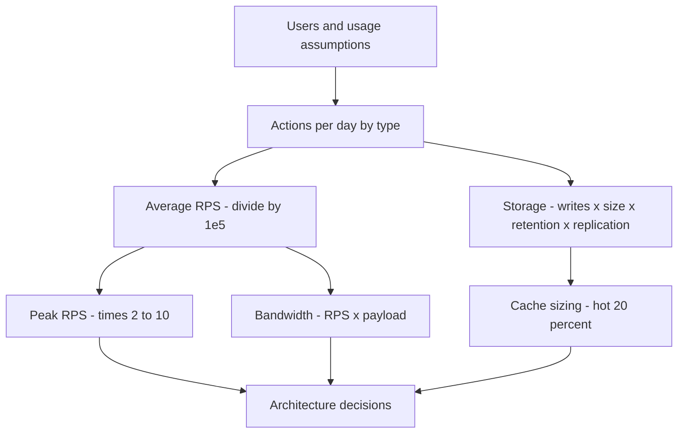

# Back of the Envelope Estimation

Back-of-the-envelope estimation is the practice of computing rough system numbers — requests per second, storage, bandwidth, server counts — from a few assumptions, using aggressive rounding. The goal is never precision; it is **order of magnitude**: does this fit on one machine or a hundred? Is the hot dataset 5 GB (RAM) or 5 TB ([[Sharding|shard it]])? The habit, attributed to Jeff Dean as one of a good engineer's core skills, is what separates "I think we need Kafka" from "we have ~100 writes/sec; a single Postgres yawns at this." In interviews it's a scored step ([[The System Design Interview Framework]]); at work it's how you sanity-check designs before building them.

## Why this matters

- **Estimates choose architectures.** 1,000 RPS vs 100,000 RPS is the difference between "one service, one DB" and "[[Load Balancers|LB]] fleets, [[Caching Strategies|cache layers]], partitioned storage" ([[Scalability]]). You can't pick the right design without knowing which problem you have.
- **It kills bad ideas in minutes, not sprints.** "Scan 10 TB per user request" dies the moment you multiply by [[Latency Numbers Every Engineer Should Know|disk throughput]].
- **It's the interview's explicit scoring checkpoint**: interviewers watch whether you estimate unprompted, round sensibly, and *use the result* to justify later choices — estimating and then ignoring the numbers scores worse than not estimating.

## How it works

### The standard pipeline: users → DAU → RPS → storage → bandwidth

1. **Users → DAU.** Start from total/monthly users, take a daily-active fraction (commonly 10–50% depending on product; state your assumption).
2. **DAU → actions/day.** Actions per user per day, split by operation type (reads vs writes — the ratio drives everything downstream).
3. **Actions/day → average RPS.** Divide by seconds per day, using the rounding convention **1 day ≈ 10⁵ seconds** (86,400 rounded; it's ~16% off, which is noise at this precision).
4. **Average → peak RPS.** Multiply by a **peak factor** — 2–3× for smooth global traffic, 5–10× for single-geography or event-driven spikes. Systems are sized for peak ([[Capacity Planning]]).
5. **Storage.** Writes/day × object size × retention days × a replication factor (typically 3× — [[Replication]]). Add index/metadata overhead if material.
6. **Bandwidth.** RPS × payload size, separately for ingress (writes) and egress (reads — usually dominant).
7. **Memory for cache.** A common heuristic: cache the hottest ~20% of daily read volume (the 80/20 skew — [[Why Caching Works]]), or cache one day's hot objects.

### Numbers and conversions to keep loaded

**Powers of two (storage math):**

| Power | Exact-ish | Name |
|---|---|---|
| 2¹⁰ | ~10³ | KB (kibi) |
| 2²⁰ | ~10⁶ | MB (mebi) |
| 2³⁰ | ~10⁹ | GB (gibi) |
| 2⁴⁰ | ~10¹² | TB (tebi) |
| 2⁵⁰ | ~10¹⁵ | PB (pebi) |

At envelope precision, treat 2¹⁰ ≈ 10³ and never apologize for it.

**SI shortcuts and time constants:**

- 1 million = 10⁶, 1 billion = 10⁹ — practice ×/÷ across these without a calculator.
- **1 day ≈ 10⁵ s** (86,400). 1 month ≈ 2.5 × 10⁶ s. **1 year ≈ 3 × 10⁷ s** (31.5M). 1 year ≈ 400 days for easy ×storage math.
- Handy pivot: **1 action per user per day at 1M DAU ≈ 10 RPS average** (10⁶/10⁵). Scale linearly: 100M DAU × 10 actions ≈ 10⁴ RPS.
- Char ≈ 1 byte (ASCII/UTF-8 English), long/pointer = 8 B, UUID string = 36 B, typical JSON metadata row = 0.5–2 KB, smartphone photo ≈ 2–5 MB, 1080p video ≈ 2–5 Mbps.

**Rules of engagement:**

- Round brutally: 86,400 → 100K; 365 → 400; 4.6K × 75 → "~350K". Keep one significant figure until the final answer.
- Write assumptions down as you make them ("assume 10:1 read:write") — the assumptions are the deliverable; anyone can redo the arithmetic.
- Sanity-check against reality: compare your result to known systems and to [[Latency Numbers Every Engineer Should Know|hardware limits]] (a modern server handles ~10K+ simple RPS; one NVMe does GB/s sequential).
- Compute *both* average and peak, and say which you're sizing for.

### Worked example 1 — Twitter-like feed service

Assumptions (stated, round): 200M DAU; each user posts 0.5 tweets/day and reads 100 timeline tweets/day; tweet = 140 chars + metadata ≈ 300 B; media on 10% of tweets ≈ 1 MB average; 5-year retention; 3× replication; peak = 3× average.

- **Write RPS**: 200M × 0.5 = 10⁸ tweets/day ÷ 10⁵ s = **~1,000 tweets/sec average, ~3,000/sec peak.**
- **Read RPS**: 200M × 100 = 2 × 10¹⁰ reads/day ÷ 10⁵ = **~200,000 reads/sec average, ~600K/sec peak.** Read:write ratio = 200:1 → read-optimized design: precomputed timelines, heavy caching ([[Scalability]]'s fan-out discussion, [[Twitter Timeline Design]]).
- **Fan-out writes**: at ~200 average followers, 1,000 tweets/sec × 200 = **200K timeline-inserts/sec** — the hidden load that dwarfs the visible write RPS ([[Design a News Feed]]).
- **Text storage**: 10⁸ tweets/day × 300 B = 30 GB/day → × 400 days ≈ 12 TB/year → 5 years = 60 TB raw, **~180 TB with 3× replication.** Modest — text is never the problem.
- **Media storage**: 10⁷ media/day × 1 MB = 10 TB/day → **~4 PB/year before replication** — media dominates by 2+ orders of magnitude → object storage + [[CDN]] ([[How S3 Works]]), not the database.
- **Egress bandwidth**: 200K reads/sec × 300 B ≈ 60 MB/s for text — trivial; media egress at even 1% of reads pulling 1 MB ≈ 2 GB/s → CDN mandatory.
- **Timeline cache**: cache 1 day of timelines for active users: 200M × 100 tweet-refs × ~20 B/ref ≈ 400 GB — a Redis *cluster*, not one node ([[Redis Cluster and Sentinel]]).

Decisions the numbers just made: read-optimized fan-out-on-write with celebrity exception; media to object store + CDN; timeline cache sharded across ~10+ nodes; the SQL-vs-NoSQL debate matters less than the 200:1 ratio.

### Worked example 2 — URL shortener

Assumptions: 100M new URLs/month; 10:1 read:write; URL record ≈ 500 B (long URL + short code + metadata); 10-year retention; peak 2×.

- **Write RPS**: 100M/month ÷ 2.5 × 10⁶ s = **40 writes/sec** (80 peak). Tiny.
- **Read RPS**: ×10 = **400 reads/sec** (800 peak). Still tiny — one good server territory; the interesting problems are elsewhere.
- **Storage**: 100M × 12 × 10 years = 1.2 × 10¹⁰ records × 500 B = **6 TB over 10 years** (18 TB replicated) — fits a single well-indexed database with room to spare; [[Sharding]] is optional, not required.
- **Key space**: Base62, 7 chars = 62⁷ ≈ 3.5 × 10¹² — thousands of years of IDs at this rate; 6 chars (≈5.7 × 10¹⁰) is already enough for ~40 years. → short code length is a math decision, not a guess ([[Design a Distributed ID Generator]]).
- **Cache**: 80/20 rule on daily reads: 400 × 10⁵ = 4 × 10⁷ reads/day; hot 20% of *objects* likely serve 80%+ of hits; caching ~1M hot mappings × 500 B = **500 MB** — one small Redis node makes the DB nearly idle ([[Why Caching Works]]).
- **Bandwidth**: 400 × 500 B = 200 KB/s egress. A phone tether could serve it.

Decisions made: this is an *availability and latency* problem (redirects must be fast and always up — [[Availability Reliability Durability]]), not a scale problem; single DB + cache + [[Load Balancers|replicated stateless redirect tier]]; the design conversation should spend its time on ID generation and cache policy ([[Design a URL Shortener]]).

### The one-card cheat sheet

Worth literally memorizing before an interview loop:

- 1 day ≈ **10⁵ s**; 1 month ≈ 2.5 × 10⁶ s; 1 year ≈ **3 × 10⁷ s** ≈ 400 days.
- **1M DAU × 1 action/day ≈ 10 RPS average**; peak = 2–10× average.
- 2¹⁰ ≈ 10³: KB→MB→GB→TB→PB each ×1,000.
- Storage = writes/day × size × retention × **3 (replication)**; add ~50% for indexes on row stores.
- Cache ≈ hot **20%** of the working set; 1M cached objects × 1 KB = 1 GB.
- One modern server: ~10K+ simple RPS, GB/s-scale NVMe sequential I/O; one Redis node: ~100K+ simple ops/sec ([[Latency Numbers Every Engineer Should Know]]).

## Common misconceptions

- **"The goal is an accurate number."** The goal is a *defensible magnitude*. 1,000 vs 1,400 RPS changes nothing; 1,000 vs 100,000 changes everything. Spending interview minutes on second decimal places is itself an error.
- **"Estimate, then design whatever you wanted anyway."** The estimate must *bind*: if you computed 40 writes/sec, proposing a 20-node Cassandra ring is a worse signal than never estimating.
- **"Peak = average."** Systems die at peak; forgetting the 2–10× factor undersizes everything. Conversely, sizing storage (a cumulative quantity) by peak RPS overbuilds — know which quantities are rates and which are integrals.
- **"Forgetting the multipliers."** Replication (×3), indexes (+20–100% on row stores), fan-out (×followers), and growth (×/year) are where naive estimates miss by 10×.
- **"1 day = 86,400 s, let me get a calculator."** The convention 1 day ≈ 10⁵ s exists because calculator fumbling costs more than the 16% error. Same for 2¹⁰ ≈ 10³.

## In your stack

- Run the pipeline on any new Niyo feature before the design review: e.g. "push transaction notifications" — X DAU × Y txns/day ÷ 10⁵ → events/sec into SQS; × payload → bandwidth; × retention → [[Message Queues vs Event Logs|queue/log]] storage. Ten minutes of this decides whether the consumer needs 1 pod or a [[Consumer Groups and Rebalancing|scaled group]].
- Fintech peak factors are vicious and calendar-shaped: salary days, festival sales, bill-due dates. A 10× peak factor on the 1st of the month is realistic for transaction flows — size queues and single-replica services against *that*, not the monthly average ([[Capacity Planning]]).
- Storage envelopes matter for compliance: RBI-mandated retention (often 5–10 years for transaction records) × per-record size × growth tells you when MongoDB collections need archiving tiers or [[Time Series and Analytics Stores|separate analytics stores]] — compute it before the collection hits billions of documents.
- Mongo-specific multipliers: working set must fit in RAM for predictable latency; indexes on a busy collection can rival data size. An envelope that ignores index size undersizes the cluster ([[MongoDB Architecture]], [[Database Indexes]]).

## Interview angle

- When to estimate: right after requirements clarification, before drawing boxes ([[The System Design Interview Framework]]). Announce it: "Let me do quick math to see what regime we're in."
- **The 60-second method**: "Users → DAU → actions/day split read vs write → ÷10⁵ for average RPS → ×2–10 for peak → writes × size × retention × replication for storage → RPS × payload for bandwidth → hot 20% for cache. Round to one significant figure, state assumptions, and let the magnitudes pick the architecture."
- What's being graded: stating assumptions aloud; clean powers-of-ten arithmetic; computing the *right* quantities (read:write ratio and peak, not just totals); and visibly *using* results ("200:1 reads — so I'll precompute timelines").
- Classic follow-ups: "Your numbers say 40 writes/sec — why did you propose sharding?" (trap: don't); "How much cache memory?" (80/20 heuristic, show the multiplication); "What if traffic grows 10× next year?" (re-run the two lines that change — the pipeline's whole point is being re-runnable).

## Check yourself

> [!question]- Q: Explain why 1 day ≈ 10⁵ seconds is an acceptable convention, and when it stops being acceptable.
> A day is 86,400 s; rounding to 100,000 introduces ~16% error — far below the uncertainty in the assumptions it multiplies (DAU guesses, actions/user, peak factors are each ±2–5×). At envelope precision, errors under ~2× are noise. It stops being acceptable when you move from sizing (orders of magnitude) to provisioning and billing (real capacity plans, SLA math — [[SLA SLO SLI and Error Budgets]]), where you use real constants and measured data.

> [!question]- Q: A chat app has 50M DAU; each user sends 40 messages/day; message ≈ 200 B; 5-year retention, 3× replication; peak 5×. Compute write RPS (avg and peak) and total storage. What architecture regime are you in?
> Writes: 50M × 40 = 2 × 10⁹ msgs/day ÷ 10⁵ = **20,000/sec average, 100,000/sec peak**. Storage: 2 × 10⁹ × 200 B = 400 GB/day × 400 days ≈ 160 TB/year × 5 = 800 TB × 3 = **~2.4 PB**. Regime: no single database survives this — partitioned storage ([[Sharding]]) with time-based tiering, a [[Kafka Architecture|log]] or queue in the write path, and per-conversation ordering concerns ([[Message Ordering]], [[Design a Chat System]]).

> [!question]- Q: What happens if you size a payments system on average RPS when traffic is 50 RPS average but 40× on salary-day mornings?
> Provisioned for ~50 RPS, the system receives 2,000: thread pools and [[Connection Pooling|connection pools]] saturate, latency explodes (Little's Law — [[Latency vs Throughput vs Bandwidth]]), [[Timeouts Retries and Exponential Backoff|retries]] amplify the overload, queues (if any) back up, and the one morning that matters most to users becomes the outage. Fixes: size for peak, autoscale ahead of the known calendar, or decouple with a queue so the spike becomes backlog instead of failure ([[Load Shedding and Graceful Degradation]]).

> [!question]- Q: Mini design prompt — estimate storage and RPS for storing 5 years of transaction records at a fintech with 10M users averaging 3 transactions/day, record ≈ 1 KB plus ~50% index overhead, 3× replication. Where does the result push the design?
> Writes: 10M × 3 = 3 × 10⁷/day ÷ 10⁵ = **300 writes/sec** (peak maybe 10× on salary days → 3,000/sec — still modest). Storage: 3 × 10⁷ × 1 KB = 30 GB/day × 400 ≈ 12 TB/year × 5 = 60 TB × 1.5 (indexes) × 3 (replication) ≈ **270 TB**. Push: write RPS is easy, *cumulative storage* is the problem — so: hot/cold tiering (recent months in Mongo, older to object storage/columnar analytics — [[Time Series and Analytics Stores]]), time-based partitioning from day one, and immutable archival for audit ([[Disaster Recovery]]). An estimate that looked RPS-shaped was actually retention-shaped — exactly what envelopes are for.

## Sources

- Alex Xu, *System Design Interview Vol. 1* — ch. 2 "Back-of-the-envelope Estimation": the canonical interview treatment, source of the conventions used here.
- Jeff Dean — "Numbers Everyone Should Know" (Google talks, ~2009–2010); the latency companion table lives in [[Latency Numbers Every Engineer Should Know]].
- *Designing Data-Intensive Applications*, Kleppmann — ch. 1's Twitter numbers as a model of load-parameter arithmetic ([[Scalability]]).
- "The Google Workbook"-style estimation drills in *Grokking the System Design Interview* (Design Gurus) — additional worked examples per design problem.
