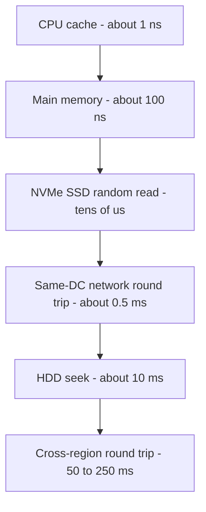

# Latency Numbers Every Engineer Should Know

This is the famous table popularized by Jeff Dean (Google) — rough times for fundamental operations, from a CPU cache reference to a cross-ocean round trip. You memorize it not for the exact figures (hardware keeps moving) but for the **ratios between tiers**, because those ratios decide architecture: they are *why* caching works, *why* disk-era databases batch writes, *why* chatty cross-service calls kill latency budgets, and *why* no amount of tuning beats geography. Every [[Back of the Envelope Estimation|estimation]] exercise leans on this table.

## Why this matters

- **Design intuition is ratio intuition.** "Memory is ~500× faster than SSD random access; a same-DC round trip is ~5,000× slower than a memory read; a cross-continent round trip is ~400× slower again" — these gaps are so large that they dominate any constant-factor cleverness in your code.
- **It converts guessing into estimating.** "Can we do 50 sequential Mongo lookups in a 100 ms budget?" stops being a matter of opinion: 50 × ~1–5 ms (same-DC round trip + indexed read, per the supplementary table below) ≈ 50–250 ms — the answer is "barely at best, usually no", so you batch instead.
- **Interviews assume it.** Estimation rounds expect you to produce these numbers from memory, at least to the right order of magnitude.

## How it works

### The table (2020s-updated values)

All values are **approximate orders of magnitude for typical 2020s server hardware**, not benchmarks — labeled accordingly; storage, NIC and cross-region rows were rechecked against vendor and cloud sources in October 2026. Classic values are shown where they differ meaningfully — Dean's ~2009–2010 slide, plus the two SSD rows, which were not on his slide and come from the widely circulated 2012 version of the table; the structure of the table (which tier beats which) has barely moved in 15 years even as several entries got faster.

| Operation | ~2020s value | Classic value (Dean ~2010; SSD rows 2012) | Notes |
|---|---|---|---|
| L1 cache reference | ~0.5–1 ns | 0.5 ns | |
| Branch mispredict | ~3–5 ns | 5 ns | |
| L2 cache reference | ~4–7 ns | 7 ns | |
| Mutex lock/unlock (uncontended) | ~17–25 ns | 25 ns | |
| Main memory reference | ~100 ns | 100 ns | stable for decades |
| Compress 1 KB (fast codec e.g. Snappy) | ~1–3 µs | 3 µs | |
| Send 1 KB over 10 Gbps network | ~1 µs | 10 µs (1 Gbps) | NICs got 10×+ faster; top EC2 instances reach 600 Gbps (2025) |
| Read 4 KB randomly from NVMe SSD | ~20–100 µs | 150 µs | NVMe improved on SATA |
| Read 1 MB sequentially from memory | ~10–65 µs | 250 µs | memory bandwidth grew |
| Round trip within same datacenter | ~100–500 µs | 500 µs | |
| Read 1 MB sequentially from NVMe SSD | ~70 µs–0.5 ms | 1 ms (SATA-era) | PCIe 5.0 drive ~14 GB/s; max-provisioned EBS gp3 ~2 GB/s (2026) |
| HDD seek | ~2–10 ms | 10 ms | physics of a moving arm |
| Read 1 MB sequentially from HDD | ~3.5–4 ms | 20 ms | 240–285 MB/s on 2025 enterprise 7,200 rpm drives |
| Round trip same cloud region, cross-AZ | ~0.5–2 ms | — | AZs are km apart |
| Round trip California ↔ Netherlands | ~150 ms | 150 ms | speed of light hasn't improved |

Supplementary rows you'll actually use in design work (approximate, steady-state):

| Operation | Rough value |
|---|---|
| Redis GET, same DC (incl. network) | ~0.2–1 ms |
| Indexed point read, warm MongoDB/MySQL, same DC | ~1–5 ms |
| TLS 1.3 handshake, same region | ~1 RTT ≈ 1–5 ms |
| TLS 1.2 handshake, cross-continent | 2 RTT ≈ 300–400 ms |
| Mobile network (4G) first-hop latency | ~30–80 ms |

### Cross-region round trips (the geography rows)

Round-trip times between regions are bounded below by the speed of light in fiber (~⅔ of c, plus non-great-circle routes and router hops). Approximate cloud-backbone RTTs, checked in October 2026 against Azure's published P50 inter-region matrix (30 days to July 2026; Azure Central India, Pune, stands in for Mumbai):

| Path | Approx RTT |
|---|---|
| Same region, cross-AZ | ~0.5–2 ms |
| Mumbai ↔ Singapore | ~50–70 ms |
| Mumbai ↔ Frankfurt | ~110–140 ms |
| **India ↔ US East** | **~190–250 ms** |
| US East ↔ US West | ~60–75 ms |
| US East ↔ Europe West | ~70–90 ms |
| Sydney ↔ US West | ~140–160 ms |

These are *floors you cannot engineer away*: an India-based user calling a US-hosted API pays ~200 ms per round trip before any server work happens. A cold HTTPS call needs three of them (TCP + TLS 1.3 + the request itself; DNS resolves at a nearby resolver) ≈ 600 ms, and TLS 1.2 adds a fourth — the reason [[CDN|CDNs]], regional deployments, and [[Replication|geo-replication]] exist ([[Anatomy of a Web Request]]).

### The ratios to memorize

Forget decimals; burn in the **tiers**, each step roughly 1–3 orders of magnitude:

1. **Memory : SSD ≈ 1 : ~500** (100 ns vs ~50 µs random read). Why in-memory caches ([[Why Caching Works]]) and why Redis can be "the fast path".
2. **SSD random : HDD seek ≈ 1 : ~200** (~50 µs vs ~10 ms). Why LSM-era databases designed around avoiding random disk I/O still matter conceptually ([[B-Tree vs LSM-Tree]], [[How Databases Store Data]]).
3. **Sequential ≫ random, on every medium.** 1 MB sequential from SSD costs roughly what a handful of random 4K reads cost. Why databases use write-ahead logs and why Kafka — pure sequential append — is fast on cheap disks ([[Kafka Architecture]]).
4. **Memory read : same-DC round trip ≈ 1 : ~5,000** (100 ns vs ~0.5 ms). A network hop annihilates in-process optimization — why chatty microservice calls and [[N+1 Queries and ORM Pitfalls|N+1 query patterns]] are architecture bugs, not tuning problems.
5. **Same-DC : cross-region ≈ 1 : ~100–500** (0.5 ms vs 50–250 ms). Why you batch cross-region traffic, replicate data near readers, and never put a synchronous cross-region call in an interactive path.
6. **One number to anchor everything: ~200 ms ≈ India↔US round trip ≈ 2 million same-DC memory-read-equivalents of time.**

### Using the table in practice

- **Budgeting**: a 100 ms p95 API budget supports ~200 bare same-DC round trips in sequence (0.5 ms each), but only ~20–100 real calls once each carries 1–5 ms of query or service work — so a handler doing 5 sequential DB queries (1–5 ms each) + 3 service calls (0.5–2 ms each) is already spending ~7–30 ms before its own logic. Parallelize or batch ([[Latency vs Throughput vs Bandwidth]]).
- **Sanity-checking claims**: "we'll read 10 GB from disk per request" → even sequential reads at ~2 GB/s (a max-provisioned EBS gp3 volume) to ~14 GB/s (a local PCIe 5.0 NVMe drive) take ~0.7–5 s (2026 figures) — not interactive; precompute instead ([[Back of the Envelope Estimation]]).
- **Choosing tiers**: data needed at µs scale lives in memory; ms scale → SSD-backed store same-DC; anything cross-region in the hot path must be cached or replicated locally.
- **A worked budget**: target p95 = 150 ms for a mobile API, user in India, backend in Mumbai. Mobile request round trip ~50 ms + one round trip of connection setup ~50 ms (HTTP/3 combines QUIC and TLS 1.3 into one; over TCP, TCP plus TLS is two and would eat the server budget) leaves ~50 ms server-side: one Redis check (~1 ms), one Mongo indexed read (~3 ms), one downstream service call (~5 ms), serialization and logic (~10 ms) — fits, with ~30 ms headroom for tail effects. The same API served from a US region fails before the first byte of server work. Writing budgets this way, hop by hop, is the table's day-to-day use.

### How to actually memorize this

Don't memorize 15 rows; memorize 6 anchors and derive the rest:

1. **1 ns** — CPU cache (and ~1 ns ≈ one simple instruction's timescale).
2. **100 ns** — main memory. (×100 from cache)
3. **50 µs** — NVMe random read. (×500 from memory)
4. **0.5 ms** — same-DC round trip. (×10 from NVMe)
5. **10 ms** — HDD seek, and also roughly an intra-country internet hop. (×20 from same-DC)
6. **200 ms** — India↔US round trip. (×20 again)

Everything else is "sequential is 10–100× cheaper per byte than random" plus "TLS costs 1–2 round trips, wherever those round trips happen to be."

## Common misconceptions

- **"These numbers are exact / current."** They're deliberately rough; several moved since 2010 (NVMe, 100+ Gbps NICs, memory bandwidth) and the table above labels 2020s values as approximations. The *ratios between tiers* are the stable, load-bearing content.
- **"Hardware progress will fix latency."** Bandwidth-ish entries improved 10×+; **physics entries didn't**: main-memory latency has sat near 100 ns for decades, HDD seeks near 10 ms, and the speed of light is fixed — cross-region RTT in 2026 ≈ cross-region RTT in 2010. Design around the immovable rows.
- **"A DB query costs what the DB says it costs."** Client-observed cost = query time + same-DC round trip + driver/serialization overhead. Sub-millisecond server-side query time still lands at ~1 ms+ at the caller — invisible once, lethal ×50 ([[N+1 Queries and ORM Pitfalls]]).
- **"Redis is so fast the network doesn't matter."** Redis serves in microseconds, but your client pays the ~0.2–1 ms round trip. Pipelining/batching exists precisely because the network, not Redis, is the cost ([[Redis Internals]]).

## In your stack

- Your canonical hop costs, same region: pod→Redis ~0.2–1 ms; pod→MongoDB indexed read ~1–5 ms; pod→pod via Kubernetes Service ~0.5–2 ms; through Kong add single-digit ms. A handler with a Redis hit, one Mongo read, and one downstream call has a realistic floor of ~2–8 ms before business logic.
- Niyo serves India-resident users and (for travel products) users abroad: an India-hosted backend serving a user roaming in the US pays ~200 ms RTT per round trip. Minimizing round trips in mobile APIs (coarse endpoints, batched calls) matters more than server-side micro-optimization — see [[Anatomy of a Web Request]] and [[API Design and Versioning]].
- Data-residency rules (RBI localisation) can *force* the data to stay in India while users roam globally — making the cross-region rows a compliance-imposed floor you must design UX around (optimistic UI, caching of non-sensitive data at edge), not engineer away.
- Kafka's economics in your stack come from ratio #3: sequential append + page cache means even modest brokers sustain high throughput; SQS hides the disk entirely but charges you ~tens of ms per API call instead.

## Interview angle

- Interviewers rarely ask you to recite the table; they watch whether your estimates *imply* it. Saying "that's 50 sequential cross-service calls, ~50 ms of pure network, half our budget" earns more than reciting nanoseconds.
- **60-second version**: "The Jeff Dean table orders operations by cost: ~1 ns CPU cache, ~100 ns memory, tens of µs SSD random read, ~0.5 ms same-DC round trip, ~10 ms disk seek, and 50–250 ms cross-region round trips — India↔US is about 200 ms. The exact values drift with hardware, but the ratios are stable and decide architecture: memory beats SSD by ~2–3 orders, a network hop costs thousands of memory reads, sequential beats random everywhere, and geography is physics you can only design around — cache, replicate, batch."
- Classic follow-ups: "Why is Kafka fast on cheap disks?" (sequential I/O + page cache); "Why do N+1 queries matter if each is 1 ms?" (round-trip multiplication); "User in India, service in Virginia — what's your latency floor and what do you do?" (~200 ms/RT; edge, regional replicas, fewer round trips); "Which numbers improved since 2010 and which didn't?" (NICs/SSDs yes; memory latency, seek time, speed of light no).

## Check yourself

> [!question]- Q: Explain, using only ratios from the table, why a cache hit in Redis can still be 1,000× slower than a local in-process cache hit — and why Redis is still usually the right choice.
> An in-process hash lookup costs ~100 ns (memory reference); a Redis GET costs a same-DC round trip, ~0.2–1 ms = 200,000–1,000,000 ns — roughly 3–4 orders of magnitude more. Redis still wins when the cache must be *shared and consistent across many stateless pods* ([[Stateless vs Stateful Services]]): a per-pod local cache multiplies memory, fragments hit ratio, and serves stale data per pod. Many systems layer both: tiny local cache for the hottest keys, Redis behind it ([[Caching Strategies]]).

> [!question]- Q: What happens if a mobile app makes 6 sequential API calls to render one screen for a user on 4G in India talking to a US-hosted backend?
> Each call pays ~200 ms India↔US RTT plus ~30–80 ms 4G first-hop, so 6 sequential calls ≈ 6 × ~250 ms ≈ 1.5 s of pure transport before any server time — the screen feels broken. Fixes: one aggregated endpoint (1 round trip), parallelize what can't merge, cache static parts on device or edge, or serve from an India region. Round-trip count × RTT dominates everything else ([[Anatomy of a Web Request]]).

> [!question]- Q: Your batch job reads 500 GB from storage. Estimate the floor time if the data is on (a) NVMe read sequentially, (b) HDD read with mostly random 4 KB access. What does the gap tell you?
> (a) Sequential at ~2 GB/s (a max-provisioned EBS gp3 volume; a local PCIe 4.0/5.0 NVMe drive does 7–14 GB/s, ~35–70 s) → ~250 s ≈ 4 minutes. (b) Random 4 KB on HDD: 500 GB / 4 KB = ~125M reads × ~5–10 ms seek ≈ 7–14 days. The gap is ~2,500–5,000× — access *pattern* and medium matter more than any code optimization, which is why storage engines organize data for sequential access ([[B-Tree vs LSM-Tree]]) and why "just query it row by row" can turn minutes into weeks.

> [!question]- Q: Which rows of the table have improved dramatically since 2010, and which are effectively frozen? Why does the distinction matter for design?
> Improved: network throughput (1 → 10/100 Gbps NICs, up to 600 Gbps on 2025 EC2 instances), SSD random access (SATA → NVMe, ~150 µs → tens of µs), memory and SSD sequential bandwidth. Frozen: main-memory latency (~100 ns for decades), HDD seek (~ms, mechanical), and every geography row (speed of light). Design implication: architectures that bet on bandwidth keep getting faster for free; architectures that depend on shaving round trips or seeks stay exactly as constrained — so the durable wins are structural (fewer hops, sequential access, data placed near users), not hardware-assisted.

> [!question]- Q: Mini design prompt — you must show a Niyo user's account balance in under 300 ms p95 while they travel in the US, but the ledger must stay in India (data residency). Sketch the options against the latency floor.
> Floor: ~200 ms RTT US↔India leaves ~100 ms for everything else — one round trip fits, two don't. Options: (1) single aggregated balance endpoint, one round trip, aggressively optimized server side (~fits, fragile); (2) edge-cache a short-TTL balance snapshot (CloudFront/regional cache) with clear staleness semantics — instant reads, but a money balance served stale needs product sign-off and an invalidation path ([[Cache Invalidation]]); (3) optimistic UI: show last-known balance immediately, refresh async. Likely answer: (3)+(1): compliance keeps truth in India, UX hides the ocean.

## Sources

- Jeff Dean, "Designs, Lessons and Advice from Building Large Distributed Systems" (Google/Stanford talks, ~2009–2010) — origin of the canonical table; "Numbers Everyone Should Know" slide.
- Peter Norvig, "Teach Yourself Programming in Ten Years" (norvig.com) — an earlier published version of the same numbers.
- Colin Scott, "Latency Numbers Every Programmer Should Know" (interactive visualization, github.com/colin-scott) — shows the numbers' evolution across years; source of several 2020s updates (its post-~2015 values are extrapolated from trend lines, not measured).
- Dean & Barroso, "The Tail at Scale" (CACM 2013) — companion reading: what the *distribution* of these latencies does at scale ([[Latency vs Throughput vs Bandwidth]]).
- Public cloud inter-region latency dashboards (e.g. AWS/GCP/Azure latency matrices, cloudping-style tools) — source of the approximate cross-region RTT ranges; rechecked October 2026 against the Azure network round-trip latency statistics page (learn.microsoft.com, P50 over 30 days to 2026-07-30).
- Vendor data for the storage rows: Seagate Exos SATA product manual (Dec 2025: 240–285 MB/s sustained, 4.16 ms average latency); Solidigm D7-PS1010 and Kioxia CM7 spec pages (14–14.5 GB/s sequential read); AWS EBS gp3 documentation (up to 2,000 MiB/s).
