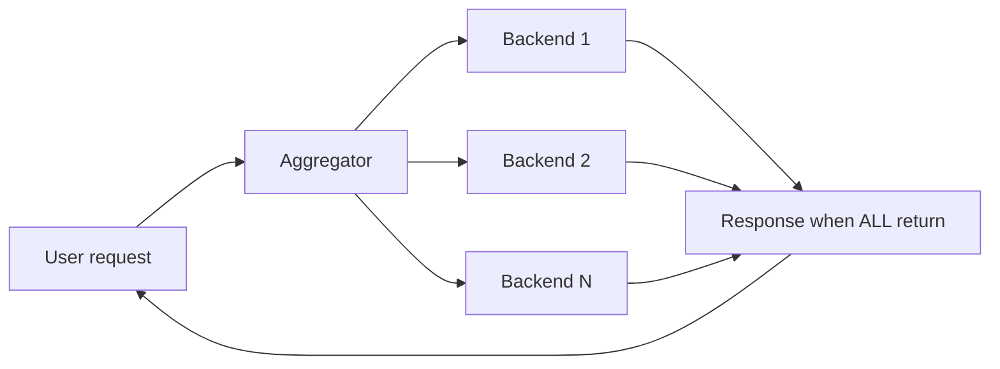

# Latency vs Throughput vs Bandwidth

These three words get used interchangeably in meetings, and they measure three different things: **latency** is how long one operation takes, **throughput** is how many operations complete per unit time, and **bandwidth** is the maximum data volume a channel can carry per unit time. A system can be excellent on one axis and terrible on another — a batch pipeline has huge throughput and hour-long latency; a lightly-loaded server has great latency and tiny demonstrated throughput. Designing, measuring, and promising performance all require keeping them separate.

## Why this matters

- **They trade against each other.** Batching improves throughput by *increasing* latency. Queues smooth throughput while adding latency. Many tuning decisions are explicit purchases of one with the other, and you need to know which one the requirement actually cares about.
- **Averages systematically hide the pain.** Latency must be reported as percentiles, because the distribution is skewed — and the slowest few percent of requests are often your most valuable users making the heaviest calls (Kleppmann's point in DDIA ch. 1).
- **Modern architectures amplify tails.** Fan-out to many backends means the user experiences the *slowest* of many calls, turning a rare per-server hiccup into a common user-facing one. This single effect shapes much of large-system design ([[Design a News Feed]], [[Anatomy of 1M RPS]]).

## How it works

### Definitions, precisely

- **Latency** — the time for one operation, measured from the requester's point of view (send request → receive response). Units: ms. Strictly, *response time* = network + queueing + service time, and *latency* is sometimes reserved for just the waiting components, but in practice the terms are used interchangeably; what matters is measuring client-observed time, since that's what users experience.
- **Throughput** — completed operations per unit time: requests/sec (RPS), transactions/sec, messages/sec. This is a measured *rate*, a property of the whole system under a given load.
- **Bandwidth** — the *capacity* of a channel: bytes per second it can carry (e.g. a 10 Gbit/s NIC). Bandwidth is a ceiling; throughput is what you actually achieve. You can have huge bandwidth and low throughput (chatty protocol, tiny payloads, round-trip-bound work).

The truck analogy that actually holds: a truck of disks driven across the country has *enormous* effective bandwidth and *terrible* latency; a fiber ping has superb latency and carries almost no data. (AWS built a product line on exactly this trade-off — the Snow family of physical data-transfer appliances, whose 100 PB Snowmobile truck ran until AWS retired it in 2024 — the whole family is now closed to new customers, with Snowball support ending 31 Dec 2026 — because for petabyte-scale migrations the shipped box genuinely wins on bytes per second.)

**Little's Law** ties latency and throughput together and is worth memorizing: **concurrency = throughput × latency**. A server handling 1,000 RPS at 50 ms average has 50 requests in flight. Corollaries: with a fixed concurrency limit (thread pool, [[Connection Pooling|connection pool]]), rising latency *mechanically* lowers maximum throughput; and a latency spike under constant load inflates in-flight requests until a pool somewhere saturates — which is how one slow dependency stalls a whole service.

### Why latency must be percentiles

Sort all response times in a window. The **p50** (median) is the value half of requests beat; **p95** and **p99** are the values 95% and 99% of requests beat. "p99 = 800 ms" means 1 in 100 requests is slower than 800 ms.

Averages lie about latency for two reasons:

1. **The distribution is right-skewed.** Most requests are fast; a few are very slow (GC pauses, cache misses, lock waits, page faults, retries). The mean lands between those two populations and describes neither: it is simultaneously dragged upward by a handful of multi-second outliers *and* silent about how **many** requests suffered, so a healthy-looking mean is compatible with both a brutal tail and a trivial one.
2. **No user experiences the average.** Users experience their own request. At 1M requests/day, a p99 of 2 s means 10,000 slow experiences daily. And the tail disproportionately hits heavy users: the customer with the most data triggers the biggest queries — Amazon's classic observation that the slowest requests often belong to the most valuable accounts.

#### A concrete distribution, worked out

Take 1,000 requests in a one-minute window with a shape that is entirely ordinary for a cached API. The numbers are illustrative; the arithmetic is exact:

| Count | Latency | What it is |
|---|---|---|
| 900 | 20 ms | cache hit |
| 70 | 50 ms | cache hit, larger payload |
| 25 | 200 ms | cache miss, database read |
| 4 | 1,000 ms | miss plus a retry, or a stop-the-world GC pause |
| 1 | 5,000 ms | a connection-pool wait that nearly hit the timeout |

Read the statistics straight off it:

- **Mean** = (900×20 + 70×50 + 25×200 + 4×1,000 + 1×5,000) / 1,000 = 35,500 / 1,000 = **35.5 ms**
- **p50** = the 500th value in sorted order = **20 ms**
- **p95** = the 950th value = **50 ms** (the first 900 are 20 ms, the next 70 reach 970)
- **p99** = the 990th value = **200 ms**
- **p99.9** = the 999th value = **1,000 ms**
- **max** = **5,000 ms**

Three conclusions fall out of that arithmetic, and they generalize:

1. **The mean describes nobody.** 90% of these requests finished in 20 ms, well under the mean; every remaining request took 50 ms or more, well over it. The mean sits in a gap in the distribution where no request actually landed.
2. **The mean is hostage to a single request.** Delete the one 5-second outlier and the mean falls to 30,500 / 999 = **30.5 ms**, a 14% swing caused by 0.1% of the data. Every percentile up to p99 is completely unchanged. Percentiles are the robust statistic here; the mean is the fragile one — which is the opposite of the intuition most people bring from school statistics.
3. **Multiply the percentile by volume to get a headcount.** At 1 million requests a day this shape puts 10,000 requests a day in the slowest 1% — 200 ms or worse — and 1,000 of them above a full second. "Only 1%" is a rate; the number that matters in a product conversation is the headcount.

Practical rules:

- Track p50 (typical experience), p95/p99 (unhappy experiences — most [[SLA SLO SLI and Error Budgets|SLOs]] bind here), and p99.9 if you fan out (see below).
- **Percentiles don't average or add.** The p99 across 10 servers is not the mean of their p99s, and end-to-end p99 of two sequential calls is not the sum of their p99s. Aggregate from histograms (HDR histograms, t-digest), not from pre-computed per-node percentiles.
- Beware **coordinated omission**: load-testing tools that wait for a slow response before sending the next request silently under-measure the tail. (Gil Tene's critique; tools like wrk2 correct for it.)

### Tail amplification in fan-out systems

The killer interaction between percentiles and architecture. Suppose one user request fans out in parallel to **N** backends, and the response needs *all* of them. The user sees the **maximum** of N latencies — so the probability of a slow experience compounds:

> P(user request is slow) = 1 − (1 − p)^N, where p is one backend's probability of being slow.

Concretely, if each backend is slower than some threshold 1% of the time (its p99):

| Fan-out N | Chance the user request hits at least one slow backend |
|---|---|
| 1 | 1% |
| 10 | 1 − 0.99¹⁰ ≈ 9.6% |
| 50 | 1 − 0.99⁵⁰ ≈ 39% |
| 100 | 1 − 0.99¹⁰⁰ ≈ 63% |

With 100-way fan-out, **the majority of user requests experience at least one backend's worst-1% latency** — the backend's p99 effectively becomes the user's p37. This is why Google's "The Tail at Scale" (Dean & Barroso, 2013) calls tail latency a first-class design constraint, and why their mitigations are standard vocabulary:

- **Hedged requests**: send the same request to a second replica after a small delay (e.g. after the p95 mark); take the first answer. Cuts the tail dramatically for a few percent extra load.
- **Tied requests / cancellation**: enqueue on two replicas, cancel the loser.
- **Partial results / timeouts**: return the feed with 49 of 50 sections rather than wait for the straggler ([[Load Shedding and Graceful Degradation]]).
- **Reduce fan-out or batch it**: fewer sequential/parallel hops per user request ([[Communication Patterns Between Services]]).

### The latency–throughput trade in tuning

- **Batching** (Kafka producers, DB bulk writes, GC): amortizes per-operation overhead → throughput up, individual latency up.
- **Queueing** ([[Why Async Messaging Exists]]): absorbs bursts, keeps workers at optimal utilization → steady throughput, but items wait in queue (latency becomes backlog-dependent — [[Backpressure and Flow Control]]).
- **Utilization**: queueing theory says response time explodes as utilization approaches 100% — the hockey-stick curve. Running hot maximizes throughput and wrecks the tail; capacity planning targets ~60–70% utilization for latency-sensitive tiers ([[Capacity Planning]]).
- **Compression**: spends CPU (latency) to save bandwidth — a direct exchange between the three quantities.

### What a tail regression looks like at 3am

An illustrative incident whose arithmetic is worth internalizing, because this shape recurs constantly:

- **03:20 — the page.** p99 on the accounts API jumped from 12 ms to 150 ms. p50 is flat at 2 ms. Error rate is zero.
- **The tell, before you open anything else.** A moving p99 with a motionless p50 means nothing got *slower* — something changed how *often* the slow path is taken. A uniform slowdown (a dropped index, a throttled CPU, a slower downstream) drags p50 along with p99. A conditional one does not. You are looking for a *ratio*, not a speed.
- **The dashboard.** Redis hit ratio for the accounts key space fell from 99% to 95% at 03:18. A deploy three minutes earlier changed the cache key prefix, orphaning every warm entry ([[Cache Invalidation]]).
- **Why the mean never alerted.** With a 2 ms hit and a 150 ms miss, mean latency at a 99% hit ratio is 0.99 × 2 + 0.01 × 150 = **3.48 ms**; at 95% it is 0.95 × 2 + 0.05 × 150 = **9.4 ms**. A mean of 9.4 ms trips no threshold anyone would have set — while the share of users waiting 150 ms went from 1 in 100 to 1 in 20. The tail did not get taller; it got *wider*, and only a percentile can see that.
- **The fix and the general rule.** Roll back the prefix, or dual-read old and new keys through a migration. Generalized: when p99 moves and p50 does not, hunt for a changed fraction — cache hit rate, retry rate, the proportion of requests taking a cold path, the share of traffic landing on one degraded replica ([[Distributed Tracing]] attributes it to a hop).

### Reading the three numbers together

A diagnostic habit: given any performance complaint, classify it before touching anything.

| Symptom | Likely quantity | First checks |
|---|---|---|
| "Every request is slow, even at 3 a.m." | Latency (fixed costs) | Round-trip count, missing index, payload size, geography ([[Latency Numbers Every Engineer Should Know]]) |
| "Slow only under load" | Throughput ceiling reached → queueing latency | Utilization of each tier, pool sizes, the bottleneck ([[Scalability]]) |
| "Most requests fine, some awful" | Tail latency | Cache miss paths, GC, lock waits, slow dependency's p99, retries ([[Distributed Tracing]]) |
| "Large responses crawl, small ones fine" | Bandwidth / transfer time | Payload sizes, compression, client network |

## Common misconceptions

- **"Our average latency is 40 ms, we're fine."** The mean says nothing about the tail; check p99 and multiply by request volume to count actual bad experiences. SLOs on means are nearly meaningless ([[SLA SLO SLI and Error Budgets]]).
- **"More bandwidth will fix our latency."** Only if you're transfer-bound (large payloads). Most API latency is round trips and server time; a fatter pipe doesn't shorten a handshake ([[Anatomy of a Web Request]]). Geostationary satellite internet has high bandwidth and high latency — they're independent.
- **"High throughput means the system is fast."** A system can complete 1M ops/sec at 5 s each (huge concurrency). Batch systems are the extreme: throughput is the goal, latency irrelevant.
- **"p99 only matters to perfectionists — it's 1% of traffic."** With fan-out it contaminates the majority of requests (table above); without fan-out it's still 1% of *every day's* traffic, concentrated on your heaviest users, and it's where [[Timeouts Retries and Exponential Backoff|timeouts and retries]] trigger — the tail is where cascading failures start.

## In your stack

- Your fintech workloads split cleanly: interactive paths (login, balance check, UPI-style transfers, OTP) are **latency-bound** — percentile SLOs matter; back-office paths (reconciliation, statement generation, KYC batch re-verification) are **throughput-bound** — RPS and completion windows matter, latency doesn't. Don't let one borrow the other's targets.
- A request through Kong → service → Redis/Mongo → two downstream services is already a fan-out of 3–5; each sequential hop adds its tail. Your `x-correlation-id` + [[Distributed Tracing]] is how you attribute a bad p99 to the guilty hop.
- Little's Law bites at 1 replica: one pod with a fixed Tomcat thread pool means any downstream latency spike (a slow Mongo query, a Redis blip) inflates in-flight requests until the pool exhausts and the service rejects — latency problems *become* throughput problems with no second replica to absorb them.
- SQS/Kafka consumers are the deliberate throughput-for-latency trade: events wait in the queue so consumers run smooth and the DB is protected. Monitor *queue age* (latency) as well as consumer throughput — a draining-but-old backlog is a user-visible delay.
- The gap between **gateway-measured and application-measured latency is itself a metric**. Kong's view of a request includes time spent waiting in the pod's accept queue and in the servlet container before your code runs; Spring Boot's own timer starts after that. Subtracting one from the other gives you queueing delay directly — and at 1 replica, that gap is the first thing to widen under load, usually well before any application metric looks unhealthy.
- Percentile aggregation is a non-problem at 1 replica and becomes one the day you scale out: with a single pod there is one histogram and nothing to merge, but with several you must export histograms and merge them centrally rather than averaging each pod's reported p99 ([[Logs Metrics and Traces]]). Worth knowing before the second replica arrives, not after.

## Interview angle

- Interviewers test vocabulary precision early: define the three terms in one sentence each, and volunteer percentiles unprompted when asked about performance. Saying "average latency" uncritically is a mild red flag.
- **60-second version**: "Latency is per-operation time; throughput is completed operations per second; bandwidth is a channel's data capacity. Latency is reported as percentiles because the distribution is skewed — averages hide the tail, and the tail is where real users suffer. In fan-out architectures tails amplify: with 100 parallel backends, a per-backend p99 becomes something the majority of user requests experience, which is why Google treats tail-tolerance — hedged requests, partial results — as a design requirement, per 'The Tail at Scale'."
- Classic follow-ups: "How do you measure p99 correctly across a fleet?" (histograms merged centrally, never averaging percentiles); "Your p99 doubled but p50 is flat — what changed?" (something conditional: cache hit ratio fell, a dependency's tail grew, GC, retries); "How would you cut tail latency of a fan-out read?" (hedging, timeouts with partial results, caching the stragglers' data); "Relationship between latency and throughput?" (Little's Law + the utilization hockey stick).

## Check yourself

> [!question]- Q: Define latency, throughput, and bandwidth in one sentence each, and give a system that's strong on one and weak on another.
> Latency: time for one operation, client-observed. Throughput: operations completed per second. Bandwidth: maximum data per second a channel can carry. Examples: a nightly batch ETL has huge throughput and terrible latency; a truck full of disks has enormous effective bandwidth and days of latency; an idle server has great latency and proves no throughput.

> [!question]- Q: Why do averages lie about latency? Give both statistical reasons.
> (1) The distribution is right-skewed: rare multi-second outliers barely move the mean, so the mean looks healthy while p99 is awful — and the mean also can't tell you how many users were affected. (2) No one experiences the mean: each user gets their own draw, and slow requests concentrate on heavy (often most valuable) users and on moments of system stress. Percentiles answer the actual question: "how bad is it for the worst X% of requests?"

> [!question]- Q: What happens if a feed service fans out in parallel to 50 backends, each with a 1% chance of exceeding 500 ms, and must wait for all of them?
> P(at least one slow) = 1 − 0.99⁵⁰ ≈ 39% — two in five user requests exceed 500 ms, even though every individual backend meets a 99% target. Mitigations: hedged requests to replicas, per-call timeouts with partial results (render 49 of 50 sections), caching, or reducing fan-out. This is the central result of "The Tail at Scale".

> [!question]- Q: A service's thread pool holds 200 threads. Downstream latency rises from 50 ms to 400 ms under constant 1,000 RPS offered load. Use Little's Law to predict what happens.
> Required concurrency = throughput × latency = 1,000 × 0.4 = 400 in-flight requests — but only 200 threads exist. The pool saturates at 200/0.4 = 500 RPS of actual throughput; the other 500 RPS queue up and then get rejected or time out. A pure latency regression downstream has mechanically halved upstream throughput — why [[Timeouts Retries and Exponential Backoff|aggressive timeouts]] and [[Circuit Breakers]] exist.

> [!question]- Q: Why is averaging per-server p99 values across a fleet statistically wrong, and what's the correct aggregation?
> A percentile is a point on a distribution, and distributions don't combine by averaging their percentiles: a server handling 10× the traffic of another contributes 10× the requests to the true fleet-wide distribution, and the shape of each server's tail differs. Averaging p99s can both overstate and understate the real fleet p99. Correct approach: export latency *histograms* (or t-digest/HDR sketches) from each node, merge the histograms centrally, then read percentiles off the merged distribution — which is how Prometheus histogram_quantile and similar systems work ([[Logs Metrics and Traces]]).

> [!question]- Q: A cost-conscious manager points out that your latency-sensitive service averages 65% CPU and asks why you are not running it at 90%. Answer with arithmetic.
> Because response time does not degrade linearly with utilization — it degrades hyperbolically. In the idealized M/M/1 queueing model, mean response time scales as 1 / (1 − ρ) where ρ is utilization: at ρ = 0.65 the multiplier is 2.9, at 0.85 it is 6.7, at 0.90 it is 10, at 0.95 it is 20. Moving from 85% to 90% utilization — a change a capacity spreadsheet would call minor — increases expected response time by 50%, and the *variance* grows faster still, so the tail degrades worse than the mean. The model's assumptions are idealized, but the shape is real, and it is why latency-sensitive tiers are provisioned with headroom while batch tiers are deliberately run hot ([[Capacity Planning]]).

> [!question]- Q: Over 1,000 requests, 900 take 20 ms, 70 take 50 ms, 25 take 200 ms, 4 take 1 s and 1 takes 5 s. Compute the mean and p99, then say which number you would put in an SLO and why.
> Mean = (18,000 + 3,500 + 5,000 + 4,000 + 5,000) / 1,000 = 35.5 ms. p99 is the 990th sorted value: the first 900 are 20 ms, the next 70 take you to 970, the next 25 take you to 995 — so the 990th is 200 ms. The SLO goes on the percentile. The mean is unrepresentative here in a strong sense: 90% of requests beat it and the other 10% are far above it, so no request resembles it, and one 5-second outlier moves it by 14% while leaving p99 untouched. An SLO phrased as "99% of requests under 300 ms" is a promise you can hold someone to; "average under 50 ms" is satisfiable while a tenth of your users suffer.

> [!question]- Q: Mini design prompt — product wants "statements generated twice as fast" for monthly statements currently taking 6 hours for 2M accounts. Which of the three quantities is this about, and what levers apply?
> Throughput (and completion window), not per-statement latency — nobody watches one statement render. Levers: parallelize across workers (partition by account — [[Vertical vs Horizontal Scaling|scale out]]), batch DB reads, precompute aggregates during the month, and remove shared bottlenecks ([[Scalability]]). Per-operation latency could even get *worse* (bigger batches) while the window halves — the right trade for a batch job.

## Sources

- Jeffrey Dean & Luiz André Barroso, "The Tail at Scale", *Communications of the ACM*, 2013 — the fan-out amplification math and the hedged/tied request techniques.
- *Designing Data-Intensive Applications*, Kleppmann — ch. 1: percentiles vs averages, response time vs latency, the Amazon heavy-user observation.
- Gil Tene, "How NOT to Measure Latency" (talk) — coordinated omission and why most latency benchmarks overstate their tails' health.
- Little's Law — J. D. C. Little's 1961 queueing result; any queueing-theory reference covers the utilization/response-time hockey stick.
