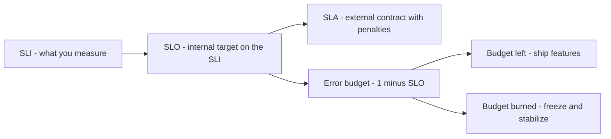

# SLA SLO SLI and Error Budgets

These four terms turn the vague goal "be reliable" into an engineering control system: an **SLI** is a measurement, an **SLO** is an internal target for that measurement, an **SLA** is an external contract with penalties, and an **error budget** is the arithmetic gap between perfection and the SLO — a spendable allowance of failure. The framework (from Google's SRE practice) exists to answer the question every team fights about: *how reliable is reliable enough, and who decides when to stop shipping features and fix stability?* The error budget replaces that argument with a number.

## Why this matters

- **100% is the wrong target for almost everything.** Each extra nine costs ~10× the effort ([[Availability Reliability Durability]]) while users — behind flaky mobile networks and their own device issues — stop being able to perceive the difference. A target below 100% is not lowering the bar; it's refusing to buy reliability nobody can see with capacity you could spend on features.
- **Without a defined target, reliability is decided by whoever shouts loudest.** Product pushes to ship; ops pushes to freeze. The SLO + error budget converts this into a pre-agreed, self-enforcing policy.
- **SLOs drive alerting and architecture.** What you promise determines what you measure ([[Logs Metrics and Traces]]), what pages a human at 3 a.m. ([[Alerting and On-Call Design]]), and how much redundancy you must buy ([[Replication]], [[Failover]]).

## How it works

### The chain: SLI → SLO → SLA

**SLI (Service Level Indicator)** — a carefully defined *measurement* of one aspect of service behavior. Best practice: express it as a ratio of good events to total events, measured as close to the user as possible:

- Availability SLI: `successful requests / total requests` (define "successful": e.g. non-5xx, completed within timeout).
- Latency SLI: `requests served under 300 ms / total requests` (note: a latency SLI is still a *proportion* — "p99 < 300 ms" and "99% of requests under 300 ms" are two phrasings of the same idea — see [[Latency vs Throughput vs Bandwidth]]).
- Others: freshness (for pipelines), durability ([[Availability Reliability Durability]]), correctness.

Google's SRE material groups SLIs by the *kind* of system being measured — request/response services, data pipelines, and storage — which is a useful menu because teams routinely reach for an availability SLI on a system whose users care about something else entirely. Targets in the last column are illustrative examples, not recommendations:

| SLI family | Good events / total events | Where it is measured | Example target | When this is the right SLI |
|---|---|---|---|---|
| **Availability** | Non-error responses / all responses | Load balancer or gateway | 99.9% / 30 d | Any synchronous request/response API |
| **Latency** | Responses under threshold T / all responses | Load balancer or client | 99% under 300 ms | Interactive paths a human waits on |
| **Freshness** | Items processed within D of creation / all items | Consumer or replica | 99% within 5 min | Queues, streams, replicas, caches, derived views |
| **Correctness** | Records with the right value / all records produced | Reconciliation job | 99.99% / 30 d | Ledgers, billing, anything money-shaped |
| **Coverage** | Items actually processed / items that should have been | Batch job | 99.9% per run | Batch and ETL jobs, where silent skips are the failure |
| **Durability** | Objects still retrievable / objects acknowledged | Restore tests and audits | Design target, not a monthly SLO | Storage systems ([[Availability Reliability Durability]]) |

The practical move is to pick **two or three** per user journey, not one per service — typically availability plus latency for the synchronous leg, plus freshness for whatever happens asynchronously behind it.

Where you measure matters: server-side metrics miss failures at the edge and DNS ([[Anatomy of a Web Request]]); load-balancer or client-side measurement is more honest.

**SLO (Service Level Objective)** — an internal *target* for an SLI over a window: "99.9% of requests succeed, measured over a rolling 30 days." This is the engineering commitment. It should be chosen from user needs (what failure rate do users actually notice?) and achievability, not aspiration.

**SLA (Service Level Agreement)** — an external *contract*: an SLO plus consequences (service credits, penalties) if missed. SLAs are written by business/legal, are looser than internal SLOs (you want to breach your SLO long before you breach the SLA), and exist for customers — e.g. S3's 99.9% availability SLA vs its 99.99% design target ([[How S3 Works]]).

> Rule of thumb: **SLA ≤ SLO ≤ what the system actually delivers.** The gaps are your safety margin.

### Error budgets — the arithmetic

The **error budget** is simply `1 − SLO`: the amount of badness you are *allowed* over the window. For a 99.9% availability SLO over 30 days:

- Time-based: 30 days × 24 h × 60 min = 43,200 min; budget = 0.1% × 43,200 = **43.2 minutes** of full downtime per 30 days.
- Request-based (usually better): at 10 M requests/month, budget = 0.1% = **10,000 failed requests** per month. Request-based budgets automatically weight peak hours (an outage at peak burns budget faster), which matches user pain.

**Worked example.** Your service has a 99.9% success-rate SLO over a rolling 30 days and serves ~4M requests/month:

1. Budget = 0.001 × 4,000,000 = **4,000 failed requests / 30 days**.
2. Week 1: a bad deploy fails 1,500 requests before rollback → 37.5% of budget gone.
3. Week 2: a Mongo failover blip fails 800 → 57.5% burned, half the window left. The team slows risky rollouts, adds a canary step.
4. Week 3: dependency outage fails 2,000 → **107.5% — budget exhausted.** Policy triggers: feature rollouts freeze; only reliability work ships until the rolling window recovers.
5. Postmortems attribute each burn; the biggest line item (deploy-caused failures) gets engineering investment — [[Deployment Strategies|canaries]], better health checks.

**Burn rate** is the operational refinement: burn rate = (current error rate) / (budgeted error rate). Burn rate 1 means you'll exactly exhaust the budget at window's end; burn rate 14.4 on a 30-day window means the whole budget gone in ~2 days. Modern alerting pages on *fast burn* (e.g. 14.4× sustained for an hour) and files a ticket on *slow burn* (3× for a day, or 1× sustained for three) — this is how SLOs replace noisy per-cause alerts ([[Alerting and On-Call Design]]).

The standard multi-window burn-rate ladder for a 30-day window — the 14.4×, 6× and 1× rows are the SRE Workbook's recommended set (ch. 5, Table 5-8); the 3× row is a common intermediate addition, not from the Workbook:

| Burn rate | Budget consumed if sustained | Window to confirm | Response |
|---|---|---|---|
| 14.4× | 2% in 1 hour | 1 h (+ 5 min short window) | Page immediately |
| 6× | 5% in 6 hours | 6 h (+ 30 min short window) | Page |
| 3× | 10% in 1 day | 1 day (+ 2 h short window) | Ticket, fix in business hours |
| 1× | 10% in 3 days | 3 days (+ 6 h short window) | Ticket, fix in business hours |

The paired short window exists to stop alerts from continuing to fire after the problem ends — both windows must breach for the alert to be active.

### What a burn-rate page looks like at 3am

An illustrative but mechanically faithful walkthrough of a fast-burn alert on a 99.9% availability SLO over a rolling 30 days:

- **02:14 — the page.** "card-auth availability: burn rate 14.4× sustained 1 h (5 min short window also breaching)."
- **What the number literally means.** The budgeted error rate is 1 − 0.999 = 0.1%. A 14.4× burn means the measured error rate over the last hour is 14.4 × 0.1% = **1.44%** — roughly 1 request in 70 failing. Sustained, the whole 30-day budget is gone in 720 h / 14.4 = **50 hours**, and the hour that just elapsed cost 14.4 × (1/720) = **2% of the month**.
- **The dashboard.** Error ratio broken down by status: almost all 504, not 500. That distinction is the finding — 504 is the gateway reporting that *your* service did not answer in time, so the fault is a timeout or a dependency, not an application exception.
- **The next panel.** Service p99 is pinned exactly at the configured upstream timeout, and a MongoDB primary election is logged 90 seconds before the first 504. Root cause: a node replacement moved the primary; requests in flight during the election window exceeded the application timeout and were returned as gateway errors ([[Failover]], [[Timeouts Retries and Exponential Backoff]]).
- **The decision the budget makes for you.** The elevated error rate lasted 11 minutes, so the real cost was 14.4 × (11/60) / 720 = **0.37% of the monthly budget**. That is a ticket, not an escalation — go back to bed. Had the same burn rate persisted for 10 hours, the cost would be 14.4 × (10/720) = **20% of the month**, which justifies waking people. The arithmetic, not the redness of the graph, decides.
- **The quieter danger.** A 2× burn that nobody pages on, running unnoticed for 10 days, costs 2 × (240/720) = **67% of the budget** — far more damage than the loud 14.4× spike. That asymmetry is exactly why the ladder has a slow-burn rule as well as a fast one.

### The SRE practice around the budget

The budget is a *policy instrument*, agreed by product + engineering in calm times:

- **Budget remaining → velocity.** Ship freely, run risky migrations, do [[Chaos Engineering|chaos experiments]] — the budget exists to be spent; chronic underspending signals you could ship faster (or your SLO is too loose).
- **Budget exhausted → consequences.** Feature freezes, mandatory postmortems, reliability work prioritized. Crucially this is *pre-agreed*, so the freeze is nobody's judgment call in the heat of the moment.
- **Shared-fate across causes**: planned maintenance, bad deploys, dependency failures, and genuine infrastructure outages all draw from the same budget — because users don't care why.
- SLOs get revisited periodically: if users are happy while you blow the SLO, it's too strict; if users complain while you meet it, your SLI measures the wrong thing.

### Choosing SLOs per service — not one-size-fits-all

Different flows deserve different targets: an OTP/login path might warrant 99.95% + tight latency; a statement-download path 99.5% is fine. Setting every service's SLO to the strictest flow's requirement overbuys reliability across the board (series math in [[Availability Reliability Durability]] shows the critical path's weakest link dominates anyway). Map user journeys first, set journey SLOs, then derive per-service ones.

### Writing an SLI definition that survives contact with reality

A usable SLI definition answers five questions explicitly, because every ambiguity becomes an argument during an incident:

1. **What counts as an event?** All HTTP requests? Only authenticated ones? Health checks excluded (they should be — they inflate the denominator with synthetic successes)?
2. **What counts as good?** Status < 500 only? Or also "completed within the timeout"? A 200 that took 30 seconds is not a good event to the user. Define good as *non-error AND within latency bound* where possible.
3. **Where is it measured?** Client, CDN, load balancer, gateway, or service. Each step toward the server silently drops classes of failure (DNS, TLS, edge errors) from the data. Measure as far out as instrumentation allows; the LB is usually the practical compromise.
4. **Over what window?** Rolling 28/30 days (smooth, always-current) vs calendar month (aligns with SLAs and reports, resets abruptly). Rolling windows avoid the "it's the 1st, budget refilled, deploy everything" pathology.
5. **What's excluded?** Planned maintenance either consumes budget (purist, recommended) or is excluded by a published maintenance-window policy — decide before the first incident, not during it.

A complete example: *"SLI: proportion of requests to `POST /v1/transfers` at the ALB returning non-5xx within 3 s, excluding synthetic health checks. SLO: 99.9% over a rolling 30 days. Budget: 0.1% of requests. Policy: page at 14x burn sustained 1 h; freeze transfer-path feature deploys when budget is exhausted; maintenance consumes budget."* Every clause earns its place.

## Common misconceptions

- **"SLA and SLO are synonyms."** The SLA is the external, penalty-backed contract; the SLO is the stricter internal target. You page on SLO burn; lawyers handle SLA breaches. Conflating them means either promising customers your internal stretch goal or managing engineering to a legal floor.
- **"The error budget is slack/an excuse."** It's the opposite — a *control loop*. It legitimizes risk-taking when healthy and *forces* stabilization when burned, with teeth agreed in advance.
- **"Set the SLO at whatever we currently achieve."** That freezes the status quo. Choose from user need; if current performance exceeds it, you've found deliberate headroom (and permission to move faster).
- **"More nines is always better."** Each nine multiplies cost ([[Availability Reliability Durability]]) and *slows feature delivery* (smaller budget → more freezes). Over-promising is a self-inflicted tax.
- **"Measure the SLI at the server."** Server-side 200s don't count DNS failures, edge errors, or timeouts experienced by clients. Measure at the load balancer or client where feasible.
- **"One global SLO for the company."** Targets belong to user journeys; a single number either over-constrains batch systems or under-protects payment flows.

## In your stack

- Natural SLI points in your path: CloudFront/ALB logs and Kong metrics give request success/latency ratios *before* your services' own view — closer to the user than pod metrics, and they catch gateway-level failures your Spring Boot metrics never see.
- Services pinned at 1 replica are less doomed than folklore suggests, and the budget arithmetic says why. A *deploy* need not burn budget at all: with a Kubernetes Deployment's default rolling update, `maxSurge` rounds up to 1 and `maxUnavailable` rounds down to 0 at `replicas: 1`, so the replacement pod must pass its readiness probe before the old one is terminated — zero-downtime, provided the readiness probe is honest and shutdown drains in-flight requests ([[Graceful Shutdown and Deployment Safety]]). What 1 replica genuinely cannot cover is **unplanned** loss — OOM kill, eviction, node drain, spot reclamation — where there is no peer to serve during the gap.
- Put numbers on that gap. A 99.9% SLO over 30 days allows 43.2 minutes; a 45-second cold start costs 0.75 min, so time-based accounting tolerates 43.2 / 0.75 ≈ **57 such gaps a month**. Restart frequency is rarely the thing that breaks a 1-replica SLO. A single 20-minute incident is: 20 / 43.2 = **46% of the month's budget in one event**, because with one replica nothing shortens an incident except a human. The honest statement is therefore "this service targets 99.9%, and its budget is dominated by MTTR, not by restarts" ([[Availability Reliability Durability]]).
- The exception that does burn budget on every deploy: services pinned at 1 for *singleton semantics* — an ordered consumer, a scheduler, a lock holder — cannot surge to two pods at all, so they must use the `Recreate` strategy (or `maxSurge: 0`) and take a real gap each release. Those are the ones where deploy frequency belongs in the SLO conversation.
- Fintech nuance: for money movement, *correctness* SLIs (failed-then-reconciled transfers, duplicate postings caught) matter as much as availability — an SLO like "99.99% of transfers complete without manual reconciliation" captures what RBI-regulated operations actually fear ([[Idempotency]], [[Stripe and Payment System Design]]).
- Async flows need freshness SLOs, not just uptime: "99% of KYC-status events processed within 5 minutes" turns SQS/Kafka backlog age into a budgeted, alertable number ([[Backpressure and Flow Control]], [[Message Queues vs Event Logs]]).
- Your `x-correlation-id` discipline is what makes SLI attribution possible — tracing a failed-request budget burn to the guilty hop ([[Distributed Tracing]]).

## Interview angle

- This is a favorite senior-signal topic: interviewers check you can define the three terms crisply, compute a budget, and — the differentiator — explain the budget as a *policy mechanism*, not just arithmetic.
- **60-second version**: "An SLI is a measured ratio of good to total events — say successful requests. An SLO is the internal target on it — 99.9% over 30 days. An SLA is the external contract with penalties, always looser than the SLO. One minus the SLO is the error budget: at 99.9% monthly that's 43 minutes of downtime or 0.1% of requests. The budget is the governance tool: while it lasts, teams ship and take risks; when it's burned, a pre-agreed policy freezes features for reliability work. Alerting keys off burn *rate* — page on fast burn, ticket on slow burn."
- Classic follow-ups: "Why not target 100%?" (cost per nine explodes; users can't perceive it past their own network's reliability; zero budget = zero change velocity); "Time-based or request-based budget?" (request-based weights peak traffic to user pain); "What if a dependency burns your budget?" (it still counts — users don't care whose fault; drives you to add resilience or get SLOs from the dependency); "Design an SLO for X" — pick the SLI, the target, the window, the measurement point, and the exhaustion policy.

## Check yourself

> [!question]- Q: Explain the chain SLI → SLO → SLA, and why the SLA should be looser than the SLO.
> SLI: the measurement (good events / total events — e.g. non-5xx responses under 300 ms / all responses). SLO: the internal target on that SLI over a window (99.9%/30 days). SLA: the customer-facing contract with financial consequences. The SLA sits below the SLO so that internal alarms, freezes, and fixes trigger well before contractual penalties — the gap is the margin in which engineering acts.

> [!question]- Q: Compute the error budget for a 99.95% SLO over a 30-day window, in minutes and in failed requests at 20M requests/month. Then: a deploy causes a 12-minute outage at a peak serving ~30 requests/sec — how much budget did it burn on each accounting?
> Budget: 0.05% of 43,200 min = 21.6 minutes; request-based: 0.0005 × 20,000,000 = 10,000 failed requests. The outage: time-based 12/21.6 ≈ 56% of the budget; request-based 12 × 60 × 30 = 21,600 failures — 216% of budget, *blown* in one incident. The divergence shows why request-based budgets are preferred: a peak-hour outage genuinely hurts more users than the clock suggests.

> [!question]- Q: What happens if a team sets a 99.99% SLO "to be safe" on a service whose users are mobile apps on Indian 4G networks?
> The last-mile network fails users far more often than 0.01%, so users can't perceive the difference between 99.9% and 99.99% — but the team pays anyway: a 4.3-minute monthly budget means nearly any deploy or dependency blip exhausts it, triggering constant freezes, alert fatigue, and pressure to game the metric. Reliability capacity is being bought where no user benefits. Right move: set the SLO at the level users notice (likely 99.9%), spend the freed capacity on features or on flows (payments correctness) where stricter targets do matter.

> [!question]- Q: Why should health-check requests be excluded from an availability SLI, and what distortion do they cause if left in?
> Health checks are synthetic, high-frequency, and trivially successful — a pod probed every 5 seconds generates ~17K guaranteed-good events a day that no user sent. They inflate the denominator and the numerator together, diluting real failures: a 10-minute outage for actual users can disappear into a sea of passing probes, so the SLI reports health while users see errors. The SLI must count *user-representative* events only; synthetic monitoring is valuable but belongs in its own signal ([[Health Checks and Service Discovery]], [[Alerting and On-Call Design]]).

> [!question]- Q: Two alerts fire in the same month on a 99.9%/30-day SLO: one burns at 14.4× for 20 minutes, the other at 2× for 9 days before anyone notices. Which did more damage, and what does that imply about alert design?
> The quiet one, by a wide margin. The spike costs 14.4 × (20/60) / 720 = 0.67% of the monthly budget. The slow burn costs 2 × (216/720) = 60% of it — ninety times as much. The implication is that a single page threshold cannot cover both: a rule tuned to catch 2× burns would page constantly on ordinary noise, while a rule tuned for 14.4× never notices a steady drip. Hence the multi-window ladder — page on fast burn because it is about to become catastrophic, ticket on slow burn because it is quietly already expensive ([[Alerting and On-Call Design]]).

> [!question]- Q: A service's dashboard shows 99.95% availability but users keep reporting failures, and the team cannot reproduce them. Name three ways the SLI itself could be lying.
> (1) Measurement point too far in: the SLI is computed from the service's own metrics, so DNS failures, TLS handshake errors, CDN/gateway 5xx, and client timeouts never enter the denominator ([[Anatomy of a Web Request]]). (2) Synthetic events in the denominator: health-check probes every few seconds add tens of thousands of guaranteed successes a day, diluting real failures until an outage disappears into the average. (3) "Good" defined too loosely: counting any non-5xx as good means a 200 returned after 30 seconds, or a 200 carrying an application-level error body, scores as success — the user experienced a failure your SLI recorded as a win. The fix in all three cases is the same: define the event, the goodness criterion, and the measurement point explicitly, and move measurement outward to the load balancer or client.

> [!question]- Q: Mini design prompt — define an SLO set for a UPI-style transfer flow at Niyo: name 2–3 SLIs, targets, the measurement point, and the exhaustion policy.
> SLIs: (1) availability — transfer API requests returning a definitive accept/reject, non-5xx, within 3 s / all transfer requests, measured at Kong/ALB; (2) completion — transfers reaching terminal success-or-clean-failure without manual reconciliation / all accepted transfers (correctness SLI); (3) freshness — status-update events processed < 60 s / all events. Targets: 99.9% / 99.99% / 99% respectively over rolling 30 days — correctness strictest, per fintech priorities. Policy: fast-burn page (>14× for 1 h), slow-burn ticket; budget exhausted → freeze feature deploys on the transfer path, mandatory postmortems, reliability backlog takes priority; SLA to partners set looser (e.g. 99.5%) than any internal SLO.

## Sources

- *Site Reliability Engineering* (Google, O'Reilly 2016) — ch. 3 "Embracing Risk" (error budgets) and ch. 4 "Service Level Objectives": the origin of the whole framework.
- *The Site Reliability Workbook* (Google, O'Reilly 2018) — ch. 2 "Implementing SLOs" and ch. 5 on alerting with burn rates: the practical arithmetic used here.
- *Implementing Service Level Objectives*, Alex Hidalgo (O'Reilly 2020) — the deepest single treatment of SLI design and budget policies.
- Google Cloud / AWS published SLAs (e.g. S3's 99.9%) — real examples of the SLA-below-design-target pattern discussed in [[Availability Reliability Durability]].
