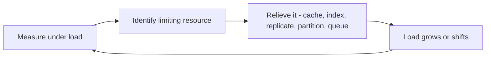

# Scalability

Scalability is **a system's ability to cope with increased load** — more users, more data, more requests — without unacceptable loss of performance. It is not a yes/no property a system has, and it is not a synonym for "big". The precise question is always: *if load grows in a specific way, what breaks first, and what are our options for fixing it?* A system is never "scalable" in general; it scales **with respect to particular load parameters** up to a particular point, beyond which something becomes the bottleneck and the architecture must change.

## Why this matters

- **"Will it scale?" is an unanswerable question until you define load.** Learning to replace it with "what happens when *this specific parameter* grows 10x?" is the single biggest upgrade to your design conversations.
- **Scaling decisions are bottleneck decisions.** Money and effort spent anywhere except the current bottleneck buy nothing. A team that doubles its app servers while the database is the constraint has doubled its bill, not its capacity.
- **Growth changes the problem's shape, not just its size.** The architecture serving 10K requests per second (RPS) is rarely a 100x-bigger copy of the one that served 100 RPS — it is usually a *different* architecture ([[Anatomy of 1M RPS]]). Knowing this stops you from both under-designing and prematurely over-designing ([[What Is System Design]]).

## How it works

### Step 1 — describe load with load parameters

Load is described by numbers called **load parameters**. Which ones matter depends entirely on the system:

| Load parameter | What it stresses | Example question |
|---|---|---|
| **Requests per second (RPS)** | CPU, connection handling, every tier's throughput | "What's peak RPS, and how spiky?" |
| **Read/write ratio** | Whether caches and replicas help (reads) or partitioning is needed (writes) | "100:1 reads, or write-heavy?" |
| **Concurrent users / open connections** | Memory, file descriptors, connection pools, stateful servers | "How many WebSockets held open?" |
| **Data size and growth rate** | Storage, index size, backup time, query latency | "How big in 2 years? Does it fit in RAM?" |
| **Fan-out** | How much internal work one external request triggers | "One write → how many downstream reads/writes?" |
| **Payload size** | Bandwidth, serialization CPU, memory per request | "KB JSON or MB documents?" |

Getting from vague product statements to these numbers is exactly the skill of [[Back of the Envelope Estimation]]. Averages are not enough — peak-to-average ratios and the distribution across users matter, because systems die at peaks and on outliers ([[Latency vs Throughput vs Bandwidth]]).

**Fan-out** is the least intuitive of these and the one most often missing from a capacity estimate: a system with modest external RPS but high fan-out is under far more stress than its public traffic suggests.

### The Twitter fan-out example (DDIA ch. 1)

The canonical illustration, from Kleppmann's *Designing Data-Intensive Applications* (using Twitter's published 2012 figures): Twitter handled roughly **4.6K tweet-posts/sec on average (~12K/sec peak)** but about **300K timeline-reads/sec**. Posting is tiny; reading is the real load. Two designs:

1. **Fan-out on read**: store each tweet once; when a user opens their timeline, query tweets from everyone they follow and merge. Writes are cheap; every timeline read does an expensive multi-way join at request time — 300K/sec of them. Twitter's first architecture, and it could not keep up.
2. **Fan-out on write**: when a user tweets, push that tweet into a precomputed timeline cache (an inbox) for *each follower*. Reads become a cheap single lookup; writes multiply by follower count. At ~75 followers on average, 4.6K tweets/sec becomes ~345K timeline-inserts/sec — but that is affordable because it makes the 300K reads/sec nearly free.

The twist: **the distribution breaks the average.** A celebrity with 30 million followers turns one tweet into 30 million inserts — fan-out on write collapses for exactly those users. Twitter's eventual answer was a **hybrid**: fan-out on write for most users, fan-out on read for high-follower accounts, merged at read time. Three lessons generalize: load parameters (here, followers-per-user) are distributions, not averages; the right architecture depends on the read/write ratio; and extreme outliers often need a different code path ([[Hot Partition Problem]], [[Twitter Timeline Design]], [[Design a News Feed]]).

### Step 2 — find the current bottleneck

At any moment, one resource constrains throughput: CPU on the app tier, database IOPS, a lock, a connection pool, network bandwidth, a single queue consumer. **Scaling is the practice of identifying and relieving the current bottleneck — which reveals the next one.** This loop never ends; mature systems are the accumulated history of relieved bottlenecks.

Practical corollaries:

- **Measure before scaling.** Metrics and load tests ([[Capacity Planning]], [[Logs Metrics and Traces]]) locate the bottleneck; intuition routinely misidentifies it.
- **The bottleneck is usually stateful.** Stateless app tiers scale by adding pods ([[Stateless vs Stateful Services]]); the hard bottlenecks live in databases, caches, and brokers, which is why Modules 4–7 exist.
- **The common escalation ladder for a read-heavy web system**: add an index ([[Database Indexes]]) → add caching ([[Why Caching Works]]) → add read replicas ([[Replication]]) → partition the data ([[Sharding]]) → precompute/denormalize ([[Normalization vs Denormalization]]). Each rung costs more complexity than the last, which is why you climb only when pushed ([[Database Scaling Patterns]]).

### How you actually identify the bottleneck

Three signals, in increasing order of confidence:

1. **A throughput plateau with rising latency.** Offered load keeps climbing; completed operations per second flattens; response time climbs steeply. That combination *is* the definition of a saturated resource — queueing theory's hockey stick ([[Latency vs Throughput vs Bandwidth]]). A resource that is merely busy shows rising throughput *and* rising latency together; a saturated one shows flat throughput only.
2. **One resource near its ceiling while the rest idle.** CPU, IOPS, network, connection-pool occupancy, thread-pool queue depth, consumer lag. The bottleneck is the one that is pinned while its neighbours are not.
3. **The removal test.** Take load off the suspected resource — serve a slice of traffic from cache, disable one feature, pause one consumer — and see whether end-to-end latency drops immediately. If it does, you found it; if it doesn't, you were about to spend money on the wrong tier.

### What a moving bottleneck looks like in production

A composite but realistic sequence — the numbers are illustrative, the shape is the thing to recognise:

- **09:40, salary day.** Balance-check p99 goes from 120 ms to 4 s. Pager fires on the latency SLO's fast-burn rule ([[SLA SLO SLI and Error Budgets]]).
- **The dashboard.** App pod CPU sits at 35% — not it. Mongo CPU is at 92% and its operations/sec is *flat* at ~3,000 while the gateway's request rate keeps climbing. Flat throughput plus rising latency is signal 1: the database is saturated.
- **The root cause.** The balance endpoint reads the account document on every call, and salary day multiplies balance checks, not writes. Nothing was broken; the read path simply had no slack.
- **The fix.** Cache balance reads in Redis ([[Caching Strategies]]). At an 85% hit ratio, Mongo's 3,000 reads/sec becomes 3,000 × 0.15 = **450 reads/sec** — a 6.7× reduction, well inside headroom.
- **The following month.** Same spike, different dashboard: Mongo is at 20%, the single app pod is at 95% CPU and its Tomcat thread pool is full. The bottleneck moved to the app tier — which is the *expected* outcome, not a failure of the fix. Relieving one constraint always promotes the next one.

The lesson is the loop, not the fix. Which constraint is promoted next, and at what load it binds, is exactly what [[Capacity Planning|capacity planning]] computes — and why the answer has to be recomputed after every successful fix rather than inherited from the last incident.

### Step 3 — know your scaling dimensions

When the bottleneck is found, the options are: **scale up** (bigger machine), **scale out** (more machines), or **reshape the work** (cache, precompute, batch, go async via [[Why Async Messaging Exists|queues]]). The up-vs-out decision has its own note — [[Vertical vs Horizontal Scaling]] — but note here that reshaping is often the cheapest: the Twitter hybrid is neither a bigger box nor more boxes, it is *different work*.

### Reads scale differently from writes

The read/write ratio deserves its own mental slot, because the toolkits barely overlap:

| | Scaling reads | Scaling writes |
|---|---|---|
| **Cheap first moves** | [[Database Indexes|Indexes]], [[Why Caching Works|caching]] | Batching, async acceptance via a queue |
| **Copy-based scaling** | [[Replication|Read replicas]] — same data, more servers to read it from | Does not help: every replica must still apply every write |
| **Split-based scaling** | Rarely needed for reads alone | [[Sharding]] — the only way to spread write volume across machines |
| **Precomputation** | Materialized views, fan-out on write ([[CQRS]]) | Moves write cost around rather than removing it |
| **Main new problem introduced** | Staleness: replica lag, [[Cache Invalidation|invalidation]] | Key choice: [[Hot Partition Problem|hot partitions]], cross-shard queries, [[Rebalancing Partitions|rebalancing]] |

The asymmetry explains a lot of architecture: read-heavy systems (most consumer products — timelines, catalogs, balance checks) get far on caches and replicas, which are retrofittable; write-heavy systems (telemetry ingestion, chat, ledgers at scale) need partitioning decisions *early*, because a shard key is hard to change later. It also explains the Twitter hybrid: fan-out on write deliberately converts a read-scaling problem into a write-scaling problem, because Twitter's read volume was the unaffordable side.

### Rough orders of magnitude

A calibration table for what each traffic regime typically demands — indicative, not prescriptive (the real driver is always the measured bottleneck):

| Sustained load | What it usually takes |
|---|---|
| ~100 RPS | One well-built service + one database; design effort goes to correctness, not scale |
| ~1K RPS | [[Load Balancers|LB]] + a few stateless replicas; [[Database Indexes|indexes]] and a [[Why Caching Works|cache]]; a single primary DB still fine |
| ~10K RPS | Serious caching, [[Replication|read replicas]], [[Connection Pooling|connection discipline]], async for non-interactive work; DB write path needs attention |
| ~100K RPS | Partitioned data ([[Sharding]]), [[CDN]] offload, [[Message Queues vs Event Logs|event pipelines]]; per-component capacity plans |
| ~1M RPS | Everything above plus cell-based isolation, custom routing, tail-latency engineering — see [[Anatomy of 1M RPS]] |

The table's real use is *placing yourself*: most systems — including most fintech systems — live in the first two rows, where the correct amount of planet-scale machinery is zero ([[What Is System Design]]).

## Common misconceptions

- **"Scalable means fast."** Different axes. A batch pipeline can be scalable and high-latency; a single-server app can be blazingly fast and unable to scale past one machine. Scalability is about the *slope* of performance versus load, not the intercept.
- **"We'll just add more servers."** Only relieves the bottleneck if the bottleneck is the stateless tier — and it usually isn't. Adding app pods against a saturated database adds zero capacity and more connection pressure ([[Connection Pooling]]).
- **"Design for 100x from day one."** Premature scaling is a real cost: sharded systems are harder to query, operate, and keep consistent. The usual rule of thumb: build for the next order of magnitude, with an idea of how you'd handle the one after — and expect to rearchitect at each one rather than stretch the same design across all of them.
- **"Average load is what matters."** Systems fail at p99 load and on outlier entities (the celebrity, the [[Hot Key Problem|hot key]]). Design against peaks and distributions.
- **"Scalability is only about traffic."** Data volume scales too: a query that was fine at 1 GB can be unusable at 1 TB, backups stop fitting in maintenance windows, and indexes stop fitting in RAM.
- **"The bottleneck is wherever CPU is highest."** CPU is the easiest thing to graph, not the most common constraint. Real bottlenecks are frequently a saturated connection pool, a thread pool whose threads are all blocked on I/O, disk IOPS, a row-level lock, a single-partition consumer, or an external API's rate limit — all of which show *low* CPU while throughput is pinned ([[Connection Pooling]], [[Message Ordering]]).
- **"Autoscaling means we don't need capacity planning."** Autoscaling reacts: it observes a metric, decides, schedules a pod, and waits for it to become ready — a loop that typically takes minutes, while a salary-day spike arrives in seconds. It also scales only the tier you pointed it at, usually the stateless one, which is rarely the constraint ([[Autoscaling]], [[Capacity Planning]]).

## In your stack

- Your fan-out lives in messaging: one domain event (say, a KYC status change) reaches several services at once — in Kafka because every consumer group reads the same log independently at its own offset, in SQS only if you deliberately fan it out through SNS or EventBridge into one queue per consumer, since a single SQS queue hands each message to one competing receiver, not to every consumer. Either way each consumer then does its own writes, so the external request count understates true system load — the fan-out multiplier is a load parameter worth knowing per event type. Worked illustratively: if one KYC-status event is consumed by 4 services and each performs 3 Mongo writes, that is **12 writes per event**; at 200 events/sec during a campaign, the "200/sec" headline is really **2,400 writes/sec** on a shared datastore. Nobody sees that number unless somebody multiplies it out.
- MongoDB is your stateful bottleneck-in-waiting: the escalation ladder above (index → Redis cache → replica reads → [[MongoDB Architecture|sharded cluster]]) is the realistic sequence, and each rung should be climbed on evidence, not anticipation.
- Services pinned at 1 replica have a hard throughput ceiling — one pod's worth. Concretely: a Spring Boot pod with a 200-thread Tomcat pool and a 50 ms mean service time tops out near 200 / 0.05 = **4,000 RPS** by Little's Law, and lower in practice because that 50 ms is not a constant: as the pod's CPU limit binds and downstream queues build, service time rises and the ceiling falls with it ([[Latency vs Throughput vs Bandwidth]]). The ceiling is real and knowable; what matters is knowing which single-replica service meets it first during salary-day bursts or a marketing-campaign OTP storm ([[Autoscaling]], [[Capacity Planning]]).
- Because the app tier is already stateless and JWT-authenticated, relieving an app-tier bottleneck is an HPA setting rather than a redesign ([[Vertical vs Horizontal Scaling]]) — which is precisely why the *interesting* bottlenecks in your stack are Mongo, Redis, and the broker, not the pods.
- Queues are your shock absorber: SQS between a spiky producer and a steady consumer converts a scaling problem into a latency problem (backlog drain time) — usually the right trade for non-interactive work ([[Backpressure and Flow Control]]). The drain arithmetic is worth doing before the incident: a 2-hour burst arriving at 2,000/sec against consumers that sustain 500/sec accumulates 1,500 × 7,200 = **10.8 million** backlogged messages, which then take 10.8M / 500 = 21,600 s ≈ **6 hours** to drain after the burst ends. A queue absorbs the spike; it does not shorten the work.

## Interview angle

- Interviewers probe whether you quantify load before designing: strong candidates ask for DAU, RPS, read/write ratio, and data size, then do [[Back of the Envelope Estimation|envelope math]] unprompted.
- **60-second explanation**: "Scalability is a system's ability to handle growing load, defined by specific parameters — RPS, data size, concurrency, fan-out. It's not binary: every architecture has a bottleneck, and scaling means finding and relieving the current one. The classic example is Twitter's timeline: read-heavy load made them precompute timelines on write, but celebrity accounts broke that with extreme fan-out, forcing a hybrid. The lesson: the right design depends on load parameters and their distributions, not averages."
- Classic follow-ups: "Your traffic 10x'd overnight — walk me through what you'd do" (measure, find bottleneck, cache/replicate before resharding); "Read-heavy vs write-heavy — how do designs differ?" (caches and replicas vs partitioning and queues); "What breaks first in your current system?" — have a real answer from work.
- Saying "load parameter", "read/write ratio", and "the bottleneck moves" signals you've internalized this; hand-waving "we'll autoscale it" signals the opposite.

## Check yourself

> [!question]- Q: Explain why "is this design scalable?" is an ill-posed question, and what to ask instead.
> Scalability is relative to specific load parameters — a design can scale beautifully with RPS but fail when data size outgrows RAM, or handle average fan-out but die on outliers. The well-posed questions: "If parameter X grows 10x, what is the first bottleneck, and what would we change?" asked for each parameter that realistically grows (RPS, data volume, concurrency, fan-out).

> [!question]- Q: In the Twitter example, what exactly breaks if you use pure fan-out on write, and for whom?
> A tweet triggers one timeline-insert per follower. For an average user (~75 followers) that's trivial; for a 30M-follower celebrity one tweet becomes 30M writes, creating a huge write burst, delaying timeline delivery for everyone sharded onto the same infrastructure, and hammering whichever partition holds hot data ([[Hot Partition Problem]]). The fix is a hybrid: precompute for normal accounts, pull celebrity tweets at read time and merge.

> [!question]- Q: What happens if you double your app-server pods while the database is at 95% CPU?
> Throughput barely moves — the database was the bottleneck and still is. It can get *worse*: twice the pods means up to twice the DB connections and more concurrent queries, adding contention and connection-pool pressure ([[Connection Pooling]]). Latency stays flat or degrades. Correct moves target the actual bottleneck: indexes, caching, replicas, or query fixes.

> [!question]- Q: Why do read-heavy and write-heavy systems scale with almost disjoint toolkits?
> Reads can be served from *copies*: caches and read replicas multiply read capacity without touching the source of truth, at the cost of staleness. Writes cannot be copied away — every replica must apply every write, so replication adds zero write capacity. Spreading writes requires *splitting* the data ([[Sharding]]), which brings shard-key design, hot partitions, and cross-shard query pain. Hence: read-heavy systems retrofit caches/replicas late and cheaply; write-heavy systems must get partitioning right early.

> [!question]- Q: A dashboard shows request rate still climbing while completed operations per second has gone flat and p99 is rising steeply. What does that combination tell you, and what does it *not* tell you?
> It tells you some resource is saturated: a busy-but-unsaturated system shows throughput and latency rising together, while a saturated one shows throughput pinned at a ceiling and all additional load converting into queueing delay. What it does not tell you is *which* resource — flat throughput is the symptom of saturation anywhere in the chain, including a thread pool, a connection pool, disk IOPS, a lock, or a single consumer. Narrow it by finding the one resource near 100% while its neighbours idle, then confirm with the removal test: take load off the suspect and see whether latency drops immediately.

> [!question]- Q: Your team ships a Redis cache that drops database reads by 85%, and p99 returns to normal. A month later the same traffic pattern causes the same alert, but the database is now at 20% CPU. Has the fix failed?
> No — it worked, and the bottleneck moved, which is the expected outcome. Relieving a constraint simply promotes whatever was second in line: here, almost certainly the app tier itself (CPU or an exhausted thread pool), or Redis if a single hot key concentrated the traffic ([[Hot Key Problem]]). The mistake would be re-tuning the database because that is where the last incident was. Re-run the identification steps from scratch: find the resource that is pinned now, not the one that was pinned then.

> [!question]- Q: Mini design prompt — a payments service does 50 RPS average, but on the 1st of each month (salary day) peaks at 40x for two hours. Name two fundamentally different ways to handle the peak and the trade-off between them.
> (1) Provision or autoscale compute for ~2,000 RPS: keeps everything synchronous and low-latency, but you pay for peak capacity used two hours a month, autoscaling must outrun the spike, and the *database* must also take 40x — often the real limit. (2) Absorb the spike in a queue: accept requests fast, process at sustainable rate, make processing async and [[Idempotency|idempotent]] — far cheaper and safer for the DB, but users get "accepted" rather than "completed", and the backlog adds minutes of processing delay ([[Why Async Messaging Exists]]). For money movement, (2) with clear status tracking is usually right; latency-critical steps like OTP still need (1).

## Sources

- *Designing Data-Intensive Applications*, Martin Kleppmann — ch. 1, "Scalability": load parameters, the Twitter fan-out worked example (figures are Twitter's 2012-era published numbers), and percentile thinking.
- Raffi Krikorian, "Timelines at Scale" (QCon talk, 2012) — the primary source for Twitter's hybrid timeline architecture, expanded on in [[Twitter Timeline Design]].
- *The Art of Scalability*, Abbott & Fisher — the AKF scale cube: a vocabulary for scaling by cloning, splitting by function, and splitting by data.
- Google SRE Book — ch. 1, section "Demand Forecasting and Capacity Planning": organic vs inorganic (launch- or campaign-driven) growth, and load testing to tie raw capacity to service capacity.
