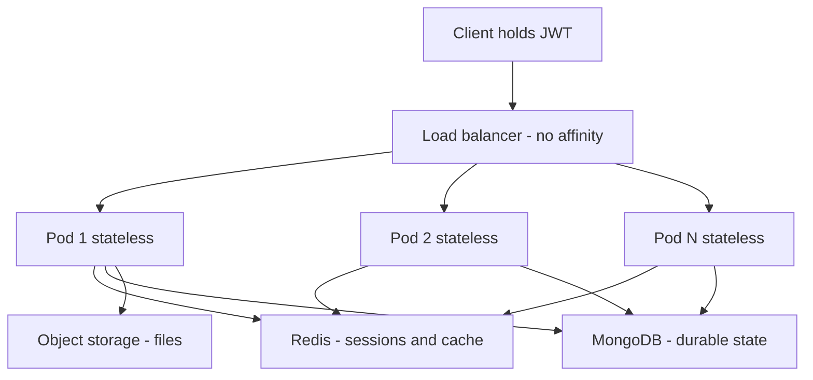

# Stateless vs Stateful Services

A **stateless service** keeps nothing between requests: every request carries (or can fetch) everything needed to process it, and after responding, the server forgets. A **stateful service** remembers — sessions in memory, files on local disk, long-lived connections, in-progress workflows. The distinction matters because statelessness is the property that makes [[Vertical vs Horizontal Scaling|horizontal scaling]], rolling deploys, and automatic failover *trivial*: if no server is special, any server can serve any request, and servers become replaceable cattle. The state never disappears — it moves to purpose-built stores (Redis, the database, the token itself) that are engineered for exactly the problems state creates.

## The problem that created it

Picture the standard growth story. Version 1 is one server: it authenticates a user, stores the session in a `HashMap` (or servlet session), keeps a shopping-cart-in-progress in memory, writes uploads to `/var/uploads`. Everything works, because there is exactly one server and every request lands on it.

Traffic grows. You add a second server behind a [[Load Balancers|load balancer]] — and the app breaks in a new, maddeningly intermittent way: a user logs in (request lands on server A, session created in A's memory), clicks the next page (request lands on server B — *no session*), and is logged out. Carts vanish. Uploaded files 404 half the time, because the file is on A's disk and the download request hit B.

Nothing is "down"; the architecture is simply wrong: **the servers remember things, and the load balancer assumes they don't.** Teams at this point face a fork:

- The quick patch: **sticky sessions** — configure the LB to pin each user to one server. The bugs disappear. The costs arrive later (below).
- The real fix: **make the servers stateless** — move sessions, carts, and files to shared stores, so any server can serve anyone.

The same problem re-arises at every operational event, not just scaling: a deploy restarts the process (sessions gone), a pod gets OOM-killed (carts gone), an autoscaler scales in (whichever users were pinned there, gone). Statefulness turns every routine operation into a small outage.

## What it solves

Making the service tier stateless solves, in one move:

- **Arbitrary load balancing** — any request to any replica; the LB can use pure least-load routing with no affinity bookkeeping.
- **Elastic scaling** — adding a pod adds capacity instantly (nothing to warm or migrate); removing one loses nothing ([[Autoscaling]]).
- **Failure transparency** — a crashed replica is a non-event; the next request goes elsewhere with no user-visible loss ([[Availability Reliability Durability]] redundancy math only works when replicas are interchangeable).
- **Safe deploys** — rolling restarts and [[Deployment Strategies|blue-green/canary]] deploys kill processes freely; no session-draining choreography.
- **Simpler reasoning** — request handling becomes a pure-ish function of (request, shared stores); no per-server hidden variables when debugging.

## How it works

The state doesn't vanish — it is **relocated by category** to systems designed to hold it:

| State in the server | Where it goes | Why there |
|---|---|---|
| Login/session data | **Redis** (external session store), or into a signed token (**JWT**) carried by the client | Redis: shared, fast (~ms — [[Latency Numbers Every Engineer Should Know]]), TTL-native. JWT: no store at all — the state travels with the request, server only verifies the signature ([[How JWT Works]], [[Sessions vs Tokens]]) |
| Business data, in-progress workflows, carts | **Database** (MongoDB/MySQL) | Needs durability and queryability ([[Availability Reliability Durability]]) |
| Cached computation | **Redis/Memcached** as shared cache | Shared hit-ratio across replicas; per-pod caches fragment it ([[Caching Strategies]]) |
| Files/uploads | **Object storage** (S3) | Durable, any-replica-accessible ([[How S3 Works]]) |
| Cross-request coordination (locks, counters, rate counts) | Redis / database with care | Needs atomicity across replicas ([[Distributed Locking]], [[Rate Limiting]]) |
| Work-in-flight | **Queue/log** (SQS, Kafka) | Survives consumer death; redelivers ([[Message Queues vs Event Logs]], [[Delivery Semantics]]) |

The request flow with externalized state: client presents a JWT (identity travels in the request); the pod validates the signature statelessly, fetches whatever durable state it needs from Mongo/Redis by key, processes, writes back, responds, forgets. Every pod is a clone; the "memory" of the system lives entirely in the stores and the token.

**The honest footnote: statelessness is relocation, not elimination.** The stateful layer still exists — it's now Redis, the database, the queue — and *those* systems must solve replication, failover, and consistency ([[Replication]], [[Redis Cluster and Sentinel]], [[MongoDB Architecture]]). The win is separation of concerns: a handful of hardened stateful systems, operated carefully, serving a fleet of disposable stateless ones. Some services are also *irreducibly* stateful — databases themselves, [[WebSockets Server-Sent Events and Long Polling|WebSocket connection]] holders, game servers, [[Kafka Architecture|brokers]] — and they pay the full price: careful [[Failover]], [[Rebalancing Partitions|data movement]], ordered deploys (StatefulSets in Kubernetes terms).

### Sticky sessions — the tempting half-measure

**Sticky sessions** (session affinity) make the LB route each user to the same server — via a cookie or source-IP hash. They let stateful servers hide behind a load balancer. The problems:

1. **Failure still loses state** — the pinned server dies, its users' sessions die with it. You've scaled out without gaining the availability that was the point ([[Vertical vs Horizontal Scaling]]).
2. **Load skews** — long-lived heavy users pile onto some servers; the LB can't rebalance without breaking sessions. Hot spots form ([[Hot Key Problem]] at the server level).
3. **Scaling in/deploys hurt** — removing a server means draining it slowly or dropping its users; autoscaling's whole speed advantage evaporates.
4. **It hides the debt** — the app still *can't* run stateless, and every operational procedure must remember that.

Legitimate uses exist: short-lived affinity for connection-oriented protocols (WebSockets must stick by nature), as a *performance hint* over a shared store (pin for cache locality, fall back safely on miss), or as a deliberate bridge while refactoring a legacy app. The trap is using stickiness as the *correctness* mechanism.

### How to check whether a service is really stateless

A concrete audit, worth running on any service before raising its replica count:

1. Grep for mutable statics, instance-level collections, and `@Scheduled` jobs that assume "only one of me exists" — singleton-cron logic double-fires the moment N=2 (fix with a [[Distributed Locking|distributed lock]] or a leader-elected job runner).
2. Look for local filesystem writes outside `/tmp`-style scratch use within a single request.
3. Check whether any in-memory cache is treated as *authoritative* rather than as a disposable hint.
4. Kill a pod mid-traffic in staging and replay the affected user's flow — any user-visible loss is state you forgot about ([[Chaos Engineering]]).

## Trade-offs

| You gain | You pay |
|---|---|
| Any-replica routing, trivial scaling and failover | Every request pays a network hop for state (Redis/DB ~0.5–5 ms) that RAM gave for ~100 ns |
| Free rolling deploys and autoscaling | Shared stores become critical dependencies — Redis down can mean *all* sessions down ([[Redis Cluster and Sentinel]]) |
| Interchangeable cattle; simple ops | State problems don't vanish — they concentrate in the stateful tier, which must be engineered well |
| Horizontal cost curve on the app tier | JWT route: tokens can't be revoked server-side without reintroducing state ([[JWT Pitfalls]]) |
| Clean mental model per request | More moving parts per request; more things to time out and retry ([[Timeouts Retries and Exponential Backoff]]) |

## Failure modes

- **The session store becomes the single point of failure.** All pods depend on Redis; a Redis outage logs out every user at once — a *worse* blast radius than one sticky server dying. Mitigations: Redis HA ([[Redis Cluster and Sentinel]]), short-TTL JWT access tokens so auth survives brief store outages, and degrading gracefully ([[Load Shedding and Graceful Degradation]]).
- **Hidden state sneaks back in.** An in-memory "small" cache without TTL, a local file written "temporarily", a static counter — each reintroduces per-replica divergence that surfaces as flaky, replica-dependent bugs. Detected by: bug reports that depend on *which pod* served the request; chaos-style pod kills in staging ([[Chaos Engineering]]).
- **Retries double-apply effects.** Stateless tiers invite aggressive retries (any replica can serve!), but a retried *write* without [[Idempotency]] double-charges. Statelessness makes retries routable, not safe.
- **Fat JWTs and stale claims.** Teams stuff roles/limits into tokens to avoid lookups; now permission changes don't take effect until expiry, and revocation needs a denylist — state through the back door ([[JWT Pitfalls]], [[Refresh Tokens and Token Rotation]]).
- **Cache-locality collapse.** Moving from sticky to stateless spreads each user across all pods; per-pod cache hit ratios crater and the DB feels sudden load — plan the shared-cache migration together with the stickiness removal ([[Why Caching Works]]).

## When NOT to use it

Statelessness is the right default for request/response services, but:

- **Irreducibly stateful workloads** — databases, brokers, coordination services ([[Consensus and Raft]]), anything holding open [[WebSockets Server-Sent Events and Long Polling|WebSockets]] — don't pretend; use StatefulSet-style patterns, careful failover, and connection re-establishment protocols instead.
- **Ultra-low-latency paths** where a ~1 ms Redis hop per request is unaffordable (trading systems, in-memory matching engines — [[Design a Stock Exchange]]): deliberate statefulness with replication of the state machine itself.
- **Single-instance tools** (internal admin app, one cron) — externalizing state is engineering spend with no payoff until there's a second replica; just know which category you're in.
- **Heavy per-user working sets** (interactive ML sessions, collaborative-document servers): re-fetching per request is prohibitive; these systems shard *users* to servers deliberately and manage the consequences ([[Sharding]]).

## In your stack

- Your platform is the textbook stateless layout: Spring Boot pods on EKS, JWTs from central IAM validated per-request ([[How JWT Works]]), Redis for sessions/cache, MongoDB for durable state, S3 for documents. Any pod can serve any user — which is exactly what lets Kubernetes reschedule pods freely.
- The 1-replica cost decision changes the *payoff*, not the pattern: statelessness at N=1 buys you clean restarts and instant scale-*out when needed*, but not availability — a pod restart is still a brief outage. The design is "horizontally scalable", the deployment is not ([[Vertical vs Horizontal Scaling]]).
- Watch the JWT/state boundary: central IAM issuing tokens means logout/compromise revocation needs either short expiries + [[Refresh Tokens and Token Rotation|refresh rotation]] or a Redis denylist — your stack already pays that known tax.
- Kubernetes enforces statelessness mechanically: pod filesystems are ephemeral, OOM-kills and node drains happen without warning — any state not in Redis/Mongo/S3 *will* eventually be lost in prod, not hypothetically ([[Graceful Shutdown and Deployment Safety]]).
- Fintech angle: idempotency keys for money-moving endpoints are the stateless tier's correctness companion — any replica may receive the retry, so the dedup record must live in a shared store (Redis/Mongo), never in process memory ([[Idempotency]]).

## Interview angle

- This is a gateway topic: interviewers use it to check you understand *why* "add more servers" works at all. The key sentence: **"statelessness is what makes replicas interchangeable; interchangeability is what makes horizontal scaling and failover trivial."**
- **60-second version**: "A stateless service keeps nothing between requests — identity arrives in a JWT, durable state lives in the DB, shared fast state in Redis, files in S3. That makes every replica identical, so load balancers route freely, deploys and crashes are non-events, and scaling is adding pods. The state doesn't disappear — it concentrates in stores built for it. Sticky sessions are the tempting shortcut: they pin users to servers, which skews load, still loses sessions on failure, and blocks clean deploys — acceptable as a bridge or for WebSockets, wrong as the correctness mechanism."
- Classic follow-ups: "Where does the session go, and the trade-offs of Redis vs JWT?" (lookup-per-request + instant revocation vs zero-lookup + revocation pain — [[Sessions vs Tokens]]); "What's still stateful in your 'stateless' architecture?" (the stores, the queues, the LB's health view); "How do WebSockets fit?" (connections are state; stick by connection, keep *application* state external so reconnects land anywhere); "Does stateless mean no caching?" (no — shared caches, or local caches treated as disposable hints).

## Check yourself

> [!question]- Q: Explain the causal chain from "server keeps sessions in memory" to "we can't autoscale".
> In-memory sessions make each server unique: it holds state no other replica has. The LB must then pin users (sticky sessions) for correctness. Pinning means removing a server destroys its users' sessions — so scale-in and rolling deploys become user-visible events requiring slow draining, and the autoscaler can't freely add/remove capacity. Interchangeability is the property autoscaling needs, and local state is precisely what destroys it.

> [!question]- Q: What happens if Redis (your session store) goes down for 90 seconds in a stateless architecture — and how do you design so this isn't a full logout of every user?
> Naively, every request needing session data fails: effectively a total auth outage — centralizing state concentrated the blast radius. Designs that soften it: JWT access tokens that validate by signature alone for their lifetime (~5–15 min), so most requests never touch Redis and the outage only blocks refresh/logout; Redis HA with [[Failover|automatic failover]] ([[Redis Cluster and Sentinel]]); treating session-store errors as degraded mode for read-only endpoints ([[Load Shedding and Graceful Degradation]]). The lesson: statelessness moves the availability problem; you still must solve it, once, in the store.

> [!question]- Q: A teammate proposes sticky sessions to fix "users getting logged out" after scaling to 3 pods. Give the honest trade-off analysis and your recommendation.
> Stickiness fixes the symptom today with one LB setting: zero code change. Costs: sessions still die with a pod (deploys/OOM-kills log users out — on EKS these are routine), load skews across pods and can't rebalance, scale-in requires draining, and the app remains architecturally unable to run stateless. Recommendation: stickiness only as an explicit, time-boxed bridge; real fix is externalizing sessions (Spring Session + Redis is a near-drop-in) or moving to JWT ([[Sessions vs Tokens]]) — then remove the affinity and let the LB balance freely.

> [!question]- Q: Mini design prompt — a document-upload flow: user uploads KYC documents in 3 steps (upload, preview, confirm) over several minutes. Design it so the service tier stays stateless; what fails if you don't?
> Stateless design: on upload, stream the file straight to S3 under a draft key; write a draft record (userId, s3Key, step, expiry) to MongoDB or Redis-with-TTL; return a draftId to the client, which carries it (plus JWT) through preview and confirm — any pod can serve any step by looking up draftId. Confirm flips the record's status and moves/retags the S3 object; an expiry job cleans abandoned drafts. If instead the file sits on the pod's disk and progress in memory: preview 404s when step 2 hits another pod, a deploy mid-flow loses the upload entirely, and the fix would end up being sticky sessions with all their costs. Note the pattern: the *workflow* is stateful — the state just lives in stores, not in pods.

## Sources

- *Designing Data-Intensive Applications*, Kleppmann — shared-nothing architectures (ch. 1, ch. 6 intro) and the general principle of pushing state into specialized systems.
- Twelve-Factor App (12factor.net) — factor VI "Processes: execute the app as one or more stateless processes"; the canonical statement of the pattern for cloud deployment.
- AWS Builders' Library / Well-Architected Framework — guidance on stateless application tiers, session externalization (ElastiCache) and when to use sticky sessions on ALB (official ALB docs describe the affinity mechanisms and caveats).
- Spring Session documentation (spring.io) — the concrete Redis-backed session externalization path for the reader's own framework.
