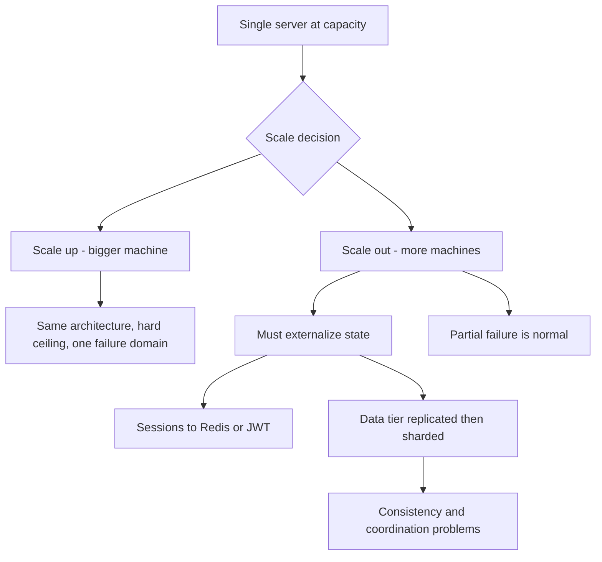

# Vertical vs Horizontal Scaling

When a machine can no longer handle its load, you have exactly two moves: make the machine bigger (**vertical scaling**, "scale up") or add more machines (**horizontal scaling**, "scale out"). Vertical scaling is operationally trivial but hits a hard ceiling and a steep price curve; horizontal scaling has no practical ceiling but converts your application into a distributed system, with every problem that implies. Most real systems use both: scale up until it stops being cheap or possible, scale out where the architecture allows it — and pay the engineering cost to *make* it allow it.

## Why this matters

- This is the first fork in every scaling conversation, and the cheap answer changes over a system's life: early on, a bigger box is almost always right; later, it is almost always unavailable.
- Horizontal scaling is not free capacity — it is a *contract*: you get elastic capacity in exchange for solving state, session, and consistency problems. Teams that scale out without paying that cost build systems that are distributed but not correct.
- Understanding *why* vertical runs out (physics and pricing) and *what* horizontal forces (the rest of this curriculum, essentially) is the frame for Modules 5–9: [[Replication]], [[Sharding]], and [[Consensus and Raft|consensus]] all exist because someone scaled out a stateful system.

## How it works

### Vertical scaling — scale up

Replace the machine with a bigger one: more cores, more RAM, faster disks (NVMe), faster network. Nothing about the application changes — same code, same single database, same transactions.

**Why it's attractive:**
- Zero architectural work. A single-node system keeps its simplest properties: local function calls, single-machine [[ACID Transactions|ACID transactions]], no network partitions between components, trivial debugging.
- It goes further than folklore says. As of 2026 a single cloud instance can offer hundreds to nearly two thousand vCPUs and tens of TB of RAM (AWS's largest high-memory instance, u7inh-32tb, has 1,920 vCPUs and 32 TiB). "We outgrew one machine" is false for the vast majority of businesses — a point the [[Why MySQL Does Scale]] and [[WhatsApp and the Small-Team Scale Story]] stories both make.

**Why it runs out anyway:**
1. **A hard ceiling exists.** At any moment there is a biggest buyable machine; demand beyond it has nowhere to go.
2. **The cost curve turns superlinear.** Commodity hardware is priced linearly; top-end hardware is priced like a scarce good. Roughly, twice the machine costs more than twice the money at the high end — while two commodity machines cost almost exactly twice one. Scale-out rides the cheap flat part of the curve; scale-up climbs the expensive steep part.
3. **Diminishing returns within the box.** More cores don't help a workload serialized on a lock or a single write head; memory bandwidth and NUMA effects mean 2x cores rarely yields 2x throughput.
4. **It does nothing for availability.** One machine is one failure domain. The biggest server still takes your whole service down when it dies, reboots for patches, or its AZ fails ([[Availability Reliability Durability]]). Scaling up can even concentrate risk: one giant blast radius instead of several small ones.
5. **Resizing is disruptive.** Upgrading an instance typically means a restart or a migration — downtime or a failover event for a stateful node, planned weeks ahead. Scale-out adds capacity in minutes without touching existing nodes ([[Autoscaling]]).

### Horizontal scaling — scale out

Run the workload on many commodity machines behind a [[Load Balancers|load balancer]]. Capacity is added by adding machines; failures are absorbed because no single machine is special.

**What you gain:**
- **Near-linear, elastic capacity** on the cheap part of the hardware price curve, adjustable to load in minutes.
- **Availability through redundancy**: N machines behind a balancer tolerate machine death; the redundancy math in [[Availability Reliability Durability]] only works when there is more than one of a thing.
- **No ceiling in practice**: web-scale systems run on thousands of nodes.

**What it forces you to solve — the real price:**

1. **State.** A request can now land on *any* server, so a server holding data in local memory or on a local disk is a bug waiting to fire. The application tier must become [[Stateless vs Stateful Services|stateless]], pushing every piece of state out to shared infrastructure — cache, database, object store. This is the foundational refactor; everything else below follows from it.
2. **Sessions.** The classic first casualty: user logged in on server A, next request hits server B, "please log in again." Fixes: externalize sessions to Redis, or carry the session in a signed token ([[How JWT Works]], [[Sessions vs Tokens]]). The anti-fix — sticky sessions — pins users to one server and quietly reintroduces the single-machine failure mode ([[Stateless vs Stateful Services]] covers why).
3. **The data tier must scale too — and that's the hard part.** Stateless app servers multiply easily; now the database is the bottleneck ([[Scalability]]). Scaling *it* out means [[Replication]] (copies of the data — introduces replication lag and stale reads) and eventually [[Sharding]] (splitting the data — introduces shard keys, [[Hot Partition Problem|hot partitions]], cross-shard queries, and [[Rebalancing Partitions|rebalancing]]). The entire Modules 6–7 syllabus is the bill for this line item.
4. **Consistency and coordination.** With one machine, "what is the current value?" has one answer. With many, you must choose how much divergence to tolerate ([[Consistency Models]], [[CAP Theorem]]), order events across nodes ([[Logical Clocks and Ordering]]), and agree on who is in charge ([[Consensus and Raft]], [[Split Brain and Fencing]]). Anything that must happen exactly once now needs explicit design ([[Idempotency]], [[Exactly-Once Delivery Is a Lie]]).
5. **Partial failure.** One machine is up or down. A fleet is *always* partially broken: some node slow, some network path flaky ([[The Fallacies of Distributed Computing]], [[Network Partitions and Timeouts]]). Every inter-node call now needs [[Timeouts Retries and Exponential Backoff|timeouts and retries]], and operations need [[Health Checks and Service Discovery|health checks]], [[Load Balancers|balancing]], and [[Distributed Tracing|tracing]] just to see what's happening.

### The comparison in one table

| | Vertical (up) | Horizontal (out) |
|---|---|---|
| Architectural change | None | Stateless app tier, shared state, distributed data |
| Cost curve | Superlinear at the top end | ~Linear (commodity nodes) |
| Ceiling | Hard (biggest buyable box) | Practically none |
| Availability | Unchanged — one failure domain | Improved via redundancy (if state allows) |
| Adding capacity | Restart/migration, planned | Add nodes in minutes |
| Consistency | Trivial (one node) | A design problem you now own |
| Operational complexity | Low | High — orchestration, discovery, tracing |
| Right when | Load fits one machine's economics | Load/availability needs exceed one machine |

### Where the cost curve actually crosses

"Vertical costs more per unit of capacity" is true but too blunt to argue a budget with. Within a commodity cloud instance family, pricing is essentially **linear**: doubling the instance size roughly doubles the hourly price, so cost per vCPU is flat across most of the ladder. The superlinearity lives at the *edges* — the specialized high-memory and bare-metal sizes at the top of the range, and, on-premises, multi-socket servers where a four-socket chassis costs far more than four single-socket boxes.

Use an illustrative ladder with that shape. The prices are invented; the curve is not:

| Instance | vCPU | Price/hour | Price per vCPU-hour |
|---|---|---|---|
| Commodity, mid-family | 32 | $8 | $0.250 |
| Commodity, mid-family | 64 | $16 | $0.250 |
| Top of family | 128 | $40 | $0.313 |
| Specialized high-memory | 448 | $200 | $0.446 |

To obtain 128 vCPUs: one 128-vCPU box costs **$40/h**; four 32-vCPU boxes cost 4 × $8 = **$32/h** — 20% cheaper, and the fleet survives losing one node. That looks decisive until you price the other side. Scale-out loses capacity to coordination (serialization, cross-node chatter, a duplicated JVM heap and local cache on every node) and adds fixed costs: a load balancer, more things to deploy, patch, and monitor. If coordination costs 15% efficiency, four nodes do the work of 4 × 0.85 = 3.4, so you need five — 5 × $8 = **$40/h** — and the price advantage is gone before anyone has billed an engineer-hour.

So state the crossover as a condition, not a price:

> **Scale out when the vertical price premium exceeds the horizontal overhead** — premium being what you pay per unit of capacity above commodity pricing, overhead being capacity lost to coordination, plus fixed per-fleet costs, plus the amortized engineering cost of making the workload distributable.

Three readings of that condition explain why real decisions look the way they do:

- **Stateless app tiers**: the engineering cost is already paid and coordination is near zero, so the condition is satisfied almost immediately. Scale out.
- **Databases**: the engineering cost of [[Sharding]] is enormous and effectively irreversible, so the premium must be large before it pays. Hence "up first, then out".
- **Availability is a term the formula hides.** If the requirement is to survive node or AZ loss, no vertical price makes one box acceptable and the crossover never applies ([[Availability Reliability Durability]]).

### How much of N you actually get

Even where scale-out is right, N machines never deliver N× throughput. Whatever fraction of each request's work serializes on a shared resource — a single primary database, a global lock, a leader node, one partition everything funnels through — sets a ceiling independent of fleet size. This is Amdahl's law applied to fleets: if a fraction **s** of the work serializes, the speedup on N nodes is `1 / (s + (1 − s)/N)`.

At s = 5%, a figure that sounds negligible:

| Nodes | Speedup | Efficiency |
|---|---|---|
| 2 | 1.90× | 95% |
| 4 | 3.48× | 87% |
| 10 | 6.90× | 69% |
| 50 | 14.49× | 29% |
| 100 | 16.81× | 17% |
| unbounded | 20× | → 0% |

Two readings. First, the ceiling is 1/s = **20×** no matter what you spend; past roughly twenty nodes you are mostly buying electricity. Second, the efficiency column *is* the budget conversation: at fifty nodes you pay for fifty and receive fourteen and a half. The engineering response is not more nodes — it is shrinking **s**: removing the shared lock, partitioning the hot collection, making the leader do less ([[Sharding]], [[Distributed Locking]]).

### How real systems actually decide

- **Stateless tiers: always out.** There is no reason to scale up an app server past the point where one more pod is cheaper — which is almost immediately. This is Kubernetes' default worldview.
- **Databases: up first, then out.** Because scaling a database out is so expensive in engineering terms, the standard ladder is: tune queries and indexes → [[Caching Strategies|caching]] → read [[Replication|replicas]] → bigger instance → functional split → [[Sharding]] last ([[Database Scaling Patterns]]). Teams that shard before exhausting vertical headroom buy complexity they didn't need.
- **Both at once.** A fleet of large-ish nodes usually beats either extreme: too-small nodes waste overhead per node and multiply coordination; one giant node concentrates risk.

### A decision checklist

When the "up or out?" question lands on a specific service, walk these in order:

1. **Is the bottleneck even this tier?** Confirm with measurement first ([[Scalability]]) — scaling the wrong tier is the most common waste.
2. **Is the tier stateless?** Yes → scale out, almost unconditionally; the marginal pod is cheap and the work is already done. No → continue.
3. **How far does vertical headroom go, and at what price?** If the next instance size up is 2× the cost for 2× the capacity, take it and defer the hard problem. If you're entering the superlinear zone or within ~2 instance sizes of the ceiling, start the scale-out work *now* — it takes quarters, not sprints, for stateful systems.
4. **What does the availability requirement say?** If the service must survive node/AZ loss, vertical alone can never satisfy it — you need ≥2 replicas regardless of capacity ([[Availability Reliability Durability]]), which forces the statefulness question anyway.
5. **Which scale-out problems does this workload actually trigger?** Read-mostly data → replicas are enough ([[Replication]]). Heavy writes or data too big for one node → [[Sharding]], the expensive door. Session-type state → externalize it ([[Stateless vs Stateful Services]]) and the problem dissolves.
6. **Write down the revisit trigger.** "At X RPS or Y GB we start partitioning" turns a future crisis into a planned project.

## Common misconceptions

- **"Horizontal is modern, vertical is legacy."** Vertical is often the *correct* engineering answer: Stack Overflow famously served its global traffic for years on a handful of beefy servers. Complexity is a cost; a bigger box is sometimes the cheapest way to not pay it.
- **"We're on Kubernetes, so we scale horizontally."** Your *stateless pods* do. If MongoDB or Redis is the bottleneck, adding pods does nothing ([[Scalability]]) — and a service pinned at 1 replica is effectively a vertically-scaled system wearing Kubernetes clothes.
- **"Scaling out N× gives N× throughput."** Coordination overhead (shared caches, lock contention, [[Consensus and Raft|consensus]] traffic, cross-node chatter) means sublinear returns — Amdahl's law applied to fleets. The serialized fraction of the workload caps speedup no matter how many nodes you add.
- **"Sticky sessions make horizontal scaling work with stateful servers."** They make it *limp*: load skews toward long-lived sessions, a server death still loses its sessions, and deploys drain painfully. It's a bridge, not a destination ([[Stateless vs Stateful Services]]).

## In your stack

- Your Spring Boot services on EKS are built for scale-out — stateless, JWT-authenticated ([[How JWT Works]]), sessions externalized to Redis — yet many run pinned at 1 replica for cost. That's the horizontal *architecture* with vertical *economics*: the scaling work is pre-paid, and turning capacity on is an HPA setting, not a redesign ([[Autoscaling]]).
- At 1 replica, "what you gain: availability" is explicitly forfeited — but precisely, not sweepingly. A rolling *deploy* can be gapless even at one replica, because Kubernetes rounds `maxSurge` up to 1 and `maxUnavailable` down to 0, so the replacement pod must pass readiness before the old one is terminated ([[Graceful Shutdown and Deployment Safety]]). What one replica can never survive is **unplanned** loss — eviction, OOM kill, node drain, AZ event — where there is no peer and the service is simply absent until a new pod starts. The honest framing: you bought elasticity-on-demand, not resilience, and [[SLA SLO SLI and Error Budgets]] works out what that costs in budget minutes.
- MongoDB follows the "up first, then out" ladder: replica sets give you read scaling and failover ([[MongoDB Architecture]]); sharding is the last rung, and the shard-key choice is where [[Hot Partition Problem]] risk enters.
- Kafka and SQS consumers both scale out by adding competing consumers ([[Consumer Groups and Rebalancing]]), but what caps that parallelism is the ordering guarantee you asked for, and it differs per product: Kafka orders only within a partition, so one consumer group can usefully run at most one consumer per partition; SQS FIFO orders within a message group, so throughput scales with the number of distinct group IDs; plain standard SQS promises no ordering at all and therefore imposes no such ceiling. Picking the ordering key is picking the horizontal-scaling limit ([[Message Ordering]]).

## Interview angle

- The lazy answer interviewers screen out is "just scale horizontally." The strong answer names the forced problems: "scale out the stateless tier behind an LB; sessions move to Redis or a token; the database becomes the bottleneck, so replicas for reads, sharding only if write volume demands it — and here's the consistency cost of each step."
- **60-second version**: "Vertical scaling means a bigger machine — zero architectural change, but a hard ceiling, superlinear cost at the top, and no availability benefit. Horizontal means more machines — near-linear cost and no ceiling, but it forces you to externalize state, fix sessions, scale the data tier via replication and sharding, and handle partial failure and consistency. Stateless tiers always scale out; databases scale up first because scaling them out is the expensive part."
- Classic follow-ups: "Why not sticky sessions?" (skewed load, lost sessions on death, painful drains); "When would you choose a bigger DB instance over sharding?" (almost always, until write volume or data size genuinely exceeds one primary — sharding is irreversible complexity); "Does horizontal scaling improve latency?" (no — it improves throughput and availability; a single request isn't faster on 50 machines than 5).

## Check yourself

> [!question]- Q: Explain why vertical scaling "runs out" — name at least three independent reasons.
> (1) Hard ceiling: there's always a biggest buyable machine. (2) Superlinear cost: top-end hardware pricing grows faster than capacity, while commodity scale-out is ~linear. (3) No availability gain: one machine remains one failure domain, and planned resizes mean downtime. (4) Diminishing in-box returns: locks, memory bandwidth, and serialized code mean 2x hardware < 2x throughput.

> [!question]- Q: What happens if you horizontally scale an app tier whose servers keep login sessions in local memory?
> Users get randomly logged out: a session created on server A is invisible to server B, and the load balancer routes requests to arbitrary servers. Teams then reach for sticky sessions, which skew load, lose sessions whenever a server dies or deploys, and block even draining a node cleanly. The real fix is externalizing session state to Redis or moving to signed tokens ([[Sessions vs Tokens]], [[Stateless vs Stateful Services]]).

> [!question]- Q: Why does scaling out the app tier often *increase* pressure on the database, and what's the standard escalation to deal with it?
> Each new app instance opens its own DB connection pool and issues queries independently, so N× instances means up to N× connections and concurrency hitting a database that hasn't gotten any bigger ([[Connection Pooling]]). The standard ladder: fix queries/indexes → cache hot reads ([[Why Caching Works]]) → read replicas ([[Replication]]) → shard only when writes or data size demand it ([[Sharding]], [[Database Scaling Patterns]]).

> [!question]- Q: Horizontal scaling improved your throughput but a user complains a single request is still slow. Why didn't adding machines help, and what would?
> Scale-out adds *parallel capacity*: more requests served concurrently. One request still runs on one machine at the same speed — its latency is set by per-request work: queries, round trips, serialization ([[Latency vs Throughput vs Bandwidth]]). What helps latency: better indexes, caching, fewer sequential hops, batching round trips ([[Latency Numbers Every Engineer Should Know]]), or moving data closer to the user. Exception: if latency was *queueing delay* from saturation, extra machines do help — which is why you check utilization before optimizing code.

> [!question]- Q: A batch job moved from 10 workers to 50 and throughput rose only 2.1×, not 5×. Infrastructure insists the cluster is healthy. What is the likely explanation, and what would you measure?
> A serialized fraction, and the numbers fit it almost exactly. With roughly 5% of each unit of work serialized on a shared resource, Amdahl's law gives 6.90× at 10 nodes and 14.49× at 50 — a ratio of 2.10, which is what was observed. The cluster really is healthy; you are simply buying parallelism the workload cannot use. Measure where the serialization lives: time waiting on the shared primary or a single collection, lock-wait time, coordinator or leader round trips, one partition every worker funnels through. Adding workers cannot help — the ceiling is 1/0.05 = 20× regardless of fleet size. The fix is to shrink the serialized fraction: partition the contended data, batch the shared writes, or move the coordination out of the per-item path.

> [!question]- Q: Your database instance is near the top of its family and the next size up is 25% more expensive per unit of capacity. Does that automatically justify sharding?
> No — a 25% premium is a weak signal on its own, because the comparison is not "premium vs zero" but "premium vs horizontal overhead". Sharding's overhead includes capacity lost to cross-shard work, the operational cost of a fleet, and — dominating everything — the engineering cost of choosing a shard key, migrating data, and rewriting queries that can no longer span shards ([[Sharding]], [[Secondary Indexes on Sharded Data]]). That cost is measured in quarters and is effectively irreversible, so it has to be amortized over years of premium to pay. What *would* justify starting now: data or write volume genuinely approaching one primary's ceiling, or an availability requirement a single primary cannot meet — because then the alternative is not more expensive, it is unavailable.

> [!question]- Q: Mini design prompt — a reporting service runs monthly on one 8-core box and now takes 30 hours, blowing its 24-hour window. Scale up or out? Argue both, then choose with stated assumptions.
> Up: a 32-core, more-RAM box might cut the time under 24h with zero code change — right answer if the job parallelizes poorly or the deadline is near; but it's a ceiling-bound fix, and if data grows 2x/year you're back here within a year. Out: partition the input (by account range, by day) and process on N workers — scales with data growth and survives worker failure, but requires the job to be partitionable, adds a coordinator/queue ([[Why Async Messaging Exists]]), and merge logic. Choice: if the job is embarrassingly parallel, scale out — monthly batch is the ideal case (no consistency or session problems, workers are stateless); if a single sort/join dominates, scale up now and re-architect before the next doubling.

## Sources

- *Designing Data-Intensive Applications*, Kleppmann — ch. 1 on scaling approaches ("shared-nothing" architectures) and the honest treatment of distributed complexity as a cost.
- *The Art of Scalability*, Abbott & Fisher — the AKF scale cube: X-axis (clone/horizontal), Y-axis (functional split), Z-axis (data split).
- Nick Craver's "Stack Overflow: The Architecture" series — the canonical scale-up success story, with the hardware inventory published.
- AWS EC2 instance documentation — current ceilings for vertical scaling (high-memory instance family); useful for calibrating "how big is the biggest box" claims.
