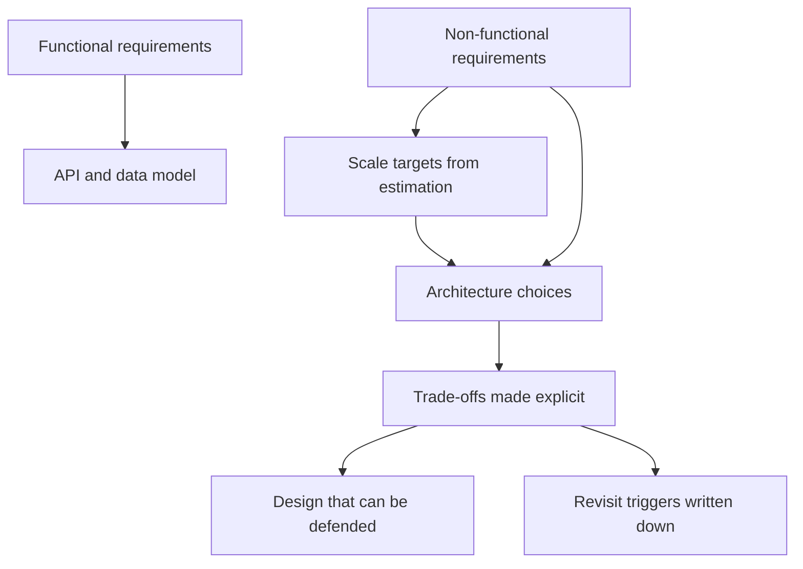

# What Is System Design

System design is the discipline of deciding how software components — servers, databases, caches, queues, networks — fit together so that a system meets its requirements *at a given scale, cost, and failure tolerance*. Writing code answers "how do I implement this feature?"; system design answers "how do I make this feature survive 10 million users, a datacenter outage, and three years of growth?". The defining property of the discipline is that there is no single correct answer — only trade-offs that are better or worse *for a specific set of requirements*.

## Why this matters

As a backend engineer you already make small design decisions daily: whether to cache a lookup, whether a call should be synchronous, how to shape a MongoDB document. System design is the same activity at a larger blast radius. It matters for three concrete reasons:

1. **Requirements beyond features decide architecture.** Two systems with identical features — say, "users can send money to other users" — can need radically different architectures depending on whether they serve 1,000 or 100 million users, whether a lost transaction is annoying or a regulatory incident, and whether 2 seconds of latency is acceptable.
2. **Early decisions are expensive to reverse.** Choice of datastore, sync-vs-async boundaries, and how data is partitioned ([[Sharding]]) tend to outlive the code written on top of them. Design is where you spend cheap thinking time to avoid expensive migration time.
3. **It is the shared vocabulary of senior engineering.** Design reviews, incident retros, and interviews all assume you can reason in terms of [[Latency vs Throughput vs Bandwidth|latency, throughput]], [[Availability Reliability Durability|availability]], and consistency — and can defend a choice by naming what it costs.

## How it works

### Functional vs non-functional requirements

Every design starts by separating two kinds of requirements:

| | Functional requirements | Non-functional requirements (NFRs) |
|---|---|---|
| **Answer the question** | *What* must the system do? | *How well* must it do it? |
| **Examples** | "Users can shorten a URL", "A transfer debits one account and credits another" | "p99 latency under 200 ms", "99.99% available", "survives loss of one availability zone", "handles 50K RPS at peak" |
| **Who usually states them** | Product | Often unstated — the engineer must extract them |
| **Effect on architecture** | Shape the APIs and data model | Shape almost everything else: replication, caching, partitioning, queueing |

The crucial insight: **functional requirements rarely determine the architecture; non-functional ones do.** A URL shortener for an internal team of 50 is a weekend project with one database. The same functional spec at Twitter-scale (see [[Design a URL Shortener]]) demands distributed ID generation, aggressive caching, and multi-region thinking. Interviewers exploit this deliberately — the problem statement is always functionally trivial, and the real test is whether you ask about scale, latency targets, and failure tolerance before drawing boxes. [[Back of the Envelope Estimation]] is the tool that converts vague NFRs ("lots of users") into numbers you can design against.

Common NFR categories worth memorizing as a checklist:

- **[[Scalability]]** — can it handle growth in load without redesign?
- **Performance** — [[Latency vs Throughput vs Bandwidth|latency and throughput]] targets, usually as percentiles.
- **[[Availability Reliability Durability|Availability]]** — what fraction of time must it answer correctly?
- **[[Availability Reliability Durability|Durability]]** — once acknowledged, can data ever be lost?
- **Consistency** — do all readers see the same data at the same time? (Formalized later in [[Consistency Models]] and [[CAP Theorem]].)
- **Security and compliance** — authn/authz ([[How JWT Works]]), audit trails, data residency.
- **Cost and operability** — can the team afford to run and debug it?

### Why there is no single correct answer

Non-functional requirements **conflict with each other**. You cannot maximize all of them; improving one usually degrades another. The recurring tensions:

- **Consistency vs availability vs latency.** Keeping replicas perfectly in sync means waiting for them, which costs latency and availability during network trouble. This is the territory of [[CAP Theorem]] and [[PACELC]].
- **Latency vs durability.** Acknowledging a write only after it is replicated and flushed to disk is safer and slower than acknowledging from memory.
- **Simplicity vs scale.** A single PostgreSQL instance is easier to operate, back up, and reason about than a [[Sharding|sharded]] fleet — and is the right answer far more often than interview culture suggests.
- **Cost vs everything.** Redundancy, multi-region [[Replication]], and headroom all cost real money. Running a service at one replica (as much of your fleet does) is a *legitimate design decision* that trades availability for cost — as long as it is made knowingly.

Because the tensions are fundamental (often physics: speed of light, disk seek times — see [[Latency Numbers Every Engineer Should Know]]), two competent engineers given different weightings will produce different, equally defensible designs. The skill being evaluated — in reviews and interviews alike — is not "did you pick the architecture I had in mind?" but "did you identify the constraints, make the trade-offs explicit, and choose consistently with the stated requirements?"

### Trade-off thinking in practice

A practical method you can apply to any design decision:

1. **Name the requirement that forces a decision.** "We need reads to survive the primary going down."
2. **List at least two options.** Read replicas with async [[Replication]]; synchronous replication; a cache in front.
3. **Name what each option costs.** Async replicas risk stale reads ([[Read Your Own Writes and Replica Lag Anomalies]]); sync replication adds write latency; a cache adds [[Cache Invalidation|invalidation]] complexity.
4. **Decide using the requirements, and record why.** If the data is a marketing page, staleness is fine. If it is an account balance in a fintech system, it is not.
5. **State what would change your mind.** "If we exceed 10K writes/sec we revisit."

A useful mantra: **every box you add to a diagram is a trade, not a gift.** A cache buys latency and pays in staleness. A queue buys decoupling and pays in [[Delivery Semantics|delivery complexity]]. A second datacenter buys availability and pays in consistency headaches and cost.

### A worked micro-example

To make the method concrete, run it on a one-line request: *"We need an export feature — users download their transaction history as CSV."*

1. **Functional scope**: which fields, what date ranges, is it per-account or per-user, does it need to be instant?
2. **NFR extraction**: how many users export per day (likely few — assume 1% of DAU)? How large can one export get (a 5-year-old account could be hundreds of thousands of rows)? Latency tolerance (a download link by email in 5 minutes is probably fine)? Any compliance angle (exports of financial data may need audit logging and masking rules)?
3. **The NFRs pick the design**: a small, bounded export can be a synchronous endpoint streaming from a read replica. A potentially huge export with minutes of latency tolerance should be an async job — request lands on a queue ([[Why Async Messaging Exists]]), a worker paginates through the data, writes the file to object storage ([[How S3 Works]]), and notifies the user — because a 300 MB response generated inline would hold an app thread and a DB cursor hostage for minutes ([[Latency vs Throughput vs Bandwidth]]).
4. **Trade-off named**: the async design costs a queue, a worker, and status-tracking UX; it buys bounded request latency and protection of the OLTP database. The sync design is simpler and right **if** exports are provably small.

Notice that the deciding inputs were all non-functional: volume, size distribution, latency tolerance, compliance. The feature description never changed.

### The recurring levers

Nearly every design in this vault is assembled from a dozen moves. Meeting them here, by name, makes the rest of the curriculum feel like variations on a theme:

| Lever | What it buys | Canonical note |
|---|---|---|
| Add a copy of data near the reader | Read latency, read scale | [[Replication]], [[CDN]], [[Why Caching Works]] |
| Split data across machines | Write scale, data size | [[Sharding]] |
| Make work asynchronous | Burst absorption, decoupling | [[Why Async Messaging Exists]] |
| Precompute at write time | Read latency at read scale | [[CQRS]], [[Design a News Feed]] |
| Add redundancy | Availability | [[Availability Reliability Durability]], [[Failover]] |
| Make operations retryable | Correctness under failure | [[Idempotency]] |
| Shed or degrade under overload | Survival at peak | [[Load Shedding and Graceful Degradation]] |

## Common misconceptions

- **"System design means microservices and Kafka."** No — it means meeting requirements. A [[Monolith vs Microservices|monolith]] on one beefy database *is* a system design, and often the best one. Reaching for planet-scale patterns at startup scale is itself a design error (see [[The Distributed Monolith Anti-Pattern]]).
- **"There is a best database / broker / pattern."** Only best *for given requirements*. [[Choosing a Database]] and [[Choosing a Message Broker]] are decision frameworks precisely because no universal winner exists.
- **"NFRs are the ops team's problem."** NFRs decide the architecture, so they are the designer's problem from day one. Bolting on availability later usually means re-architecting.
- **"More nines, more scale, lower latency is always better."** Each is a cost. A back-office reconciliation job does not need 99.99% availability, and paying for it steals budget from things that do. [[SLA SLO SLI and Error Budgets]] formalizes "how good is good enough".

## In your stack

- Niyo's domain makes the trade-off weighting unusual: for money movement and KYC, **correctness and auditability outrank latency**. Where a social app picks availability in a partition, a ledger-touching service should usually fail closed — refuse the write rather than risk a double-spend.
- The "many services pinned at 1 replica" cost decision is trade-off thinking in action: it knowingly accepts that an unplanned pod restart means tens of seconds of downtime for that service while a replacement JVM starts and passes readiness. The honest design question is which services that is acceptable for — and it is *not* acceptable where an outage blocks money movement at peak.
- Your messaging journey (RabbitMQ → Kafka → SQS → planned Redis Streams) is a live case study in re-making the same trade-off as requirements and operating costs shifted — see [[Choosing a Message Broker]].
- Your stack already encodes NFR decisions you can read: Kong at the edge centralizes authn and [[Rate Limiting]] (operability), JWT from a central IAM service trades revocation ease for statelessness ([[How JWT Works]]), and `x-correlation-id` on every call buys debuggability ([[Distributed Tracing]]).

## Interview angle

- The interview is a requirements-extraction test disguised as an architecture test. The strongest opening move is always clarifying functional scope and NFRs, then [[Back of the Envelope Estimation|estimating]] — see [[The System Design Interview Framework]].
- **60-second answer to "what is system design?"**: "It's choosing an architecture that meets stated functional and non-functional requirements at acceptable cost. Functional requirements shape the API and data model; non-functional ones — scale, latency, availability, consistency, durability — shape everything else. Because those properties conflict, every design is a set of trade-offs, so the job is to make the trade-offs explicit and justify them against the requirements."
- Classic follow-ups: "Give me an example of a trade-off you made at work" (have a real one ready — a cache you added, a sync call you made async); "What would you ask before designing X?" (scale, read/write ratio, latency target, consistency needs, availability target); "When is a monolith the right answer?" (small team, unproven product, requirements fit on one machine).
- Red flags interviewers watch for: jumping straight to a diagram without requirements; naming technologies without naming what they cost; claiming a design has no downsides.

## Check yourself

> [!question]- Q: Explain the difference between functional and non-functional requirements, and which one drives architecture — with an example.
> Functional requirements say *what* the system does (shorten a URL, transfer money); non-functional requirements say *how well* (latency, availability, scale, durability, consistency). Architecture is driven mostly by NFRs: a URL shortener for 50 internal users is one server and one database, while the functionally identical service at 100M users needs distributed ID generation, caching layers, and replication. Same features, different NFRs, completely different systems.

> [!question]- Q: What happens if you design a fintech transfer service to prioritize availability over consistency during a network partition?
> The service keeps accepting writes on both sides of the partition. For a ledger this can mean the same balance is spent twice, producing money-out-of-nothing or negative balances that must be reconciled after the fact — a regulatory and financial incident, not just a bug. That is why ledger-type systems choose consistency (fail closed, reject writes) in a partition, accepting downtime instead. See [[CAP Theorem]] and [[Stripe and Payment System Design]].

> [!question]- Q: A teammate proposes adding Redis in front of MongoDB "because caching is best practice". Using trade-off thinking, how do you evaluate the proposal?
> Name the requirement: is there a measured latency or load problem on these reads? List options: cache-aside Redis, a MongoDB index fix, read replicas, or doing nothing. Name costs: a cache adds staleness and [[Cache Invalidation|invalidation]] logic, a new failure mode ([[Cache Stampede and Thundering Herd]]), and operational surface. Decide from requirements: for hot, read-heavy, staleness-tolerant data it is a win; for balance reads it may be wrong regardless of speed. Record the decision and the threshold that would revisit it.

> [!question]- Q: Name three pairs of non-functional requirements that directly conflict, and the mechanism of each conflict.
> (1) Consistency vs write latency: keeping replicas in sync means a write waits for acknowledgements from other nodes, so stronger consistency costs round trips ([[Replication]], [[PACELC]]). (2) Availability vs consistency under partition: when nodes can't talk, you either keep serving (and risk divergence) or refuse (and lose availability) — [[CAP Theorem]]. (3) Durability vs latency: acknowledging a write only after fsync and replication is slower than acknowledging from memory ([[Availability Reliability Durability]]). A fourth worth knowing: cost vs everything — redundancy, headroom, and multi-region all buy NFRs with money.

> [!question]- Q: Mini design prompt — product asks for "a notifications feature". What do you ask before drawing anything?
> Functional: which channels (push/SMS/email), who triggers them, is read-state tracked? Non-functional: how many users and notifications/day ([[Back of the Envelope Estimation]]); latency tolerance (OTP seconds-critical vs marketing hours-tolerant); delivery guarantees — is dropping one acceptable, is duplicating one acceptable ([[Delivery Semantics]], [[Idempotency]]); ordering needs; retention and audit requirements. The answers decide whether this is a cron job or [[Design a Notification Service]].

## Sources

- *Designing Data-Intensive Applications*, Martin Kleppmann — ch. 1 ("Reliable, Scalable, and Maintainable Applications") frames the discipline exactly this way.
- *System Design Interview — An Insider's Guide, Vol. 1*, Alex Xu — ch. 1 on scaling from zero and the role of requirements.
- Google SRE Book (*Site Reliability Engineering*, O'Reilly, 2016) — chapters on embracing risk: reliability is a feature with a cost, not an absolute.
- AWS Well-Architected Framework (official AWS docs) — a production checklist of non-functional pillars: reliability, performance efficiency, cost optimization, security, operational excellence, and (added 2021) sustainability.
