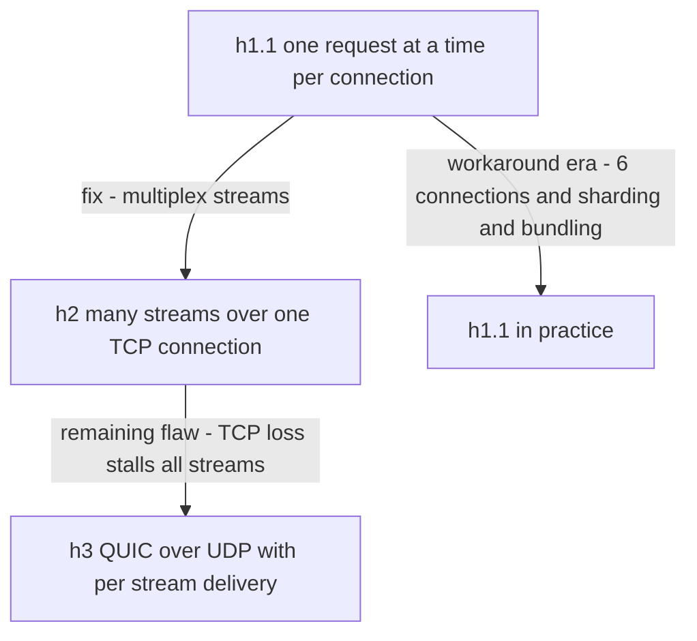

# HTTP 1.1 vs HTTP 2 vs HTTP 3

HTTP's semantics — methods, status codes, headers — have barely changed since the 1990s. What the three generations change is the **transport framing**: how many requests can share a connection, and what happens when packets are lost. The through-line is a single enemy, **head-of-line (HOL) blocking**, pushed down one layer at a time: HTTP/1.1 has it in the application protocol (one response at a time per connection), HTTP/2 fixes that but inherits it from TCP (one lost packet stalls every multiplexed stream), and HTTP/3 fixes *that* by abandoning TCP for QUIC over UDP. Knowing which generation to run where — h2 or h3 at the browser edge, often plain h1.1 or h2-for-gRPC inside the cluster — is the practical payoff.

## Why this matters

Web performance work, [[CDN]] configuration, gRPC (which *requires* HTTP/2), and load-balancer behavior all hinge on these differences. It's also a favorite interview ladder: each generation's fix creates the next generation's problem, and walking that chain cleanly signals real understanding of [[TCP vs UDP]].

## How it works

First, fix the mental model: **semantics vs framing**. The semantics layer — `GET /accounts/42`, `201 Created`, `Cache-Control`, cookies — is identical across all three versions; your Spring controllers and REST clients neither know nor care which one carried the request. The framing layer — how requests are delimited, interleaved, and recovered after packet loss — is what each generation replaces. This separation is why an edge proxy can accept h3 from a phone and forward h1.1 to your pod: it translates framing, not meaning.

| Layer | Examples | Changes across versions? |
|---|---|---|
| Semantics | methods, status codes, headers, caching rules | no — RFC 9110 defines them version-independently |
| Framing/transport | text lines vs binary frames, streams, loss recovery | yes — this is the whole story below |

**HTTP/1.1 (1997): keep-alive, and the pipelining dead end.** HTTP/1.0 opened a TCP connection per request — handshake, slow start, teardown, repeat. 1.1's big win was **persistent connections** (keep-alive): reuse one connection for many sequential requests. But *sequential* is the operative word: one outstanding request per connection; the next response cannot begin until the current one finishes. That is application-level HOL blocking. **Pipelining** — sending several requests without waiting — was specified, but responses still had to return *in order* (a slow first response blocks all others), and broken proxy support made browsers disable it. The workaround everyone actually used: **open 6 parallel TCP connections per origin** (the de facto browser limit), plus hacks like domain sharding, image sprites, and JS/CSS bundling — all contortions to smuggle parallelism through a serial protocol.

**HTTP/2 (RFC 7540, 2015): multiplexing over one connection.** h2 keeps HTTP semantics but replaces the text framing with binary **frames** belonging to **streams** — many concurrent request/response streams interleaved over *one* TCP connection, with stream prioritization. Application-level HOL blocking: gone. Added:

- **HPACK header compression** — HTTP headers are repetitive (same cookies, same user-agent every request); HPACK keeps a shared dynamic table on both ends so repeated headers cost a few bytes. (Why a *special* compressor: the CRIME attack showed naive gzip over headers leaks secrets via compression ratios.)
- **Server push** — the server could preemptively send resources ("you asked for index.html, here's style.css too"). **Push died**: servers guessed wrong, pushed bytes the browser already had cached, wasted bandwidth, and measurable wins never materialized. Chrome removed support in 2022; the ecosystem settled on `103 Early Hints` + preload instead. Lesson worth quoting: speculative optimization that ignores client state tends to lose.

Two h2 details that matter operationally:

- **h2 has its own flow control** — per-stream and per-connection windows on top of TCP's, so one greedy stream can't starve the connection. Misconfigured small windows are an occasional cause of mysteriously capped throughput on proxied h2 paths.
- **Version negotiation is invisible**: browsers pick h2 via **ALPN** during the TLS handshake (there is no plaintext h2 on the open web, which is one reason the "HTTPS everywhere" and h2 eras arrived together); servers advertise h3 via the `Alt-Svc` header or DNS HTTPS records, and clients race/upgrade on later connections. The practical consequence: whether you're "on h3" is a per-connection negotiation outcome — measure it from real clients, don't assume it from config.

h2's own flaw: **TCP HOL blocking remains.** TCP delivers one ordered byte stream and knows nothing of h2's streams; one lost packet halts delivery of *every* stream until retransmission ([[TCP vs UDP]]). On a clean network this is theoretical; on a lossy mobile link, h2 (one connection, all eggs in one basket) can underperform h1.1's six independent connections.

**HTTP/3 (RFC 9114, 2022): QUIC, leaving TCP entirely.** **QUIC** (RFC 9000) is a transport built on **UDP** that reimplements reliability, congestion control, and ordering *per stream* in userspace, with TLS 1.3 fused into its handshake:

- **No cross-stream HOL blocking** — a lost packet stalls only the stream whose bytes it carried; other streams keep delivering.
- **Faster setup** — transport + crypto handshake combined: 1 RTT cold, 0-RTT resumed (vs TCP+TLS1.3's 2 RTT cold). See [[TLS and HTTPS]] for 0-RTT's replay caveat.
- **Connection migration** — QUIC connections are identified by a connection ID, not the 4-tuple of addresses/ports, so a phone hopping Wi-Fi → LTE keeps its connection instead of re-handshaking.
- **QPACK** replaces HPACK (same idea, redesigned so header compression itself can't reintroduce cross-stream blocking).

Costs: UDP is second-class in some networks and kernels (CPU per byte historically higher than TCP's hyper-optimized path), some corporate firewalls block it (clients fall back to h2), and you lose decades of TCP operational tooling.

**What to use where:**

| Hop | Use | Why |
|---|---|---|
| Browser → edge (CDN/ALB) | **h2 baseline, h3 where offered** | high-latency, lossy last mile is exactly what h2/h3 were built for; CDNs/ALBs make it a checkbox |
| Edge → services, service → service | **h1.1 over pooled keep-alive connections — still common and fine; h2 where it earns its keep** | datacenter links are fast and nearly loss-free, so HOL blocking rarely bites; a connection *pool* already provides parallelism; h1.1 is trivially debuggable (`curl`, tcpdump, readable wire format) |
| gRPC between services | **h2 — required** | gRPC is built on h2 streams and trailers ([[REST vs gRPC vs GraphQL]]); note ALBs historically mishandled gRPC/trailers — check your LB's gRPC support explicitly |
| Inside cluster, h3 | rarely, as of ~2024–2026 | QUIC's wins (lossy links, migration, handshake RTTs) mostly don't apply between pods; its costs (CPU, tooling) do |

The index's phrasing is exactly right: **HTTP/2 to the browser, often 1.1 inside the cluster** — asymmetry by design, because the two environments have opposite loss and latency profiles.

Why the asymmetry holds up under scrutiny, hop by hop:

- The browser↔edge hop crosses tens of milliseconds of lossy, shared, mobile-heavy internet, carrying dozens of parallel resource fetches for a page — multiplexing and loss isolation pay directly in user-visible latency.
- The edge↔pod hop crosses a sub-millisecond, engineered, almost lossless datacenter fabric, carrying one logical request at a time per pooled connection — there is nothing for multiplexing to parallelize and almost no loss to isolate.
- Inside the cluster the scarce resources are *operator attention and debuggability*: when a payment flow misbehaves at 2 a.m., `curl -v` against a pod and a readable tcpdump are worth more than header compression.
- The exception that proves the rule is gRPC: it imposes h2 internally because it *uses* h2's streams as a feature (multiplexed RPCs, streaming, trailers for status) — not for last-mile performance.

A capsule history of why each transition took the shape it did:

- **SPDY → h2 (2009–2015)**: Google shipped SPDY in Chrome and its own servers, proved multiplexing wins on real traffic, and the IETF standardized it as h2 with HPACK swapped in post-CRIME. Lesson: transport evolution now happens by a browser+server owner deploying first and standardizing after.
- **gQUIC → h3 (2013–2022)**: same playbook, bigger ambition — Google ran QUIC between Chrome and Google properties for years before IETF QUIC (RFC 9000) diverged and h3 landed. The UDP choice was forced by **ossification**: middleboxes drop or mangle anything that isn't TCP-or-UDP-shaped, and kernels take a decade to update, so the only deployable place for a new transport was userspace atop UDP. QUIC even encrypts its own transport headers specifically so middleboxes *can't* grow dependencies on them.
- As of ~2024, HTTP/3 carries roughly a quarter to a third of web requests measured at large CDNs (Cloudflare's published radar numbers), with h2 carrying most of the rest — h1.1 persists mainly on APIs, internal hops, and old clients.

## Trade-offs

| | h1.1 | h2 | h3 |
|---|---|---|---|
| Parallelism | 1 per connection (pool of ~6 in browsers) | full multiplexing, one connection | full multiplexing, loss-isolated streams |
| HOL blocking | at HTTP layer | at TCP layer | none across streams |
| Header cost | full text every request | HPACK | QPACK |
| Setup (cold, with TLS 1.3) | ~2 RTT | ~2 RTT | ~1 RTT |
| Debuggability/ops | trivial (plaintext possible) | binary; needs tooling | binary + UDP; newest tooling, firewall risk |
| Where it shines | simple internal calls | browser edge, gRPC | lossy/mobile last mile |

## Common misconceptions

- **"h2 is always faster than h1.1."** On lossy links, one h2 connection can lose to six h1.1 connections — TCP HOL blocking is shared fate.
- **"Server push makes h2 faster."** It's dead; Chrome removed it. Say `Early Hints`/preload instead.
- **"h3 is HTTP over raw UDP, so it's unreliable."** QUIC reimplements reliability and congestion control per stream; nothing user-visible is lost — see [[TCP vs UDP]].
- **"We should upgrade everything to h3."** Inside a datacenter the problems h3 solves barely exist; the operational cost is real. Upgrade the browser edge; leave the cluster to evidence.
- **"h2 means I can stop pooling connections."** You still pool for *redundancy and load spreading* across backends — one connection multiplexed to one pod is also one basket for [[Load Balancers|load balancing]] to misjudge (see below).

## In your stack

- Your browser/mobile-facing hop — CloudFront and ALB — speaks **h2 to clients today, h3/QUIC as a CloudFront checkbox**; backends behind them typically receive **h1.1**, which is normal and fine: the edge translates.
- Kong → Spring Boot services: pooled h1.1 keep-alive connections. The pool is your parallelism; see [[TCP vs UDP]] on what churned connections cost.
- **The h2 load-balancing gotcha**: an L4 balancer (or Kubernetes Service) balances *connections*, and h2/gRPC multiplexes everything onto few long-lived connections — so two pods can receive wildly uneven load. gRPC shops need L7 balancing (Envoy/mesh) or client-side balancing. At Niyo's 1-replica services this is moot *today*, but it's the first surprise when a service scales to 2.
- If you adopt gRPC between services, you are adopting h2 end-to-end on that path — verify Kong/ALB handle trailers and h2 cleartext or re-encrypt appropriately.
- CloudFront idiosyncrasy worth remembering: protocol versions are *per hop* — a user on h3 still reaches an origin configured for h1.1/h2; enabling h3 at the edge requires zero origin changes, which is exactly why it's cheap to turn on and measure.
- Streaming responses (SSE for payment-status push — see [[WebSockets Server-Sent Events and Long Polling]]) ride much better on h2/h3 browser-side, where they don't consume one of h1.1's six connections per origin.

A quick operational checklist if you flip h2 on for an internal hop:

- Confirm every proxy in the path speaks h2 end-to-end or translates cleanly (mixed h2-front/h1.1-back is normal and fine — just know which you have).
- Re-examine load balancing: per-connection balancers skew badly under multiplexing (see the gotcha below).
- Re-examine timeouts: one connection now carries many requests, so connection-level idle timeouts and resets have a larger blast radius.
- Keep `curl --http2 -v` and `nghttp` in your debugging kit; readable-wire-format debugging is gone.

## Interview angle

The 60-second version: *"Same HTTP semantics, three framings, one enemy. h1.1 serializes requests per connection — browsers worked around it with six connections and bundling; pipelining failed because responses stayed ordered. h2 multiplexes binary streams over one TCP connection with HPACK header compression — but TCP delivers one ordered byte stream, so one lost packet stalls every stream: HOL blocking moved down a layer. h3 runs on QUIC over UDP: per-stream reliability, TLS fused into a 1-RTT handshake, connection migration for mobile. Deployment answer: h2/h3 browser-facing where latency and loss live; inside the cluster plain h1.1 over pooled connections is often still the right call, with h2 where gRPC requires it."*

Classic follow-ups: *Why did pipelining fail?* (In-order responses + broken intermediaries.) *Why did server push die?* (Pushed already-cached bytes; no client state; replaced by Early Hints.) *Why does gRPC need h2?* (Streams for multiplexed/streaming RPCs, trailers for status.) *Why not h3 everywhere?* (Datacenter links don't have the problem; UDP costs CPU and firewall friction.)

## Check yourself

**Q1 (explain it): Walk the HOL-blocking chain: where does it live in h1.1, why does h2 only half-fix it, and what does h3 change structurally?**

> [!question]- Q1 answer
> h1.1: in the protocol itself — one outstanding response per connection; everything queues behind the current one. h2: fixed at the HTTP layer via independent streams, but all streams share one TCP byte stream, and TCP must deliver bytes in order — a single lost packet blocks delivery of *all* streams until retransmission. h3: QUIC makes reliability per-stream in userspace over UDP, so loss on stream A never stalls stream B. The blocking wasn't eliminated between the generations so much as pushed down until the transport itself was replaced.

**Q2 (scenario): After migrating your internal gRPC services from 1 to 3 replicas, one pod runs at 90% CPU while two idle. Why, and what fixes it?**

> [!question]- Q2 answer
> gRPC rides h2: each client holds a few long-lived connections and multiplexes all RPCs onto them. Kubernetes Services and L4 balancers distribute *connections*, not requests — whoever got the connection gets all its traffic. Fixes: L7 load balancing that balances per-request (Envoy sidecar / service mesh), gRPC client-side load balancing against endpoint lists (headless Service), or periodically forcing connection re-establishment (`MAX_CONNECTION_AGE`) as a blunt rebalancer.

**Q3 (mini design): You serve a React app to users across India on variable mobile networks, backed by APIs in one AWS region. Which protocol goes where, and name the one h1.1-era optimization you should keep anyway.**

> [!question]- Q3 answer
> Browser → CloudFront: enable h3 with h2 fallback — lossy, high-RTT mobile links are QUIC's home turf, and connection migration helps users moving between networks. CloudFront → ALB → services: h1.1/h2 per defaults; no need to force h3 inside AWS's network. Keep: *bundling/minification and caching discipline* — fewer bytes always wins; conversely, stop domain sharding (it defeats h2/h3 multiplexing by splitting connections). And since it's one region, the [[CDN]] edge itself is doing the real latency work.

**Q4 (scenario): A perf test shows h2 between two services in the same AZ is no faster than h1.1 with a 20-connection pool, and ops complains debugging got harder. What do you conclude, and was the test even measuring the right thing?**

> [!question]- Q4 answer
> The result is expected, not anomalous: h2's wins (multiplexing many parallel fetches, loss isolation, header compression over slow links) target conditions — high RTT, loss, dozens of concurrent requests per connection — that a same-AZ pooled-h1.1 hop doesn't have. The pool already supplies parallelism; the fabric supplies near-zero loss. So h1.1 stays unless something *else* forces h2 (gRPC adoption, extreme header volume). And check the test measured p99 under concurrency and packet loss, not mean latency of serial requests — though on this hop, even the right test usually says "keep it simple".

## Sources

- RFC 9110–9113 — HTTP Semantics, Caching, HTTP/1.1, HTTP/2 (2022 editions; h2 originally RFC 7540, 2015)
- RFC 9000 / RFC 9114 — QUIC transport (2021) / HTTP/3 (2022)
- *High Performance Browser Networking* (Ilya Grigorik, O'Reilly) — the h1.1 workaround era and h2 design rationale
- Chrome developers blog — "Removing HTTP/2 Server Push" (2022); Cloudflare blog posts on HTTP/3 and QUIC deployment experience
- gRPC documentation — "gRPC on HTTP/2" and load-balancing guidance
