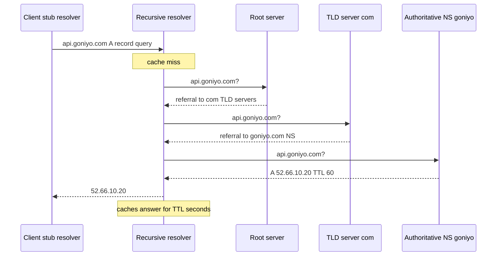

# How DNS Works

DNS (**Domain Name System**) is the distributed, hierarchical directory that translates names humans use (`api.goniyo.com`) into IP addresses machines route to (`52.66.x.x`). It is the first network hop of almost every request your systems make — see [[Anatomy of a Web Request]] — and because the answer it returns can be *chosen per query*, it doubles as a crude but globally available load balancer and failover switch. Understanding it means understanding two things: how a lookup actually travels, and how caching (TTL) governs how fast a change you make becomes visible to the world.

## The problem that created it

In the early ARPANET, every machine kept a local file (`HOSTS.TXT`, maintained at Stanford) mapping every known hostname to an address. Each site periodically downloaded the whole file. As the network grew this broke in every dimension: the file grew without bound, updates took days to propagate, name collisions had to be arbitrated by one organization, and a single FTP server was the distribution bottleneck. DNS (1983, RFC 882/883, later RFC 1034/1035) replaced the flat file with a **delegated hierarchy**: the namespace is a tree (`.` → `com.` → `goniyo.com.`), and each zone's owner runs (or rents) the authoritative servers for their own subtree. Nobody holds the whole map; everybody can be found.

## What it solves

- **Decentralized naming** — each organization manages its own zone; no central registry of every host.
- **Indirection** — clients bind to a stable *name*; the operator can change the *address* behind it (new servers, new region, new cloud) without touching clients.
- **Scalability through caching** — answers carry a **TTL** (time to live); resolvers cache them, so the authoritative servers see a tiny fraction of real query volume.
- **Traffic steering** — because the authoritative server picks the answer at query time, DNS can route by health, geography, latency, or weight (how [[CDN]]s and Route 53 work).

## How it works

Two roles matter:

- A **recursive resolver** (e.g. your ISP's resolver, `8.8.8.8`, or the VPC resolver in AWS) does the full lookup on the client's behalf and caches results.
- **Authoritative servers** hold the actual records for a zone and answer only for what they own: the 13 root server *identities* (hundreds of anycast instances), the TLD servers (`.com`), and the zone's own name servers.

**Recursive vs iterative resolution**: the client-to-resolver query is *recursive* ("get me the final answer"); the resolver-to-authoritative queries are *iterative* ("tell me the answer or who to ask next"). Each iterative response is a **referral** down the tree until an authoritative answer arrives.

On a warm cache (the common case) the resolver answers immediately from steps it already knows — often it has the `com` and `goniyo.com` referrals cached and only asks the last server, or answers entirely from cache.

Caching actually happens at *every* layer on the client side too, each with its own lifetime — and each is a place a stale answer can hide:

- the application/runtime (JVM `InetAddress` cache, Node's lookup behavior),
- the OS stub resolver / systemd-resolved / nscd,
- the recursive resolver (honors TTL),
- sometimes a middlebox or VPN resolver you forgot exists.

Two more pieces of the modern picture: lookups are classically plain UDP on port 53 (readable by anyone on the path; **DoT/DoH** — DNS over TLS/HTTPS — encrypt the client→resolver hop), and **DNSSEC** adds signatures so a resolver can verify a record wasn't forged — it provides authenticity, not confidentiality, and deployment remains patchy as of ~2024.

**Record types you must know:**

| Type | Maps | Notes |
|---|---|---|
| **A** | name → IPv4 address | the workhorse |
| **AAAA** | name → IPv6 address | "quad-A" |
| **CNAME** | name → another name | alias; the resolver then resolves the target. Cannot coexist with other records at the same name, so not allowed at a zone apex (why Route 53 invented ALIAS records) |
| **NS** | zone → its authoritative name servers | the delegation glue of the hierarchy |
| **TXT** | name → arbitrary text | domain-ownership proofs (ACME/cert issuance), SPF/DKIM email policy |
| MX, SRV, CAA | mail routing, service discovery, cert-issuance policy | worth recognizing |

**TTL trade-offs.** Every record carries a TTL in seconds; caches may serve it until expiry. This is the knob behind "DNS propagation delay" — which is a misleading phrase. Nothing *propagates* outward when you change a record: authoritative servers answer with the new value instantly. What you are waiting for is **every cached copy of the old answer, everywhere in the world, to expire**. Worst case ≈ the old TTL. The practical discipline: lower the TTL (e.g. 3600 → 60) at least one *old* TTL before a planned migration, cut over, then raise it back.

| TTL | You gain | You pay |
|---|---|---|
| Long (hours/day) | fewer queries, lower latency, resilient to resolver outages | changes and failover take hours to take effect |
| Short (30–60s) | fast failover and migrations | more query load and cost, more exposure to DNS blips, some resolvers ignore very low TTLs anyway |

**DNS as load balancer, failover, and geo-router.** Because the authoritative server composes each response, managed DNS (AWS **Route 53** is the canonical example) offers routing policies:

- **Simple / multivalue** — return several A records; clients pick one (crude round-robin spread).
- **Weighted** — e.g. 90/10 split across targets: canary releases, gradual migrations.
- **Latency-based** — answer with the region historically lowest-latency for the asking resolver.
- **Geolocation / geoproximity** — route by where the query comes from: data-residency rules, localized content.
- **Failover** — primary/secondary pairs driven by health checks: the unhealthy target simply stops being answered.

This is load balancing *before* any [[Load Balancers|load balancer]] is reachable — it is how traffic chooses a region or a CDN edge at all. Its weakness is the cache: you cannot revoke an answer already cached in a million resolvers, so DNS failover is only as fast as your TTL, and it balances per-*resolver*, not per-request (one ISP resolver may front millions of users, all of whom get the same answer). Fine-grained balancing belongs to the load balancer behind the name; see also [[Health Checks and Service Discovery]] for the in-cluster equivalent.

## Trade-offs

| You gain | You pay |
|---|---|
| Global, infinitely cached, survives almost anything | eventual consistency by design — changes lag by TTL |
| Traffic steering with zero client changes | steering granularity is per-resolver, not per-user or per-request |
| Decoupled naming (swap infra behind a name) | one more distributed system in the critical path of *everything* |
| Health-checked failover without touching servers | failover speed capped by TTL and by resolvers that disrespect it |

## Failure modes

- **Expired domain / bad delegation** — NS records point nowhere; the entire company disappears at once. Detected instantly and catastrophically.
- **Resolver outage** — your app can't resolve anything even though every server is healthy. The 2016 Dyn DDoS took down Twitter, Spotify, and GitHub without touching their infrastructure. Mitigation: multiple DNS providers, sane client-side caching.
- **Stuck caches after a change** — some resolvers and some *applications* cache beyond TTL. The JVM is a classic offender: `networkaddress.cache.ttl` historically cached successful lookups **forever** when a security manager was in effect; many services still pin it high. A failover "completes" and half your Java fleet keeps calling the dead IP.
- **Negative caching** — "no such name" answers (NXDOMAIN) are cached too (per the SOA record's negative TTL); deploy a brand-new record and clients that asked a minute too early keep failing.
- **Split-horizon surprises** — internal and external DNS give different answers for the same name; a service works in the VPC and fails from the office, or vice versa.

Detection: resolution-time metrics and NXDOMAIN/SERVFAIL rates in client logs; synthetic checks that resolve from outside your network, not just inside it.

## When NOT to use it

- **Not for fast or fine-grained load balancing.** Sub-minute reaction, per-request balancing, least-connections — that's a real [[Load Balancers|load balancer]]'s job. DNS is the coarse, global tier above it.
- **Not for service discovery inside a busy cluster where churn is constant** — TTL caching means stale endpoints; Kubernetes pairs its internal DNS with Services/Endpoints precisely to hide pod churn behind a stable virtual IP.
- **Not as a security boundary.** Anyone can look up your records; "hidden" internal hostnames in public zones leak your topology.

## In your stack

- Your clients resolve through CloudFront/ALB hostnames managed in Route 53; **failover and region choice happen at DNS before Kong or any pod sees a packet** — worth knowing when debugging "works from UAT, fails from prod" reports.
- Inside EKS, `service-name.namespace.svc.cluster.local` is resolved by **CoreDNS** — a DNS outage *inside* the cluster looks like every service failing simultaneously; it has nothing to do with your code.
- JVM DNS caching: if a managed datastore (MongoDB Atlas, ElastiCache) fails over by changing DNS, a Spring Boot service with a high `networkaddress.cache.ttl` will keep dialing the old primary. Check the JVM setting before blaming the driver.
- With many services pinned at 1 replica, DNS-level failover buys you nothing within a service — there is no second target to answer with. It only helps across regions or across managed endpoints.

## Interview angle

The 60-second version: *"DNS is a delegated hierarchy — root, TLD, zone — queried iteratively by recursive resolvers that cache answers for the record's TTL. A/AAAA map names to addresses, CNAME aliases names, NS delegates zones, TXT carries proofs. Because the authoritative server picks each answer, managed DNS does weighted, latency, geo, and health-checked failover routing — but all steering is bounded by caching: 'propagation delay' is just old TTLs expiring, so you lower TTL before a migration and accept that DNS failover is a minutes-level tool, not a seconds-level one."*

Classic follow-ups: *Why can't a CNAME live at the zone apex?* (It must be the only record at a name, and the apex needs SOA/NS.) *How would you migrate a high-traffic domain with zero downtime?* (Drop TTL ahead of time, dual-run both targets, cut over, watch old-target traffic decay, raise TTL.) *Why did your failover take 40 minutes when the TTL was 60 seconds?* (Client-side caches — JVM, OS, apps — ignoring TTL.)

## Check yourself

**Q1 (explain it): A teammate says "we changed the DNS record an hour ago but it hasn't propagated yet." What is actually happening, and what should you have done beforehand?**

> [!question]- Q1 answer
> Nothing propagates. The authoritative servers already serve the new value; what remains is cached copies of the *old* answer in recursive resolvers worldwide, each valid until its TTL expires. Worst-case wait ≈ the old TTL (plus misbehaving caches like the JVM's). Beforehand: lower the TTL at least one old-TTL-period before the change, so caches expire quickly during the cutover.

**Q2 (scenario): Route 53 health checks mark your primary region unhealthy at 12:00:00. The failover record has TTL 60. When does user traffic actually stop hitting the dead region, and who keeps hitting it after that?**

> [!question]- Q2 answer
> New resolver queries get the secondary answer within the health-check detection window (tens of seconds). Resolvers that cached the primary's IP at 11:59:59 serve it until ~12:00:59 — so roughly a minute of tail traffic is expected. Beyond that: clients with their own long-lived caches (JVMs with high `networkaddress.cache.ttl`, OS caches, apps that resolved once at startup and kept the socket/IP) can keep hitting the dead region indefinitely until restarted or reconnected.

**Q3 (mini design): You must canary a new API cluster for 5% of traffic, with instant rollback. Would you do this in DNS? Defend your answer.**

> [!question]- Q3 answer
> DNS *can* do it (Route 53 weighted records, 5/95), but it's a poor fit: weighting is per-resolver so the real split is lumpy, and "instant rollback" is impossible — cached answers live for the TTL. Better: do the split at a layer that sees every request — the [[Load Balancers|load balancer]] or [[API Gateway]] (Kong) — where rollback is one config change taking effect immediately. Use DNS weighting only for coarse, slow-moving splits like region migrations.

## Sources

- RFC 1034 / RFC 1035 — *Domain Names: Concepts and Facilities / Implementation and Specification* (Mockapetris, 1987)
- AWS Route 53 documentation — routing policies (weighted, latency, geolocation, failover) and health checks
- Cloudflare Learning Center — "What is DNS?" series (resolver vs authoritative, caching)
- *Designing Data-Intensive Applications* (Kleppmann), Ch. 8 — unreliable networks context for why naming/indirection layers exist
- Dyn/Oracle post-mortems and press coverage of the October 2016 Dyn DDoS (DNS as a single point of failure)
