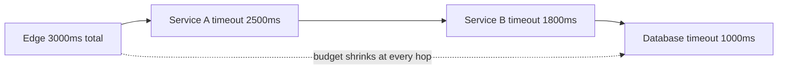

# Network Partitions and Timeouts

Every arrow in your architecture diagram is a lie of omission: it's drawn as a solid line, but it's really a maybe. Packets are lost, delayed, duplicated, and reordered; links fail in one direction but not the other; a switch degrades to 10% throughput without ever going "down". The first of [[The Fallacies of Distributed Computing]] — *the network is reliable* — is first for a reason. This note is about what network failure actually looks like (it's rarely a clean cut), why **slow is harder to handle than down**, and the one universal defense: every remote call gets a **timeout**, and timeouts across a call chain must form a coherent **budget**, not a set of independent guesses.

## Why this matters

Partitions are the "P" whose handling defines the [[CAP Theorem]] trade; replication, [[Failover]], consensus ([[Consensus and Raft]]), and quorums all exist because of what this note describes. More practically: most production incidents in microservice estates are not crashes — they are *timeouts, retries, and queues interacting badly* during a partial network degradation. If you internalize one operational idea from this module, make it timeout budgeting.

## How it works

**The failure menagerie — in increasing order of nastiness:**

| Failure | What it looks like | Who notices |
|---|---|---|
| Packet loss/delay | p99 latency spikes, no errors | nobody, until tail-latency SLOs fire |
| Full partition | two islands, each internally healthy | both sides, quickly and loudly |
| Partial partition | A↮B but both reach C; views disagree | depends where you stand — contradictory alerts |
| Asymmetric partition | requests arrive, replies vanish | caller sees timeouts; callee sees nothing wrong |
| Gray failure | health checks green, real traffic burning | customers first, dashboards last |

- **Packet loss and delay.** Routine, continuous, invisible at p50. TCP retransmits ([[TCP vs UDP]]), converting loss into *latency*: a 1% loss rate doesn't produce 1% errors, it produces multi-hundred-millisecond stalls on the unlucky requests — pure p99 poison. Lesson one: the network's default failure *presentation* is slowness, not errors.
- **Full partition.** A link/switch/AZ cut splits the network into islands that each work internally but can't reach the other. Clean in theory, and the case distributed-systems theory handles best — each side can detect "I can't reach quorum" and act ([[Quorum Reads and Writes]], [[Split Brain and Fencing]]).
- **Partial partition.** A can reach C, B can reach C, but A can't reach B. Now views *disagree*: C thinks everything is fine; A thinks B is dead; B thinks A is dead. Failure detectors give contradictory answers depending on vantage point, which is how you get two nodes each convinced they should be leader — a coordinator sees both, each sees only itself. Many real-world consensus bugs and "zombie leader" incidents live here.
- **Asymmetric partition.** Traffic flows A→B but not B→A (one-direction link failure, asymmetric routing, a firewall rule). B receives requests and processes them; its responses vanish. A times out and retries work that *already executed* — the canonical generator of duplicate side effects, and the reason [[Idempotency]] is non-negotiable for anything that moves money. Also poisons failure detection: B's heartbeats die while B happily serves other callers.
- **Gray failure.** The component neither works nor fails: a NIC dropping 30% of packets, a switch at 100× normal latency, a node that answers health checks (cheap path) while timing out real work (expensive path). The defining property, per the Microsoft Research paper that named it (Huang et al., 2017): **differential observability** — the system's own health checks say green while clients burn. Gray failures routinely escape detection for a long time because every monitor was asked the wrong question.

**Why "slow" is harder than "down".** A dead dependency fails fast: connection refused in milliseconds, callers error immediately, [[Circuit Breakers]] open, capacity is preserved. A *slow* dependency fails expensively: every caller holds a thread, a connection-pool slot, and memory for the full timeout; queues build; the caller's own callers slow down; retries add load to the already-struggling dependency. Slowness **propagates upstream and amplifies downstream** — this is the mechanics behind cascading and metastable failures ([[Failure Modes in Distributed Systems]]). Down subtracts capacity; slow *consumes* it. Corollary: a health check that only answers "is it up?" is checking the easy, mostly-irrelevant question; latency is the signal.

Where partitions actually come from, so they feel concrete rather than theoretical:

- hardware: switch/router failures and firmware bugs, NIC degradation, bad cables and optics;
- software: firewall/security-group changes, routing misconfiguration, conntrack/NAT table exhaustion, kernel bugs;
- operations: overlapping maintenance, mis-scoped network ACL rollouts, VPN flaps between sites;
- capacity: congestion that drops or delays enough packets to be indistinguishable from a partial cut;
- cloud specifics: cross-AZ link degradation, a sick node's kubelet/VPC agent isolating its pods.

The OSDI 2018 study of 136 network-partition failures across 25 distributed systems found that while most (69%) followed complete partitions, nearly a third came from *partial* (29%) or one-directional (2%) partitions developers had not anticipated; that 80% were catastrophic — data loss, stale reads, broken locks — and 90% silent; and that 88% could be triggered by isolating a single node. In other words: the nastiest cases are not exotic, they are simply the ones nobody tested.

**How systems decide someone is dead: failure detectors.** There is no way to *know* a remote node is down — only to stop hearing from it. Practical systems use heartbeats plus a threshold: miss N beats in T seconds and the node is declared dead. The threshold is a trade: too aggressive and transient congestion triggers false deaths (and a false death triggers [[Failover]] — the operation that *causes* many outages); too lenient and real failures go unhandled for minutes. Two refinements worth knowing by name:

- **Phi-accrual failure detection** (used by Cassandra and Akka): instead of a binary dead/alive verdict, maintain a running distribution of heartbeat inter-arrival times and output a *suspicion level* that rises the longer the silence lasts relative to history. Callers pick their own threshold per decision — a gossip update can act on low suspicion, a leader eviction demands high.
- **Lease-based liveness**: a node is "alive" only while it holds a time-bounded lease it must actively renew (how Kubernetes node heartbeats and many lock services work). The lease converts "I haven't heard from you" into "your permission expired" — a decision with a defined owner and clock, rather than a guess. Clock skew becomes the new risk, which is why lease math always includes a safety margin.

Partial and asymmetric partitions break naive detectors precisely because *reachability is not transitive*: the detector's verdict depends on where it runs. Mature systems therefore aggregate multiple vantage points (quorum-based eviction: a node is dead only if a majority can't reach it) rather than letting any single observer declare death.

**Timeouts — turning ambiguity into a decision.** Over a network you can never distinguish "lost request", "slow server", "executed but reply lost" — a timeout doesn't resolve the ambiguity, it just *bounds how long you'll wait before acting in uncertainty*. That has two consequences. First, every remote call must have one: an unbounded wait donates your thread to someone else's outage (JDK `HttpClient`, many drivers, and classic `RestTemplate` historically default to *no* timeout — the single most common resilience hole in Java services). Second, after a timeout you don't know whether the work happened — so retries require idempotency, and "timeout ≠ failure" must be wired into reconciliation for money paths.

**Timeout budgets across hops.** Timeouts set independently per service produce nonsense: if the edge allows 3s but the chain beneath it can legitimately take 2s + 2s + 2s, the deep hops keep computing answers for a caller that already gave up — wasted work during exactly the overload that caused the slowness. A **budget** makes the numbers coherent: the edge owns the total (say 3s), and each hop receives *less* than its caller's remainder, accounting for network overhead and any retry it intends to make.

A worked example of why budgets must be explicit. Suppose the edge allows 3s, service A calls B with a 2s timeout and retries once on timeout, and B calls the database with a 2s timeout. Worst case: B's DB call consumes 2s, A times out at 2s and retries, the retry consumes another 2s — A has now spent 4s+ inside a 3s edge budget. The user saw an error at 3s; A and B spent a further second computing an answer nobody will read, during exactly the overload that made things slow. Every number was individually "reasonable"; the *composition* was broken. Budgets fix composition.

Two implementation styles: **static nesting** (each hop configured smaller than its parent — simple, drifts as topology changes) and **deadline propagation** (the edge stamps an absolute deadline that travels with the request — gRPC does this natively; in REST estates it's a header you propagate like `x-correlation-id`). Rules of thumb that survive contact with production: derive timeouts from the dependency's *measured* p99 plus headroom, not from vibes; if you retry, the budget must cover retries (two attempts at 1s each inside a 1.5s budget is a lie); and hedge/retry *within* the budget rather than stacking timeouts serially. Full treatment of retries, backoff, and jitter: [[Timeouts Retries and Exponential Backoff]].

**Detecting what the network is doing to you.** You cannot fix what presents as "the app is slow" without separating app time from network time:

- **Per-dependency latency histograms** (not averages) — a bimodal distribution with a spike near the retransmission timeout (~200ms+) or near your own timeout value is the network's signature, not your code's.
- **Timeout and retry counters per dependency, per direction** — a rise in A→B timeouts *without* a rise in B's self-reported latency is the smell of an asymmetric path problem or a drop between them.
- **Error-type discrimination** — connection refused (process down), connection timeout (host/path unreachable — network), read timeout (reached it, it's slow): three different failures, three different pages. Log them distinctly.
- **Cross-vantage checks** — probe each dependency from more than one place; partial partitions are invisible from any single vantage point by definition.
- **TCP-level counters where available** — retransmit rates on nodes (`netstat -s`, eBPF tooling) turn "feels slow" into "3% retransmits on that node pair".

These feed the correlation story: with `x-correlation-id` on every hop ([[Distributed Tracing]]), a single slow user request can be decomposed into which hop ate the budget — without it, every partial partition becomes an inter-team blame session.

## Trade-offs

| Decision | Short setting | Long setting |
|---|---|---|
| Timeout length | fast failure detection, bounded resource hold; but false positives on healthy-slow requests → spurious retries, duplicate work | tolerant of real variance; but resources held longer, slowness propagates further before anyone acts |
| Failure-detector sensitivity | reacts fast to real partitions | fewer wrong "node is dead" verdicts (and wrongly declaring death triggers failover — the dangerous operation; see [[Failover]]) |

There is no correct timeout — only one *consistent with the SLO and the measured latency distribution*. The goal is an explicit decision, not a default nobody chose.

Two tactics refine the basic timeout, both borrowed from Google's "The Tail at Scale" (Dean & Barroso, 2013):

- **Hedged requests**: after the p95 latency has elapsed with no reply, send a second copy of an (idempotent!) request to another replica and take whichever answers first. Caps tail latency at the cost of a few percent extra load — but requires a replica to hedge to and strict idempotency.
- **Deadline-aware rejection**: a service that receives a request whose propagated deadline has already expired (or will expire before its own p50 completes) should reject immediately rather than start work. Cheap to implement once deadlines propagate; recovers the "wasted work past the edge's patience" loss directly.

## Common misconceptions

- **"Partitions are rare, so CAP rarely applies."** Full AZ-splits are rare; *partial* degradation — loss, gray failure, one slow link — is continuous background reality. Every timeout firing is a micro-partition from the caller's point of view.
- **"A timeout means the operation failed."** It means *you stopped waiting*. The write may have committed; the reply died. Treating timeout as failure and blindly retrying non-idempotent work is the classic double-charge recipe.
- **"Health checks tell us when a node is bad."** Gray failure's whole definition is that they don't — the probe exercises a cheaper path than real traffic. Measure what users experience (real-request latency/error SLIs), not just what the probe experiences.
- **"We set timeouts everywhere, so we're safe."** Uncoordinated timeouts can be worse than none: inner retries × outer retries multiply load (retry amplification), and inner timeouts longer than outer ones guarantee orphaned work.
- **"TCP guarantees delivery, so if the call returned without error, the data arrived."** TCP guarantees delivery *to the peer's kernel buffer*, not that the application read it, processed it, or persisted it. A process can crash with acknowledged-but-unprocessed bytes in its socket buffer. Application-level acknowledgment is the only real confirmation — a theme that returns in [[Delivery Semantics]].
- **"Our cloud provider's network makes this someone else's problem."** Managed networks reduce frequency, not possibility — and they add their own actors: conntrack limits, NAT gateway idle timeouts, cross-AZ congestion, and node-level issues all present exactly the symptoms above, inside AWS as anywhere else.

## In your stack

- Audit the actual numbers: Kong has route-level timeouts, ALB has its idle timeout, and each Spring Boot service sets (or forgets) connect/read timeouts on HTTP clients, Mongo (`serverSelectionTimeoutMS`, `socketTimeoutMS`), Redis/Lettuce command timeouts. If the edge's number isn't the largest and the DB's the smallest, the budget is incoherent — a one-afternoon audit with real payoff.
- **Fail-closed is your friend**: in money movement, the correct response to timeout-ambiguity is *hold and reconcile*, never *assume success* — a stuck transfer is recoverable, a duplicated one is an incident with a regulator. Pair every ambiguous external call (bank/partner APIs) with idempotency keys and a reconciliation job.
- At **1 replica**, "slow vs down" sharpens: there is no healthy peer for the LB to shift to, so a slow pod means *every* request suffers for the full timeout. Readiness probes that would deregister the only pod on a datastore blip make it worse — connection-refused instead of an interpretable 5xx (a lesson already learned in your fleet's probe configuration).
- You already propagate `x-correlation-id` on every hop; a propagated deadline header is the same plumbing and turns static timeout nesting into real budget enforcement.
- Mongo driver timeouts deserve special respect: `socketTimeoutMS` unset means a gray-failing node can hold your request threads indefinitely while the pod stays "healthy". Recent driver versions consolidate the per-stage knobs behind a single client-side operation timeout (`timeoutMS`), still marked experimental in the Java driver docs as of 2026 — check what your driver version actually supports before writing the config.

## Interview angle

The 60-second version: *"Networks don't fail cleanly. Besides loss and full partitions you get partial partitions — A and B each think the other is dead while C sees both — asymmetric ones where requests arrive but replies vanish, so retries duplicate executed work, and gray failures where health checks pass while real traffic burns. Slow is worse than down: down fails fast and frees resources; slow holds threads and pool slots for the full timeout, backs up queues, and propagates upstream — that's how cascades start. Defenses: an explicit timeout on every remote call, derived from measured p99; timeouts arranged as a shrinking budget across hops — ideally a propagated deadline, like gRPC's — so deep services never work past the edge's patience; retries only within budget, only on idempotent operations, with backoff and jitter; and detection based on user-experienced latency, not probe success."*

Classic follow-ups: *What can you conclude when a call times out?* (Nothing about whether it executed — hence idempotency.) *Why is wrongly declaring a node dead dangerous?* (It triggers failover/election — see [[Split Brain and Fencing]].) *How do you set a timeout?* (From the callee's latency distribution + SLO math, reviewed as topology changes.) *What's a gray failure?* (Differential observability: system says healthy, clients say broken.)

## Check yourself

**Q1 (explain it): Explain to a new joiner why a dependency that's slow is operationally worse than one that's crashed, mechanically — what resources are involved?**

> [!question]- Q1 answer
> Crashed: connections are refused in milliseconds; callers error immediately, threads and pool slots are freed, circuit breakers open, and the caller keeps serving what it can. Slow: each in-flight call pins a thread (or event-loop future), an HTTP/DB connection-pool slot, and request memory for the *full timeout duration*. Throughput of the caller collapses to pool-size ÷ timeout, its own callers start timing out, and their retries add load to the sick dependency. The failure converts capacity into waiting, then spreads — down is a subtraction, slow is a multiplication.

**Q2 (scenario): Payments calls a bank API with a 10s timeout. At 10s it times out and your code retries; the customer is debited twice. Walk the chain of wrong assumptions and the fixes.**

> [!question]- Q2 answer
> Wrong assumption 1: timeout = failure. The first request likely executed; only the response was lost or late (possibly an asymmetric-partition pattern). Wrong assumption 2: retry is safe. It wasn't idempotent, so re-execution duplicated the debit. Fixes: send an idempotency key the bank honors (or their dedup reference) so a retry returns the original outcome; treat post-timeout state as *unknown* — query status before retrying, or park in a pending state and reconcile; fail closed and surface "processing" to the user. This is [[Idempotency]] plus timeout-ambiguity, the single most important pairing in fintech engineering.

**Q3 (mini design): The edge SLO for a checkout call is 2s. The path is Kong → order service → risk service → MongoDB, and the order service retries the risk call once. Assign a coherent timeout budget and state your reasoning.**

> [!question]- Q3 answer
> Work backwards from 2s, leaving headroom at each hop for network + processing. Example: Kong 2000ms → order service treats its total work as ≤1800ms; it plans two attempts at risk, so each attempt gets ~800ms (2 × 800 + backoff + own processing ≈ 1800) → risk service internal budget ~700ms → its Mongo `socketTimeoutMS`/`maxTimeMS` ~400–500ms. Invariants checked: inner < outer at every nesting, the retry is *inside* the budget rather than doubling it, and the deepest timeout is the smallest. Better still: propagate an absolute deadline header from Kong so each hop computes its remaining budget instead of trusting static config to stay consistent.

**Q4 (explain it): What is a gray failure, and why do its incidents tend to run long before anyone finds the cause?**

> [!question]- Q4 answer
> A gray failure is a component that is degraded for its real users while appearing healthy to the system's own detectors — *differential observability*. The health check exercises a cheap path (a TCP accept, a `/health` handler returning 200) while real traffic exercises the expensive one (disk, downstream calls, the NIC under load). Incidents run long because every dashboard that would normally localize the fault says green: responders chase the application layer, the database, recent deploys — everything except the component whose own telemetry is lying. Fixes are philosophical as much as technical: measure from the *client's* side (per-dependency latency SLIs), probe the real code path, and trust user-experience signals over component self-reports.

## Sources

- *Designing Data-Intensive Applications* (Kleppmann), **Ch. 8 — The Trouble with Distributed Systems** (unreliable networks, timeouts, detecting faults)
- Huang et al., *Gray Failure: The Achilles' Heel of Cloud-Scale Systems*, HotOS 2017 (differential observability)
- L. Peter Deutsch — the original seven Fallacies of Distributed Computing (c. 1994 at Sun); James Gosling added the eighth, "the network is homogeneous" (c. 1997); see [[The Fallacies of Distributed Computing]]
- Alquraan, Takruri, Alfatafta & Al-Kiswany, *An Analysis of Network-Partitioning Failures in Cloud Systems*, OSDI 2018 (partial partitions in real systems)
- AWS Builders' Library — "Timeouts, retries, and backoff with jitter" (Marc Brooker); gRPC documentation on deadlines and deadline propagation
- Dean & Barroso, *The Tail at Scale*, CACM 2013 (hedged requests, tail-latency tactics)
- Hayashibara et al., *The Phi Accrual Failure Detector*, SRDS 2004 (as implemented in Cassandra and Akka)
