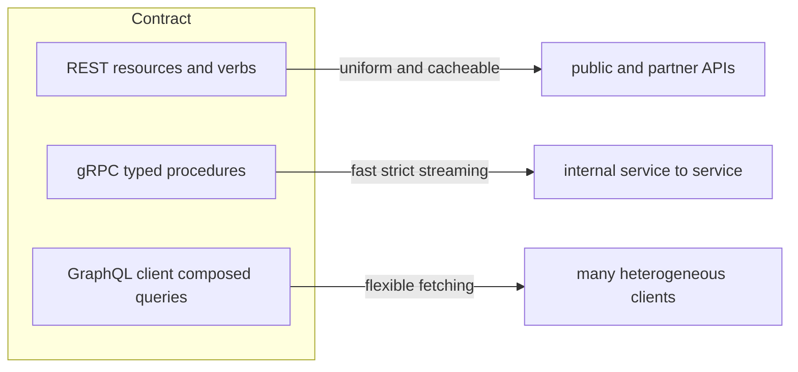

# REST vs gRPC vs GraphQL

These are three answers to the same question: **what shape is the contract between a client and a server?** REST says *the contract is a set of resources* you manipulate with HTTP's own verbs. gRPC says *the contract is a set of typed functions* you call as if they were local. GraphQL says *the contract is a typed data graph* and each client composes its own query against it. None is "more modern" than the others — they optimize for different pain: REST for uniformity and HTTP-native caching, gRPC for efficiency and strict contracts between services you control, GraphQL for flexible data fetching across many differently-shaped clients. Most real estates run more than one, on purpose.

## Why this matters

Choosing a contract style fixes your serialization cost, your caching options, your versioning discipline ([[API Design and Versioning]]), your tooling, and how painful cross-team coordination is. It's also one of the most common interview comparison questions, where the differentiator is *honesty about weaknesses* rather than feature lists.

## How it works

**REST (REpresentational State Transfer)** — Fielding's 2000 thesis, as practiced: model the domain as **resources** at URLs (`/users/42/accounts`), manipulate them with HTTP methods (GET read, POST create, PUT/PATCH update, DELETE remove), represent them as JSON, use status codes for outcomes. The leverage comes from riding HTTP's machinery: **GET is cacheable by any CDN or proxy on the path with zero custom work**, semantics are uniform across every API in the world, and a human can debug with curl. In practice almost nobody implements full REST (HATEOAS hypermedia); "HTTP+JSON resource APIs" is what the industry means, and that's fine.

What disciplined REST actually requires (the part "just JSON over HTTP" skips):

- **Resource modeling** — nouns, not verbs: `POST /transfers` beats `POST /executeTransfer`; actions that don't fit CRUD become resources themselves (a `/transfers/123/reversal`).
- **Verb semantics** — GET safe and cacheable, PUT/DELETE idempotent, POST neither; retry logic and caches *assume* you honored this, so violating it (a GET that mutates) breaks infrastructure you don't control.
- **Error contract** — status codes for the machine-readable class (400 vs 404 vs 409 vs 503), a consistent JSON error body for the human/program detail; RFC 9457 (`application/problem+json`) is the standardized shape.
- **Pagination, filtering, versioning** — decided once, applied everywhere; the full treatment lives in [[API Design and Versioning]].

**gRPC** — Google's RPC framework (2015, from internal Stubby). You define services and messages in a **`.proto` file**; `protoc` generates client stubs and server skeletons in your languages. Calls are **Protocol Buffers** binary payloads over **HTTP/2** streams ([[HTTP 1.1 vs HTTP 2 vs HTTP 3]]).

- **JSON vs protobuf cost**: JSON is text — field names repeated in every message, numbers as digit strings, parsing that walks bytes building maps. Protobuf is binary — fields as numeric tags, varint-encoded numbers, schema known in advance, so messages are typically severalfold smaller and materially cheaper to encode/decode (exact ratios depend on payload shape; the win is biggest on number-heavy, repetitive data). At one call this is noise; at thousands of RPS across a service mesh it is real CPU and bandwidth money.
- **Contract-first and typed**: the `.proto` *is* the API; mismatches fail at compile time, not in production. Evolution has rules (field numbers are forever, add optional fields, never reuse tags) — see [[Event Schema Evolution]] for the same discipline applied to messages.
- **Streaming**: four call shapes — unary, **server-streaming** (one request, a stream of responses: live updates, large result sets), **client-streaming** (uploads, telemetry), **bidirectional streaming** (chat-like, realtime sync). This is a genuine capability gap over plain REST, which would need [[WebSockets Server-Sent Events and Long Polling|SSE/WebSockets]] bolted on.
- **Deadlines and status codes built in**: every gRPC call carries an optional **deadline** that propagates to downstream gRPC hops automatically — the timeout-budget discipline of [[Network Partitions and Timeouts]] as a first-class feature — plus a typed status-code vocabulary (`DEADLINE_EXCEEDED`, `UNAVAILABLE`, `ALREADY_EXISTS`) that makes retry policy decidable per code instead of per regex-on-error-message.
- Costs: browsers can't speak native gRPC (needs gRPC-Web + proxy), payloads aren't human-readable, L7 infrastructure must understand h2 trailers, and HTTP caching machinery doesn't apply.

**GraphQL** — Facebook (2012 internal, 2015 public). The server exposes one endpoint and a **typed schema**; the client sends a **query** naming exactly the fields it wants, arbitrarily nested; the server returns exactly that shape. Built for the problem of *many clients with different data needs* hitting the same backend: the mobile app wants 5 fields, the web dashboard wants 40, and without GraphQL you either **over-fetch** (one fat endpoint) or **under-fetch** (N calls to compose a screen) or sprout bespoke backend-for-frontend endpoints endlessly.

- **The N+1 problem**: GraphQL resolvers execute per-field. A query for 100 posts and each post's author naively triggers 1 query for posts + 100 for authors — the server-side twin of [[N+1 Queries and ORM Pitfalls]]. The standard fix is **DataLoader**-style batching (collect the 100 author IDs within one tick, issue one `WHERE id IN (...)`), which works but is *mandatory operational knowledge*, not an optional optimization.
- **Caching difficulty**: queries go by **POST to a single endpoint**, so URL-keyed HTTP caching — the entire CDN/proxy ecosystem REST gets free — doesn't apply. Caching moves into the GraphQL layer: normalized client caches (Apollo), persisted queries (whitelisted query hashes, GET-able), per-resolver server caches. All workable, none free.
- Other sharp edges: clients can compose pathologically expensive queries (you need depth limits, complexity budgets, timeouts — an availability concern, not a nicety), and "one endpoint" makes per-endpoint rate limiting and authz coarser by default.
- **At organization scale**: multiple teams contributing to one schema leads to **federation** (Apollo Federation-style) — each service owns a subgraph, a gateway composes them into one graph. Powerful, and a whole operational platform of its own; Netflix and Shopify have written candidly about the investment it takes. Don't adopt federation ambitions with a two-team backend.

How the three handle the same everyday concerns:

| Concern | REST | gRPC | GraphQL |
|---|---|---|---|
| Errors | status codes + error body | typed status codes per call | 200 + `errors` array in body (partial success possible — clients must check both) |
| Timeouts/deadlines | per-client config, manual propagation | deadline propagation built in | per-request config; resolver-level budgets manual |
| Pagination | query params, `Link` headers | request fields + repeated responses or streaming | cursor connections (Relay spec) |
| Auth granularity | per endpoint/verb — gateway-friendly | per method via interceptors | per field via resolvers — powerful, easy to get wrong |

## Trade-offs

| | REST | gRPC | GraphQL |
|---|---|---|---|
| Contract | implicit (OpenAPI bolts it on) | explicit `.proto`, compile-checked | explicit schema, runtime-validated |
| Payload | JSON text — larger, human-readable | protobuf binary — compact, fast, opaque | JSON, but only requested fields |
| HTTP/CDN caching | **free on GET** | none | hard; persisted queries recover some |
| Streaming | no (bolt on SSE/WS) | native, 4 modes | subscriptions (usually WS underneath) |
| Browser support | universal | via gRPC-Web proxy only | universal |
| Fetch shape | server decides (over/under-fetch risk) | server decides | **client decides** |
| Ops/debug | curl-grade simple | needs tooling (grpcurl), h2-aware infra | query cost controls required |
| Versioning | URL/header versioning, loose | field-number discipline, strong | additive schema evolution, deprecation |

What adopting each one commits your organization to — the hidden line items:

- **REST**: a style guide and review discipline (nothing enforces resource modeling), OpenAPI specs kept honest (generated or contract-tested, else they rot), and a versioning policy before the first breaking change arrives, not after.
- **gRPC**: a proto repository with ownership and CI (breaking-change linting like `buf`), build-pipeline codegen for every consumer language, h2-capable infrastructure verified end to end, and grpcurl/reflection conventions so on-call engineers can poke services at 2 a.m.
- **GraphQL**: a schema governance process (who may add fields, deprecation windows), DataLoader batching as standard practice, query cost limiting in production from day one, and observability that attributes cost per query shape — the single endpoint makes "which client is hurting us" a question you must build the answer to.

## Common misconceptions

- **"gRPC is faster, so use it everywhere."** The protobuf/h2 win is real *between services you control at volume*. For a public API it costs you browser clients, curl-ability, CDN caching, and ecosystem familiarity — usually a bad trade.
- **"GraphQL replaces REST."** GraphQL solves *client data-shaping*. If your API has one consumer shape (service-to-service, webhooks, public resources), GraphQL adds a resolver layer, N+1 risk, and a caching problem for nothing.
- **"REST is just JSON over HTTP, no design needed."** Resource modeling, idempotent verb use, pagination, and error contracts are exactly where sloppy REST APIs rot — see [[API Design and Versioning]].
- **"gRPC means no versioning problems."** Protobuf makes *wire* compatibility easy (old clients ignore new fields), but *semantic* compatibility — a field's meaning changing, a default behaving differently — still breaks consumers exactly as it does in REST. Contract discipline moves, it doesn't disappear.
- **"GraphQL subscriptions make it a realtime platform."** Subscriptions define query shape over a push channel; the hard parts — connection state, scaling fan-out, reconnects — are the [[WebSockets Server-Sent Events and Long Polling]] problems underneath, unchanged.
- **"GraphQL is a database query language."** It queries the *schema you expose*; every field still resolves through your code and authz. It is not SQL-over-HTTP, and exposing your DB shape through it couples clients to your storage.

## When each wins (honest guidance)

- **REST wins**: public and partner APIs (universality, docs, curl), resource-shaped CRUD, anything where CDN/HTTP caching carries real load, webhook payloads, and as the default when no measured pain says otherwise. Boring is a feature.
- **gRPC wins**: internal service-to-service at meaningful volume (payload/CPU economics), polyglot estates wanting compile-time contracts, and anywhere streaming is native to the problem (live feeds, bulk transfer, bidirectional sync).
- **GraphQL wins**: one backend serving *many* client shapes (iOS/Android/web/partners) where screen-composition over-/under-fetching is measured pain; API-gateway-for-frontends over multiple services (BFF consolidation). It wins on *organizational* grounds — frontend teams self-serve without backend ticket queues — more than on raw performance.
- **Mixing is normal**: GraphQL or REST at the edge for clients, gRPC inside the cluster, REST for partners. The styles compose; dogmatic uniformity is the anti-pattern.
- **Also real options, briefly**: plain JSON-RPC-over-HTTP (RPC semantics without the gRPC toolchain — underrated for small internal estates), and async messaging — many "API" interactions are better modeled as events on a queue or log ([[Why Async Messaging Exists]]); the sync-API-vs-event decision usually matters more than which sync style you pick ([[Communication Patterns Between Services]]).

And a worked payload-cost intuition, since "protobuf is smaller" deserves numbers-shaped reasoning: a JSON risk event like `{"userId":"u-19284","score":0.82,"factors":[4,9,23],"ts":1759276800000}` spends most of its bytes on field names, quotes, and digit characters repeated in *every* message. The protobuf equivalent sends each field as a 1-byte tag plus a compact value (varint/fixed), omits absent fields entirely, and never repeats names — the schema on both ends is the dictionary. The same logic explains the decode cost: a JSON parser discovers structure byte-by-byte at runtime; generated protobuf code already knows the structure and mostly copies values. Multiply a few hundred saved bytes and a few hundred saved microseconds by every message on a hot internal path to see where the "gRPC for service-to-service at volume" guidance comes from — and why it's irrelevant at ten requests per second.

## In your stack

- Your estate is REST/JSON between Spring Boot services through Kong — appropriate: Kong's routing, rate limiting, and authn plugins are HTTP/REST-native, and curl-grade debuggability matters during incidents.
- If an internal hot path (e.g. a fraud-check or balance-lookup fan-out) ever shows serialization/bandwidth as measured cost, that pair of services is the gRPC candidate — not a blanket migration. Verify ALB/Kong h2+trailer handling first ([[HTTP 1.1 vs HTTP 2 vs HTTP 3]]).
- In fintech, **protobuf's compile-time contracts are an auditability asset** (the API is a reviewed file in git), but REST+OpenAPI achieves the same with discipline.
- GraphQL would only earn its place if Niyo's mobile + web clients demonstrably suffer from over-/under-fetching across many screens — and then the N+1/DataLoader and query-cost-limiting work is part of the price, with MongoDB lookups behind resolvers being exactly where N+1 would bite.
- Whatever the style: propagate `x-correlation-id` — contract style doesn't change observability obligations ([[Distributed Tracing]]).
- Error contracts deserve the same rigor as success contracts in money movement: a partner retrying on an ambiguous 500 vs honoring a 409-with-idempotency-key is the difference between a clean ledger and a reconciliation project ([[Idempotency]]).
- Pagination style is a silent API commitment: offset pagination over MongoDB collections degrades as offsets grow and skews under concurrent writes; cursor-based pagination is the default worth standardizing before external consumers freeze your contract.

## Interview angle

The 60-second version: *"Three contract shapes. REST: resources + HTTP verbs — universal, curl-able, and GETs cache in any CDN for free; weakness is fixed response shapes, so clients over- or under-fetch. gRPC: typed procedures from a proto file, protobuf-over-HTTP/2 — compact, fast, compile-time contracts, native streaming; weakness is browsers, debuggability, and no HTTP caching, so it's an internal tool. GraphQL: clients compose typed queries, killing over/under-fetch across heterogeneous clients; weaknesses are N+1 resolvers needing DataLoader batching, losing URL-keyed caching, and unbounded query cost needing limits. Default REST publicly, gRPC on hot internal paths, GraphQL when many client shapes are measured pain — and mixing them is the normal end state."*

Classic follow-ups: *How does GraphQL get N+1 and how do you fix it?* (Per-field resolvers; DataLoader batching per request tick.) *Why is GraphQL hard to cache?* (POST, single endpoint, infinite query shapes — no URL key; persisted queries mitigate.) *When would you NOT use gRPC despite it being internal?* (Low volume, team unfamiliarity, infra that mangles h2, debuggability priorities.)

## Check yourself

**Q1 (explain it): Why does REST get CDN caching "for free" while GraphQL has to rebuild caching, despite both returning JSON over HTTP?**

> [!question]- Q1 answer
> HTTP caching keys on method + URL (+ headers): a REST `GET /users/42` is an idempotent, URL-identified read any proxy/CDN can store and serve. GraphQL sends every operation — reads included — as a POST to one endpoint with the query in the body; to a cache every request looks like an uncacheable write to the same URL. Mitigations (persisted queries as GETs, client normalized caches, resolver-level caches) all require building what REST inherited from HTTP's design.

**Q2 (scenario): Mobile team complains your REST API forces 6 sequential calls to render the home screen; they propose GraphQL. Give the case for it and one cheaper alternative, with the deciding factor.**

> [!question]- Q2 answer
> Case for: this is literally GraphQL's founding problem — under-fetching composition; one query returns the screen's exact shape, and future screens self-serve without backend changes. Cheaper alternative: a purpose-built BFF/aggregate endpoint (`GET /home-screen`) that composes the 6 calls server-side — one endpoint, no new runtime, keeps HTTP caching. Deciding factor: *how many distinct screens/clients will need this*. One screen → BFF endpoint. Dozens of evolving screens across platforms → the BFF sprawls into an unmaintained endpoint farm, and GraphQL's schema pays for its complexity.

**Q3 (mini design): Two internal services exchange ~5k requests/sec of small, number-heavy risk-score payloads, p99 budget 20ms. Make the transport call and name the two infrastructure checks before committing.**

> [!question]- Q3 answer
> gRPC fits: binary protobuf slashes serialization CPU and bytes on exactly this payload shape, typed contracts suit a stable internal pair, and server-streaming helps if scoring becomes batch/flow. Checks: (1) every L7 hop on the path (ALB, Kong, mesh) must correctly pass HTTP/2 with trailers — historically a real failure point; (2) load balancing — h2 multiplexes onto few long-lived connections, so per-connection L4 balancing will skew pods; you need L7/client-side balancing (see [[HTTP 1.1 vs HTTP 2 vs HTTP 3]]).

**Q4 (scenario): A GraphQL endpoint starts timing out every evening. Logs show one partner's dashboard sends a query fetching accounts → transactions → merchant → all transactions at that merchant, four levels deep. What class of problem is this, and what are the three standard controls?**

> [!question]- Q4 answer
> Unbounded client-composed query cost — GraphQL's version of letting strangers write your SQL. The nested query likely also detonates N+1 resolvers at each level, multiplying database load. Controls: (1) **depth limiting** — reject queries past a nesting bound; (2) **cost/complexity analysis** — assign weights per field, score the query *before executing*, reject or throttle over-budget ones; (3) **persisted queries** — in partner-facing setups, only pre-registered query shapes are allowed, converting an open query language back into a reviewed contract. Plus the perennial baseline: DataLoader batching so the queries that do run don't multiply, and per-caller rate limits so one partner's dashboard can't spend everyone's evening capacity.

## Sources

- Roy Fielding, *Architectural Styles and the Design of Network-based Software Architectures* (2000), Ch. 5 — REST
- gRPC documentation (grpc.io) — concepts, streaming modes, "gRPC on HTTP/2"; Protocol Buffers encoding docs for the payload-cost claims
- GraphQL specification (graphql.org) and Apollo/graphql.org docs on DataLoader-style batching and persisted queries
- Netflix and Shopify engineering blog posts on running GraphQL at scale (query cost limiting, federation experience)
- RFC 9457 — *Problem Details for HTTP APIs* (2023) — the standardized REST error-body shape referenced above
- *API Design Patterns* (JJ Geewax, Manning) — resource modeling and contract evolution
