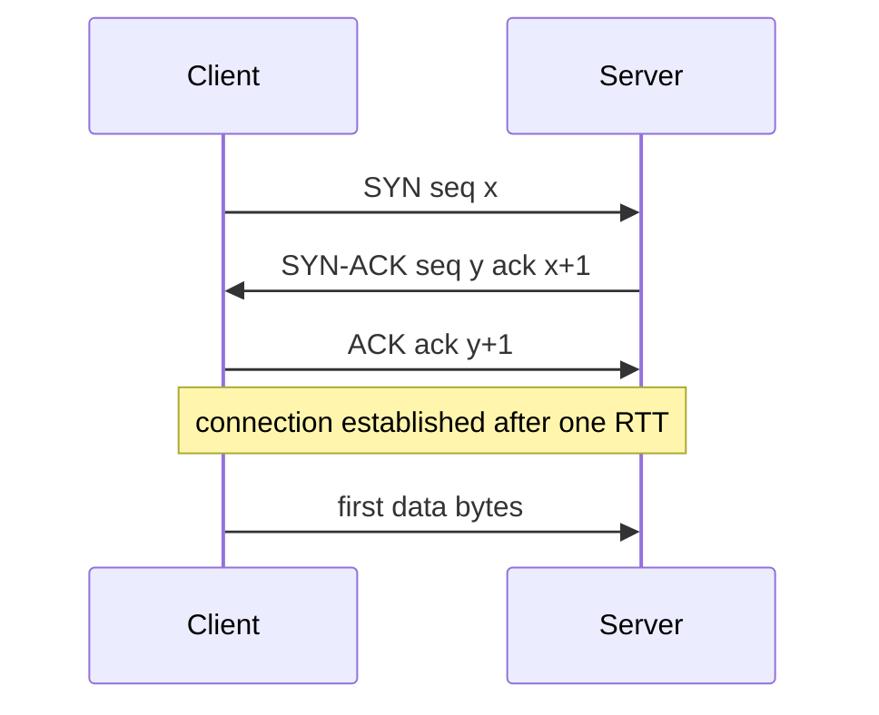
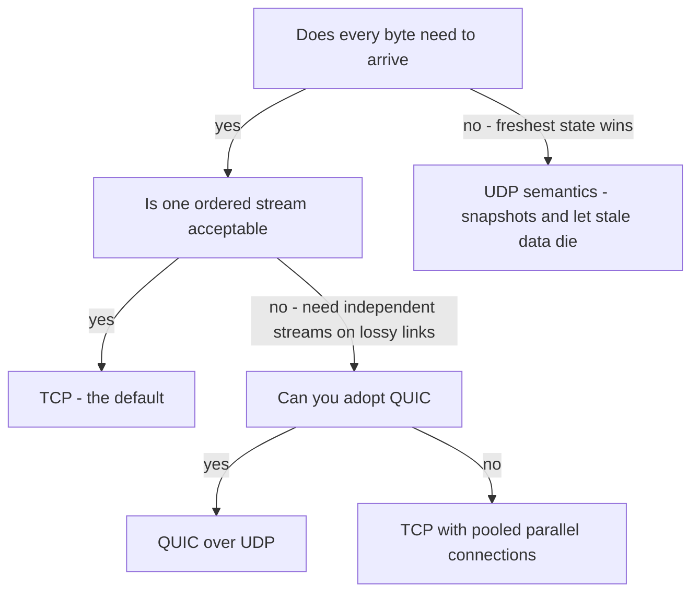

# TCP vs UDP

IP delivers packets *maybe*: they can be lost, duplicated, reordered, or delayed, and IP doesn't care. TCP and UDP are the two transport layers built on top of that uncertainty, and they represent opposite answers to it. **TCP** manufactures the illusion of a reliable, ordered byte stream — at the cost of handshakes, retransmission delays, and head-of-line blocking. **UDP** passes IP's uncertainty straight through to you — at the cost of nothing, which is exactly why the most latency-sensitive systems (DNS, QUIC, games, video calls) choose it and handle reliability themselves. This is not "reliable vs unreliable"; it is *who* handles unreliability: the kernel's one-size-fits-all policy, or your application's purpose-built one.

## Why this matters

Every choice in [[HTTP 1.1 vs HTTP 2 vs HTTP 3]], every connection-pool setting, every "why is p99 bad on lossy networks" investigation bottoms out here. TCP's guarantees are *mechanisms with costs*, and those costs surface as tail latency ([[Latency vs Throughput vs Bandwidth]]). Interviewers use this topic to check whether you know what your defaults are actually doing.

## How it works

**TCP (Transmission Control Protocol)** gives you a **connection**: a stateful, bidirectional, ordered, reliable byte stream.

**The 3-way handshake** establishes shared state (initial sequence numbers, negotiated options) before any data flows:

That is **one full round trip before the first byte of data** — the reason connection reuse (keep-alive, pooling) matters so much, and the first thing QUIC set out to delete.

**Ordering and retransmission.** Every byte has a **sequence number**. The receiver acknowledges what it has received contiguously; the sender retransmits anything unacknowledged after a timeout or after duplicate ACKs signal a hole. The receiver buffers out-of-order segments but **delivers bytes to the application strictly in order**.

**Flow control vs congestion control** — different problems, often conflated:

| | Protects | Mechanism (concept) |
|---|---|---|
| **Flow control** | the *receiver* from being overwhelmed | receiver advertises a window: "I have buffer for N more bytes"; sender never exceeds it |
| **Congestion control** | the *network* from being overwhelmed | sender probes capacity: start slow, grow the sending window until loss/delay signals congestion, then back off (slow start, AIMD). Know the two names you will actually meet: **CUBIC**, the Linux default since kernel 2.6.19 in 2006, which grows the window on a cubic curve after loss; and **BBR** (Google, 2016), which models bottleneck bandwidth and RTT instead of treating loss as the only congestion signal |

The effective send rate is bounded by the smaller of the two windows. Congestion control is why a single TCP connection takes time to reach full throughput on a fat pipe (slow start), and why loss doesn't collapse the internet.

**Connection state is a real resource.** A TCP connection is identified by the 4-tuple (source IP, source port, destination IP, destination port), and both ends hold kernel state for it: sequence tracking, buffers, timers. Three operational consequences:

- **TIME_WAIT**: the side that closes first keeps the connection's state for a waiting period (commonly 60s on Linux) to absorb stray late packets. A client that opens and closes thousands of short connections per second accumulates tens of thousands of TIME_WAIT sockets and can exhaust ephemeral ports — another reason pooling beats churn.
- **SYN floods**: because the server allocates state on receiving a SYN (before the handshake completes), an attacker can send SYNs from spoofed addresses and fill the server's half-open connection table. **SYN cookies** — encoding the state into the sequence number itself so nothing is stored until the final ACK — are the standard kernel defense.
- **Half-dead connections**: if a peer vanishes silently (power loss, NAT entry expired), TCP notices only on the next *write* (retransmissions fail) — a reader can block forever. This is why application-level heartbeats exist even over "reliable" TCP; see [[WebSockets Server-Sent Events and Long Polling]].

Two small latency gotchas worth recognizing by name: **Nagle's algorithm** (batch tiny writes until the previous packet is ACKed) interacting with **delayed ACKs** (the receiver sits on the ACK hoping to piggyback it — about 40ms on Linux, and RFC 1122 permits up to 500ms) can add ~40ms stalls to chatty request/response protocols — the reason latency-sensitive servers set `TCP_NODELAY`, and most modern RPC stacks and Redis clients do so by default.

**Head-of-line (HOL) blocking** — the cost of ordering. If segment N is lost, segments N+1…N+k may already be sitting in the receiver's kernel buffer, but the application sees *nothing* until N is retransmitted and arrives. One lost packet stalls the entire stream behind it. This is a per-connection, kernel-level stall — no userspace protocol trick can bypass it, which is why HTTP/2's multiplexing over one TCP connection backfired on lossy links and why HTTP/3 left TCP entirely (see [[HTTP 1.1 vs HTTP 2 vs HTTP 3]]).

**UDP (User Datagram Protocol)** adds almost nothing to IP: source/destination ports, length, and a checksum — optional over IPv4, mandatory over IPv6. No connection, no handshake, no ordering, no retransmission, no flow or congestion control. Each **datagram** is independent and either arrives whole or not at all. That absence is the feature:

- **No handshake** → first byte of data in the first packet. DNS resolves in one round trip because of this ([[How DNS Works]]).
- **No ordering** → no HOL blocking; a lost packet affects only itself.
- **No kernel-imposed reliability policy** → the application chooses: retransmit? interpolate? skip?

**When UDP wins:**

- **DNS** — a query fits in one datagram; a handshake would double the round trips of every lookup. Retry logic is trivial (ask again, or ask another server).
- **QUIC / HTTP3** — the heavyweight case: QUIC rebuilds reliability, ordering *per stream*, and congestion control in userspace **on top of UDP**, precisely so one lost packet blocks only its own stream and so the transport can evolve without waiting for kernels and middleboxes. UDP here is an escape hatch from TCP's ossification, not a rejection of reliability.
- **Live video/voice calls** — a frame that arrives late is worthless; retransmitting it wastes bandwidth to deliver garbage. Better to drop it and conceal the loss (interpolation, forward error correction). Note: *buffered streaming* like Netflix is the opposite case — it runs fine over TCP because a client buffer absorbs retransmission delays.
- **Multiplayer games** — only the *latest* position matters; a retransmitted stale position is actively harmful. Send state snapshots, let old ones die.
- **Metrics/telemetry** (classic statsd) — losing 0.1% of counters is acceptable; blocking the app to guarantee them is not.

A decision sketch for "which transport":

## Trade-offs

| | TCP | UDP |
|---|---|---|
| Setup cost | 1 RTT handshake (+ TLS on top) | none |
| Delivery | guaranteed (retransmit until ACKed or connection dies) | best-effort |
| Ordering | strict, with HOL blocking | none — app's problem and app's freedom |
| Congestion control | built in, fair-ish by default | none — an app that blasts UDP can hurt the network (QUIC reimplements it) |
| State | per-connection state on both ends — a cost at millions of connections | effectively stateless |
| Middleboxes/firewalls | universally supported | sometimes blocked or rate-limited; NAT needs keepalives |

The honest summary: **TCP front-loads engineering** (the kernel solved reliability for you, accept its latency behavior); **UDP defers it** (you get latency freedom and must solve reliability, ordering, and congestion yourself — which is a serious undertaking; QUIC took Google years).

Where each shows up in a typical backend day:

| You touch | Transport underneath | Why it matters to you |
|---|---|---|
| REST call between services | TCP (pooled) | pool churn = handshake + slow-start tax on p99 |
| MongoDB / Redis / Kafka clients | TCP (long-lived) | socket timeouts and keepalives are *your* config |
| DNS lookup before any of the above | UDP (TCP fallback for big answers) | one lost datagram = one retry timeout added to a request |
| statsd-style metrics | UDP | loss-tolerant by design; never blocks the app |
| HTTP/3 at the CDN edge | QUIC over UDP | browser-side; your origin usually still speaks TCP |

## Common misconceptions

- **"UDP is faster than TCP."** UDP has lower *overhead and latency variance*; raw throughput on a clean network is comparable. On lossy networks TCP's retransmissions and backoff hurt latency, which is what people actually mean.
- **"UDP is unreliable, so serious systems avoid it."** HTTP/3 — about a fifth of requests to Cloudflare in 2025 (21%) — runs on UDP. Reliability was *moved*, not removed.
- **"The handshake is 3 messages, so it's 1.5 RTT."** Data can ride immediately after the client's final ACK — the client-perceived cost is one RTT.
- **"Flow control and congestion control are the same thing."** Receiver protection vs network protection; an interviewer distinguishing question.

## In your stack

- Everything you run — HTTP APIs through Kong, MongoDB wire protocol, Redis (RESP), Kafka, JDBC — speaks **TCP**. Your daily UDP exposure is DNS lookups and any statsd-style metrics emission.
- Connection pools (Mongo driver, Redis/Lettuce, HTTP clients) exist to amortize the TCP+TLS handshake cost. A pool misconfigured to churn connections pays ~2–3 RTTs (TCP plus TLS 1.3 or 1.2; 1 RTT for plaintext) plus slow-start on every request — visible as a p99 cliff, invisible at p50.
- TCP retransmission timeouts are one of the gremlins behind "the service was *slow*, not down" incidents — a few lost SYNs between a pod and MongoDB produce multi-second stalls with zero errors logged. See [[Network Partitions and Timeouts]].
- Kubernetes Services and ALBs track TCP connection state; long-lived idle connections can be silently dropped by intermediaries (NAT, ALB idle timeout), and the next write discovers it the hard way — keepalives exist for this.

## Interview angle

The 60-second version: *"TCP builds a reliable ordered byte stream over unreliable IP using a 3-way handshake, sequence numbers with retransmission, flow control to protect the receiver, and congestion control to protect the network. The costs: one RTT before data, per-connection state, and head-of-line blocking — one lost segment stalls everything behind it. UDP is just ports over IP: no handshake, no ordering, no HOL blocking, and no help. It wins when latency beats completeness — DNS, live media, games — or as a substrate for rebuilding transport in userspace, which is exactly what QUIC/HTTP-3 does."*

Classic follow-ups: *Why does HTTP/3 use UDP — isn't that unreliable?* (QUIC adds per-stream reliability; the point is eliminating TCP's cross-stream HOL blocking and kernel ossification.) *What's the difference between flow and congestion control?* *Why is video calling UDP but Netflix TCP?* (Real-time vs buffered — the buffer absorbs retransmission jitter.)

## Check yourself

**Q1 (explain it): Explain head-of-line blocking in TCP to a junior engineer, and why no application-level protocol running over a single TCP connection can avoid it.**

> [!question]- Q1 answer
> TCP promises in-order delivery. If segment N is lost, later segments wait in the kernel buffer — the app cannot read byte N+1 before byte N exists. Since the kernel enforces this per connection, any protocol multiplexing logical streams onto one TCP connection (like HTTP/2) stalls *all* streams when one packet is lost: the kernel doesn't know the bytes belong to independent streams. Fixing it requires either separate connections or a transport that understands streams — QUIC.

**Q2 (scenario): A pod calls MongoDB over a link that silently drops 1% of packets. No errors appear in logs, but p99 latency jumps from 5ms to several hundred ms while p50 stays flat. What's happening?**

> [!question]- Q2 answer
> TCP retransmission. Most requests see no loss (flat p50). The unlucky ~1–2% hit a dropped segment; the sender waits a retransmission timeout (commonly ~200ms minimum, with exponential backoff on repeated loss) before resending, and HOL blocking stalls the whole response behind the hole. No errors, because TCP *recovers* — slowly. This "slow, not down" pattern is the core lesson of [[Network Partitions and Timeouts]].

**Q3 (mini design): You're designing live location sharing — riders see their driver's position updated every second. TCP or UDP for the position stream, and what do you do about lost updates?**

> [!question]- Q3 answer
> The data is *last-write-wins*: a stale position retransmitted late is worse than useless. UDP-style semantics fit — send full position snapshots each second, never retransmit; a lost update is corrected by the next one. In practice on mobile you'd likely get this via QUIC/WebTransport or tolerate WebSockets-over-TCP for firewall traversal — but the design insight to state is: retransmitting superseded state is wasted work, so choose a transport (or app protocol) that lets old data die.

## Sources

- RFC 9293 — *Transmission Control Protocol* (2022 roll-up of RFC 793 and errata)
- RFC 768 — *User Datagram Protocol* (1980)
- RFC 5681 — *TCP Congestion Control* (2009); RFC 9438 — *CUBIC for Fast and Long-Distance Networks* (2023, documenting the Linux default); BBR: Cardwell et al., "BBR: Congestion-Based Congestion Control," ACM Queue (2016)
- *Computer Networking: A Top-Down Approach* (Kurose & Ross), transport layer chapter
- RFC 9000 — *QUIC: A UDP-Based Multiplexed and Secure Transport* (2021), for the "rebuild on UDP" rationale
