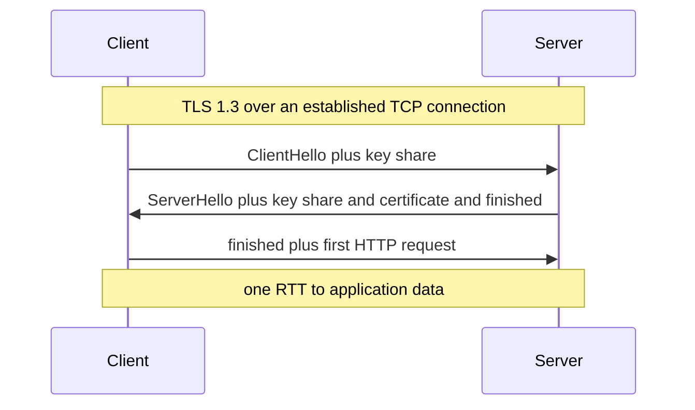

# TLS and HTTPS

**TLS (Transport Layer Security)** is the protocol that upgrades a plaintext connection into an encrypted, authenticated one; **HTTPS** is simply HTTP carried over TLS. Every byte your users send — passwords, PANs, KYC documents — crosses networks owned by strangers, and TLS is the only reason that's acceptable. For a system designer the interesting parts are not the cryptography but the *costs and placement decisions*: the handshake adds round trips (which 1.3 and resumption claw back), certificates create an identity chain you must operate (rotation, expiry), and **where TLS terminates** decides which parts of your own network can read traffic — a genuine design decision, not an ops detail.

## The problem that created it

Early HTTP was plaintext end to end. Anyone on the path — coffee-shop Wi-Fi, an ISP, a compromised router — could **read** traffic (passwords, cookies), **modify** it (inject content, strip security headers), or **impersonate** the server entirely (DNS answers aren't authenticated; see [[How DNS Works]]). E-commerce was impossible without a fix. Netscape shipped SSL in 1995; the IETF standardized its successor as TLS 1.0 (1999), and the modern baseline is TLS 1.2 (2008) with **TLS 1.3 (RFC 8446, 2018)** as the current generation. Post-2013, "encrypt everything, not just the login page" became the norm, and browsers now treat plain HTTP as an error.

## What it solves

TLS provides exactly three guarantees — be precise about them:

- **Confidentiality** — a passive observer on the path learns (almost) nothing of the payload. (Metadata still leaks: IPs, timing, sizes, and usually the hostname via SNI.)
- **Integrity** — any in-flight tampering is detected and the connection fails; no silent modification.
- **Authentication** — the client verifies it is talking to the holder of a private key that a trusted **Certificate Authority** has bound to the hostname. By default this authenticates the *server only*; **mTLS** adds the client.

What it does *not* solve: a compromised endpoint, authorization, or anything about the data once decrypted. TLS secures the pipe, not the ends.

Mapped to concrete attacks:

| Attack | Stopped by |
|---|---|
| Passive sniffing on shared networks | confidentiality (encryption) |
| In-flight modification or content injection | integrity (AEAD ciphers detect tampering) |
| Impersonation via DNS or BGP hijack | authentication (certificate chain to a trusted CA) |
| Replaying a recorded session later | handshake freshness — except 0-RTT early data (see below) |
| Decrypting recorded traffic after stealing the server key | forward secrecy (mandatory in 1.3) |
| Phishing, XSS, a breached server, an insider | nothing in TLS — wrong layer |

## How it works

**Handshake at a concept level.** Before data flows, the two sides must (1) agree on cryptographic algorithms, (2) authenticate the server, and (3) derive shared symmetric keys. The expensive asymmetric cryptography is used only for this setup; the bulk traffic uses fast symmetric encryption (AES-GCM or ChaCha20-Poly1305).

- **TLS 1.2**: ClientHello → ServerHello + certificate → key exchange → finished. **Two round trips** on top of the TCP handshake before application data — ~3 RTTs total to the first HTTP byte on a cold connection.
- **TLS 1.3**: the client *guesses* the key-exchange group and sends its key share in the first flight; the server replies with its share, certificate, and is ready. **One round trip.** 1.3 also removed every legacy footgun — static RSA key exchange, weak ciphers, renegotiation — so all 1.3 connections have **forward secrecy** (a stolen server key cannot decrypt past recorded traffic) by construction.

**Session resumption.** Handshakes cost RTTs and CPU; resumption amortizes them across connections. The server hands the client an encrypted **session ticket**; on the next connection the client presents it and both sides resume from cached key material — skipping certificate exchange and (in 1.3) optionally sending **0-RTT early data**: the first request rides in the very first packet. 0-RTT's sharp edge: early data can be **replayed** by an attacker who recorded it, so it is safe only for idempotent requests — never for a payment POST. (See [[Idempotency]].)

**Certificate chain.** Your server presents a chain: *leaf* certificate (your hostname, your public key) ← signed by an *intermediate* CA ← signed by a *root* CA that ships in OS/browser trust stores. The verifier walks the chain to a trusted root, checks hostnames, validity dates, and revocation. Operationally this means: certificates **expire** (public leaf-cert maximum lifetimes have been ratcheting down — ~398 days since 2020, with an industry-approved schedule shortening this further through the late 2020s; Let's Encrypt/ACME normalized ~90-day automated renewal), a forgotten renewal is a total outage, and serving an incomplete chain (missing intermediate) breaks some clients but not others — a classic "works on my machine" bug.

Four handshake-adjacent mechanisms you'll meet in real configs:

- **SNI (Server Name Indication)** — the client states the hostname it wants *in the ClientHello*, so one IP can serve certificates for many domains (all shared hosting and CDNs depend on this). It's also the main plaintext metadata leak in TLS; Encrypted Client Hello (ECH) is the in-progress fix, deployed partially as of ~2024.
- **ALPN (Application-Layer Protocol Negotiation)** — the handshake also negotiates the protocol that will run *inside* the tunnel (h1.1 vs h2); it's how browsers end up on HTTP/2 without an extra round trip ([[HTTP 1.1 vs HTTP 2 vs HTTP 3]]).
- **OCSP stapling** — revocation checking without the client calling the CA per handshake: the server periodically fetches a signed "this cert is still good" statement and staples it into the handshake. Plain OCSP (client calls CA) is a privacy leak and an availability coupling; stapling removes both.
- **Certificate pinning** — a client hard-codes which key/cert it will accept, defeating a compromised or coerced CA. Powerful and dangerous: pin the wrong thing or rotate without updating clients and you've bricked your own mobile app's connectivity until a store release ships. Modern guidance: pin only with automated rotation discipline, prefer pinning to an intermediate or your own CA, and always ship a backup pin.

**mTLS (mutual TLS)** — both sides present certificates, so the *server also authenticates the client*. This turns TLS into service-to-service identity: service A can only call service B if A holds a certificate issued by the internal CA. The price is running a certificate infrastructure — issuance, short-lived rotation, revocation — for every workload, which is precisely the job a [[Service Mesh]] (Istio/Linkerd with SPIFFE-style identities) automates. Banks and partner APIs also mandate mTLS at the edge for machine clients.

**Where TLS terminates — the design decision.** "Termination" is where ciphertext becomes plaintext:

| Pattern | Plaintext exists | Pros | Cons |
|---|---|---|---|
| **Edge termination** — CDN/ALB decrypts; plaintext to backends | everywhere behind the edge | centralized certs, L7 routing/WAF/caching possible, zero TLS cost on apps | the entire internal network is a trusted zone; one compromised box reads everything |
| **Re-encryption** — edge decrypts, then new TLS hop to backends | momentarily at each hop | L7 features *and* encrypted transit | two TLS costs per request; internal certs to manage |
| **End-to-end / passthrough** — only the destination service decrypts | only at the true endpoint | strongest confidentiality; intermediaries can't read | edge is blind — no L7 routing, no WAF inspection, no caching; cert sprawl |

A note on cost, because "TLS is slow" folklore dies hard: with hardware AES (universal on server CPUs for over a decade), bulk encryption overhead is low single-digit percent CPU — Google reported SSL accounting for under 1% of CPU load and under 2% of network overhead when it switched Gmail to HTTPS-by-default back in 2010, on far weaker hardware. The *real* costs are handshake RTTs on cold connections (addressed by 1.3, resumption, and pooling) and certificate operations at extreme connection-churn scale (addressed by session tickets and TLS-terminating edges). Performance has not been a valid argument against encrypting internal traffic for years; operational complexity is the honest one. Related hardening at the HTTP layer: **HSTS** (`Strict-Transport-Security`) tells browsers to never attempt plain HTTP for your domain again, closing the first-visit downgrade window.

The trade is **operational convenience and L7 intelligence vs the size of your plaintext zone**. Zero-trust thinking ("assume the internal network is hostile") pushes toward re-encryption or mesh-managed mTLS everywhere; cost and simplicity push toward edge termination. Regulated environments often mandate encryption in transit *internally* too, taking the choice away.

## Trade-offs

| You gain | You pay |
|---|---|
| Confidentiality + integrity + server identity | handshake RTTs (1 in 1.3, ~0 resumed) and CPU (small with AES-NI; real at extreme connection-churn scale) |
| Forward secrecy (1.3) | certificate lifecycle operations — expiry is an outage class of its own |
| mTLS: cryptographic service identity | an internal CA and rotation machinery for every workload |
| Edge termination: central control point | a large trusted plaintext zone behind it |

## Failure modes

- **Expired certificate** — the most common self-inflicted outage on the internet; every client hard-fails simultaneously. Detection: expiry monitoring with weeks of lead time, automated renewal (ACME), *and* an alert on renewal failure — automation that silently stops is the actual killer.
- **Incomplete chain** — missing intermediate; browsers (which cache intermediates) work, strict clients (Java, curl) fail. Maddening to debug because it's client-dependent.
- **Clock skew** — a container with a wrong clock rejects perfectly valid certificates ("not yet valid").
- **Trust-store drift** — JVM trust stores are bundled with the JDK; an old base image may not trust a newer root CA. Surfaces as `PKIX path building failed` only from *some* services.
- **mTLS rotation gaps** — a client cert expires mid-flight and a service loses the ability to call its dependency; at 1-replica services this is a hard outage, not a brown-out.
- **0-RTT replay** — accepting early data on non-idempotent endpoints invites duplicated side effects.

A certificate-operations checklist that prevents most TLS incidents:

- Automate issuance and renewal (ACME/ATM-style), and **alert on renewal failure**, not just on imminent expiry — silent automation death is the common path to an expired cert.
- Monitor expiry *externally* for every public and partner-facing endpoint, including ones "nobody changed" — inventory drift is how the forgotten admin subdomain takes down an integration.
- Keep a dated calendar for certs you can't automate (partner-pinned mTLS client certs, HSM-backed keys) with owners named.
- Test the *chain* from a strict client (Java, OpenSSL s_client) after every rotation, not just from a browser.
- Treat private keys as production secrets: short lifetimes beat elaborate revocation, because revocation checking is unreliable in practice.

## When NOT to use it

- Almost never "don't use TLS" in 2026 — the honest question is *where to terminate*, answered above.
- **mTLS everywhere, by hand, without automation** — if you can't rotate short-lived certs automatically, hand-rolled mTLS becomes an outage generator; network-level controls plus edge auth may serve you better until you adopt a mesh.
- **0-RTT for anything non-idempotent** — disable it or restrict it to safe methods.
- TLS is **not** a substitute for application auth — it authenticates machines/hostnames, not users; you still need [[How JWT Works|JWTs]]/sessions on top.

## In your stack

- Your topology is **edge termination with re-encryption to the VPC**: CloudFront/ALB hold the public certs (AWS ACM renews them — one less outage class), and traffic to Kong and onward rides inside the VPC. Know exactly which internal hops are plaintext — an auditor will ask, and RBI-adjacent data-in-transit expectations make "the VPC is trusted" a position you must *defend*, not assume.
- Per org convention, CORS/TLS belong at the edge — Kong/CloudFront/ALB — not in Spring Boot apps. App-level TLS config in a service is a smell unless it's a deliberate end-to-end requirement.
- **JVM specifics**: `PKIX path building failed` = trust-store/chain issue, not code; check base-image JDK age. TLS handshakes are another reason connection pools matter — see [[TCP vs UDP]].
- Partner/bank integrations in fintech routinely require **mTLS with pinned client certificates** — treat those certs as production secrets with owned rotation calendars; an expired partner cert blocks money movement.
- If you later adopt a [[Service Mesh]], its headline feature is exactly this: automated mTLS between all pods without app changes.

## Interview angle

The 60-second version: *"TLS gives three things: confidentiality, integrity, and authentication of the server via a certificate chain to a trusted CA. The handshake negotiates ciphers and derives symmetric keys — two RTTs in 1.2, one in 1.3, near-zero with session resumption, and 1.3 made forward secrecy mandatory. mTLS adds client certificates, turning TLS into service-to-service identity. The design decision is termination: at the edge you get central certs and L7 routing but a plaintext internal zone; end-to-end you get confidentiality but a blind edge; most real systems terminate at the edge and re-encrypt inward, and a service mesh automates the mTLS version of that."*

Classic follow-ups: *What does TLS NOT protect against?* (Compromised endpoints, metadata/timing, authorization.) *Why is 0-RTT dangerous?* (Replay.) *How do certificates actually establish trust?* (Chain to a pre-installed root; signatures bind hostname→key.) *Why might a bank require mTLS from partners?* (Machine identity that can't be phished or leaked as easily as an API key — and when it is leaked, it expires.)

## Check yourself

**Q1 (explain it): A new engineer asks why we "pay for TLS twice" — once at the ALB and again from the ALB to services. Justify the re-encryption hop.**

> [!question]- Q1 answer
> Terminating at the ALB gives L7 routing, WAF, and central cert management — but if plaintext flows behind it, every host and every network path in the VPC becomes part of the confidentiality boundary. Re-encrypting inward shrinks the plaintext zone to the processes at each end, so a compromised node or a misconfigured mirror/tap can't read customer data. In a regulated fintech, encryption-in-transit internally is often an audit requirement anyway. The cost — extra handshakes — is mostly amortized by connection pooling and session resumption.

**Q2 (scenario): At 09:00 every Java service starts failing calls to a partner bank with handshake errors; curl from your laptop works. List your first three hypotheses in order.**

> [!question]- Q2 answer
> (1) The partner rotated to a certificate chain whose root/intermediate the JVM trust store doesn't have — your laptop's OS store is newer than your base image's JDK store. (2) Expired *client* certificate on your side if the integration is mTLS — the server rejects you, while your curl (without the client cert) may be hitting a different endpoint or failing differently. (3) The partner served an incomplete chain — browsers/curl with cached intermediates succeed, strict JVMs fail. All three are "certificate lifecycle" failures, which is the point: most TLS outages are operational, not cryptographic.

**Q3 (scenario): Your mobile app's p99 connection setup to the API is slow from high-latency networks. Which TLS levers reduce round trips, and what's the risk of the most aggressive one?**

> [!question]- Q3 answer
> Ensure TLS 1.3 end-to-end at the edge (1 RTT instead of 2); enable session resumption so repeat connections skip the full handshake; keep connections alive to avoid handshakes altogether (see [[HTTP 1.1 vs HTTP 2 vs HTTP 3]]); and optionally 0-RTT early data for a true first-flight request. The aggressive one is 0-RTT: early data is replayable, so it must carry only idempotent requests — a replayed GET is noise, a replayed transfer initiation is an incident.

## Sources

- RFC 8446 — *The Transport Layer Security (TLS) Protocol Version 1.3* (2018)
- RFC 5246 — TLS 1.2 (2008), for contrast on handshake shape
- Cloudflare blog — TLS 1.3 and 0-RTT explainers (handshake diagrams, replay discussion)
- Let's Encrypt documentation — ACME and the case for short-lived automated certificates
- SPIFFE/SPIRE documentation — workload identity for mTLS; Istio security docs for mesh-managed mTLS
