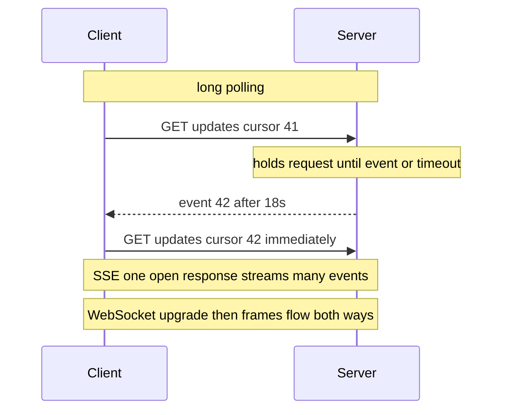

# WebSockets Server-Sent Events and Long Polling

HTTP's native shape is request→response: the client speaks first, always. The moment your product needs the *server* to speak first — a chat message arrives, a payment status flips, a driver moves on the map — you need one of three techniques: **long polling** (stretch the request until there's news), **Server-Sent Events** (hold one response open forever and stream events down it), or **WebSockets** (upgrade to a full two-way socket). The protocol choice is the easy half. The hard half is that all three keep **long-lived open connections**, which quietly converts your stateless, load-balance-anywhere fleet ([[Stateless vs Stateful Services]]) into a stateful system with connection affinity, drain problems, and reconnect-storm failure modes.

## The problem that created it

A growing product adds its first realtime feature — say, order status. V1: the client polls `GET /status` every 10 seconds. It works, but 95%+ of polls return "no change": wasted requests, wasted battery, and still up to 10s of staleness. Tighten to 1s and you've multiplied backend load tenfold to serve mostly-empty responses; at 100k clients that's 100k RPS of nothing. Polling couples *freshness* to *cost* linearly. The escape is inversion: stop asking, let the server push — which is what these three techniques provide, each with a different compatibility/capability trade.

## What it solves

- **Latency**: events reach clients in milliseconds, not at the next poll tick.
- **Waste**: no empty polls; network and CPU spent only when something happened.
- **Bidirectionality** (WebSockets specifically): client→server messages without per-message HTTP overhead — needed for chat typing, game input, collaborative editing.

## How it works

**Long polling** — the client sends a normal request; the server *doesn't answer* until an event arrives or a timeout (~30–60s) fires; the client immediately re-requests. Each event costs a full HTTP round trip + re-request, and ordering across consecutive polls needs care (a cursor/offset parameter). Its virtue is compatibility: it *is* plain HTTP, so every proxy, LB, and corporate firewall on earth passes it. This is exactly how **SQS long polling** works (`WaitTimeSeconds` up to 20s) — the pattern survives at the heart of AWS.

**Server-Sent Events (SSE)** — the client opens `GET /events` with `Accept: text/event-stream`; the server keeps the response open and writes `data:` frames down it indefinitely. One-directional (server→client only); client→server goes via ordinary separate requests. Native browser API (`EventSource`) with **built-in auto-reconnect and `Last-Event-ID` resume** — the reconnection machinery WebSockets makes you build yourself. It's just HTTP, so it rides h2/h3 cleanly. Fits: news feeds, notifications, price tickers, LLM token streaming (the ChatGPT-style streaming response is SSE). Caveats: text-oriented protocol; on HTTP/1.1 each SSE stream eats one of the browser's ~6 connections per origin (h2 multiplexing removes this); buffering middleboxes that don't flush can break it.

The SSE wire format is worth seeing once, because its simplicity *is* the feature — it's just a long-lived HTTP response body:

```
HTTP/1.1 200 OK
Content-Type: text/event-stream

id: 42
event: payment-status
data: {"paymentId":"p-981","status":"SUCCESS"}

: heartbeat comment, ignored by clients

id: 43
event: payment-status
data: {"paymentId":"p-982","status":"PENDING"}
```

Blank lines delimit events; `id:` feeds the automatic `Last-Event-ID` resume header on reconnect; lines starting with `:` are comments — the idiomatic heartbeat.

**WebSockets (RFC 6455, 2011)** — starts as an HTTP GET with `Upgrade: websocket`; after a `101 Switching Protocols` handshake the connection stops being HTTP and becomes a **full-duplex, message-framed TCP socket**. Either side sends binary or text frames any time. Maximum capability, maximum cost: you leave HTTP's ecosystem (no status codes, no caching, no standard auth-per-message — you design your own sub-protocol), intermediaries must support Upgrade, and reconnect/resume/heartbeat logic is yours to build.



**Connection cost at scale.** A million connected clients means a million open sockets *somewhere*. Per connection: a file descriptor, kernel socket buffers, TLS session state, heartbeat timers, and your application's per-connection object. Mostly-idle connections are cheap individually (tens of KB each; the C10k problem of 1999 became routine with epoll/event loops — WhatsApp famously reported more than 2 million concurrent connections on a single tuned FreeBSD/Erlang box back in 2012), so the real limits are: **memory × connections**, file-descriptor and conntrack/NAT table limits on every box *and middlebox* on the path, and — critically — **threading model**. A classic thread-per-connection servlet stack on platform threads dies at a few thousand; event-loop stacks (Netty, Node, Go) are built for this. Era note: Java 21's virtual threads (2023) raise that ceiling a lot, but they do not remove the per-connection memory cost or the problem of routing an event to the one box holding the socket. Push tiers are therefore usually a **separate gateway fleet** — small, event-loop-based, holding sockets and forwarding events — so the stateless request fleet stays stateless.

Back-of-envelope sizing for a push tier (the arithmetic interviewers want to see):

- Concurrent connections ≈ active users × fraction with the app foregrounded. 1M DAU with 5% concurrently active → ~50k sockets.
- Memory ≈ connections × (kernel buffers + TLS state + app object) ≈ 50k × ~50KB ≈ 2.5GB — one modest box *for the sockets themselves*; CPU is driven by event rate and TLS handshake churn, not idle connections.
- Heartbeat overhead ≈ connections ÷ interval: 50k sockets pinged every 25s ≈ 2k tiny messages/sec — trivial bandwidth, but it defines your baseline event-loop load.
- The number that actually sizes the fleet is usually **reconnect rate**, not steady state: all 50k reconnecting within 10s after an LB blip = 5k TLS handshakes + auth checks per second — size (and rate-limit) for that.

**Load balancer implications.** This is where push architectures bite:

- The LB must **support** the technique (WebSocket Upgrade pass-through; not buffering SSE). ALB does; classic setups and some proxies don't by default.
- **Idle timeouts**: an ALB's default idle timeout is 60s — any connection quieter than that is silently cut. Hence **heartbeats** (ping/pong frames, SSE comments) at an interval below the *lowest* timeout on the path, which also detect half-dead connections (TCP won't tell you a peer vanished until you try writing).
- **Statefulness**: once a client's socket lives on gateway G3, every event for that client must reach G3. Two standard shapes: a **pub/sub backplane** (each gateway subscribes to Redis pub/sub / Kafka topics for its connected users — the common choice) or a **connection registry** (userId→gateway map in Redis, events routed directly). Sticky sessions at the LB help the *handshake* phase but don't solve event routing.
- **Draining**: deploys can't just kill a gateway — it holds 50k live conversations. You need connection draining, graceful close frames, and clients that resume; see [[Graceful Shutdown and Deployment Safety]].
- **Reconnect storms**: when a gateway (or the LB, or a region) blips, *every* connected client reconnects at once — a thundering herd of TLS handshakes and auth checks that can flatten the auth service and the gateways in a retry loop ([[Cache Stampede and Thundering Herd]] is the same shape). Mitigations: **jittered exponential backoff in every client**, cheap reconnect auth (token validation, not DB hits), LB-level connection-rate limiting, and resume protocols (`Last-Event-ID`, message cursors) so reconnects don't also trigger full state refetches.

**Choosing:**

| | Long polling | SSE | WebSockets |
|---|---|---|---|
| Direction | server→client (per poll) | server→client stream | full duplex |
| Transport | plain HTTP | plain HTTP (streamed) | upgraded TCP, leaves HTTP |
| Reconnect/resume | inherent (each poll is new) | built into EventSource | build it yourself |
| Infra compatibility | universal | good (beware buffering) | needs Upgrade support end-to-end |
| Per-event overhead | full HTTP round trip | bytes | bytes |
| Right when | compatibility above all, low event rate | one-way feeds, notifications, token streams | chat, games, collaboration, high-rate bidirectional |

Default honestly: **SSE for one-way push, WebSockets only when you truly need upstream messages at message-frame granularity, long polling as the lowest-common-denominator fallback.**

## Trade-offs

| You gain | You pay |
|---|---|
| ms-level delivery, no empty polls | a stateful connection tier in a stateless architecture |
| battery/bandwidth efficiency | heartbeats, drain logic, reconnect protocol — undifferentiated heavy lifting |
| bidirectional channel (WS) | leaving HTTP's tooling: auth, caching, debuggability all bespoke |
| | capacity planning by *connections held*, not RPS |

## Failure modes

- **Silent idle-timeout cuts** — LB/NAT kills quiet connections; clients think they're connected and miss events until next write. Detected by heartbeat gaps; mitigated by pings under the lowest path timeout.
- **Reconnect storm** after gateway/LB restart — see above; the classic secondary failure is the herd taking down auth, which prevents recovery.
- **Slow consumers / backpressure** — a client on bad network can't drain its event stream; server buffers grow until OOM. Mitigation: bounded per-connection queues, drop-or-disconnect policies ([[Backpressure and Flow Control]]).
- **Missed events across reconnects** — push alone is at-most-once; without cursors/resume, a 2s disconnect silently loses messages. Durable feed + resume cursor (or reconcile-on-reconnect fetch) fixes it; see [[Delivery Semantics]].
- **Uneven connection distribution** — long-lived connections don't rebalance when you scale out; new gateways sit idle while old ones stay full until connections naturally churn (or you force periodic reconnects).

## When NOT to use it

- **Data that changes slower than anyone looks at it** — polling every 30–60s is simpler and fine; push infrastructure is overhead with no user-visible win.
- **Server-to-server eventing** — services should use queues/logs ([[Message Queues vs Event Logs]]), which give durability and replay; WebSockets between backend services is almost always the wrong tool.
- **When you can't invest in client discipline** — push without jittered backoff and resume logic in every client platform is an outage waiting for its trigger.

## In your stack

- Your messaging journey already contains the pattern: **SQS long polling** is technique #1 server-side — `ReceiveMessage` with `WaitTimeSeconds=20` instead of hot-looping.
- A notification push tier at Niyo (payment status, KYC progress — close to [[Design a Notification Service]]) fits **SSE gateways + Redis pub/sub backplane**: your Redis estate already provides the fan-out layer, and one-directional covers those use cases; WebSockets would be paying full-duplex costs for one-way traffic.
- **1-replica reality check**: a single-replica push gateway means every deploy or pod eviction disconnects *all* connected clients at once — a self-inflicted reconnect storm on every release. A push tier is the component where 2+ replicas and drain handling stop being optional; honesty about that belongs in the design doc.
- Mind the full path: CloudFront, ALB, and Kong each have their own idle-timeout and Upgrade/streaming behavior — the connection only works if *every* hop cooperates; heartbeat below the minimum of all of them.
- Mobile reality: for app-closed scenarios you'll use FCM/APNs anyway — persistent connections are for *foreground* realtime; design both paths.

## Interview angle

The 60-second version: *"Three escalating techniques for server push. Long polling: hold the request until there's news — pure HTTP, works everywhere, one round trip per event; it's how SQS works. SSE: one HTTP response held open streaming events — one-directional, built-in reconnect and resume via Last-Event-ID, ideal for feeds and token streams. WebSockets: upgrade to a full-duplex socket — needed for chat and collaboration, but you leave HTTP and own reconnect, auth, and framing. The real cost of all three is architectural: long-lived connections make the tier stateful — you need event-loop servers sized by connections not RPS, a pub/sub backplane to route events to whichever gateway holds the socket, heartbeats under every idle timeout on the path, drain-aware deploys, and jittered client backoff because the reconnect storm after any blip is the failure mode that takes you down."*

Classic follow-ups: *Why heartbeats if TCP is "reliable"?* (Silent middlebox cuts; TCP only detects death on write.) *How does an event for user X find the right gateway?* (Backplane subscribe or registry routing.) *SSE vs WebSockets for notifications?* (SSE — one-way suffices, reconnect is free, it stays HTTP.) *What happens when 500k clients reconnect at once?* (Herd on TLS+auth; jittered backoff, cheap auth, rate-limited accept.)

## Check yourself

**Q1 (explain it): Your PM asks why the realtime feature "needs its own servers" when the REST API autoscales fine. Explain the stateless/stateful distinction this note hinges on.**

> [!question]- Q1 answer
> REST pods are interchangeable: any request can hit any pod, so scaling and deploys are trivial ([[Stateless vs Stateful Services]]). A push connection is a *held resource*: the client's socket lives on one specific gateway, events must be routed to that gateway, capacity is bounded by concurrent sockets per box, and killing a pod disconnects everyone on it. Different scaling metric, different deploy procedure, different threading model — hence a separate, event-loop-based tier rather than bolting sockets onto the request fleet.

**Q2 (scenario): Users report missing chat messages whenever they ride elevators. Connections auto-reconnect successfully. What's the bug class and the fix?**

> [!question]- Q2 answer
> Push is fire-and-forget: messages emitted while the socket was dead went nowhere, and reconnecting restores the *pipe*, not the *missed history*. Fix: make the stream resumable — persist messages durably, give each a per-conversation sequence/cursor, and on reconnect the client sends its last-seen cursor (SSE's `Last-Event-ID` for free, or a fetch-since call) so the server replays the gap. Delivery becomes at-least-once + client dedup — the [[Delivery Semantics]] lesson applied to humans in elevators.

**Q3 (mini design): Sketch the push path for live payment-status updates to the Niyo app: ~200k DAU, foreground sessions ~3 min, status events from the payments service. Name technique, routing, and the two ops guardrails you'd insist on.**

> [!question]- Q3 answer
> Technique: SSE (one-way, auto-reconnect, HTTP-friendly through CloudFront/ALB/Kong); FCM/APNs for backgrounded apps. Routing: payments service publishes `payment.status` to a Redis pub/sub channel keyed by userId; a small SSE gateway fleet (2+ replicas, Netty/WebFlux-style event loop) subscribes for its connected users and streams events down. Rough connection load: 200k DAU × 3 min ≈ a few thousand concurrent sockets at peak — small, but still: Guardrail 1: heartbeat comments every ~25s (under ALB's 60s idle timeout) + client jittered backoff. Guardrail 2: deploy-time connection draining with resume cursors, so releases don't manufacture reconnect storms or lost events.

## Sources

- RFC 6455 — *The WebSocket Protocol* (2011); WHATWG HTML spec — Server-Sent Events / `EventSource`
- *High Performance Browser Networking* (Grigorik) — chapters on XHR/long-polling, SSE, and WebSocket
- AWS documentation — SQS long polling (`WaitTimeSeconds`, max 20s); ALB idle timeout default and WebSocket support
- The C10k problem (Dan Kegel, 1999); WhatsApp engineering talks on millions of connections per server (Erlang)
- Slack engineering blog — "Real-time Messaging" architecture posts (gateway fleets, reconnect handling)
