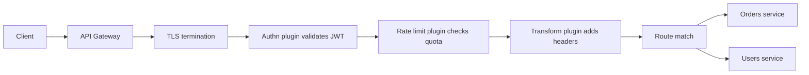

# API Gateway

An **API gateway** is the single entry point through which all external API traffic reaches your microservices. It handles the *cross-cutting* edge concerns — authentication, rate limiting, routing, request shaping, TLS — once, so that fifty services don't each reimplement them fifty slightly-different ways. It is a specialized [[Reverse Proxy vs Forward Proxy|reverse proxy]] that understands your API surface.

## The problem that created it

Start with a monolith: one service, one place to check tokens and count requests. Now split it into microservices. Immediately:

1. **Every service must authenticate every request.** Fifty services each validating JWTs means fifty copies of the validation code, fifty places a security bug can hide, fifty services to update when the signing key rotates (see [[How JWT Works]]).
2. **Clients must know your internal topology.** A mobile app calling `orders-service.internal:8443` and `users-service.internal:8081` directly means every internal refactor is a breaking client change — and every service is exposed to the public internet.
3. **Per-client policy has no home.** "Free-tier users get 100 requests/minute" is a business-wide rule. Enforcing it per-service means a client can spend its quota fifty times over, once per service.
4. **Edge plumbing is duplicated.** TLS certs, CORS, request logging, IP allowlists — all needed everywhere, all boring, all dangerous to get wrong.

The gateway reintroduces the monolith's single front door without reintroducing the monolith: one place where a request is authenticated, rate-limited, logged, and *then* routed to whichever internal service owns it.

## What it solves

- **Centralized authn/authz** — validate the JWT/API key once at the edge; services behind it trust the gateway's verdict (often passed along as headers or a re-signed internal token).
- **Global [[Rate Limiting|rate limiting]] and quotas** — per-user, per-key, per-plan limits enforced where every request passes.
- **Routing and API composition** — `/v1/orders/**` → orders service; clients see one stable hostname and contract.
- **Request/response transformation** — header injection (correlation IDs), protocol translation (external REST → internal gRPC), response reshaping for clients.
- **TLS termination** — certificates live in one managed place ([[TLS and HTTPS]]).
- **Hiding topology** — internal services are unreachable from outside; the attack surface is one hardened component.

## How it works

A request flows through an ordered chain of middleware ("plugins" in Kong's vocabulary) before being proxied upstream:

Each phase can short-circuit: an invalid token returns 401 without touching any upstream; an exhausted quota returns 429 (see [[Rate Limiting]] for what a good 429 carries). What survives the chain is proxied to the matched upstream, and the response flows back through the chain's response-phase hooks (strip internal headers, add CORS headers).

### Gateway vs load balancer vs reverse proxy

These three overlap heavily — all sit in front of servers and forward traffic — and interviewers love asking where the lines are:

| | **[[Load Balancers|Load balancer]]** | **[[Reverse Proxy vs Forward Proxy|Reverse proxy]]** | **API gateway** |
|---|---|---|---|
| Core job | Spread traffic across identical replicas of one service | Front one or more servers: TLS, caching, compression, rewriting | Front an *API product*: auth, quotas, routing across many different services |
| Understands | Connections (L4) or HTTP (L7) | HTTP | Your API: consumers, keys, routes, plans |
| Typical identity awareness | None | None | Central — per-consumer policy is the point |
| Examples | ALB, NLB, HAProxy | NGINX, Envoy | Kong, Apigee, AWS API Gateway, Spring Cloud Gateway |

The honest summary: an API gateway **is** a reverse proxy with an API-management brain, and it usually **contains** L7 load-balancing ability. In practice you stack them — edge LB for raw traffic spreading and HA, gateway for API policy — because the LB tier must stay simple and boringly reliable while the gateway tier changes with your API.

### Kong specifics (the plugins model)

Kong is built on NGINX/OpenResty (NGINX scripted with Lua). Its data model, worth knowing because it generalizes:

- **Service** — an upstream (e.g. the orders service's internal address).
- **Route** — match rules (host, path, method) that map incoming requests to a Service.
- **Consumer** — an identified caller (API key, JWT claim), the unit that policy attaches to.
- **Plugin** — a unit of middleware attachable *globally, per-service, per-route, or per-consumer*. Bundled plugins cover JWT validation, key auth, rate limiting, request/response transformation, correlation-id injection, logging to various sinks; custom ones are written in Lua (or Go/other via plugin runners).

The scoping model is the power feature: "rate-limit everyone to 1000/min, except partner X who gets 10,000, and apply stricter auth on `/payments` routes" is configuration, not code. Kong stores config in a database (Postgres) or runs **DB-less** from a declarative YAML file — the latter fits GitOps and makes the gateway's state reviewable.

### The "smart pipes" risk

The microservices principle is **smart endpoints, dumb pipes** (James Lewis and Martin Fowler's phrasing, 2014): intelligence belongs in services; the network fabric between them should be dumb. Gateways invite violation because they're *such* a convenient place to add logic — and each addition seems small:

- "Just combine these two backend responses for mobile" → the gateway now contains an orchestration workflow.
- "Just reject orders over ₹50,000 here" → a *business rule* now lives in gateway config, invisible to the service's tests, versioned separately from the domain code, owned by whoever owns the gateway.

The end state is the **ESB problem** reborn: a central component that encodes business logic, requires its own release train, becomes a change bottleneck for every team, and whose config no one fully understands. Rule of thumb: the gateway may decide *whether* a request gets in (auth, quota, routing) and *what shape* it has (headers, protocol), but never *what it means for the business*. If a rule needs domain knowledge or a product owner's sign-off, it belongs in a service. Aggregation-for-clients, if genuinely needed, gets its own explicitly-owned service (the **Backend-for-Frontend** pattern), not a pile of gateway scripts.

## Trade-offs

| You gain | You pay |
|---|---|
| Auth, quotas, TLS implemented once | An extra hop — typically ~1 ms to single-digit ms added latency, more if plugins call out (e.g. Redis for rate limits) |
| Stable public contract hiding topology | A critical single choke point: gateway down = every API down |
| Per-consumer policy as configuration | Config sprawl: hundreds of routes/plugins become their own codebase needing review and testing |
| Smaller public attack surface | Services may go lax internally ("the gateway checks auth") — dangerous if an attacker gets inside the perimeter |
| Observability of all edge traffic in one place | Organizational coupling: every team's API change may need a gateway change |

## Failure modes

- **Gateway outage = total API outage.** Mitigate like any [[Load Balancers|LB tier]]: multiple gateway nodes behind an LB/DNS, spread across AZs. Watch for the subtler version: a bad *config push* (broken route, misordered plugin) is functionally an outage with all nodes green.
- **Shared-state dependency drags it down.** Distributed [[Rate Limiting|rate limiting]] via Redis, or Kong's config DB, becomes a hidden dependency. Well-designed gateways degrade (fail-open on the limiter, serve cached config) rather than hard-fail; know which yours does — failing *open* on auth is never acceptable, failing open on a quota usually is.
- **Latency amplification under plugin bloat.** Each plugin adds work per request; a plugin making a synchronous network call (auth introspection, logging to a slow sink) couples your p99 to that dependency. Detected via per-phase latency metrics; mitigated by caching (JWKS, consumer lookups) and async logging.
- **Header-trust confusion.** If services trust an `X-User-Id` header set by the gateway, *anything* that can reach a service directly can forge it. Mitigations: network policy so only the gateway can reach services, mTLS, or passing a verifiable token instead of bare headers ([[API Security Essentials]]).
- **Retry/timeout mismatch.** Gateway timeout shorter than upstream processing time yields 504s with work still completing behind — a classic duplicate-payment source. Align the timeout chain; see [[Timeouts Retries and Exponential Backoff]].

## When NOT to use it

- **A monolith with one client.** The monolith's own middleware does all of this with one less hop and one less system to operate.
- **Pure internal service-to-service traffic.** East-west calls shouldn't hairpin through the north-south edge gateway; that's what direct calls, client-side discovery, or a [[Service Mesh|service mesh]] are for.
- **As an orchestration engine.** Multi-step workflows with business meaning belong in a service (see smart pipes above).
- **A two-service system "for the future."** The gateway earns its operational cost at some scale of services × consumers × policies. Below that, NGINX with an auth middleware per service is honest and sufficient.

## In your stack

- **Kong is your gateway**, behind CloudFront/ALB: the edge order is CloudFront (CDN) → ALB (L7 LB, TLS) → Kong (API policy) → EKS services. Org convention says CORS, TLS, and *generic* rate limiting belong at this edge — Kong/CloudFront/ALB — while app-level limits that form a security boundary stay in the app.
- Your **central IAM service issues JWTs**; Kong-level validation means a Spring service can trust `sub` (oneAppUserId) claims on arriving requests — but only because network policy keeps non-Kong traffic out. Remember `sub` and `jti` are system identifiers, not PII, and stay in logs.
- The **`x-correlation-id` header** convention is exactly the kind of transformation a gateway should own: inject if absent at the edge, propagate everywhere ([[Distributed Tracing]]).
- Fintech framing: the gateway may *authenticate* a payments request and *throttle* it, but approval/limits logic is deterministic service code with audit trails — an edge config change must never be able to alter money-movement behavior silently.

## Interview angle

**The 60-second version:** "An API gateway is the single front door to a microservices API. It centralizes the cross-cutting edge concerns — TLS, authentication, rate limiting, routing, request transformation — so services don't each reimplement them, and clients see one stable contract instead of internal topology. It's a reverse proxy specialized with API-management concepts: consumers, routes, plugins. The classic design mistake is letting business logic creep into it — gateways should decide whether and where a request goes, never what it means."

Interviewers probe:
- *Gateway vs load balancer?* — Policy vs distribution; identity-aware vs identity-blind; usually stacked, LB in front.
- *Isn't it a single point of failure?* — Yes architecturally; mitigate with horizontal gateway replicas + LB, and degrade gracefully when its dependencies (Redis, config store) fail.
- *Where do you do auth — gateway, service, or both?* — Gateway for edge validation; services still enforce *authorization* (ownership checks) because the gateway can't know domain-level permissions. Defense in depth.
- *What belongs in the gateway vs a BFF?* — Transformation and policy in the gateway; client-specific aggregation in an owned BFF service.
- Classic follow-up: "Design the rate limiter inside the gateway" → walks straight into [[Rate Limiting]] and [[Design a Rate Limiter]].

## Check yourself

**Q1 (explain it):** Explain "smart endpoints, dumb pipes" and how an API gateway can violate it.

> [!question]- Q: What does smart endpoints, dumb pipes mean for gateways?
> The principle says domain intelligence belongs inside services (endpoints), while the infrastructure that moves requests between them (pipes) stays generic. A gateway violates it when business rules — order limits, workflow orchestration, domain validation — move into gateway plugins/config. Those rules then live outside the owning service's code, tests, and release cycle, recreating the ESB bottleneck: a central component every team must change through, encoding logic nobody owns end-to-end. The gateway should restrict itself to admission (auth, quota), routing, and shape (headers, protocol).

**Q2 (scenario):** Your gateway validates JWTs, so a teammate proposes services skip token checks entirely and trust an `X-User-Id` header the gateway sets. What breaks, and what makes it safe(r)?

> [!question]- Q: What breaks if services blindly trust a gateway-set header?
> Anyone who can reach a service without passing through the gateway — a compromised pod, a misconfigured internal route, an engineer's port-forward — can forge `X-User-Id` and impersonate any user. Safer options: enforce network policy/mTLS so only the gateway can reach services; have the gateway pass the original (or a re-signed) verifiable token so services cryptographically validate identity; and keep authorization (ownership checks) in services regardless — per the fintech rule, every access path needs authn, authz, and an ownership check.

**Q3 (scenario):** The Redis backing your gateway's rate-limit plugin goes down. What are your two options and which do you pick for (a) a public marketing API, (b) an OTP-issuing endpoint?

> [!question]- Q: Rate limiter's Redis dies — fail open or closed?
> Fail open (stop limiting, serve traffic) or fail closed (reject when you can't count). (a) Public marketing API: fail open — the limiter is a protection against abuse, and an outage of *counting* shouldn't become an outage of *service*; accept temporary abuse risk. (b) OTP endpoint: fail closed (or sharply degraded local limiting) — the limit *is* a security control against OTP brute-forcing/SMS-pumping; unlimited traffic is worse than rejected traffic. The general rule: fail open for quality-of-service limits, fail closed where the limit is a security boundary — and where value or identity is at stake, fail closed.

**Q4 (mini design):** Sketch the edge for a fintech API: mobile clients, third-party partners with API keys, internal admin UI. Which concerns live where?

> [!question]- Q: Edge design for mobile + partners + admin?
> CDN for static assets and TLS at the true edge; L7 LB for HA across gateway nodes. Gateway: route `/api/mobile/**` (JWT auth plugin against IAM's JWKS), `/api/partner/**` (API-key auth, per-partner quotas and IP allowlists as consumer-scoped plugins), and keep the admin UI off the public gateway entirely — internal LB + VPN/zero-trust access. Correlation-id injection and request logging global. No aggregation logic in the gateway; if mobile needs composed responses, a mobile BFF service behind the gateway owns that. Services behind everything still do authorization + ownership checks.

## Sources

- Kong official documentation — gateway concepts (Services, Routes, Consumers, Plugins), DB-less mode.
- Martin Fowler / James Lewis, *Microservices* (martinfowler.com, 2014) — origin of "smart endpoints and dumb pipes".
- Chris Richardson, microservices.io — the "API Gateway" pattern, which documents backends-for-frontends as a variation on it (one gateway per kind of client) rather than as a standalone pattern page. See [[Backend for Frontend]].
- AWS documentation: Amazon API Gateway concepts.
- Sam Newman, *Building Microservices* (2nd ed., 2021), ch. on service communication and edge.
