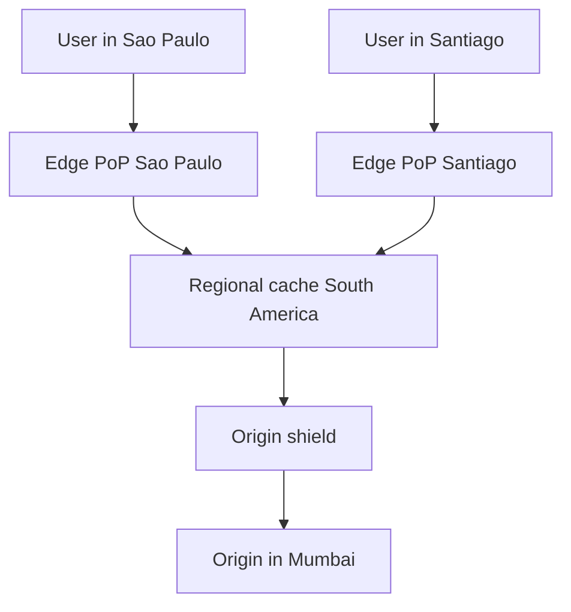

# CDN

A **content delivery network (CDN)** is a globally distributed fleet of caching [[Reverse Proxy vs Forward Proxy|reverse proxies]] that answers user requests from a location near the user instead of from your origin servers. It attacks the one latency cost no code change can remove — the speed of light across geography — and absorbs traffic your origin would otherwise serve repeatedly. Despite the name, modern CDNs accelerate *dynamic* traffic too, not just static files.

## The problem that created it

Your servers are in Mumbai. A user in São Paulo requests your page. The physics: a round trip across ~15,000 km of fiber costs roughly 300 ms *before any processing* (Azure's measured P50 for Brazil South ↔ Central India was ~304 ms in July 2026) — and a page load takes many round trips (DNS, TCP handshake, [[TLS and HTTPS|TLS handshake]], then requests for dozens of assets). No amount of backend optimization fixes this; the photons simply take that long.

Second problem, independent of distance: the same logo, JS bundle, and product image are fetched millions of times a day. Serving identical bytes from application infrastructure wastes origin capacity, and a traffic spike (product launch, viral moment) hits the origin with its full force.

The CDN answer to both: place thousands of cache servers in cities around the world, route each user to the nearest one (via [[How DNS Works|DNS]] or anycast), and serve from that cache whenever possible. São Paulo's user now completes TCP/TLS and fetches cached assets from a server a few milliseconds away; your origin sees one fetch per object per edge location instead of one per user.

## What it solves

- **Geographic latency** — round trips happen to a nearby edge, cutting asset latency from hundreds of ms to tens or less.
- **Origin offload** — cache hits never touch your servers; origin egress traffic (and that bandwidth bill) shrinks by the hit ratio.
- **Spike absorption** — a million users requesting one hot object is a million edge cache hits, not a million origin hits.
- **DDoS surface** — volumetric attacks land on a network built with terabits of capacity, in front of your origin; most CDNs bundle WAF/DDoS filtering.
- **Faster TLS/TCP even for uncacheable requests** — handshakes terminate nearby (see dynamic acceleration below).

## How it works

### Edge PoPs and the cache hierarchy

A **PoP (point of presence)** is a CDN data center — racks of cache servers in an internet exchange in some city; large CDNs operate hundreds of PoPs (CloudFront: 750+ PoPs in 100+ cities plus 15 Regional Edge Caches, as of 2026). User routing to the nearest PoP happens by **anycast** (one IP advertised everywhere — Cloudflare's model) or **DNS-based mapping** (the CDN's resolver returns a nearby PoP's address — CloudFront/Akamai style).

Caches form a **hierarchy** so that an edge miss doesn't automatically become an origin hit:

Miss at the edge → check a bigger **regional/mid-tier cache** (CloudFront: Regional Edge Caches) → only then the origin. Each tier aggregates the misses of many children, multiplying effective hit ratio.

**Origin shield** is a designated single cache layer in front of the origin: *all* PoPs funnel their misses through it. Value: **request collapsing** across the whole network — when an object expires globally, one origin fetch repopulates everyone, instead of hundreds of PoPs independently stampeding the origin (the CDN-scale version of [[Cache Stampede and Thundering Herd]]).

### Push vs pull

- **Pull (origin pull)** — the default. The CDN fetches from your origin *on first miss*, caches per response headers, serves subsequent hits. Zero upload workflow; the cache populates itself. Cost: first user per PoP eats a miss, and your origin must stay available.
- **Push** — you upload content to the CDN/its storage ahead of time (in practice usually: upload to object storage like S3 and let the CDN pull from it, or pre-warm caches). Fits large, planned releases — video, game patches, app binaries — where a synchronized global miss-storm at release time would crush the origin.

Pull for the long tail, push/pre-warm for the planned avalanche.

### TTL, invalidation, and purge

Every cached object carries a freshness lifetime — the **TTL** — set by origin response headers (`Cache-Control: max-age` / `s-maxage`) or CDN config defaults. After expiry, the edge **revalidates** (conditional GET with `If-None-Match`/ETag; a `304 Not Modified` renews the object cheaply) or refetches.

But TTL alone means wrong content lives until expiry — unacceptable for a pulled product, a bad JS bundle, a legal takedown. Hence **purge/invalidation APIs**: explicitly evict by exact URL, prefix, or (on some CDNs) tag. Propagating a purge across hundreds of PoPs takes seconds to minutes and often costs money per path (CloudFront charges for invalidation paths beyond a free tier) — it's an escape hatch, not a routine mechanism.

The pattern that avoids needing purges at all: **cache-busting / versioned URLs**. Fingerprint immutable assets into the filename (`app.3f9c1b.js`), serve them with `max-age=31536000, immutable`, and "invalidate" by deploying HTML that references a new filename. The general theory of why invalidation is hard lives in [[Cache Invalidation]]; TTL-vs-event trade-offs mirror [[Caching Strategies]].

### Dynamic acceleration

For uncacheable responses (API calls, personalized pages) the CDN still helps, which surprises people:

- **Terminate TCP + TLS at the edge** — the user's handshakes (several round trips) happen over a few-ms path instead of an intercontinental one.
- **Keep warm, pooled connections edge→origin** — requests ride existing connections, skipping handshakes entirely.
- **Private backbone routing** — edge-to-origin travels the CDN's optimized network rather than congested public internet paths.

This is CloudFront's behavior for dynamic content and the explicit product in Akamai's dynamic site acceleration. Gains are real but smaller than caching — think "shave 100–300 ms of connection setup," not "2 ms response."

### Signed URLs and signed cookies

Cached content is served by edge nodes that never consult your application — so how do you keep *private* content (paid videos, KYC documents) from being one guessable URL away from public? **Signed URLs**: the application generates a URL carrying an expiry and a cryptographic signature (CloudFront: signed with a private key you hold; S3 presigned URLs: SigV4). The edge validates signature + expiry *locally* — no call to your origin — and serves the cached object only on a valid signature. **Signed cookies** do the same for whole classes of content (e.g., all segments of one video stream) without rewriting every URL. Authorization decision stays with your app (it decides *whether* to mint a signature); enforcement distributes to the edge.

## Trade-offs

| You gain | You pay |
|---|---|
| Latency floor set by nearest PoP, not origin distance | **Staleness window** — TTL seconds of possibly-outdated content, or purge cost/latency |
| Origin offload proportional to hit ratio | Loss of per-request control — edge hits never run your code or appear in app logs (edge logs instead) |
| Spike and DDoS absorption | Another vendor in the critical path — CDN incidents become your incidents |
| Bundled TLS, WAF, HTTP/3 at the edge | Cache-key subtleties: cookies/query params/headers silently fragment or poison the cache |
| Pay-per-GB egress often cheaper than origin egress | Cost model complexity; invalidations and origin-shield fetches are billable line items |

## Failure modes

- **Serving stale after origin fixes** — the "we deployed but users see the old bundle" classic. Cause: HTML or assets cached without versioned names. Fix: fingerprinted assets + short-TTL HTML; emergency purge.
- **Cache poisoning** — a response generated for one context (wrong `Vary`, attacker-influenced header or query param in the cache key... or an error page) gets cached and served to everyone. Mitigation: strict, minimal cache keys; never cache `Set-Cookie` responses; careful `Vary` discipline.
- **Private data cached publicly** — a per-user response (`/me`, authenticated API) marked cacheable serves user A's data to user B. Catastrophic in fintech. Mitigation: `Cache-Control: private/no-store` on personalized responses, audits of what the CDN caches, signed URLs for private objects.
- **Origin stampede on mass expiry** — a global TTL expiry or purge turns every PoP into a concurrent origin fetcher. Mitigations: origin shield, request collapsing, staggered TTLs, `stale-while-revalidate`.
- **CDN outage** — rare but global and famous (large CDN incidents have taken down swaths of the internet for minutes to hours: Fastly in June 2021 for under an hour, Cloudflare on 18 November 2025 for about three hours of core impact). Detected instantly by synthetic monitoring; mitigation at serious scale is multi-CDN with DNS steering, at normal scale is accepting the risk consciously.
- **Config-as-outage** — a bad behavior/rule push (wrong origin, overbroad caching rule) is functionally an outage with all infrastructure healthy. Treat CDN config like code: version it, review it, canary it.

## When NOT to use it

- **Purely internal applications** — users are in your offices/VPC; there is no geographic spread to fix.
- **Single-region user base near your origin** — a Mumbai-only user base served from Mumbai gains little; a regional cache or [[Caching Strategies|application-level caching]] may be the better spend.
- **Highly personalized, uncacheable-by-nature traffic as the sole workload** — you'd be buying only dynamic acceleration; worth it sometimes, but weigh honestly against cost and added complexity.
- **Tiny scale** — a few thousand users; nginx static serving plus decent `Cache-Control` headers covers you.
- **When the real problem is backend latency** — a 900 ms database query is not fixed by edge caching the response for some users and lying to the rest; fix the query ([[Database Indexes]]).

## In your stack

- **CloudFront fronts your edge** (CloudFront → ALB → Kong → EKS). Org convention places TLS and CORS at this layer. Static app assets and app-download binaries are the obvious cacheable set; API routes pass through with `no-store` semantics.
- **Fintech caution dominates**: responses carrying account data, KYC status, or anything personalized must be explicitly non-cacheable — one wrong `Cache-Control` on an authenticated route is a data-leak incident, not a perf bug. Correctness beats latency, per the house rule.
- **Signed URLs fit document delivery**: statements or KYC documents in S3, delivered via CloudFront signed URLs with short expiry — the app authorizes (authn + authz + ownership check, as always), the edge enforces, the object never becomes a shareable public link.
- Cost shape to name in any proposal: on pay-as-you-go pricing, CDN spend scales with *egress GB + requests + invalidation paths*, plus a per-request charge for Origin Shield (since November 2025 CloudFront also sells flat-rate monthly plans with no overage charges, which flatten this shape). Transfer from AWS origins (ALB, S3) to CloudFront is free, so misses cost origin compute and requests rather than origin egress; a non-AWS origin pays its own egress. Offload ratio is the lever that moves the bill.
- Your `x-correlation-id` convention starts at the CDN only if injected there; otherwise Kong is the first stamping point, since the ALB injects only its own `X-Amzn-Trace-Id` and will not mint your correlation header for you — relevant when tracing a request that may have been an edge hit (it never reached Kong at all).

## Interview angle

**The 60-second version:** "A CDN is a global fleet of caching reverse proxies. Users reach the nearest PoP via anycast or DNS; edges serve cache hits locally and funnel misses up a hierarchy — regional caches, then an origin shield that collapses global misses into single origin fetches. Freshness is TTL-driven with purge APIs as the escape hatch; the clean pattern is immutable fingerprinted asset URLs with long TTLs. CDNs also accelerate dynamic traffic by terminating TLS near the user and reusing warm connections to origin, and they enforce access to private cached content with signed URLs validated at the edge."

Interviewers probe:
- *Push vs pull, and when each?* — Pull as default; push/pre-warm for planned, synchronized, huge releases.
- *How do you invalidate instantly?* — You mostly don't; you design not to need it (versioned URLs), and purge for emergencies.
- *What's origin shield for?* — Collapsing the global miss-storm into one origin fetch; protects origin during mass expiry.
- *How does a CDN help a POST-heavy API?* — Connection/TLS acceleration and backbone routing, not caching; be precise about which benefit applies.
- Classic follow-up in design problems: video streaming ([[Design a Video Streaming Service]]) — CDN carries the bytes, signed URLs/cookies gate access, origin holds the manifest logic.

## Check yourself

**Q1 (explain it):** Explain to a junior engineer why "just set TTL to 0 so content is always fresh" defeats the purpose, and what the right pattern is for always-fresh JS/CSS.

> [!question]- Q: Why not TTL 0, and what's the right asset pattern?
> TTL 0 forces revalidation or refetch on every request, so nearly every request pays an origin round trip — you keep the CDN's connection benefits but lose offload and most latency gains. The right pattern: make assets immutable by fingerprinting the content hash into the filename, cache them with a year-long TTL and `immutable`, and keep only the small HTML entry point on a short TTL. Freshness then comes from referencing new filenames at deploy, not from expiring caches. See [[Cache Invalidation]] for the general principle: the cheapest invalidation is the one you designed away.

**Q2 (scenario):** Minutes after a deploy, some users see the new UI and others see the old one, and a few see a broken page mixing both. What happened at the CDN layer?

> [!question]- Q: Mixed old/new UI after deploy — what happened?
> The HTML and its assets were cached with independent TTLs and expired at different times across PoPs: a user getting new HTML referencing new bundles on an edge still holding old assets (or vice versa) gets the mixed, broken state; different PoPs expire at different moments, so users disagree. Root cause is deploying by overwriting the *same* asset URLs. Fix: fingerprinted asset filenames (old and new coexist during rollout), short-TTL or purged HTML, and keeping previous-version assets available until no cached HTML references them.

**Q3 (scenario):** Your authenticated `/api/v1/profile` endpoint starts returning other users' names. The app code has no bug. Where do you look?

> [!question]- Q: Users seeing each other's profile data — where's the leak?
> At a cache layer caching a personalized response: the endpoint lacked `Cache-Control: private`/`no-store` (or a CDN behavior overrode headers and cached it), so user A's response became a shared cached object with a cache key that ignored identity (no Authorization in key, cookies stripped). Check CDN behavior config and response headers, purge immediately, add `no-store`, and audit every authenticated route's cacheability. In a fintech this is a reportable data-leak incident — treat the audit as mandatory, not hygiene.

**Q4 (mini design):** Design delivery for monthly PDF account statements: private, ~2 MB each, bursty on the 1st of the month, users worldwide.

> [!question]- Q: Private statement delivery via CDN?
> Store PDFs in object storage (S3) as origin. Front with CDN for geographic latency and burst absorption. Access: app authenticates the user, performs the ownership check, then mints a short-expiry signed URL (or signed cookie) for that object; edge validates signature locally and serves from cache. Cache key = object path (statements are per-user objects, so cached copies are per-user anyway; signing gates access, caching helps repeat/multi-device fetches and takes handshakes off the long path). Pre-1st, no push needed — bursts are spread across distinct objects; origin shield keeps S3 request rates sane. Audit trail: log signature issuance in the app (immutable), edge access in CDN logs.

## Sources

- AWS CloudFront documentation: how caching works, Regional Edge Caches, Origin Shield, invalidations, signed URLs and signed cookies.
- Cloudflare Learning Center: "What is a CDN?", anycast routing, cache hierarchy.
- MDN Web Docs: `Cache-Control`, `Vary`, conditional requests (ETag / `If-None-Match`), `stale-while-revalidate`.
- Akamai documentation/whitepapers on dynamic site acceleration.
- Google web.dev: "Love your cache" / HTTP caching guidance (fingerprinted immutable assets pattern).
