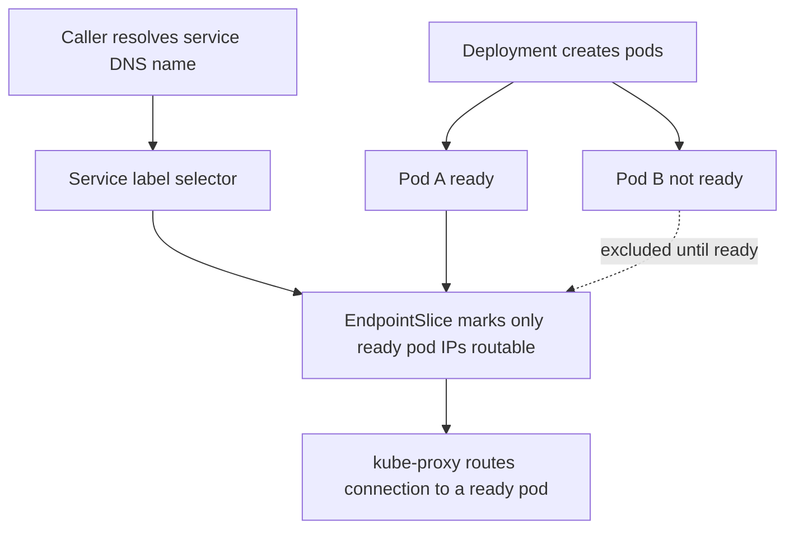

# Health Checks and Service Discovery

Two questions sit under all [[Load Balancers|traffic management]]: **where are the instances of the service I want to call?** (service discovery) and **which of them is currently safe to send traffic to?** (health checking). In a static world both were a config file. In a world of autoscaling, rolling deploys, and pods rescheduled across nodes hourly, the answers change by the minute — so they must be *computed continuously*, and the machinery that computes them becomes critical infrastructure with its own spectacular failure modes.

## The problem that created it

A growing system, in three acts:

1. **Static addresses die first.** Service A calls service B at an IP from a config file. B's host is replaced; the IP changes; A fails until a human edits config and redeploys. Multiply by dozens of services and daily deploys — humans can't keep up. Addresses must become *looked up*, not *configured*.
2. **Then "up" turns out not to mean "working".** The process listens on its port but can't reach its database; or it's deadlocked; or it's mid-startup with caches cold. Routing to it produces errors even though the process is "running." Discovery needs a health signal, not just an address list.
3. **Then the health signal itself becomes dangerous.** You make checks thorough — ping the database, check dependencies. One shared dependency blips, every instance "fails" simultaneously, and your own machinery ejects the entire fleet: a self-inflicted total outage from a partial problem. Now health checking needs *design*, not just implementation.

Kubernetes, Consul, Eureka, and LB health checks are all answers to these three acts.

## What it solves

- **Dynamic addressing** — callers find current instances without redeploying config.
- **Failure masking** — dead or sick instances stop receiving traffic within seconds, automatically.
- **Deploy safety** — new instances receive traffic only when actually ready; old ones drain before dying ([[Graceful Shutdown and Deployment Safety]]).
- **Autoscaling integration** — scaled-out instances become routable the moment they're ready, with no human in the loop.
- **Self-healing** — crashed-but-running processes (deadlock, OOM-adjacent states) get restarted, not just avoided.

## How it works

### The three Kubernetes probes — three different questions

Kubernetes made precise a distinction older systems blurred. Each probe answers a *different question* and triggers a *different action* — conflating them is the root of most probe bugs:

| Probe | Question | On failure | Wrong answer costs you |
|---|---|---|---|
| **Liveness** | "Is this process beyond saving?" | **Restart the container** | Restart loops that destroy working pods |
| **Readiness** | "Can it serve traffic *right now*?" | **Remove from Service endpoints** (no restart) | Traffic to broken pods, or zero endpoints |
| **Startup** | "Has it finished booting yet?" | While it runs, liveness and readiness are held off entirely — but once its own budget is exhausted the kubelet **kills the container**, restarted per `restartPolicy` | Slow-starting apps killed before they ever come up |

Key semantics: readiness is *continuous*, not just for boot — a pod can become unready mid-life (overloaded, dependency lost) and later recover; it's taken out of rotation and put back, never restarted for it. Liveness should test only "is the process fundamentally stuck" — the classic correct implementation is a trivial handler that proves the event loop/thread pool responds. Startup exists because one timeout can't fit both "boots in 3 minutes once" and "should answer probes in 1 second forever after": the startup probe covers boot, then hands off. Note what it is *not*: an infinitely patient waiter. While it runs, liveness and readiness never fire — but if it exhausts `periodSeconds × failureThreshold`, the kubelet kills the container exactly as a failed liveness probe would. Sizing that budget above the real worst-case boot is the whole job.

A failure budget is `period × failureThreshold` — a readiness probe every 5 s with threshold 3 means ~15 s worst-case detection. Know *both* numbers, and know that platforms differ on them. Kubernetes' own defaults are `periodSeconds: 10`, `failureThreshold: 3`, `successThreshold: 1`, and `timeoutSeconds: 1` — that last one catches people, because a probe handler that occasionally takes 1.2 s behind a GC pause is already recording failures. Managed platforms can hardcode their own values; yours hardcodes `failureThreshold: 10`, see below.

### Shallow vs deep checks — and the cascading-ejection trap

A **shallow check** answers from the process itself (static 200, thread-pool alive). A **deep check** exercises dependencies (DB ping, Redis ping, downstream call).

The trap: **a deep check copies every dependency's availability into *your* availability, multiplied across the fleet.** All instances share the database; the database has a 10-second blip; all instances fail their deep readiness check simultaneously; the [[Load Balancers|load balancer]]/Service ejects *everything*; callers get connection-refused for a problem that would have surfaced as some slow queries. Worse: ejection sends zero traffic, dependency recovers, but probes must now pass again before any instance returns — recovery lags the fix. Deep checks on *liveness* are strictly worse: the platform *restarts* every instance in unison — cold caches, connection-pool reestablishment stampede, and a thundering herd into the just-recovered dependency ([[Failure Modes in Distributed Systems|metastable failure]] territory).

Design rules that survive production:

- **Liveness: always shallow.** Only "is this process stuck beyond recovery." Never a dependency in it.
- **Readiness: mostly shallow**, plus at most *hard* dependencies without which literally every request fails — and even then prefer serving 503s from a live endpoint over vanishing from the endpoint list (an HTTP 503 is debuggable; connection-refused is a mystery).
- **Deep health belongs in monitoring**, not in routing: expose a rich `/health/detail` for dashboards and alerts, wire only the shallow one into probes. Envoy's **panic threshold** (when the *healthy* share of a cluster's hosts falls below the threshold — default 50% — Envoy disregards health status and routes across all hosts anyway) exists precisely because mass ejection is usually a lying signal.

### Service registries — Eureka and Consul concepts

Outside Kubernetes, discovery is a **registry**: a database of `service name → [healthy instances]`.

- **Registration**: instances self-register on boot (Eureka model) or are registered by an agent (Consul runs a local agent that also executes health checks). Deregistration on shutdown; **TTL/heartbeat expiry** reaps instances that died without saying goodbye — miss heartbeats, get dropped.
- **Lookup**: clients fetch (and cache) the instance list — via HTTP API (Eureka), or DNS/HTTP (Consul serves discovery over plain DNS, which any client speaks).
- **The registry's own availability problem**: it's infrastructure for finding infrastructure, so it must be a clustered, replicated system itself — and it faces a [[CAP Theorem|CP-vs-AP choice]]. Consul chose consistency (Raft consensus); Eureka deliberately chose availability — its **self-preservation mode** stops expiring instances when too many heartbeats disappear at once, on the reasoning that a network blip hiding heartbeats is likelier than 80% of the fleet dying, and a stale instance list beats an empty one. That philosophical split — *stale data vs no data* — is the registry design question.

### DNS-based vs client-side discovery

- **DNS-based**: the registry publishes instances as DNS records; callers resolve a name per [[How DNS Works]]. Universal (every language speaks DNS) — but client-side DNS caching means ejected instances keep receiving traffic until caches expire (the JVM caches successful lookups for `networkaddress.cache.ttl` — historically *forever* when a SecurityManager was installed, 30 s otherwise, and both outlive a fast ejection), and plain DNS carries no port/health metadata (SRV records help; few clients use them).
- **Server-side discovery**: callers hit a stable VIP/[[Load Balancers|load balancer]] that does discovery for them. Simplest clients, one more hop, LB must stay current.
- **Client-side discovery**: the caller fetches the instance list and picks an instance itself (Eureka + Ribbon-style, gRPC client-side LB, mesh sidecars). No extra hop, per-caller balancing choice, instant reaction to pushed updates — at the cost of discovery logic in every client (or a sidecar to hold it).

### Kubernetes Services as discovery

Kubernetes bundles the whole stack into the platform:

- A **Service** selects pods by label; the control plane maintains **EndpointSlices** listing each matching pod IP alongside a `ready` condition, and only ready endpoints receive traffic (readiness probes feed discovery directly — this is the integration's elegance). Note the mechanism precisely: a not-ready pod stays *listed* and flagged rather than vanishing, which is what lets controllers tell "unready" from "gone".
- **Discovery** = DNS: `payments.prod.svc.cluster.local` resolves to the Service's stable ClusterIP; **kube-proxy** (iptables/IPVS) routes connections to a ready endpoint. Registration, health, reaping: all automatic via the kubelet and controllers.
- Honest limits: kube-proxy balances per-*connection* (L4) — long-lived HTTP/2 or gRPC connections pin to one pod and skew load ([[Load Balancers|see L4 vs L7]]); headless Services (`clusterIP: None`) return pod IPs directly for client-side discovery; DNS caching inside the app can still serve stale answers.

## Trade-offs

| You gain | You pay |
|---|---|
| Instances come and go with zero config changes | The registry/control plane is new critical infrastructure — it can take everything down |
| Seconds-scale failure masking | Detection is probabilistic and lagged: budget = period × threshold |
| Deploys gated on actual readiness | Probe misconfiguration is now a first-class outage cause |
| Self-healing restarts | Liveness restarts can mask real bugs (restart-loop as lifestyle) and amplify load |
| Health integrated into routing | The deep-check trap: dependency blips amplified into fleet-wide ejection |

## Failure modes

- **Mass ejection via deep readiness** — shared dependency blip ejects the fleet; see above. Detect: endpoint count alongside error rates; alert on "endpoints < minimum", not only on probe failures. Mitigate: shallow checks, panic-threshold-style routing, serve-503-rather-than-vanish.
- **Liveness restart loops** — an overloaded app answers probes slowly → killed → restarts with cold caches → slower → killed again. The platform turns overload into permanent death. Mitigate: raise `timeoutSeconds` off its 1-second default, use a startup probe for boot, and keep the liveness handler off the request thread pool.
- **Zombie instances** — process up, port open, shallow check green, app useless (wedged pool, bad config). Passes every probe, fails every user. Detect via symptom-based alerting (error rate, latency) — never via probes alone.
- **Stale discovery data** — DNS/client caches serve ejected IPs; callers see connection-refused from instances the platform already replaced. Mitigate: low TTLs, cache-respecting clients, retries-on-connect targeting a different endpoint.
- **Registry outage** — Eureka down: clients run on cached lists (degraded but alive — the AP choice paying off); Consul losing Raft quorum: no updates until quorum returns. Know which behavior your stack has *before* the incident.
- **Heartbeat false deaths** — GC pauses or network partitions make healthy instances miss TTLs; the registry reaps them; capacity drops exactly when the system is already stressed — the registry version of retry amplification. Eureka's self-preservation mode is the designed answer, with its own cost (staleness).

## When NOT to use it

- **Static, tiny topologies** — three services on fixed VMs with yearly changes: a config file plus monitoring is simpler and has fewer failure modes than a registry cluster.
- **Deep checks in probes** — almost never; monitoring owns deep health (worth restating as an anti-use).
- **A separate registry inside Kubernetes** — running Eureka inside a cluster that already does registration, health, and DNS natively duplicates machinery to keep two systems consistent. Use platform primitives; add a mesh only when you need L7 features Services lack.
- **Liveness probes "because the template had one"** — a liveness probe that can fail under load is a self-destruct button; if you can't name the stuck-state it detects, ship readiness only.

## In your stack

- **Your Facets-managed EKS hardcodes probe `failureThreshold: 10`** (readiness, liveness, *and* startup) with no exposed override — so every budget is `period × 10`, not the Kubernetes-default ×3. A `readiness_period: 5` means ~50 s worst-case detection, not 15 s. Self-managed `.kube/*.yml` services use the default 3. Sizing against the wrong threshold is the single most-repeated bug in this area of your fleet.
- **Services pinned at 1 replica change the readiness calculus**: with no peer to shed to, readiness gating on Mongo/Redis means a datastore blip deregisters the *only* pod — the Service drops to zero endpoints and callers get connection-refused instead of an interpretable 5xx. House rule: at 1 replica, readiness must not gate on shared datastores; services at 2+ replicas may deliberately keep them in. The two decisions are linked to replica count — never copy one without the other.
- Spring Boot Actuator maps cleanly: wire `/actuator/health/liveness` and `/actuator/health/readiness` probe groups, and keep datastore indicators *out* of the probe groups (they stay in the full `/actuator/health` for monitoring).
- Kubernetes Service discovery + Kong: Kong routes to Services, so readiness directly controls what the gateway can reach; correlate "Kong 502/503 spikes" with endpoint-count drops when debugging.
- At 1 replica, remember what health checking buys honestly: detection and restart, *not* availability — there is no second instance to fail over to. Only a second replica closes that gap.

## Interview angle

**The 60-second version:** "Service discovery answers 'where are the instances'; health checking answers 'which ones can take traffic.' Kubernetes splits health into three probes — liveness restarts stuck processes, readiness gates traffic without restarting, startup protects slow boots. The critical design rule is shallow-vs-deep: probes that check shared dependencies turn a dependency blip into fleet-wide ejection or synchronized restarts, so liveness stays shallow always, readiness nearly always, and deep health lives in monitoring. Discovery comes as DNS-based, server-side via a load balancer, or client-side from a registry like Eureka or Consul — registries themselves face a CP-vs-AP choice between stale data and no data. Kubernetes Services integrate it all: readiness feeds EndpointSlices, DNS names resolve to a stable IP, kube-proxy routes to ready pods."

Interviewers probe:
- *Liveness vs readiness, and what happens on each failure?* — restart vs endpoint removal; recovery differs too.
- *Should readiness check the database?* — "mostly no," argued via the mass-ejection cascade; bonus points for the zero-endpoints-vs-503 distinction and panic thresholds.
- *Eureka vs Consul?* — AP vs CP registry philosophy; self-preservation mode as a deliberate staleness choice.
- *How does Kubernetes discovery actually work?* — Service → EndpointSlice → kube-proxy; mention the L4-pinning gRPC caveat for senior-signal.
- Classic follow-up: "Your deploy is green but users see errors for 40 seconds" — readiness gating, probe budgets, and drain timing in one story.

## Check yourself

**Q1 (explain it):** Explain liveness vs readiness vs startup probes — the question each asks, the action each triggers, and one concrete bug caused by conflating liveness with readiness.

> [!question]- Q: The three probes, and a conflation bug?
> Liveness asks "is this process permanently stuck?" — failure restarts the container. Readiness asks "can it serve right now?" — failure removes it from Service endpoints, no restart, and it returns when the probe passes. Startup asks "has boot finished?" — it holds the other probes off so slow boots aren't killed, though it kills the container itself if boot overruns its own `periodSeconds × failureThreshold`. Conflation bug: putting a readiness-style condition (e.g., "database reachable") into liveness means a 30-second DB blip doesn't just pause traffic — it *restarts every pod simultaneously*, cold caches and reconnect stampede included, turning a blip into a prolonged outage.

**Q2 (scenario):** Mongo has a 15-second election. Your service's readiness probe pings Mongo. Walk through what happens at 1 replica, and what the caller experience is versus a shallow probe.

> [!question]- Q: Mongo blips, readiness is deep, 1 replica — what happens?
> Probe failures accumulate during the election; after `period × failureThreshold` the only pod is marked unready and removed from EndpointSlices — the Service has zero endpoints. Callers get connection-refused/empty-upstream errors (at the gateway: 502/503 with no useful detail), which look like "service is gone," not "database electing." After Mongo recovers, the pod must pass probes again before traffic returns, so the outage outlives the blip. With a shallow probe the pod stays in rotation and returns interpretable 500s/503s for the few seconds queries actually fail — shorter, more debuggable degradation. This is why readiness must not gate on shared datastores at 1 replica.

**Q3 (scenario):** A service passes liveness and readiness yet serves 100% errors for an hour before anyone notices. How is that possible, and what closes the gap?

> [!question]- Q: Green probes, broken service — how?
> The probes are shallow and the failure is in business function: a wedged downstream dependency returning errors, a bad config/feature flag, an exhausted internal pool the probe handler doesn't touch — the probe endpoint works while real endpoints fail. Probes verify *process* health, not *service* health. The gap is closed by symptom-based monitoring and alerting — error rate, latency, traffic — alongside probes (see [[Alerting and On-Call Design]] and [[Logs Metrics and Traces]]): probes decide routing/restarts; alerts decide human attention. If a check can't be in the probe (deep), it should still be on a dashboard.

**Q4 (mini design):** Design discovery + health for 30 Spring Boot services on Kubernetes calling each other over HTTP, including probe choices and what you'd explicitly not do.

> [!question]- Q: Discovery and health for 30 services on K8s?
> Discovery: one ClusterIP Service per deployment, callers use DNS names (`svc.namespace.svc.cluster.local`), no external registry — the platform already registers, health-checks, and reaps. Probes: startup probe sized to worst JVM boot (period × threshold > boot time); liveness = shallow Actuator liveness group (process/event-loop only), generous timeout; readiness = shallow + hard-local concerns only, datastores excluded for 1-replica services (kept only where 2+ replicas make shedding meaningful). Deep health on `/actuator/health` for monitoring only. Graceful shutdown + preStop sleep coordinated with drain ([[Graceful Shutdown and Deployment Safety]]). Explicitly not doing: Eureka-in-K8s (duplicate machinery), deep liveness (synchronized restarts), per-connection gRPC between hot services without L7 balancing (pinning skew).

## Sources

- Kubernetes documentation: "Configure Liveness, Readiness and Startup Probes"; Services, EndpointSlices, and DNS for Services and Pods.
- Google SRE workbook/book — health checking and load balancing in the datacenter (lame ducks, graceful degradation).
- Netflix Tech Blog / Eureka wiki: Eureka architecture and self-preservation mode (AP registry design).
- HashiCorp Consul documentation: architecture (Raft consensus, agents, DNS interface), health checks.
- Envoy proxy documentation: outlier detection and the healthy panic threshold.
- Spring Boot documentation: Actuator health groups, liveness/readiness probe support, graceful shutdown.
