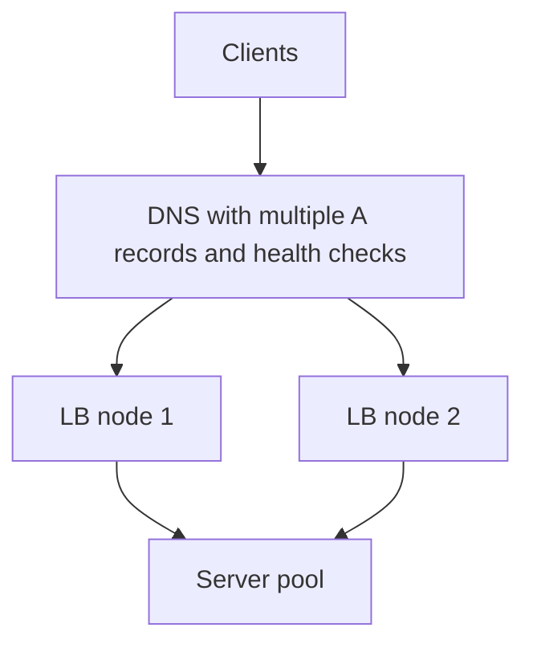

# Load Balancers

A **load balancer (LB)** sits between clients and a pool of servers and decides, for every incoming connection or request, which server handles it. It is the component that makes [[Vertical vs Horizontal Scaling|horizontal scaling]] usable: without it, "add more servers" gives you more servers but no way to spread work across them. It also quietly provides the second half of availability — routing *around* servers that are down.

## The problem that created it

Picture a service on one machine. Traffic grows; the machine saturates. You buy a bigger machine ([[Vertical vs Horizontal Scaling|scale up]]) until there is no bigger machine, or the bigger machine's failure takes down everything at once. So you run two servers. Now two problems appear immediately:

1. **Distribution** — clients need to pick a server. Hardcoding IPs into clients means redeploying every client to add capacity. Publishing both IPs in DNS ([[How DNS Works|round-robin DNS]]) helps, but DNS caches aggressively, honors TTLs loosely, and has no idea whether a server is alive.
2. **Failure masking** — when server A dies, clients that cached A's address keep failing until their DNS TTL expires, which can be minutes. A growing system can't accept minutes of errors per server death.

The fix is to put one well-known address in front and let a dedicated component — the load balancer — hold the server list, watch server health, and spread the traffic. Clients only ever know the LB's address; the pool behind it can grow, shrink, and fail invisibly.

## What it solves

- **Horizontal scaling** — N servers appear to clients as one logical endpoint.
- **Availability** — unhealthy servers are detected and ejected from rotation automatically.
- **Zero-downtime deploys** — servers can be drained and replaced one at a time behind the LB (see [[Graceful Shutdown and Deployment Safety]]).
- **Load isolation** — overloaded servers receive less traffic under least-connections-style algorithms.
- **A natural enforcement point** — TLS termination, connection limits, and request logging can live in one place instead of N places.

## How it works

### L4 vs L7

The single most important distinction is **which layer of the network stack the LB operates at**, because it determines what the LB can *see* and therefore what decisions it can make.

| | **L4 (transport layer)** | **L7 (application layer)** |
|---|---|---|
| Sees | IP addresses, TCP/UDP ports, packets | Full HTTP request: path, headers, cookies, method, body |
| Unit of balancing | A TCP connection (all its requests go to one server) | An individual HTTP request |
| Can route by URL/header | No | Yes (`/payments` → payments pool) |
| TLS | Usually passes encrypted bytes through | Usually terminates TLS, so it can read the request (see [[TLS and HTTPS]]) |
| Cost per request | Very low — roughly packet forwarding with NAT or tunneling | Higher — parses HTTP, often maintains two TCP connections per client |
| Examples | AWS NLB, LVS, HAProxy in TCP mode | AWS ALB, NGINX, Envoy, HAProxy in HTTP mode |

An L4 balancer is essentially a very fast connection router: it picks a backend when the TCP connection opens and sticks with it. An L7 balancer is a full [[Reverse Proxy vs Forward Proxy|reverse proxy]]: it terminates the client's connection, reads the request, and makes a fresh routing decision per request — which enables path-based routing, header-based canarying, cookie stickiness, retries, and request rewriting. With HTTP/2, where one connection multiplexes many requests ([[HTTP 1.1 vs HTTP 2 vs HTTP 3]]), L7 balancing matters even more: an L4 device would pin an entire multiplexed connection to one backend.

### Algorithms

- **Round robin** — rotate through the server list in order. Simple, fair when requests are uniform and servers identical. Degrades when some requests are 100× heavier than others.
- **Weighted round robin** — same, but servers get traffic proportional to a weight (bigger instance, higher weight; canary instance, tiny weight).
- **Least connections** — send to the server with the fewest open connections right now. Adapts to uneven request cost: a server stuck on slow requests accumulates connections and automatically receives less new work. The usual default for long or variable requests.
- **Least response time** — least connections refined by observed latency: prefer the server answering fastest. Reacts to a degraded-but-alive server (GC thrashing, noisy neighbor) that least-connections alone may miss.
- **IP hash** — `hash(client IP) mod N` picks the server. Gives **session affinity** (the same client lands on the same server) without cookies — useful for [[Stateless vs Stateful Services|stateful]] servers holding per-client data. Breaks badly when N changes: adding one server remaps almost every client.
- **Consistent hashing** — hashing on a ring so that adding/removing a server remaps only ~1/N of keys instead of nearly all of them. The right choice when backends hold per-key state or cache (affinity preserves cache hit rates). Full treatment in [[Consistent Hashing]].

A practical note on least-connections at scale: when *many independent LB instances* each pick the globally least-loaded backend, they can all pick the *same* one and dogpile it. Mitigations include **power of two choices** (pick two backends at random, send to the less loaded — nearly as good as global least-connections with none of the herding). It is how Envoy's `LEAST_REQUEST` policy picks hosts by default, and what NGINX's `random two least_conn` method does — available in open-source NGINX since 1.15.1 (2018), not a Plus-only feature.

### Health checks and ejection

The LB continuously probes each backend — typically an HTTP `GET /health` every few seconds, or a TCP connect for L4. A backend failing N consecutive probes is **ejected** (removed from rotation); after M consecutive passes it is restored. Two flavors:

- **Active checks** — the LB sends synthetic probes on a timer. Detection latency = probe interval × failure threshold.
- **Passive checks (outlier detection)** — the LB watches *real* traffic and ejects a backend returning consecutive 5xx or connection errors. Faster detection, no synthetic load, but needs real traffic to observe.

Depth of the check matters enormously — a check that probes the server's dependencies can eject the entire fleet at once when a shared dependency blips. That trap, and liveness vs readiness semantics, are covered in [[Health Checks and Service Discovery]].

### Connection draining

When a backend must be removed deliberately (deploy, scale-in), yanking it would sever in-flight requests. **Connection draining** (AWS calls it deregistration delay) means: stop sending *new* connections to the backend, but let existing ones finish, up to a timeout (commonly 30–300 s). The backend-side counterpart — the app finishing requests on SIGTERM — is [[Graceful Shutdown and Deployment Safety|graceful shutdown]]; both halves must work for zero-dropped-request deploys.

### Who balances the balancer?

The LB is itself a single point of failure unless it's made redundant. The standard layers, outermost first:

1. **DNS** — publish several LB IPs; a health-checking DNS service (e.g. Route 53) stops advertising a dead one. Coarse and slow (client caches), but it's the only tool that works across regions.
2. **Anycast** — advertise the *same* IP from many locations via BGP; the internet routes each client to the nearest. Used by CDNs and large L4 tiers (Cloudflare, Google Maglev). Failover is a routing-table update — seconds, no client cache involved.
3. **Active/passive pairs** — two LB nodes share a virtual IP (VRRP/keepalived); the standby grabs the IP when the active dies. Classic on-prem pattern.
4. **Managed layering** — AWS ELB is itself a fleet: DNS resolves the ELB name to multiple per-AZ nodes, AWS scales and heals those nodes invisibly. You outsource "who balances the balancer" to the cloud provider.

Real architectures stack these: DNS → anycast L4 tier → L7 tier → services. Each layer balances the one below it.

## Trade-offs

| You gain | You pay |
|---|---|
| Horizontal scaling behind one endpoint | An extra network hop of latency (sub-ms L4, ~1 ms+ L7) |
| Automatic failure masking | A new critical component to make highly available |
| Per-request routing, retries, TLS offload (L7) | L7 must terminate TLS — certificate management, and plaintext exists at the LB |
| Central point for policy and metrics | Central point for *misconfiguration* — one bad LB change takes down everything |
| Drain-based zero-downtime deploys | Health-check tuning becomes a real engineering task (thresholds, depth) |

## Failure modes

- **The LB itself dies** — total outage if not redundant. Detected trivially (everything is down); mitigated by the layering above.
- **Health-check false positives** — checks pass while the app is actually broken (shallow check hits a static handler; app can't reach its DB). Traffic flows into a black hole. Mitigation: make the check exercise minimal real functionality, and alert on backend error rates, not just check status.
- **Health-check false negatives / mass ejection** — a slow dependency makes *all* backends fail a deep check; the LB ejects everything and serves nothing. Some LBs have a **panic threshold** (Envoy: when the *healthy* share of a cluster's hosts falls below the threshold — default 50% — Envoy disregards health status and balances across all hosts anyway) precisely for this. See [[Health Checks and Service Discovery]].
- **Uneven load despite balancing** — long-lived connections (gRPC, WebSockets) pinned by an L4 LB concentrate on old backends after a scale-out; new backends idle. Mitigation: L7 balancing, connection age limits, or client-side rebalancing.
- **Retry amplification through the LB** — LB-level retries on top of client retries multiply load during a partial outage. Budget retries; see [[Timeouts Retries and Exponential Backoff]].
- **Sticky-session loss** — affinity by cookie/IP hash means a backend death loses its users' sessions. If sessions live on the server, this is an architecture smell; push state out ([[Stateless vs Stateful Services]]).

## When NOT to use it

- **One server, honestly sized** — an internal tool at 5 RPS gains nothing except a hop and a config surface.
- **Client-side balancing fits better** — in service-to-service meshes, a smart client (gRPC client-side LB, Envoy sidecar) picking from a [[Health Checks and Service Discovery|service registry]] avoids the extra hop and the central bottleneck.
- **Stateful protocols with per-connection affinity needs you can't express** — some licensing servers/game servers manage their own placement; an LB in front just fights them.
- **As a substitute for capacity** — an LB spreads load; it does not create capacity. If every backend is at 95% CPU, you need [[Autoscaling|more backends]] or [[Load Shedding and Graceful Degradation|load shedding]], not a better algorithm.

## In your stack

- Your edge is **CloudFront → ALB → Kong → services on EKS**: the ALB is an L7 balancer doing TLS termination and host/path routing into the cluster; per the org convention, TLS and generic rate limiting live at this edge layer, not in apps.
- Inside EKS, a Kubernetes **Service** is effectively a tiny L4 balancer: kube-proxy spreads connections across pod endpoints. For HTTP between Java services this is connection-grained, not request-grained — a reason long-lived connection pools can skew load.
- **Services pinned at 1 replica** make most balancing moot: the LB's only real job there is health-based ejection, and ejecting the only pod means zero endpoints — callers see connection refused, not a graceful error. Honest framing: at 1 replica, the LB buys deploy-time draining, not availability.
- Deregistration delay on the ALB must exceed your Spring Boot graceful-shutdown window, or in-flight requests die at deploy. The two timers are a matched pair — see [[Graceful Shutdown and Deployment Safety]].

## Interview angle

**The 60-second version:** "A load balancer gives N servers one address and splits traffic among the healthy ones. The key design split is L4 vs L7: L4 routes whole TCP connections fast but blind; L7 terminates TLS, reads each HTTP request, and can route per-request by path or header. Algorithms range from round robin through least-connections to consistent hashing when backends hold per-key state. Health checks eject dead backends; connection draining removes them gracefully. The LB itself is made redundant with DNS, anycast, or VRRP pairs — it's balancers all the way up."

Interviewers probe:
- *When would you pick L4 over L7?* — raw TCP/non-HTTP protocols, extreme throughput, when you must not terminate TLS at the edge.
- *How does the load balancer avoid being a single point of failure?* — the DNS/anycast/VRRP layering; know that managed ELB is itself a balanced fleet.
- *Why consistent hashing instead of IP hash?* — resize behavior: mod-N remaps everything, the ring remaps ~1/N. Then they'll pull toward [[Consistent Hashing]] and caches.
- *Sticky sessions — good or bad?* — a crutch for server-held state; prefer stateless services, then stickiness becomes an optimization (cache affinity) not a correctness requirement.
- Classic follow-up: "Your deploy drops requests — walk me through why." Answer spans draining + graceful shutdown + readiness timing.

## Check yourself

**Q1 (explain it):** Explain to a new engineer why an L7 load balancer can do path-based routing but an L4 one cannot.

> [!question]- Q: Why can L7 route by path but L4 cannot?
> An L4 balancer operates on TCP/UDP: it sees source/destination IPs and ports and forwards packets or connections. The URL path lives inside the HTTP payload, which at L4 is just opaque bytes — usually TLS-encrypted bytes. An L7 balancer terminates the connection (including TLS), parses the HTTP request, and therefore can inspect the path, headers, and method, making a routing decision per request rather than per connection.

**Q2 (scenario):** You scale from 4 to 5 backends under IP-hash balancing. What happens to session affinity, and what algorithm fixes it?

> [!question]- Q: What happens to IP-hash affinity when N changes 4→5?
> IP hash computes `hash(IP) mod N`. Changing N from 4 to 5 changes the result for roughly 4/5 of all client IPs, so ~80% of clients land on a different server and lose any server-held session/cache affinity. [[Consistent Hashing]] fixes this: servers and clients map onto a ring, and adding a server remaps only ~1/(N+1) of clients — here 1/5, ~20% — the ones whose ring segment the new server takes over.

**Q3 (scenario):** During a deploy, users report dropped requests even though you use rolling updates. Name the two timers that are probably mismatched.

> [!question]- Q: Which two timers cause dropped requests on rolling deploys?
> The LB's connection-draining/deregistration delay and the application's graceful-shutdown timeout. If the LB keeps sending (or hasn't finished draining) after the app begins killing connections — or the app's shutdown window is shorter than the drain period — in-flight requests are severed. The app must stop accepting, finish in-flight work, and only then exit, with the drain window at least as long. See [[Graceful Shutdown and Deployment Safety]].

**Q4 (mini design):** Design the balancing tier for an API serving two regions, each with 20 backends, requiring region failover under 1 minute. Sketch the layers.

> [!question]- Q: Two-region balancing tier with sub-minute failover?
> DNS layer (health-checked, low TTL ~30–60 s, e.g. Route 53 failover or latency routing) chooses the region — or anycast if you control BGP, for faster failover. Inside each region: a managed L7 LB fleet (ALB-style, itself multi-node across AZs) terminates TLS, health-checks the 20 backends (active checks + outlier detection), uses least-connections or power-of-two-choices, and drains on deploy. Cross-region failover = DNS stops advertising the dead region; intra-region failover = LB ejection in seconds. Note the honest gap: DNS failover costs *detection plus propagation*, and people only ever budget the second. Detection is the health checker's own `interval × failure threshold` — Route 53 standard health checks poll every 30 s with a default failure threshold of 3, so roughly 90 s before it stops advertising the dead region, unless you pay for 10-second fast checks. Propagation is then bounded below by client TTL caching, and some resolvers ignore TTLs outright. "Under 1 minute" therefore needs fast health checks *and* TTL ≤ 30 s, and still accepts stragglers.

## Sources

- Google SRE Book, ch. 19 "Load Balancing at the Frontend" and ch. 20 "Load Balancing in the Datacenter" (subsetting, least-loaded and weighted round robin, lame-duck state). It does not cover power of two choices; Mitzenmacher below is that source.
- *Maglev: A Fast and Reliable Software Network Load Balancer* (Google, NSDI 2016) — anycast + consistent-hashing L4 design.
- AWS docs: Elastic Load Balancing (ALB vs NLB comparison; deregistration delay).
- Envoy proxy docs: load balancing algorithms, outlier detection, panic threshold.
- NGINX docs: HTTP load balancing methods.
- Mitzenmacher, *The Power of Two Choices in Randomized Load Balancing* (2001).
