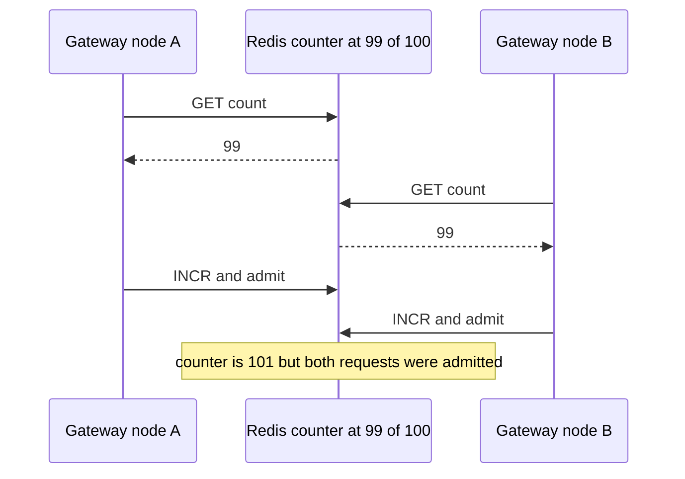

# Rate Limiting

A **rate limiter** bounds how many requests a caller may make in a window of time, rejecting the excess. It exists because every system has finite capacity and some callers — buggy, greedy, or malicious — will consume all of it if allowed. Rate limiting is the polite, *per-caller* cousin of [[Load Shedding and Graceful Degradation|load shedding]]: shedding protects the system from aggregate overload; limiting enforces fairness and policy per identity before overload ever happens.

## The problem that created it

A growing API meets three attackers, usually in this order:

1. **The accidental one** — a partner's retry loop without backoff hammers your endpoint at 500 RPS because one response was slow (see [[Timeouts Retries and Exponential Backoff|retry storms]]). Nobody is malicious; your database dies anyway.
2. **The economic one** — scrapers harvesting your catalog, or one free-tier user generating 95% of load that paying users subsidize. Capacity is money; unmetered use is an open bar.
3. **The malicious one** — credential stuffing against `/login`, OTP flooding against `/send-otp`, carding attacks against payment endpoints. Here the limit is a *security control*, not a capacity control.

Without limits, one caller's behavior becomes every caller's latency. With them, each caller gets a defined budget and the system gets a defendable perimeter. The subtle part — and the reason there are five algorithms, not one — is defining what "X requests per minute" *means* at boundaries: does a caller get to send all X in one millisecond? Twice X when a minute ticks over? Each algorithm answers differently.

## What it solves

- **Overload protection upstream of the bottleneck** — cheap rejection at the edge instead of expensive collapse at the database.
- **Fairness** — one caller cannot starve the rest.
- **Abuse and brute-force mitigation** — login, OTP, signup, and payment endpoints get hard security budgets.
- **Monetization/quota enforcement** — plans are defined as request budgets ("10,000 calls/day on the free tier").
- **Blast-radius control for your own services** — internal callers get budgets too, so a runaway batch job can't flatten a shared dependency.

## How it works

Every limiter answers one question per request — *has this key exceeded its budget?* — differing in how they count. The five standard algorithms:

### Token bucket

A bucket per key holds up to **B** tokens, refilled at rate **r** tokens/sec. Each request takes one token; empty bucket → reject. In practice implemented lazily: store `(tokens, last_refill_ts)` and compute the refill on each request — no background timer needed.

- **Allows bursts** up to B (a full bucket can be spent instantly), long-run rate capped at r. Burst size and sustained rate are *independently tunable* — the reason this is the most-used algorithm (and the model behind AWS API throttling).
- Accuracy: exact for the budget it defines (r with burst B).

### Leaky bucket

Requests enter a queue (the bucket, capacity B); they drain to the backend at a fixed rate r; a full queue rejects. Where token bucket caps *admission* and lets bursts through, leaky bucket **smooths output flow** — the backend never sees more than r/sec regardless of arrival pattern.

- Perfectly smooth downstream traffic; great when the protected resource genuinely cannot absorb bursts.
- Cost: queued requests wait (added latency), and a sustained burst fills the queue then rejects — bursty-but-legitimate clients suffer.

### Fixed window counter

Count requests per key per clock window (e.g., per calendar minute); reject above N; reset at the window edge. One counter, one `INCR` + expiry — the cheapest possible implementation.

- **The boundary burst flaw**: N requests at 11:59:59 and N more at 12:00:01 are both allowed — up to **2N in two seconds** while never technically breaking "N per minute."
- Fine where limits are coarse and approximate (daily quotas), wrong where the limit is a security control.

### Sliding window log

Store a timestamp per request (per key); on each request, drop timestamps older than the window, count the rest, reject above N.

- **Perfectly accurate** over any rolling window — no boundary artifacts at all.
- Cost: memory and work proportional to N per key (a Redis sorted set per key with `ZREMRANGEBYSCORE` + `ZCARD`). At N=10,000/min across a million keys, that's real money. Use where accuracy matters and N is small (login attempts: N=5 — the log is tiny).

### Sliding window counter

The engineering compromise: keep fixed-window counters, but estimate the rolling count as `current_window_count + previous_window_count × overlap_fraction`. Example: limit 100/min, 20 requests in 0:00–1:00, now at 1:15 — estimate = current + 20 × 0.75.

- Near-fixed-window cost, and it removes the 2N boundary artifact. It does *not* smooth traffic: after a quiet previous window the estimate starts near zero, so a caller can still fire the full N in one instant. It bounds the rolling *total*, not burstiness — if burstiness is what you care about, you want token bucket with a small B.
- Accuracy: an approximation — it assumes the previous window's requests were evenly spread. Cloudflare (who popularized it) reported the error is small in practice on real traffic. Slightly off is fine for capacity limits; prefer the log for strict security counts.

### Choosing between them

| Algorithm | Bursts | Accuracy | Memory/key | Typical use |
|---|---|---|---|---|
| Token bucket | Allowed, tunable (B) | Exact for its model | O(1) | General API limiting — the default |
| Leaky bucket | Smoothed away | Exact output rate | O(B) queue | Protecting burst-intolerant backends |
| Fixed window | 2N at boundaries | Weak at edges | O(1) | Coarse quotas (per-day) |
| Sliding log | Exact rolling budget | Perfect | O(N) | Security limits with small N |
| Sliding counter | No 2N edge, but still N instantly | Approximate | O(1) | High-traffic rolling limits at scale |

### Local vs distributed limiters

A **local (in-process) limiter** keeps buckets in the instance's memory. Zero added latency, zero dependencies — but each of your k replicas enforces its own budget, so the real global limit is up to **k × N** and shifts with [[Autoscaling|autoscaling]] and the load balancer's distribution. Acceptable when the limit is approximate capacity protection; wrong for billing quotas or security limits.

A **distributed limiter** keeps counters in a shared store — in practice almost always **Redis** ([[Redis Internals|single-threaded command execution]] makes it a natural atomic counter). Now the budget is truly global, paid for with a Redis round trip per request and a new dependency.

**The race condition:** the naive sequence `GET count → if count < N → INCR` is a read-check-write across two commands; two gateway nodes interleave, each believes it is admitting request number N, and so request N+1 gets through:

Fixes, in order of preference:

1. **Atomic single commands** — `INCR` returns the new value; check *after* incrementing (`if INCR > N: reject`). The fixed/sliding counter fits this naturally.
2. **Lua scripts** — Redis executes a script atomically, so token-bucket math (refill + take, multiple keys) runs as one unit. This is the standard production approach (e.g., Spring Cloud Gateway's Redis limiter uses a Lua token bucket).
3. Avoid distributed locks for this — a [[Distributed Locking|lock]] per request is latency and failure surface for no gain over a Lua script.

Failure policy must be chosen explicitly: Redis down → **fail open** (admit everything; right for quality-of-service limits) or **fail closed** (reject; right where the limit is a security boundary). Many real systems fail open with a local fallback limiter — degraded accuracy beats a full outage *except* on endpoints like OTP where unlimited traffic is the worse outcome.

### What to return

Rejecting well is part of the design:

- **Status 429 Too Many Requests** (RFC 6585, 2012 — 429 was never folded into RFC 9110, so 6585 is still its defining document). Use **403** instead when you don't want to reveal a limit exists to a suspected attacker.
- **`Retry-After` header** (defined in RFC 9110 §10.2.3; RFC 6585 says a 429 *may* carry it). Its value is either a delay in seconds or an absolute HTTP-date — not seconds only. It stops well-behaved clients from hammering and guessing, but send a **per-client jittered** value: handing every blocked caller the identical number synchronizes the whole population into one retry spike at the same instant, which is precisely the thundering herd you were avoiding.
- **Rate-limit headers** let clients self-regulate before hitting the wall. The thing actually deployed in the wild is the de-facto `X-RateLimit-Limit` / `-Remaining` / `-Reset` trio (GitHub among many). The IETF work to standardise this is still an Internet-Draft, not an RFC, and it has changed shape: early revisions mirrored that trio as `RateLimit-Limit` / `-Remaining` / `-Reset`, while revisions from 2023 onward collapse it into two structured fields, `RateLimit` and `RateLimit-Policy`. Emit the `X-` trio today and don't call the `RateLimit-*` trio a standard (Kong's own rate-limiting plugin still emits that pre-2023 trio alongside its `X-RateLimit-*` headers, as of 2026).
- A body with a machine-readable error code, so SDKs can branch on it.

### Dimensions: per-what?

The **key** you count by defines the policy:

- **Per-user** — the fairest for authenticated traffic; requires authn before limiting, so it sits *after* token validation (one reason gateways do both — see [[API Gateway]]).
- **Per-IP** — the only handle for anonymous traffic (login pages, signup). Weak both ways: thousands of users behind one corporate NAT/CGNAT share an IP (false positives), and one attacker rotates thousands of IPs (false negatives). Behind proxies you must key on the *forwarded* client IP, trusted only from your own proxy — see [[Reverse Proxy vs Forward Proxy]].
- **Per-API-key** — for machine/partner callers; the key identifies a *contract*, so limits map to plans and billing.
- **Composite and layered** — real systems stack dimensions: per-IP on unauthenticated endpoints, per-user after login, per-key for partners, plus a global ceiling as backstop; and per-endpoint cost weights (one `/reports/export` may "cost" 100 tokens).

## Trade-offs

| You gain | You pay |
|---|---|
| Bottleneck protected by cheap early rejection | Legitimate bursts rejected — tuning is a product decision, not just an engineering one |
| Fairness and per-plan quotas | Distributed enforcement: a Redis hop on every request and a new failure domain |
| Brute-force/abuse budgets | False positives on shared IPs; false negatives on rotating ones |
| Client self-regulation via headers | Limit sprawl: dozens of per-endpoint rules become config nobody fully remembers |
| Predictable downstream load (leaky bucket) | Queueing latency and burst-hostility (leaky bucket) |

## Failure modes

- **Boundary bursts (fixed window)** — 2N at the window edge; detected as periodic spikes aligned to clock boundaries; fixed by sliding-window variants.
- **Race-condition overshoot** — non-atomic check-then-increment admits over-budget traffic under concurrency; invisible at low load, systematic at high load. Fix with atomic INCR/Lua as above.
- **Limiter dependency outage** — Redis down takes limiting (or, if fail-closed, *the API*) with it. Decide fail-open/closed per endpoint class ahead of time; add a local fallback.
- **Hot limiter keys** — a single global counter, or one abusive key, concentrates load on one Redis shard — the limiter's own [[Hot Key Problem]]. Mitigations: shard the counter, or local pre-filters in front of Redis.
- **NAT lockout** — per-IP limits throttle an entire office/carrier; looks like "your app is down" for one company. Mitigation: per-user keys where possible, allowlists, and composite keys (IP + device fingerprint).
- **Retry amplification on 429** — clients without backoff treat 429 as "try again immediately," doubling traffic exactly when you asked for less. Jittered `Retry-After` values + documented client behavior + jittered backoff in SDKs; see [[Timeouts Retries and Exponential Backoff]].

## When NOT to use it

- **Internal traffic whose real problem is capacity** — if your own batch job overruns your own database nightly, fix scheduling or capacity; a limiter that silently drops your own work hides the bug. (Internal *backpressure* — see [[Backpressure and Flow Control]] — is usually the better tool between your own services.)
- **As the primary DDoS defense** — volumetric attacks must be absorbed at the [[CDN]]/edge network layer; an application-level limiter dying under 100 Gbps protects nothing.
- **Where queueing is the honest answer** — if work is asynchronous anyway, admit-and-queue ([[Why Async Messaging Exists|message queue]]) serves users better than rejecting them.
- **Across trusted low-volume admin paths** — limiting your own break-glass tooling has locked real operators out mid-incident; scope carefully.

## In your stack

- Org convention: **generic rate limiting belongs at the edge** — Kong/CloudFront/ALB — while app-level limits that are part of a *security boundary* (OTP issuance, login attempts, payment initiation) are the app's job. That maps exactly to the fail-open (edge, QoS) vs fail-closed (app, security) split above.
- **Kong's rate-limiting plugins** use local, Redis-backed, or cluster-wide counting — the local-vs-distributed trade is a config flag, so be explicit about which accuracy you're buying per route. Kong consumers let you key limits per API key/JWT consumer.
- **Redis is already in your stack**, so distributed limiting adds no new infrastructure — but note the cost shape: one Redis round trip per edge request scales linearly with traffic, and limiter keys should carry TTLs so abandoned keys don't accumulate.
- Fintech specifics: OTP/login limits are RBI-audit-relevant security controls — log rejections immutably (with `sub`/`jti`, which are system identifiers, not PII), fail closed, and alert on anomalies rather than silently absorbing them.
- Many services at **1 replica** means an in-process limiter is *accidentally* global today — and silently becomes k-times-looser the day a service scales out. If a local limiter is load-bearing, write that assumption down.

## Interview angle

**The 60-second version:** "Rate limiting bounds requests per key per time window. Token bucket is the default — tunable burst B, sustained rate r, O(1) state. Leaky bucket smooths output for burst-intolerant backends. Fixed window is cheapest but admits 2N at boundaries; sliding window log is exact but O(N) memory; sliding window counter approximates the rolling window at O(1). At scale the counters live in Redis with atomic Lua updates to avoid check-then-act races. Reject with 429 plus Retry-After and `X-RateLimit-*` headers so clients back off instead of storming. Key by user, IP, or API key depending on what identity you have — usually layered."

Interviewers probe:
- *Token vs leaky bucket, crisply?* — Token caps admission allowing bursts; leaky fixes the *output* rate, queueing/rejecting to smooth flow.
- *Why is fixed window wrong for a login limiter?* — Boundary burst: 2N attempts in seconds. Security limits want sliding log (N is tiny anyway).
- *How do you rate-limit across 10 gateway nodes?* — Shared Redis counters, atomic via INCR/Lua; name the race condition unprompted.
- *Redis goes down — what does your limiter do?* — Fail open vs closed, decided per endpoint class; local fallback.
- The full interview problem is [[Design a Rate Limiter]] — this note is its component foundation.

## Check yourself

**Q1 (explain it):** Explain token bucket to someone who's never seen it, including what B and r each control and why having both matters.

> [!question]- Q: Token bucket in plain words?
> Each caller has a bucket holding at most B tokens; tokens drip in at r per second; a request spends one token, and an empty bucket means rejection. r sets the long-run sustained rate — over an hour, nobody exceeds r/sec on average. B sets burst tolerance — how much a quiet caller can "save up" and spend instantly. Both matter because real traffic is bursty: B=1 punishes a client sending 5 quick requests after an idle minute even though their average is tiny, while a huge B lets a burst overwhelm the backend. Separating the knobs lets you say "100/sec sustained, bursts of 500 OK."

**Q2 (scenario):** Your limit is 600/min using a fixed window. A monitoring graph shows your backend absorbing ~1,200 requests from one key within a 3-second span, yet the limiter logged no rejections. Explain, and name two fixes with their costs.

> [!question]- Q: 1200 through a 600/min fixed window — how?
> Boundary burst: the caller sent ~600 in the final seconds of window W and ~600 in the opening seconds of W+1. Each window individually stayed within budget, so nothing was rejected — but the rolling 3-second reality was 2N. Fix 1: sliding window counter — O(1) state, removes the artifact, slightly approximate (assumes even spread in the previous window). Fix 2: sliding window log — exact rolling enforcement, but O(N) memory per key and more Redis work; right where N is small or the limit is security-critical. (Token bucket with B « 600 also works if burst control is the actual goal.)

**Q3 (scenario):** Two Kong nodes share a Redis limiter implemented as `GET`, compare, then `INCR`. Under load tests the limit of 100 admits 103–108 requests. Why, and what's the fix?

> [!question]- Q: Why does GET-then-INCR overshoot?
> It's a check-then-act race: both nodes `GET` 99 concurrently, both see "under 100," both `INCR` — 101 admitted; with more concurrency, more interleavings, hence 103–108. Redis is atomic per command but not across commands. Fix: make the decision atomic — `INCR` first and reject if the returned value exceeds the limit (set TTL on first increment), or move the whole read-modify-write into a Lua script, which Redis executes atomically. Never a distributed lock per request — all cost, no added correctness over Lua.

**Q4 (mini design):** Design the limiter set for a fintech's public API: login, OTP send, money transfer, and a partner data API. Name algorithm, key, store, and failure policy for each.

> [!question]- Q: Limiter design for login, OTP, transfers, partner API?
> Login: sliding window log (exactness, tiny N ~5–10/15 min), key = username + source IP, Redis, fail closed, 403/generic error (don't advertise the limit), immutable audit log. OTP send: sliding log, key = phone number (attacker rotates IPs; the phone is the scarce resource), N very small, Redis, fail closed — this is SMS-pumping/brute-force defense. Money transfer: token bucket per user with small B (humans don't burst transfers), Redis, fail closed, plus deterministic velocity checks in the service — the limiter supplements, never replaces, domain controls ([[Idempotency]] handles retries). Partner API: token bucket per API key sized to contract (e.g., 50/sec sustained, burst 200), Redis via Kong at the edge, fail open with local fallback, 429 + Retry-After + `X-RateLimit-*` headers.

## Sources

- RFC 6585 (2012) — 429 Too Many Requests. RFC 9110 §10.2.3 — `Retry-After` (delay-seconds or HTTP-date). IETF Internet-Draft `draft-ietf-httpapi-ratelimit-headers`, "RateLimit header fields for HTTP" — now the `RateLimit` / `RateLimit-Policy` structured fields; still a draft as of 2026.
- Stripe engineering blog: "Scaling your API with rate limiters" (token bucket in Redis, limiter/shedder layering).
- Cloudflare blog: "How we built rate limiting capable of scaling to millions of domains" (sliding window counter and its accuracy).
- Alex Xu, *System Design Interview* Vol. 1, ch. 4 "Design a Rate Limiter" — the five algorithms.
- Redis documentation: `INCR` pattern for rate limiting; EVAL/Lua atomicity.
- Kong documentation: Rate Limiting and Rate Limiting Advanced plugins (local vs Redis vs cluster strategies).
