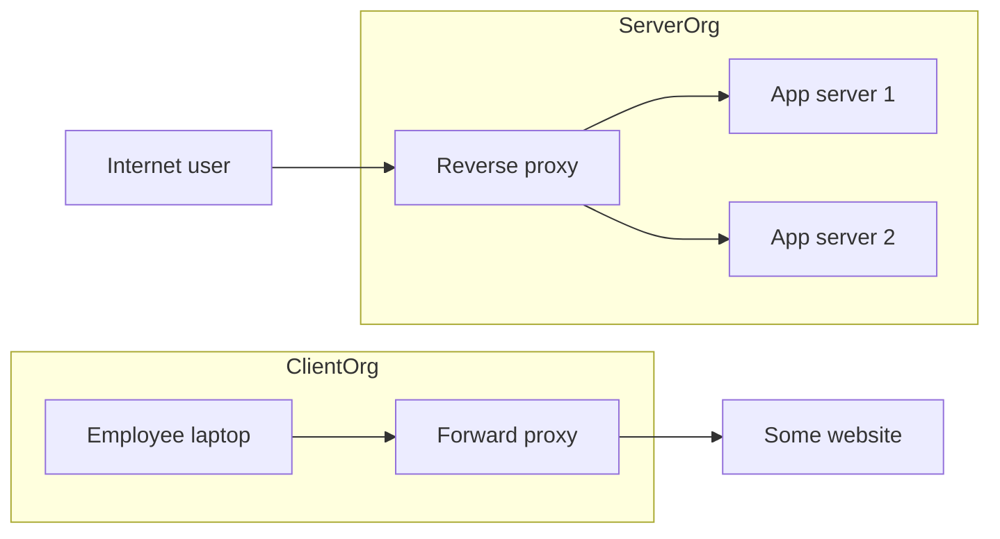

# Reverse Proxy vs Forward Proxy

A **proxy** is a server that makes requests on behalf of someone else. The entire distinction between the two kinds is *whose side it is on*: a **forward proxy** represents the **client** (the server never learns who really asked), while a **reverse proxy** represents the **server** (the client never learns who really answered). Once you hold that one sentence, half of modern web infrastructure — [[CDN|CDNs]], [[API Gateway|API gateways]], [[Load Balancers|L7 load balancers]], sidecars — resolves into "a reverse proxy with a specialty."

## The problem that created it

Two independent stories created the two kinds.

**The client-side story (forward proxy).** A 1990s corporate network has hundreds of PCs and expensive, slow internet. Problems: every PC fetching the same page wastes bandwidth; the company must enforce policy (no gambling sites, log who visits what); and security wants one controlled, monitorable exit to the internet rather than hundreds. Answer: route every outbound request through one server — the forward proxy — that caches, filters, logs, and forwards. The destination website sees only the proxy's IP.

**The server-side story (reverse proxy).** A growing website has problems that are mirror images: one app server can't hold enough concurrent connections; TLS handshakes eat CPU that should serve requests; static files shouldn't occupy an application thread; and you'd like to swap backend servers without clients noticing. Answer: put a server in front — the reverse proxy — that accepts all client connections, terminates [[TLS and HTTPS|TLS]], serves cached/static content itself, and forwards the rest to backends. The client sees only the proxy's address.

Same machinery (accept request, maybe transform, forward, relay response) — opposite allegiance.

## What it solves

**Forward proxy (deployed by the client's organization):**
- Egress control and policy — one audited, filtered path out of the network.
- Anonymity/IP pooling — the destination sees the proxy, not individual clients.
- Shared caching of external content for many internal clients.
- Reaching the internet from machines with no public route (NAT-ish egress for locked-down subnets).

**Reverse proxy (deployed by the server's organization):**
- **TLS termination** — certificates and handshake CPU in one place.
- **Load balancing** — spread requests across backends (an L7 [[Load Balancers|load balancer]] *is* a reverse proxy with balancing as its specialty).
- **Caching and static serving** — answer repeat requests without touching app servers.
- **Compression, connection management** — hold 10,000 slow client connections, speak few fast keep-alive connections to backends; shield apps from slowloris-style slow clients.
- **Security and hiding topology** — backends are unroutable from outside; one hardened surface; a natural home for WAF rules and [[Rate Limiting|rate limiting]].

## How it works

**Direction of representation, concretely:**

| | Forward proxy | Reverse proxy |
|---|---|---|
| Deployed/chosen by | The client's organization | The server's organization |
| Who is hidden | The client (server sees proxy IP) | The servers (client sees proxy address) |
| Who must be configured | The client (browser/OS proxy settings, env vars) — or a transparent intercept | Nobody — the proxy simply *is* the published address in DNS |
| Traffic direction it governs | Egress (inside → out) | Ingress (outside → in) |
| Typical software | Squid, corporate SWGs (Zscaler-style), `HTTP(S)_PROXY` in CI | NGINX, Envoy, HAProxy, Traefik, Varnish |

A detail worth knowing: for HTTPS, a classic forward proxy can't read the traffic — the client issues `CONNECT host:443` and the proxy blind-tunnels encrypted bytes. Corporate proxies that *do* inspect HTTPS perform **TLS interception**: they re-sign certificates with a corporate CA that employee machines are configured to trust — effectively a sanctioned man-in-the-middle. A reverse proxy has no such problem: it legitimately holds the server's own certificate, because it *is* the server as far as the world knows.

**CDNs and gateways are specialized reverse proxies.** This is the unifying insight:

- A **[[CDN]]** is a reverse proxy fleet distributed to hundreds of cities, specialized in caching: it represents your origin servers, holds your certificate, and answers from edge cache when it can.
- An **[[API Gateway]]** is a reverse proxy specialized in API policy: consumers, auth, quotas, per-route plugins.
- An **L7 [[Load Balancers|load balancer]]** is a reverse proxy specialized in backend selection and health.
- A **service-mesh sidecar** (Envoy) is both at once: a reverse proxy for traffic entering its pod, and a forward-proxy-like egress hop for traffic leaving it — which is why one binary (Envoy) serves every role.

These aren't analogies; they are literally the same request-forwarding machinery with different feature sets bolted on. Vendors market categories; the architecture is one pattern.

## Trade-offs

| You gain | You pay |
|---|---|
| Central control point (either direction) | Extra hop: latency, and a component to scale and keep highly available |
| TLS, caching, compression offloaded from apps | The proxy sees plaintext — it's inside your trust boundary and must be secured accordingly |
| Backend/client anonymity as appropriate | Debugging gains a layer: "is it the app or the proxy?" becomes a standing question |
| Apps shielded from slow clients and malformed requests | Config in a separate system from app code — drift and ownership questions |
| Swap backends invisibly | **Lost client identity**: backends see the proxy's IP unless headers forward it |

That last cost deserves emphasis because it bites everyone once: behind a reverse proxy, the app's "remote address" is the proxy. Conventions like `X-Forwarded-For` (client IP chain), `X-Forwarded-Proto`, and the standardized `Forwarded` header exist to pass the truth along — and the app must trust them *only* from its own proxy, since clients can send fake ones. Getting this wrong corrupts [[Rate Limiting|per-IP rate limiting]], audit logs, and geo logic.

## Failure modes

- **The proxy as single point of failure** — both directions. A dead forward proxy cuts the office off the internet; a dead reverse proxy is a full outage. Mitigation is the usual [[Load Balancers|HA layering]] (multiple nodes, health-checked DNS/VIP).
- **Connection exhaustion** — the reverse proxy holds every client connection; file-descriptor or memory limits hit at the proxy before backends feel anything. Detected via proxy-level connection metrics; mitigated by tuning limits, timeouts on idle clients.
- **Buffering surprises** — proxies often buffer whole requests/responses (to shield backends from slow clients). Large uploads/downloads spike proxy memory or disk; streaming/SSE endpoints break or stall if buffering isn't disabled for them (a classic NGINX + [[WebSockets Server-Sent Events and Long Polling|SSE]] gotcha).
- **Timeout mismatch in the chain** — proxy timeout < backend processing time ⇒ client gets 502/504 while the backend finishes anyway, work done but reported failed; see [[Timeouts Retries and Exponential Backoff]]. Every hop in CDN → LB → gateway → app needs coherent, increasing-inward timeouts.
- **Header spoofing** — trusting `X-Forwarded-For` from the open internet lets clients forge their IP; auth or limits keyed on it are bypassable. Mitigation: the first trusted proxy overwrites rather than appends, apps trust only the rightmost trusted entry.
- **Forward-proxy TLS interception breakage** — corporate MITM proxies break certificate pinning and confuse CLI tools (the familiar "works at home, SSL error in office" bug; `HTTPS_PROXY` env vars and corporate CA bundles are the fix).

## When NOT to use it

- **Forward proxy for anonymity you actually need to be strong** — a single proxy sees everything and is one subpoena/compromise away from deanonymizing you; that threat model needs Tor-style onion routing, not a proxy.
- **Reverse proxy in front of one tiny internal service** — a hop and a config file for nothing; add it when TLS, caching, or multiple backends make it earn its place.
- **A proxy as a bandage for app problems** — if the app can't handle concurrent connections or big payloads, the proxy only moves where the symptom appears.
- **East-west traffic hairpinned through the edge reverse proxy** — internal service-to-service calls shouldn't loop out through the ingress layer; that adds latency and makes the edge a bigger blast radius. Use direct calls, [[Health Checks and Service Discovery|service discovery]], or a mesh.

## In your stack

- Your ingress chain — **CloudFront → ALB → Kong → services** — is three reverse proxies stacked, each with its specialty: CDN caching at the true edge, L7 balancing + TLS at the ALB, API policy in Kong. Recognizing them as one pattern explains why each layer can inject/strip headers and why client IP must be forwarded deliberately through all three.
- Inside EKS, if a mesh or Envoy sidecars ever land, the same binary pattern appears per-pod; your `x-correlation-id` convention survives because every proxy layer passes it through (and the gateway injects it when absent).
- Outbound calls from services to third parties (KYC vendors, banking partners) through NAT gateways or egress proxies are the **forward** direction: fixed egress IPs exist so partners can allowlist you — a compliance-friendly, auditable single exit, same 1990s logic, RBI-era stakes.
- Audit note for fintech: every proxy layer that terminates TLS sees request plaintext. Where payloads carry KYC/PII, that layer is in regulatory scope — flag it, per the working agreement.

## Interview angle

**The 60-second version:** "Both proxies forward requests; the difference is allegiance. A forward proxy is deployed by the client side — corporate egress, filtering, caching, hiding the client from the server. A reverse proxy is deployed by the server side — it's the published address, terminates TLS, caches, balances, and hides the backends from the client. CDNs, API gateways, and L7 load balancers are all reverse proxies with different specialties. The classic operational gotchas are client-IP forwarding via X-Forwarded-For and timeout coherence through the proxy chain."

Interviewers probe:
- *Who configures each proxy?* — Forward: the client (or transparent interception). Reverse: nobody on the client side; it's just the DNS answer.
- *How does a backend learn the real client IP?* — `X-Forwarded-For`/`Forwarded`, and the trust rules around them.
- *Is a CDN a reverse proxy?* — Yes, a geographically distributed caching one; saying this crisply signals you see the pattern, not the product names.
- *How does a forward proxy handle HTTPS?* — `CONNECT` tunneling (blind) vs TLS interception with a corporate CA (inspecting), and the trade-offs.
- Classic follow-up: "Your rate limiter counts all traffic as one IP — why?" (Answer: keying on the proxy's IP instead of the forwarded client IP.)

## Check yourself

**Q1 (explain it):** In one minute, explain the difference between forward and reverse proxies to a junior engineer, including who deploys each and who gets hidden.

> [!question]- Q: Forward vs reverse in one minute?
> A forward proxy works for the client: the client's organization deploys it, clients are configured to send outbound traffic through it, and the destination server sees only the proxy — the client is hidden. A reverse proxy works for the server: the server's organization deploys it as the public address, clients connect to it unknowingly, and it forwards to backend servers the client never sees — the servers are hidden. Forward governs egress and policy; reverse governs ingress, TLS, caching, and balancing.

**Q2 (scenario):** Your per-IP rate limiter suddenly throttles *all* mobile users as if they were one client. What happened?

> [!question]- Q: Why does the limiter see one IP for everyone?
> The limiter is keyed on the TCP source address, and a proxy layer (CDN, LB, or gateway) sits in front — so every request arrives from the proxy's IP, and all users share one bucket. Fix: key on the real client IP taken from `X-Forwarded-For`/`Forwarded`, trusting only the entry appended by your own trusted proxy (clients can forge the header's earlier entries). This is covered from the limiter's side in [[Rate Limiting]].

**Q3 (scenario):** A streaming endpoint (server-sent events) works when hitting the app directly but hangs behind NGINX. Most likely cause?

> [!question]- Q: SSE works direct but hangs behind the proxy — why?
> Response buffering. Reverse proxies commonly buffer backend responses before relaying them, which turns a continuous event stream into "nothing until the buffer flushes or the connection closes." The fix is disabling proxy buffering for that route (and checking proxy read timeouts, which will otherwise kill long-lived idle streams). Same class of issue affects WebSocket upgrades if the proxy isn't configured to pass `Upgrade` headers — see [[WebSockets Server-Sent Events and Long Polling]].

**Q4 (mini design):** A regulated fintech needs: fixed egress IPs for partner allowlisting, inspection-free TLS to partners, and a public API behind a CDN. Which proxies go where?

> [!question]- Q: Proxy placement for egress allowlisting + public API?
> Egress: route partner-bound traffic through a forward proxy/NAT layer with a small set of static IPs the partners allowlist; use CONNECT-style tunneling (no TLS interception) so partner TLS stays end-to-end, and log connection metadata for audit. Ingress: public API behind CDN (reverse proxy #1, caching + edge TLS) → L7 LB (reverse proxy #2, HA + balancing) → API gateway (reverse proxy #3, auth/quota) → services. Client IP forwarded via X-Forwarded-For with trust anchored at the CDN; coherent timeouts increasing inward.

## Sources

- NGINX documentation and glossary: "What is a Reverse Proxy?" — reverse vs forward definitions, proxy_pass and buffering behavior.
- Cloudflare Learning Center: "What is a reverse proxy?" / "Forward proxy vs reverse proxy".
- MDN Web Docs: `Forwarded` and `X-Forwarded-For` headers; HTTP `CONNECT` method.
- Squid cache documentation — the canonical forward proxy.
- Envoy proxy documentation — one proxy binary serving edge, sidecar, and egress roles.
