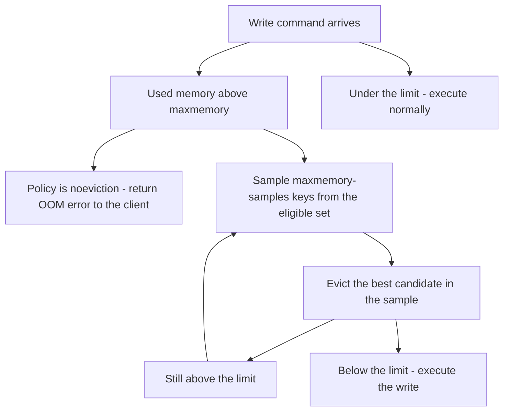

# Cache Eviction Policies

A cache is by definition smaller than the data it fronts, so it will fill up, and then every new entry requires throwing an old one away. The **eviction policy** is the rule for choosing the victim, and it is a bet about the future: "the key I evict is the one least likely to be asked for again." LRU bets on recency, LFU bets on frequency, FIFO bets on age, random bets on nothing. This note covers the standard policies, how Redis actually implements them (approximately, on purpose), and the separate but related question of choosing TTLs.

## Why this matters

Eviction is where [[Why Caching Works]] meets physical limits: your hit ratio is determined jointly by cache size and eviction policy, and a bad policy can waste half your memory keeping the wrong keys. It also matters operationally in a specific, dangerous way: **a Redis with the wrong `maxmemory-policy` doesn't degrade — it breaks.** The default policy (as of 2026), `noeviction`, makes Redis *reject writes with an error* once `maxmemory` is reached. A team that thinks of Redis as "a cache that just evicts old stuff" and never set the policy discovers this during their first memory spike, as every SET in the fleet starts throwing exceptions.

## How it works

### The classic policies

- **LRU (Least Recently Used)** — evict the key untouched for longest. Bets on temporal locality; the standard textbook implementation is a hash map plus doubly-linked list, giving O(1) lookup and promotion. Worst case: a one-pass scan over many keys (a batch job reading everything once) flushes the entire hot set — "sequential flooding."
- **LFU (Least Frequently Used)** — evict the key accessed fewest times. Better than LRU when popularity is stable and long-lived (a celebrity's profile stays hot even if not touched this minute). Two inherent problems: a once-hot key keeps a high count forever and squats in the cache ("cache pollution"), so practical LFUs add **decay** over time; and new keys start at count ~0, so they're evicted before proving themselves unless given a grace boost.
- **FIFO** — evict the oldest-inserted key regardless of use. Trivially cheap, ignores access patterns entirely; acceptable only when entries age out of relevance by insertion time anyway.
- **TTL-based** — every key carries an expiry; expiry removes keys independent of memory pressure, and `volatile-ttl` style policies evict the key with the nearest expiry first when memory *is* tight. TTL is really a **freshness** mechanism (see [[Cache Invalidation]]) that doubles as an eviction input.
- **Random** — evict any key. Sounds dumb; is surprisingly competitive when access is heavily skewed, because a random victim is overwhelmingly likely to be from the cold tail, not the hot head. Costs nothing to track.

| Policy | Bets on | Metadata cost | Fails when |
|---|---|---|---|
| LRU | recency | per-access bookkeeping | one-pass scans flush the hot set |
| LFU | stable popularity | counters + decay | popularity shifts fast; new keys starved |
| FIFO | age = irrelevance | none per access | access pattern matters at all |
| TTL-nearest | expiring soon = least valuable | TTL storage | TTLs don't reflect actual value |
| Random | skew itself | none | small caches, mild skew |

### Admission: the question eviction policies don't ask

Every policy above answers "who leaves?" A second, less obvious question is "**who gets in?**" — because a miss on a one-off key currently *forces* an eviction of something possibly more valuable. A scan that touches a million keys once doesn't just fail to benefit from the cache; it destroys the cache for everyone else. An **admission policy** sits in front of eviction and refuses to cache entries that look less valuable than the victim they would displace.

This is what your in-process Java caches do: **Caffeine** uses W-TinyLFU — a small frequency sketch (a count-min-style estimator over a recent window, so it costs bits rather than counters per key) that compares the incoming key's estimated frequency against the eviction candidate's, admitting the newcomer only if it wins, with a small admission window so genuinely new hot keys can still get established. The practical effect is that Caffeine resists sequential flooding in a way plain LRU cannot. Redis has no admission policy — it caches whatever you `SET` — which is worth knowing when you compare hit ratios between your L1 and your Redis tier and find the small local cache punching above its size.

### Redis: approximated LRU and LFU

Redis deliberately does **not** implement exact LRU. An exact LRU needs a global linked list threaded through every key, costing at least two extra pointers per key and pointer churn on every single read. Instead, when memory must be freed, Redis **samples N keys** (default `maxmemory-samples 5`, as of 2026) and evicts the best candidate among them — for LRU, the one with the oldest access time (each key stores a small access clock in spare bits of its object header). Since Redis 3.0 it also keeps a pool of good candidates across evictions, which sharpens the approximation.

Why approximation is fine: eviction only needs to avoid evicting the *hot head*, not find the single globally coldest key. Under skewed access, a sample of 5 almost never contains a hot key, so the evicted key is almost always cold — and raising `maxmemory-samples` to 10 approaches exact LRU closely (Redis's own documentation shows the comparison graphs) at slightly higher CPU. Precision beyond that buys nothing measurable in hit ratio.

Redis's **LFU** (added in Redis 4.0) is likewise approximate: an 8-bit **Morris counter** (logarithmic probabilistic counter) per key — increments become less likely as the count grows, so 8 bits can represent huge frequencies — plus a configurable **decay** (`lfu-decay-time`, default 1: a counter sampled and found idle for that many minutes is reduced, and `0` disables decay entirely) to solve the stale-hot-key pollution problem, and a non-zero starting value of 5 so new keys aren't instantly evicted. Note that the starting value is `LFU_INIT_VAL`, a constant compiled into the server — not a directive you can set, which is the detail people trip over when they go looking for it in `redis.conf`. The knob that *is* yours, besides decay time, is `lfu-log-factor` (default 10): it controls how steeply the probability of incrementing falls off as the counter rises — a higher factor compresses more real accesses into the same 8 bits, so very hot keys stay distinguishable from merely warm ones for longer. With the defaults, the counter saturates at roughly a million accesses.

### The maxmemory-policy options

Set `maxmemory` (e.g. `4gb`), then choose a policy. Eight have existed since Redis 4.0, and Redis 8.6 added two more — the `lrm` (Least Recently Modified) pair — so check what your server version actually offers before writing a policy name into config. `allkeys-*` considers every key; `volatile-*` considers **only keys that have a TTL set** — which lets you mix "evictable cache entries" (with TTL) and "protected data" (no TTL) in one instance.

| Policy | Scope | Victim selection |
|---|---|---|
| `noeviction` | — | none: writes error when full (**the default**) |
| `allkeys-lru` | all keys | approximated LRU |
| `volatile-lru` | TTL'd keys | approximated LRU |
| `allkeys-lfu` | all keys | approximated LFU |
| `volatile-lfu` | TTL'd keys | approximated LFU |
| `allkeys-random` | all keys | random |
| `volatile-random` | TTL'd keys | random |
| `volatile-ttl` | TTL'd keys | shortest remaining TTL |
| `allkeys-lrm` | all keys | approximated LRM — Redis 8.6 and later |
| `volatile-lrm` | TTL'd keys | approximated LRM — Redis 8.6 and later |

The `lrm` pair is the newest and the narrowest: it stamps the clock on **writes only**, so a key that is read constantly but never updated still ages out. That is right when "stale" means "nobody has refreshed this" and wrong as a general cache default, where reads are exactly the signal you want to keep — don't reach for it just because it is newer than `lru`.

Pure cache → `allkeys-lru` (or `allkeys-lfu` if popularity is stable and you're on ≥4.0). Mixed cache + durable-ish data (locks, counters, sessions you must not drop) → `volatile-lru` **and the discipline that every cache entry gets a TTL** — if no key has a TTL, `volatile-*` has no candidates and behaves like `noeviction`. Redis as a primary store → `noeviction` plus real capacity planning.

### What actually happens at the memory ceiling

Eviction is not a background sweeper; it is **inline with command execution**. Before running a command that may consume memory, Redis checks whether used memory exceeds `maxmemory`, and if so it evicts — sampling, picking a victim, freeing, repeating — until it is back under the limit or it runs out of candidates.

Three consequences worth internalising:

- **Eviction costs latency on the request that triggers it.** A burst of writes against a full instance pays sampling and freeing work on the hot path. Freeing a *large* value is the painful case, which is why `lazyfree-lazy-eviction` exists: it hands the deallocation to a background thread (the `UNLINK` mechanism) so a multi-megabyte victim doesn't stall the single event loop ([[Redis Internals]]).
- **If it cannot free enough, writes fail and reads keep working.** Commands flagged as memory-consuming return an OOM error; `GET` still answers. The application sees a half-working cache — which is why "Redis is up, health check green, but every `SET` throws" is such a confusing first page.
- **Replicas do not evict independently.** The primary chooses victims and replicates the deletion, so the replica's keyspace tracks the primary's rather than diverging through its own sampling (`replica-ignore-maxmemory` is the switch governing this). Practical upshot: don't reason about a replica's memory as if it evicts on its own, and don't size a replica smaller than its primary.

### Expiry runs on its own clock

TTL expiry and memory-pressure eviction are separate machinery, and expiry is deliberately lazy. A key past its TTL is removed in two ways: **on access** (any read of an expired key deletes it and reports a miss), and by an **active expiry cycle** that runs as part of Redis's periodic background job — roughly 10 times a second by default. Each pass samples about 20 keys from the set of keys that have a TTL, deletes those found expired, and if more than ~10% of the sample was expired it immediately repeats (the threshold since Redis 6.0's rewrite of the cycle; pre-6.0 code and older docs say 25%), so a large backlog drains fast while a small one costs almost nothing.

The probabilistic design means **expired-but-never-read keys keep occupying memory until a sampling pass happens to pick them**. A batch that wrote ten million keys with a one-hour TTL does not free ten million keys at the stroke of the hour. Two different `INFO stats` counters tell the two stories apart: `expired_keys` (removed because their TTL passed) and `evicted_keys` (removed because memory was tight). Rising `expired_keys` is normal housekeeping; rising `evicted_keys` means your working set no longer fits.

### Choosing TTLs

Eviction answers "we're out of memory"; TTL answers "how stale is tolerable." Choose TTLs from the **staleness budget**, not from memory:

1. Start from the consumer: how old can this data be before it causes a wrong decision? Reference data: hours. Product catalogue: minutes. Session-ish state: the session's own lifetime. Money state: effectively zero — reconsider caching ([[Caching Strategies]]).
2. TTL is your **backstop against every invalidation bug**: if a DEL-on-write is missed, TTL bounds the damage window. A key with no TTL and a missed invalidation is stale *forever*.
3. Shorter TTL = lower hit ratio = more origin load; the trade is explicit in the hit-ratio math of [[Why Caching Works]].
4. **Add jitter** — `TTL + random(0, 10%)` — so keys populated together don't expire together; synchronized expiry is one trigger of [[Cache Stampede and Thundering Herd]].

### Sizing: the arithmetic that decides whether policy even matters

Policy choice is a second-order knob; **cache size relative to working set is the first-order one**. Work the numbers before tuning anything.

Origin load is `traffic × (1 − hit_ratio)`. At 10,000 req/s:

| Hit ratio | Misses/s reaching MongoDB |
|---|---|
| 99% | 100 |
| 98% | 200 |
| 95% | 500 |
| 90% | 1,000 |

The shape to remember: **origin load is governed by the miss rate, so it doubles every time the miss rate doubles — and near the top of the range tiny hit-ratio movements are huge**. Dropping 99% → 98% doubles database load; nobody notices a "1% regression" on a dashboard, and the database notices immediately. This is the same arithmetic as [[Why Caching Works]], read from the eviction side: every evicted key that gets requested again converts directly into origin traffic.

Sizing then becomes: estimate the **working set** (the keys actually re-requested within their TTL window, not the whole keyspace) and give `maxmemory` room for it plus headroom. Keys cost their value size plus per-key overhead of tens of bytes — measure a representative key with `MEMORY USAGE <key>` rather than estimating, because encoding choices change it substantially ([[Redis Internals]]). If `maxmemory` sits below the working set, the cache **thrashes**: it evicts keys it is about to need, so eviction rate stays high and hit ratio stays low no matter which policy you pick. Under thrashing, LRU-vs-LFU debates are noise; the answer is more memory or a smaller working set (shorter TTLs on low-value key families, fewer cached projections).

### Seeing what your cache is actually doing

A short runbook, all of it cheap enough to run on a live instance:

- `INFO memory` — `used_memory` vs `maxmemory`, and `mem_fragmentation_ratio` (allocator overhead; well above 1.0 means the process holds more RSS than the data needs).
- `INFO stats` — `keyspace_hits`, `keyspace_misses`, `evicted_keys`, `expired_keys`. These are cumulative since start, so graph their *rate*, not their value.
- `OBJECT IDLETIME <key>` — seconds since last access, the raw signal behind LRU. Available only when the policy is **not** an LFU one.
- `OBJECT FREQ <key>` — the LFU counter, available only when the policy **is** an LFU one. The two commands are mutually exclusive because the key's object header stores either a clock or a counter, not both.
- `redis-cli --bigkeys` (the largest key of each type, by element count or string length) and `--memkeys` (ranked by actual memory usage) — the standard way to find the handful of keys eating your ceiling. Both iterate the keyspace with `SCAN` rather than blocking it.
- `SCAN` with `TTL` on a sample to audit TTL discipline: the fraction of keys with `TTL = -1` is exactly the fraction that `volatile-*` policies cannot touch.

## Common misconceptions

- **"Redis evicts expired keys instantly."** No. Expired keys are removed lazily (on access) and by a periodic active-expiry job that samples TTL'd keys (roughly 10 times per second, deleting found-expired ones and repeating if a large fraction were expired). A mass of expired-but-unvisited keys can linger in memory for a while; `INFO` memory and `expired_keys` stats show the lag.
- **"Approximated LRU is a corner Redis cut; real systems need exact LRU."** The approximation is a measured engineering trade: near-identical hit ratios at a fraction of the per-key memory and zero per-read list maintenance. Exactness in eviction is almost never the bottleneck on hit ratio — sizing and policy choice are.
- **"LFU is strictly better than LRU."** Only for stable popularity. Under shifting workloads (news articles, flash sales) LFU's history becomes a liability that decay only partially fixes; LRU adapts instantly.
- **"Setting maxmemory is optional."** Without it, Redis grows until the OS OOM-killer ends the process (or swap destroys latency). With it but with default `noeviction`, writes fail at the ceiling. Both failure modes have paged real on-call engineers; set both knobs deliberately.
- **"TTL and eviction are the same thing."** TTL is a freshness contract per key; eviction is a memory-pressure response for the whole instance. You need both: TTL bounds staleness, eviction policy decides behaviour at the memory ceiling.

## In your stack

- Audit every Redis your services use: `CONFIG GET maxmemory` and `CONFIG GET maxmemory-policy`. Anything serving as a pure cache with `noeviction` and no `maxmemory` is an incident on a timer. (On managed/ElastiCache instances, check the parameter group.)
- You likely mix concerns in one Redis — cache entries, distributed locks ([[Distributed Locking]]), rate-limit counters ([[Rate Limiting]]), maybe session state. Under `allkeys-lru`, **a memory spike can evict a live lock or counter** — silent correctness loss. Either split instances by concern or use `volatile-lru` with TTLs only on evictable keys.
- Monitor `evicted_keys` and the hit ratio (`keyspace_hits` / (`keyspace_hits`+`keyspace_misses`)) in `INFO stats`. A rising eviction rate with a falling hit ratio means the working set has outgrown `maxmemory` — a sizing conversation, not a tuning one.
- Fintech angle: TTL-as-backstop deserves to be policy. Every cached key relating to customer or account state should have a TTL even if event-driven invalidation exists — the TTL is the bound an auditor can reason about.
- If any Redis runs as a pod on EKS, two ceilings exist and only one of them is Redis's. The **container memory limit** must sit comfortably above `maxmemory` plus allocator fragmentation plus replication and client buffers — otherwise the kernel OOM-kills the container before Redis's eviction policy ever engages, Kubernetes restarts it, and you get a cold cache instead of a graceful eviction. Set `maxmemory` explicitly to a fraction of the limit; never leave it at 0 and hope the policy saves you.
- Managed Redis ships its own parameter-group defaults, which need not match open-source Redis's `noeviction`. Read the actual effective value (`CONFIG GET maxmemory-policy` against the running endpoint) rather than assuming either default — this is a two-minute check per environment and it has saved real incidents.
- Services pinned at 1 replica make the hit-ratio arithmetic sharper, not softer: when eviction pressure pushes misses up, the extra origin load funnels through one JVM's connection pool and one set of Mongo connections. Pair the `evicted_keys` alert with a connection-pool-saturation alert, because that is where the symptom will actually surface. Relatedly, a readiness probe that fails when Redis is unreachable takes your only pod out of service for a cache problem — keep datastore health out of readiness at one replica.

## Interview angle

The 60-second version: *"When a cache is full, eviction picks a victim — LRU bets the least-recently-used key won't return, LFU bets on frequency, random exploits skew for free. Redis approximates LRU by sampling five keys and evicting the coldest of them, because exact LRU's global list costs memory and per-read work while buying almost no extra hit ratio; its LFU uses 8-bit logarithmic counters with decay. The operational killer detail: Redis defaults to noeviction, which errors on writes at maxmemory — a cache must be set to allkeys-lru or similar. TTLs are a separate axis: they bound staleness and act as the backstop for missed invalidations."*

Classic follow-ups: "Design an O(1) exact LRU" (hash map + doubly-linked list — a standard coding question hiding inside the system question). "When does random eviction beat LRU?" (heavy skew, tiny metadata budget). "volatile-lru with no TTLs set — what happens?" (no candidates → behaves like noeviction → write errors).

## Check yourself

> [!question]- Q: Explain to a teammate why Redis's sampled LRU is "good enough" compared to exact LRU.
> Eviction's job is to avoid evicting hot keys, not to find the globally coldest key. Under real skewed workloads the hot set is a small fraction of keys, so 5 random samples almost surely contain only cold keys — evicting the coldest of them is nearly as good as the true global minimum. Exact LRU would cost a doubly-linked list threaded through every key (extra bytes per key, pointer updates on every read) for a hit-ratio gain too small to measure. Redis's docs show sampled-LRU at 10 samples is visually close to exact.

> [!question]- Q: Scenario — your Redis is at maxmemory with policy volatile-lru. A deploy introduces a code path that writes keys without TTLs, and gradually those keys dominate memory. What happens, and what do you see?
> `volatile-lru` can only evict keys that have TTLs. As no-TTL keys grow, the evictable pool shrinks; eviction thrashes the few TTL'd keys (hit ratio collapses for them), and once no TTL'd keys remain to free enough memory, writes start failing with OOM errors — `noeviction` behaviour in effect. You'd see `evicted_keys` climbing then plateauing, hit ratio falling, then application write exceptions while `used_memory` sits pinned at `maxmemory`.

> [!question]- Q: Why does Redis's LFU need both a logarithmic counter and a decay timer? What breaks if you remove each?
> Remove the logarithmic (Morris) counter and you need many more bits per key to distinguish frequencies across orders of magnitude — the log counter makes 8 bits span huge ranges by making increments probabilistically rarer as the count grows. Remove decay and formerly-hot keys keep their high counts forever: yesterday's viral item outranks today's moderately-hot keys indefinitely (cache pollution), and newly inserted keys can never catch up.

> [!question]- Q: Scenario — a release starts caching rendered statement documents, a few megabytes each, in the same Redis as everything else. Within a day, p99 latency on *unrelated* `SET` calls triples and `evicted_keys` climbs. Explain the mechanism and give two fixes.
> Eviction is inline with command execution: a write that pushes the instance over `maxmemory` must free memory *before* it completes, and when the sampled victims are multi-megabyte values, the freeing itself occupies the single event loop ([[Redis Internals]]). Every client sharing that instance pays, which is why the damage shows on unrelated keys. The big values also crowd out far more numerous small ones, so the eviction rate rises and the hit ratio falls at the same time. Confirm with `redis-cli --bigkeys` or `--memkeys` and by graphing `evicted_keys` against the deploy. Fixes, in order of honesty: (1) don't cache multi-megabyte blobs in Redis — put the documents in object storage and cache only the pointer or metadata; (2) if they must stay, isolate them on their own instance so their eviction churn can't touch the shared hot path, and enable `lazyfree-lazy-eviction` so large frees move off the event loop. Raising `maxmemory` alone just delays the same curve.

> [!question]- Q: Mini design — one Redis instance holds cache-aside entries, distributed locks, and rate-limit counters. Memory pressure is coming. Give a safe configuration and say what you'd refuse to do.
> Refuse `allkeys-*`: it can evict a held lock (two clients then hold "the same" lock) or a rate counter (limits reset). Safe shape: TTLs on all cache entries (they should have them anyway), locks and counters already carry short TTLs by design but must not be eviction fodder — so the honest answer is to split instances: one cache Redis with `allkeys-lru`, one "correctness" Redis with `noeviction` and headroom. If splitting is impossible short-term: `volatile-lru`, strict TTL discipline on cache keys, and accept that under extreme pressure lock/counter keys with TTLs are still at risk — monitor `evicted_keys` and alert at the first eviction.

## Sources

- Redis documentation — "Key eviction" (maxmemory, policies, approximated LRU/LFU, sampling graphs) and `EXPIRE` docs (lazy + active expiry cycle), redis.io.
- Antirez (Salvatore Sanfilippo), "Random notes on improving the Redis LRU algorithm" — the design reasoning behind sampled LRU and the eviction pool.
- Redis 4.0 release notes — introduction of the LFU policy and its Morris-counter design.
- Einziger, Friedman and Manes — "TinyLFU: A Highly Efficient Cache Admission Policy" — the frequency-sketch admission filter behind Caffeine's W-TinyLFU; see also the Caffeine project's design documentation.
- *Designing Data-Intensive Applications*, Kleppmann — Ch. 3 for the storage/caching context these policies live in.
