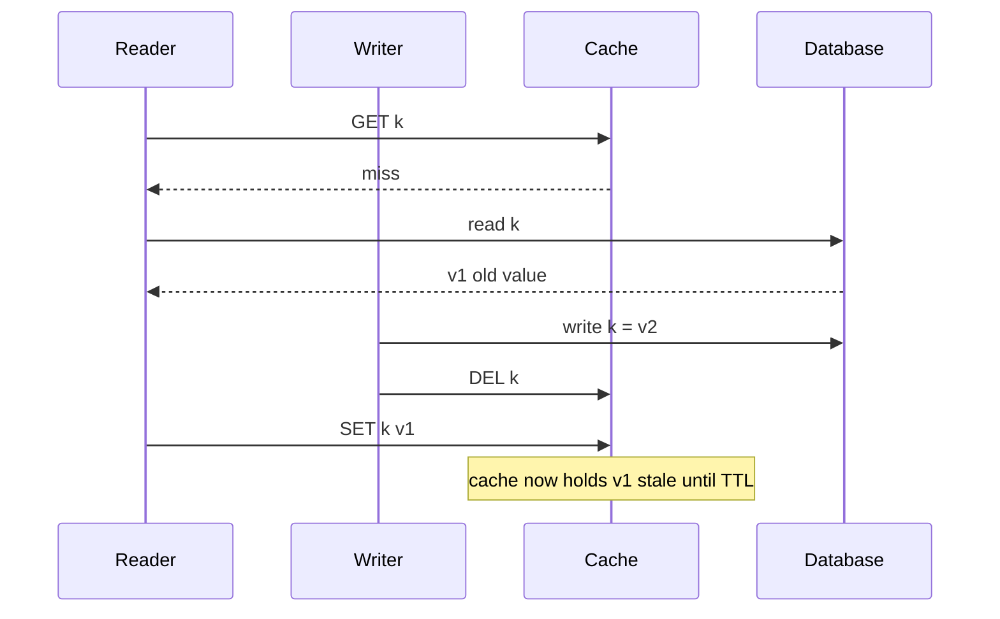
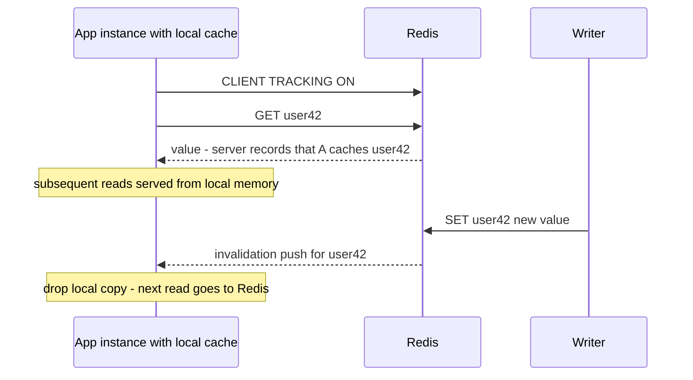

# Cache Invalidation

"There are only two hard things in Computer Science: cache invalidation and naming things" — the Phil Karlton quip survives because it is true in a precise way. The moment you copy data out of its source of truth, you own the problem of making the copy disappear when the truth changes, and doing that *correctly, atomically, across every write path, under concurrency and partial failure* is genuinely unsolvable in general — only manageable. This note explains why, surveys the three invalidation styles (TTL, explicit, event-driven), and is honest about the races each one leaves open.

## Why this matters

Every cached byte is a potential lie, and invalidation is your only tool for bounding how long the lie lives. Unlike most bugs, stale-cache bugs are **invisible in testing** (single user, no concurrency, cache usually cold) and **intermittent in production** (they need a write to race a read). They surface as "customer saw their old address after updating it," which support tickets, not dashboards, discover. In a regulated fintech context, a stale read can be a compliance event — a KYC status that stayed "verified" in cache after being revoked in the database is not a UX bug. Understanding exactly which windows each invalidation scheme leaves open is the difference between a bounded, documented risk and a latent incident.

### Why it's famously hard — the actual reasons

1. **No atomicity across systems.** The database write and the cache operation are two calls to two systems; no transaction spans them. One can succeed while the other fails, times out, or lands after a reorder. This is the same **dual-write problem** that motivates [[The Outbox Pattern]].
2. **Concurrency reorders everything.** Even when both operations succeed, a concurrent reader can interleave between them and resurrect old data (the race below).
3. **Write paths multiply.** Invalidation logic must live beside *every* code path that mutates the data — the service's API, the admin tool, the batch job, the DBA's manual fix. Miss one and that path produces permanent staleness.
4. **Derived data fans out.** One row may feed ten cache keys (the entity, three list views, an aggregate, a search result). Knowing *what* to invalidate is itself a dependency-tracking problem.

## How it works

### Strategy 1 — TTL-based (passive)

Give every key a time-to-live; staleness is bounded by the TTL, no invalidation code at all. This is the baseline and the **backstop every other scheme still needs** (see [[Cache Eviction Policies]] for choosing TTLs). Cost: average staleness ≈ TTL/2 for a change landing at a random point in the cached lifetime (up to the full TTL for one that lands right after caching), and the shorter you make the TTL to reduce staleness, the more you pay in misses — and synchronized expiry invites [[Cache Stampede and Thundering Herd]].

### Strategy 2 — Explicit invalidation (active, in-line)

The writer deletes (or overwrites) the cache key as part of the write path: *update DB, then DEL key* — standard cache-aside ([[Caching Strategies]]). Staleness window shrinks from TTL-scale to milliseconds. But two races survive:

**The read-populate race** (the famous one):



The reader fetched v1 *before* the write committed but populated the cache *after* the writer's DEL. The cache holds v1 until TTL expiry or the next write. The window requires a miss, a concurrent write, and a slow reader — rare, but at millions of requests it happens daily.

**The order question** — DEL-then-write vs write-then-DEL: delete the cache *before* the DB write and any reader in the gap repopulates the old value immediately (a much wider race). Write-then-delete is the right default; its residual race is the narrow one above. (Updating the cache with the new value instead of deleting re-introduces a writer-vs-writer ordering race — covered in [[Caching Strategies]].)

**Delayed double delete** patches the narrow race: write DB → DEL key → wait a short delay (longer than a read round trip, e.g. 500 ms) → DEL again, asynchronously. The second delete sweeps away any stale populate from an in-flight reader. Its honest limits: the delay is a guess (a reader slower than it still loses), the second delete can itself fail, and it adds a queue/scheduler to every write path. It reduces probability; it proves nothing. TTL remains the backstop.

### Strategy 3 — Event-driven invalidation (active, out-of-band)

Decouple invalidation from write paths: something observes committed changes and invalidates subscribers' caches. The gold standard source is **[[Change Data Capture]]** — tail the database's own replication log (Debezium-style), so *every* write path is captured, including the admin tool and the DBA's console. Events flow through a log/queue ([[Message Queues vs Event Logs]], your future [[Redis Streams]]) to a consumer that DELs the affected keys.

Properties: write paths can't forget (the log sees everything); invalidation is retryable because the event is durable; but it is **asynchronous** — there is an inherent stale window equal to CDC pipeline lag (typically tens of ms, unbounded during pipeline incidents — monitor it like replication lag). Consumers must map table rows to cache keys, which resurrects the fan-out problem in one place (better) rather than every write path (worse).

### Strategy 4 — Versioned keys (sidestep invalidation entirely)

Never mutate or delete: change the *key* instead. Store a version (or hash/timestamp) with the entity; cache under `user:42:v17`. Writers bump the version; readers look up the current version, then fetch the versioned key. Old versions become garbage that TTL/eviction collects — no invalidation race exists because stale keys are simply never asked for again.

The catch: readers must learn the current version cheaply, which either means another lookup (often itself cached — turtles) or a version embedded in something the reader already has. Where it shines with no catch at all: **immutable-content URLs** — `app.v2026-10-01.js`, content-hashed assets behind a [[CDN]] — the canonical solution to CDN invalidation, which is otherwise slow purge APIs and prayer.

### Strategy 5 — Server-assisted invalidation for local caches

The strategies above assume one shared cache. The moment you put a per-instance L1 cache in front of Redis — Caffeine in each JVM, the standard fix for a [[Hot Key Problem|hot key]] — you have created a *second* invalidation problem, in the layer closest to the user and the hardest to reach from a writer that doesn't know which instances cached what.

Redis 6 added a mechanism for exactly this: **client-side caching via tracking**. A client issues `CLIENT TRACKING ON`; from then on the server remembers which keys that connection has read, and when one of them is modified, expires, or is evicted, it pushes an **invalidation message** to that client, which drops its local copy. Over RESP3 the push arrives on the same connection; RESP2 clients get the same thing by redirecting invalidations to a pub/sub connection (`REDIRECT <client-id>`).



Two modes, with a real trade between them. **Default mode** keeps a server-side invalidation table of key → interested clients: precise, so a client is told only about keys it actually holds, at the cost of server memory proportional to the tracked keyspace. **Broadcasting mode** (`BCAST` with one or more `PREFIX` arguments) keeps no per-key state at all — the server simply broadcasts invalidations for every key matching the registered prefixes — which costs nothing to track but tells clients about keys they never cached. Choose default mode for a large keyspace with small per-client working sets, broadcasting for a small, well-prefixed set of hot keys that everyone caches.

Honest limits, consistent with the rest of this note: delivery rides a connection, so a dropped or re-established connection means missed invalidations — a correct client **flushes its local cache on reconnect** — and the push is asynchronous, so a narrow window of local staleness always remains. It is a very good accelerator, not a consistency guarantee. Give the local cache a short TTL anyway.

### Comparison

| Scheme | Staleness window | Write-path coupling | Catches all write paths? | Failure behaviour |
|---|---|---|---|---|
| TTL only | up to TTL | none | yes (trivially) | degrades gracefully |
| Explicit DEL | ms, + rare race until TTL | every write path | **no — only the ones you remembered** | DEL failure = stale until TTL |
| Delayed double delete | narrower race | every write path + async step | no | second DEL failure = same as above |
| CDC / event-driven | pipeline lag (ms–s) | none | **yes** | pipeline down = staleness grows, measurable |
| Versioned keys | ~zero for new readers | version bump on write | yes if version is authoritative | garbage accumulates; version lookup is the new hot path |
| Redis tracking (L1 only) | push latency | none (server-side) | yes for writes through that Redis | missed pushes on disconnect — flush L1 on reconnect |

In practice mature systems **layer** them: explicit DEL for immediacy, CDC as the catch-all, TTL as the final backstop.

### Knowing *what* to invalidate

Reason 4 above — derived data fans out — is the part no mechanism solves for you. One changed row may back the entity key, three list views, an aggregate, and a search result; `DEL user:42` leaves the other four stale. Two patterns make the fan-out tractable:

- **Namespace versioning.** Keep a version integer per entity (`ver:user:42`) and embed it in every derived key: `user:42:v17:profile`, `user:42:v17:orders`. A writer does one `INCR` and the entire family becomes unreachable at once — no enumeration, no missed key, no race, because nothing is deleted. Old entries are garbage that eviction and TTL collect ([[Cache Eviction Policies]]). The cost is an extra lookup for the current version on every read, which you will want to cache locally, which re-opens a small staleness window on the version itself. It is a very good trade when a family has many members.
- **Tag sets.** Record the dependency explicitly: when you populate `orders:42`, also `SADD tag:user:42 orders:42`. On change, read the set and `UNLINK` its members. This handles arbitrary many-to-many dependencies that versioning can't express. The sharp edge is that **the tag set is itself a cache key** — if it is evicted, its members survive as orphaned stale entries that nothing will ever invalidate. Tag sets belong on an instance or policy where they cannot be evicted, and they need their own TTL hygiene or they grow forever.

### Negative caching carries its own obligation

Caching *misses* — storing a "not found" marker so repeated lookups for a non-existent id don't hammer the database — is a standard defence against lookup floods for ids that will never resolve. It also quietly creates an invalidation duty that teams forget: **when the entity is finally created, the negative entry must go**, or a user who just registered gets told they don't exist for the rest of the TTL. Keep negative TTLs much shorter than positive ones (seconds, not minutes), and make entity-creation paths delete the negative key explicitly — it is the single most commonly missed write path in this whole note.

### How stale, in numbers

"Sixty seconds of staleness" sounds harmless until you multiply it by traffic. For a TTL-only scheme, a value changed at a uniformly random moment in its cached lifetime is stale for an expected `TTL / 2`, so:

```
expected stale responses per write = read_rate × TTL / 2
```

A product page read 200×/s behind a 60 s TTL serves roughly **6,000 stale responses per price change** on average, and up to 12,000 in the worst case. That is the number to bring to the conversation about whether 60 seconds is acceptable — not the seconds, which nobody can feel. The same arithmetic reframes delete-on-write: it collapses the window from tens of seconds to the DEL round trip, which is why it is worth the coupling even though it leaves the read-populate race open. And it explains why CDC lag deserves a dashboard: your staleness exposure is directly proportional to it.

### Detecting staleness before your users do

Stale-cache bugs do not raise errors, so nothing finds them unless you build the finder:

- **A staleness canary.** A low-rate background job samples cached keys, re-reads the source of truth, compares, and emits a counter labelled by key family. This converts the single most invisible bug class in caching into a graph with a non-zero line on it. It is a day of work and it pays for itself the first time.
- **Loud invalidation failures.** A `DEL` that times out and gets logged-and-swallowed is a permanent staleness bug with a paper trail nobody reads. Count invalidation failures as a metric, alert on any sustained rate, and retry them out-of-band.
- **A write-path inventory.** For each cached collection, enumerate every code path that mutates it — service endpoints, batch jobs, admin tools, other services — and assert each one invalidates. The paths you cannot enumerate are the argument for CDC.
- **CDC lag as a first-class SLI.** Treat it exactly like replication lag: graphed, alerted, and understood as "this is how stale we currently are."
- **Log the key on populate and on evict.** The "reads cache under one key shape, evicts another" bug is trivially found this way and nearly invisible otherwise.

## Common misconceptions

- **"We invalidate on write, so our cache is consistent."** No scheme above gives consistency; they bound staleness. The read-populate race, DEL failures, and CDC lag all leave windows. If a read must be correct, read the source of truth.
- **"Double delete fixes the race."** It shrinks a probability. Any reader slower than the delay still loses; the pattern is a mitigation with a tunable, not a proof.
- **"CDC invalidation means we don't need TTLs."** The CDC pipeline is itself a distributed system that lags and breaks. TTL is the only bound that holds when everything else fails; keep it.
- **"Invalidate = evict."** Different problems: invalidation is about *freshness* (truth changed), eviction ([[Cache Eviction Policies]]) is about *memory pressure*. Conflating them leads to "we set maxmemory-policy, so staleness is handled," which is a category error.

## In your stack

- Your Spring `@CacheEvict` annotations are Strategy 2 — audit whether *every* MongoDB write path for a cached collection carries one, including batch jobs and admin endpoints. The ones without it are permanent-staleness bugs waiting for a support ticket.
- MongoDB change streams are your native CDC hook: a small consumer watching change streams and DELing Redis keys gives you Strategy 3 without deploying Debezium/Kafka. The planned [[Redis Streams]] move gives that consumer a durable transport with replay ([[Change Data Capture]]).
- Fintech rule of thumb worth writing down: cached regulated state (KYC flags, limits, account status) gets **both** event-driven invalidation **and** a short TTL, and anything feeding a money-movement decision reads the source of truth, full stop.
- CloudFront in front of your APIs: for static assets use versioned/hashed URLs, never purges; for API responses keep CDN TTLs at seconds or zero, because purge propagation is too slow to be an invalidation mechanism.
- If you build the change-streams consumer, **persist the resume token**. A consumer that restarts without one resumes from "now" and silently skips every change that happened while it was down — which turns your catch-all invalidation mechanism back into best-effort signalling, with none of the loudness of a pub/sub message you can see being dropped.
- Services at 1 replica make L1 invalidation deceptively easy — one JVM means one local cache, so a Caffeine entry and a Redis tracking subscription have exactly one holder. The honest flip side is that there is no partial degradation: when that single instance misses an invalidation push, 100% of the service's reads are stale until the local TTL expires, rather than a fraction of them. Keep L1 TTLs in the low seconds for anything customer-visible, and flush the local cache on Redis reconnect rather than assuming the push stream was continuous.
- Negative caching deserves an explicit policy in a KYC-shaped domain: a "customer not found" or "no document on file" marker that outlives the moment the record appears turns into a support ticket about onboarding, and occasionally into a compliance conversation. Short negative TTLs, and an explicit delete of the negative key on every create path.

## Interview angle

The 60-second version: *"Invalidation is hard because the DB write and cache operation can't be atomic, concurrency can reorder them, and invalidation logic must cover every write path. Three tools: TTLs bound staleness passively and are the universal backstop; explicit delete-on-write shrinks the window to milliseconds but leaves the read-populate race — a reader that fetched old data before a write can repopulate the cache after the writer's delete — which delayed double-delete mitigates but can't eliminate; event-driven invalidation via CDC catches every write path by tailing the DB log at the cost of pipeline lag. Versioned keys sidestep the whole problem by never reusing a key — that's how CDNs do it with hashed asset URLs. Mature systems layer all three."*

Classic follow-ups: "Walk me through the race in delete-on-write cache-aside" (draw the sequence above — this is *the* caching interview question). "Why delete after the DB write rather than before?" (before-write leaves a wide gap where any reader re-caches old data). "How would you invalidate caches in 50 services when one table changes?" (CDC → event bus → each service owns its key mapping).

## Check yourself

> [!question]- Q: Explain why cache invalidation can't be fully solved, only bounded, in a standard cache-aside setup.
> The cache and database are separate systems with no shared transaction, so write-DB and delete-key are two operations that can interleave with reads and fail independently. A reader can read old data from the DB before a write commits and populate the cache after the writer's delete — no ordering of two non-atomic operations eliminates this. You can shrink the window (double delete), move detection out-of-band (CDC), or sidestep reuse (versioned keys), but each leaves either a window or a new dependency. TTL is the only absolute bound, and it is a bound, not a fix.

> [!question]- Q: Scenario — users report seeing old KYC status for up to an hour after re-verification. The code does cacheEvict after every Mongo update, and the TTL is one hour. List the plausible causes in order of likelihood.
> (1) A write path without the evict — a batch re-verification job, admin console, or another service writing the same collection; the TTL (1h) exactly matches the max observed staleness, which smells like evict-never-fired. (2) Evict failures being swallowed — Redis timeout during DEL, exception caught and logged, write proceeds. (3) The read-populate race — it too pins the stale value for a full TTL counted from the bad populate, but it needs a read to straddle the write, so it explains occasional reports rather than a steady pattern. (4) Wrong key derivation — evicting `kyc:{userId}` while reads cache under a composite key. Fix order: inventory write paths, make DEL failures loud/retryable, then shorten TTL for regulated state regardless.

> [!question]- Q: What does event-driven CDC invalidation give you that explicit delete-on-write cannot, and what new failure does it introduce?
> Coverage: CDC tails the database's own change log, so every write path — services, admin tools, manual DBA fixes — produces an invalidation event; nothing depends on developers remembering. Durability: events can be retried after consumer crashes. New failure: the pipeline is asynchronous and can lag or stop — staleness becomes a function of pipeline health, so you must monitor CDC lag like replication lag, and you still keep TTLs for the day the pipeline is down.

> [!question]- Q: Scenario — a handful of users each week report "account not found" for several minutes immediately after signing up, and it only happens to people who checked the app during onboarding. Everything looks correct in MongoDB. What is going on, and what is the fix?
> A negative cache entry. The pre-signup lookup (or the user's own impatient check) found no record and cached a "not found" marker under the account key; the create path wrote the document to Mongo and invalidated the *positive* key shape, which did not exist, while leaving the negative marker in place until its TTL. Everyone who never looked before signing up is unaffected, which is why it is rare and reproducible only by accident. Fixes, in order: make every entity-creation path delete the negative key explicitly — it is a write path like any other and belongs in the write-path inventory; cut the negative TTL to a few seconds, since its job is absorbing lookup floods, not caching facts; and make sure the negative and positive entries share one key so a single invalidation covers both rather than two shapes that can disagree. The general lesson: a cached *absence* is a cached value with exactly the same invalidation obligations, and it is the one everyone forgets.

> [!question]- Q: Mini design — product images and prices on an e-commerce page: images change rarely but must update instantly when they do; prices change often and can be ~30 s stale. Design the caching/invalidation for both.
> Images: versioned/content-hashed URLs (`img/abc123.jpg`) cached at the CDN with effectively infinite TTL; a change produces a *new URL* referenced by the page — instant "invalidation" with zero purge calls. Prices: cache-aside in Redis with TTL ~30 s plus delete-on-write from the pricing service; no CDN caching of the price API (or TTL of a few seconds). If price writes come from multiple systems, add CDC-driven invalidation and keep the 30 s TTL as backstop.

## Sources

- Phil Karlton (attributed), the "two hard things" aphorism — popularized via Martin Fowler's "TwoHardThings" bliki page, which collects its variants.
- "Scaling Memcache at Facebook" (NSDI 2013) — delete-on-write at scale, the stale-set race, and leases as the production-grade mitigation.
- *Designing Data-Intensive Applications*, Kleppmann — Ch. 5 (replication lag anomalies, the same staleness reasoning) and Ch. 11 (CDC and keeping derived data in sync).
- Debezium documentation — CDC-based cache invalidation as a first-class use case.
- Redis documentation — "Client-side caching in Redis" (`CLIENT TRACKING`, RESP3 invalidation push, default vs broadcasting mode, RESP2 redirection), redis.io.
- MongoDB documentation — change streams and resume tokens, the native CDC hook behind event-driven invalidation on a Mongo-backed stack.
- RFC 9111 (HTTP Caching) — the TTL/validation model used by browsers and CDNs.
