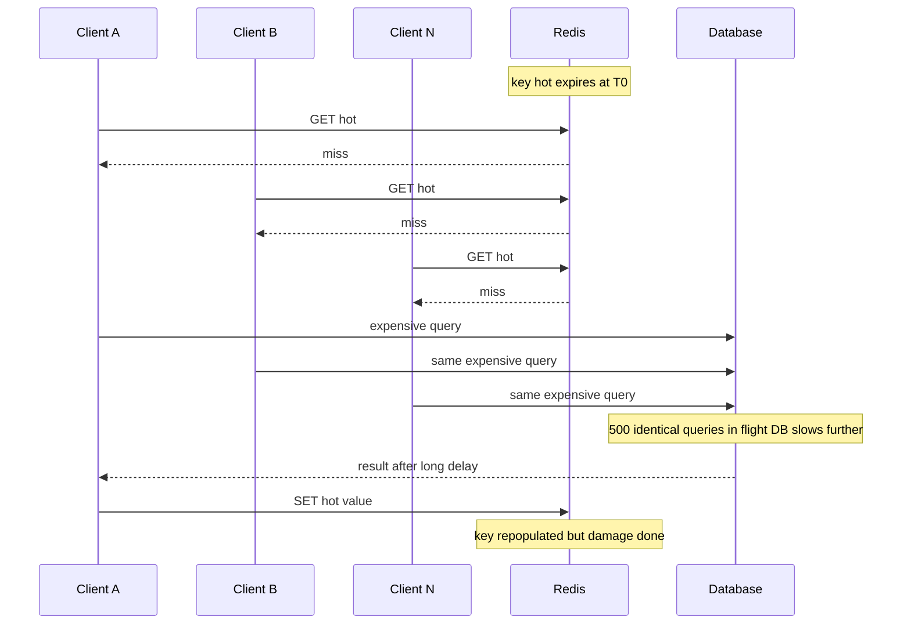

# Cache Stampede and Thundering Herd

A cache protects your database from the traffic it could never survive alone — right up until one hot key expires, and every request that would have hit the cache arrives at the database at once. That is a **cache stampede** (also "dogpile effect"): the cache's protection vanishes for exactly the keys and moments where it was doing the most work. The cruel part is self-amplification: the database slows under the surge, so recomputation takes longer, so more requests pile up behind the still-missing key. This note covers how stampedes start, why cold starts are the worst case, and the four standard mitigations.

## Why this matters

Stampedes convert a routine event — a TTL expiring, a deploy, a cache restart — into an outage, and they specifically punish **successful** systems: the higher your hit ratio and traffic, the larger the herd behind each miss. Recall from [[Why Caching Works]] that DB load scales with miss rate; a stampede is a step-function spike in miss rate on your hottest keys. A database provisioned for 1% of read traffic (because the cache absorbs 99%) can receive 50–100× its normal load for the duration of the pileup. Every mature caching layer — Facebook's memcache tier, every CDN, Guava/Caffeine in-process caches — has stampede protection built in, which tells you how universal the problem is.

The **thundering herd** is the same shape generalized: many waiters released at once toward one resource. The term comes from OS scheduling (many processes woken for one socket event); in distributed systems it covers cache expiry herds, reconnect storms after a broker restart, and retry storms after a timeout ([[Timeouts Retries and Exponential Backoff]]).

## How it works

### Anatomy of an expiry stampede

Precondition: a hot key (requested, say, 1,000×/s), an expensive recomputation (a 500 ms aggregate query), and simple [[Caching Strategies|cache-aside]] with TTL.



During the 500 ms recomputation window, ~500 requests miss and each independently runs the same query. The DB, hit by hundreds of identical expensive queries, slows; recomputation now takes 2 s; the herd quadruples. In the worst case the system enters a **metastable failure**: even after the key repopulates, queued work and retries keep the DB saturated ([[Failure Modes in Distributed Systems]]).

### The arithmetic, with your actual connection pool

The herd's size is just **arrival rate × recompute duration**: 1,000 req/s × 0.5 s = **500** simultaneous executions of the same query. What turns that number into an outage is the next constraint down, which is almost never the database's CPU — it is the connection pool. The MongoDB Java driver's default `maxPoolSize` is **100**, so of those 500 callers, 100 get a connection and 400 queue.

Follow it through, using nothing but those three numbers:

| Wave | Requests needing the DB | Connections | Time to drain at 0.5 s per query | Arrivals during that drain |
|---|---|---|---|---|
| 1 | 500 | 100 | 500 ÷ 100 × 0.5 s = **2.5 s** | 1,000/s × 2.5 s = 2,500 |
| 2 | 2,500 | 100 | 2,500 ÷ 100 × 0.5 s = **12.5 s** | 12,500 |
| 3 | 12,500 | 100 | 12,500 ÷ 100 × 0.5 s = **62.5 s** | 62,500 |

This diverges, and the condition for divergence is a single comparison you can do on a whiteboard. The pool's **drain rate** is `pool_size ÷ recompute_time` = 100 ÷ 0.5 s = **200 requests/s**. Arrivals are 1,000/s. Because 200 < 1,000, every wave is larger than the one before it and the system never catches up on its own — this is the precise mechanism behind the loose phrase "self-amplifying". It also explains the shape operators report: the incident does not peak and recover, it widens, and it keeps widening after the original key has long since been repopulated, because the backlog is now the cause.

Three levers exist and only one of them is bounded. Reducing `d` (a faster query) helps linearly. Raising `maxPoolSize` raises the drain rate linearly too — and hands the database the concurrency that was being usefully queued, usually converting a pool-wait problem into a database problem. **Collapsing the herd to 1** makes the comparison irrelevant: one query, 0.5 s, independent of arrival rate. That asymmetry is why coalescing is the mitigation of first resort for expensive recomputes, and why the other three mitigations are best understood as cheaper ways of reaching the same bound.

### Cold-start stampedes — the worse cousin

Expiry stampedes hit one key; a **cold cache** stampedes on *every* key simultaneously: a Redis restart/failover that loses data, a cache flush, a new region coming online, or a deploy that changes key prefixes (an underrated self-inflicted classic — every key "misses" because its name changed). At a 99% pre-incident hit ratio, the DB instantly receives ~100× its provisioned read load. Mitigations differ from the single-key case: **cache warming** (replay recent hot keys before taking traffic), gradual traffic ramp, replica-backed caches that survive restarts ([[Redis Cluster and Sentinel]], [[Redis Internals]] persistence), and — bluntly — a DB with enough headroom to survive a few minutes of pain ([[Load Shedding and Graceful Degradation]] as the last line).

### Mitigation 1 — Request coalescing / single-flight

Only one caller recomputes; everyone else waits for that result or serves stale. Implementations:

- **In-process:** Caffeine/Guava `LoadingCache` does this per JVM automatically — concurrent `get(key)` calls for a loading key block on one load. Go's `singleflight` package is the same idea by name.
- **Distributed:** the first miss acquires a short-TTL mutex (`SET lock:hot <token> NX PX 3000` — see [[Distributed Locking]] for doing this right); the winner recomputes and populates; losers either wait-and-retry the cache briefly or serve the previous stale value.
- **Leases (the memcache paper's variant):** the cache itself hands the first misser a lease token granting the right to populate; subsequent missers are told "someone's on it" and wait or serve stale. Facebook reported this collapsed peak DB query rates dramatically.

Coalescing is the only mitigation that bounds the herd at **exactly 1** recomputation. Cost: a lock/lease mechanism on the hot path, and waiters add latency (or staleness, if they serve old data).

The distributed version is short, and one line in it is the line everyone leaves out:

```java
String value = redis.get(key);
if (value != null) return value;                                    // 1. ordinary hit

String token = UUID.randomUUID().toString();
Boolean won = redis.setIfAbsent(lockKey, token, Duration.ofSeconds(3));
if (Boolean.TRUE.equals(won)) {                                     // 2. I won the race
    try {
        value = redis.get(key);                                     // 3. DOUBLE-CHECK
        if (value == null) {
            value = loadFromMongo(key);
            redis.set(key, value, baseTtl.plus(jitter()));
        }
    } finally {
        redis.execute(RELEASE_SCRIPT, List.of(lockKey), token);     // token-checked Lua
    }
    return value;
}
return pollCacheWithBackoffOrServeStale(key, deadline);             // 4. I lost the race
```

**Step 3 is the whole point.** Picture the common naive variant where losers *block waiting for the lock* instead of returning at line 4. Without the re-read, the 499 callers queued behind the winner each acquire the lock in turn, find `value` still null in their own stale local variable, and run the query again — even though the key was repopulated half a second in. You have converted 500 parallel queries into 500 *sequential* ones. The database stops melting, because its concurrency is now 1; total origin work is unchanged; and total elapsed time becomes 500 × 0.5 s = **250 seconds**, every second of which is a user waiting. The double-check is what makes the lock a coalescer rather than a serialiser.

Two more details decide whether this helps or hurts:

- **Losers must not block on the lock.** They poll the *value* key with capped, jittered backoff under an overall deadline, or immediately serve stale. A loop that hammers `SETNX` on one key at 1,000/s creates a [[Hot Key Problem|hot key]] inside the mitigation for a hot key, and on a single-threaded Redis that is real contention ([[Redis Internals]]).
- **This is an efficiency lock, in the precise sense of [[Distributed Locking]].** Nothing is corrupted if two holders slip through — you get two queries instead of one. That is why a plain single-node `SET NX PX` with a token and a Lua release is exactly the right tool here and Redlock would be absurd; and why the lock TTL should be *short* (a little above the expected recompute), since the cost of expiring early is one redundant query, while the cost of a long TTL after a loader crash is a cold key nobody is allowed to fill.

### Mitigation 2 — Jittered TTLs

Many keys populated together (deploy, batch load) expire together, creating a scheduled mass-miss. Add randomness: `TTL = base + random(0, 0.1 × base)`. Costs nothing, removes only the *synchronized* expiry pattern — does nothing for a single hot key's expiry. It should be your default everywhere regardless ([[Cache Eviction Policies]]).

### Mitigation 3 — Stale-while-revalidate

Serve the expired value immediately; refresh in the background. One request (or a background task) recomputes; nobody waits. Formalized for HTTP in **RFC 5861** (`stale-while-revalidate` Cache-Control extension, honored by CDNs); in Redis terms: store a *logical* expiry inside the value while the key's real TTL is much longer — readers past logical expiry trigger an async refresh (ideally coalesced) and return the stale value.

Concretely in Redis, that means **two expiries per entry, not one**. Store `{ value, softExpiryEpochMs }` as the cached object, and set the key's real TTL to the soft expiry **plus a grace window**:

- `now < softExpiry` → fresh; return it.
- `now ≥ softExpiry` and the key is still present → return the value *immediately*, and trigger a background refresh behind the single-flight lock above. Nobody waits.
- key absent → the grace window was exhausted (or the key was evicted), and you are back to an ordinary synchronous miss with a full herd.

The grace window is therefore the parameter that matters, and it must comfortably exceed your worst-case recompute plus however long your origin might be unavailable — a 30-second grace on a query whose p99.9 is 8 seconds is a stampede waiting for a bad minute at the database.

Cost: bounded extra staleness, and the data must tolerate it. This is the highest-leverage pattern for read-heavy, staleness-tolerant data because it decouples user latency from recomputation entirely — the origin recomputes once per refresh period no matter the traffic.

### Mitigation 4 — Probabilistic early expiration

Each reader, on each hit, *might* voluntarily recompute early — with probability rising steeply as expiry approaches, scaled by how long recomputation takes. The standard formulation (Vattani, Chierichetti, Lowenstein, "Optimal Probabilistic Cache Stampede Prevention", VLDB 2015, "XFetch") refreshes when:

```
now − delta × beta × ln(rand01) ≥ expiry
```

where `delta` is the measured recomputation time and `beta` ≈ 1. Because `ln(rand)` is negative, each reader jumps a random distance ahead of its clock; the hotter the key, the more lottery tickets, so hot keys reliably refresh *before* expiring — with no coordination, no locks, no extra infrastructure. Cold keys may still expire and miss, which is fine: no herd exists for them. Cost: a small rate of unnecessary early recomputations.

### Choosing

| Mitigation | Herd size becomes | Staleness added | Infra needed | Best for |
|---|---|---|---|---|
| Coalescing / single-flight | 1 | none (waiters block) or some (serve-stale losers) | lock/lease or loader cache | expensive recomputes, correctness-leaning data |
| Jittered TTL | unchanged per key; de-synchronized across keys | none | none | always, as hygiene |
| Stale-while-revalidate | ~1 per refresh period | bounded, explicit | background refresh path | hot, staleness-tolerant reads |
| Probabilistic early expiry | ~1, probabilistically | none (refresh before expiry) | none — pure math | hot keys, minimal-moving-parts teams |

These compose: jitter everywhere + XFetch or SWR on hot keys + single-flight at the loader is a sensible full stack.

## Common misconceptions

- **"Our hit ratio is 99.9%, stampedes aren't our problem."** Backwards — the higher the hit ratio, the bigger the herd hiding behind each hot-key miss, and the less DB headroom you've kept.
- **"Longer TTLs fix it."** They make expiry rarer but each one worse, and they widen your staleness window ([[Cache Invalidation]]). The herd needs to be *bounded*, not postponed.
- **"The stampede is over when the key repopulates."** The queued requests, held connections, and triggered retries can keep the DB saturated after the cause is gone — the metastable tail is often the majority of the incident.
- **"Thundering herd is just the cache thing."** It's any many-waiters-one-wakeup pattern: reconnect storms after broker failover, synchronized cron fleets, retry storms. The cache stampede is the most common instance, not the definition.

## Failure modes

Each mitigation brings failure modes of its own, and they are quieter than the stampede they prevent — which is the danger. The signal to watch is listed with each.

- **The serialised herd** (missing double-check, above). *Signal:* origin query count during a miss event is roughly equal to the herd size rather than 1, but the queries arrive *sequentially* instead of in parallel — so database concurrency and database latency both look healthy while the endpoint's p99 is multiplied by the herd size. *Confirm:* count origin executions per cache key per miss event; the correct number is 1.
- **Loser polling becomes its own herd.** *Signal:* Redis ops/sec concentrated on one key, or on one lock key, far exceeding the request rate for the data it guards. *Confirm:* `redis-cli --hotkeys`, or simply compare lock-attempt count against successful-acquisition count — a ratio in the hundreds means your waiters are busy-waiting.
- **Stale-while-revalidate masks a dead origin indefinitely.** This is the quiet one. If the background refresh keeps failing, latency stays excellent, error rate stays at zero, the hit ratio stays at 100%, and you serve steadily older data while every dashboard reports health. *Signal:* you must instrument two things that hit-ratio dashboards do not show — **refresh failure count** and the **age distribution of served values** (how far past soft expiry each read was). *Confirm:* alert on value age exceeding a stated freshness budget, not on errors. In a fintech context this is the incident that is hardest to explain afterwards, because "the system was serving yesterday's data and nothing alerted" is a monitoring failure rather than an availability one.
- **Mis-measured `delta` in probabilistic early expiry.** The XFetch formula scales the early-refresh window by the measured recompute time. Record it from one unusually fast run and the window is too narrow, so the key expires anyway and the herd returns; record it from one unusually slow run and every reader starts refreshing far too early, multiplying origin load for no freshness benefit. *Signal:* early-refresh rate per key that is either near zero or far above one per recompute period. *Fix:* keep `delta` as a smoothed or high-percentile estimate rather than the last observation.
- **The warm job stampedes on behalf of everyone.** A cold-start warmer that loads the top 10,000 keys as fast as it can is itself a herd, just one you scheduled. *Signal:* origin saturation during warm-up with zero user traffic involved. *Fix:* rate-limit the warmer and ramp user traffic behind it, rather than racing the two.
- **Jittered TTLs with an un-jittered writer.** Jitter on expiry does nothing if the *populate* is synchronised: a nightly job that writes every key at 02:00 with TTL `24 h ± 10 min` still produces a 20-minute expiry cluster tomorrow. *Signal:* miss-rate spikes that are narrower than before but still clock-aligned. *Fix:* jitter proportional to the TTL, and prefer refresh-ahead so keys are overwritten before they lapse.

## In your stack

- Caffeine in front of Redis in your Spring services gives you per-JVM coalescing for free — with replicas pinned at 1, a single JVM *is* the fleet for that service, so in-process single-flight alone may fully bound your herd. That's an honest silver lining of the 1-replica cost decision.
- Your DB behind the cache is MongoDB: a stampede shows up as a connection-pool spike and queued operations. Check your Mongo connection pool limits against "what if the top 5 cache keys all miss at once."
- Deploys that change cache key prefixes (a renamed `@Cacheable` cache name, a serialization change) are self-inflicted cold starts. Treat cache-key formats as a public contract in code review.
- CloudFront honours the RFC 5861 `stale-while-revalidate` directive on cacheable GET responses, which is stampede protection before traffic ever reaches your services. Do not assume the same of the gateway: Kong's proxy-cache plugin is TTL-based, so confirm against its documentation whether your version implements RFC 5861 rather than inferring it from CloudFront's behaviour.
- **Check the pool numbers against the arithmetic above before anything else.** The MongoDB Java driver's `maxPoolSize` default of 100 and your per-pod `maxPoolSize` setting together define the drain rate for every service behind the cache. At one replica per service, that pool is the *entire* concurrency your service has against Mongo — there is no second pod's pool to spread the herd across, so the divergence comparison is computed on a single pool, not a fleet-wide one.
- **The 1-replica honesty cuts both ways.** In-process coalescing bounding your herd at 1 is genuine, and it stops the day a service scales to 2 replicas — at which point your herd quietly becomes 2 recomputes per key, then k. That is survivable; the real hazard is that nobody re-examines the cache design when the replica count changes, so write the assumption next to the Caffeine configuration. Against it: one pod means a stampede has no healthy sibling to serve from, so the pileup becomes that service's full outage rather than a degraded fraction of it, and a liveness probe failing mid-pileup restarts the JVM into a cold local cache — a second, self-inflicted cold start on top of the first.
- Redis itself is single-threaded ([[Redis Internals]]): during a cold-start stampede the *lock* traffic and the repopulating `SET`s compete for the same thread as every other service's commands. Size the warm-up ramp against Redis's command budget, not only Mongo's.
- For RBI-relevant reads, the stale-while-revalidate failure mode above is the one to design against deliberately: pick a maximum tolerable value age per key family, make it an alert, and make the code fail the read rather than serve past it. "We served stale balances for an hour and the latency graph was green" is not a defensible answer.

## Interview angle

The 60-second version: *"When a hot key expires, every concurrent request misses and recomputes — hundreds of identical expensive queries hit a DB provisioned for cache-filtered traffic, which slows it, which grows the herd. Four mitigations: single-flight/coalescing locks so exactly one caller recomputes — memcache leases are the famous version; TTL jitter so co-populated keys don't expire together; stale-while-revalidate, RFC 5861, serve the old value and refresh in background; and probabilistic early expiration — XFetch — where each hit may refresh early with probability rising near expiry, so hot keys renew before ever expiring, with zero coordination. Cold starts are the all-keys version; the answers there are warming, gradual ramp, and persistence/replicas."*

Classic follow-ups: "Exactly how does the lock variant handle the waiters?" (retry the cache with backoff, or serve stale — never busy-spin on the DB). "What if the lock holder crashes?" (lock has a TTL; next misser wins it — and see [[Distributed Locking]] for release-safety). "Design stampede protection with no new infrastructure" (jitter + XFetch — the no-moving-parts answer interviewers like).

## Check yourself

> [!question]- Q: Explain why a stampede is self-amplifying rather than a one-shot spike.
> The herd's size equals requests arriving during recomputation. The surge of identical queries slows the database, which lengthens recomputation, which extends the window, which grows the herd — a positive feedback loop. Add client timeouts firing and triggering retries, and load climbs further even with no new user demand. That's why stampedes can tip into metastable failure where the system stays down after the trigger has passed.

> [!question]- Q: Scenario — every morning at 09:00 your dashboard DB spikes to 40× load for two minutes. Caches use TTL 86400 set by a 09:00 nightly warm job. Diagnose and fix cheaply.
> All warmed keys share one expiry instant: 24 h after the 09:00 populate, the whole warmed set misses simultaneously — a scheduled, synchronized stampede. Cheapest fix: jitter the TTL (86400 + random up to ~2 h) so expiries spread. Better: have the warm job overwrite keys *before* expiry (refresh-ahead), so they never lapse; add stale-while-revalidate for the stragglers.

> [!question]- Q: Compare single-flight locking and probabilistic early expiration: when is each the wrong choice?
> Single-flight is wrong when you can't afford its moving parts or its waiters: it needs a distributed mutex (failure modes of its own — holder crash, lock TTL tuning), and losers either add latency (waiting) or staleness (serve-stale). It's also pointless for cheap recomputations. Probabilistic early expiry is wrong for *cold or lukewarm* keys (too few hits to win the refresh lottery before expiry — though no herd exists there either), and wrong when the value must never be recomputed redundantly (it's probabilistic — occasionally two readers refresh). For an expensive, correctness-sensitive recompute, lock; for hot tolerant reads, XFetch or SWR.

> [!question]- Q: Scenario — you shipped a single-flight lock around an expensive aggregate. The database stopped melting, which is what you wanted, but p99 on that endpoint went from 600 ms to 9 s and the database's query count during a miss event is unchanged. What did you build by mistake?
> A serialiser, not a coalescer. Two things went wrong together and the symptom needs both: losers **block waiting for the lock** instead of polling the value key, and the winner's path **omits the re-read of the cache after acquiring the lock**. Each waiter eventually wins the lock, finds its own local `value` variable still null, and runs the full query again even though the key has long since been populated. The queries now happen one at a time instead of all at once, so total origin work is unchanged — which is exactly what the query count is telling you — while total elapsed time is multiplied by the herd size, which is the latency. The database looks healthy because its concurrency is 1; the latency is the queue. Confirm by counting origin executions per cache key per miss event: the correct number is 1 and you will see roughly N. The fix is the double-check inside the lock, plus making losers poll the value key with capped jittered backoff under a deadline rather than queueing on the lock at all. One more thing to rule out while you are there: if losers block on acquisition with no deadline and the lock TTL is longer than the recompute, they wait out the TTL rather than the work — same latency symptom, different line of code.

> [!question]- Q: Mini design — your Redis loses all data on restart, hit ratio is 99%, and ops needs to restart it for an upgrade. Plan the restart without an outage.
> Options in order: (1) avoid the cold start — add a replica, replicate, promote it, upgrade the old node ([[Redis Cluster and Sentinel]]); (2) if restart-in-place is forced: enable persistence so the restart comes back warm ([[Redis Internals]]); (3) if it must come back empty: pre-warm by replaying the top-N hottest keys from access logs before re-admitting traffic, then ramp traffic gradually (weighted routing), with single-flight at the loaders bounding per-key herds and the DB connection pool capped so Mongo degrades by queueing rather than collapsing. Schedule in the lowest-traffic window and have [[Load Shedding and Graceful Degradation|load shedding]] ready.

## Sources

- "Scaling Memcache at Facebook" (NSDI 2013) — leases as stampede (stale-set + thundering-herd) protection in production.
- Vattani, Chierichetti, Lowenstein — "Optimal Probabilistic Cache Stampede Prevention" (PVLDB 2015) — the XFetch algorithm and its optimality proof.
- RFC 5861 — HTTP `stale-while-revalidate` and `stale-if-error` Cache-Control extensions.
- Caffeine documentation (`refreshAfterWrite` for refresh-ahead, coalesced loading in `LoadingCache`) and Go `golang.org/x/sync/singleflight` — reference implementations of coalescing.
- MongoDB Java driver documentation — connection pool settings (`maxPoolSize`, default 100), the constraint the arithmetic in this note turns on.
- *Designing Data-Intensive Applications*, Kleppmann — Ch. 1 on load and Ch. 8 on partial failure, the backdrop for metastable pileups.
