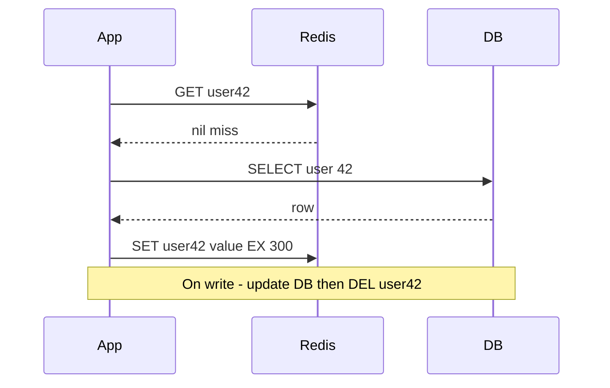

# Caching Strategies

Once you decide to cache ([[Why Caching Works]]), you must decide *who* puts data into the cache, *when*, and *what happens on writes*. Those three questions have five standard answers — cache-aside, read-through, write-through, write-behind, and write-around — and each one draws the consistency/durability/latency triangle differently. Most application teams use cache-aside without thinking about it; this note makes the choice conscious.

## The problem that created it

Picture a growing service: reads start hammering the database, so someone adds Redis. Immediately three design questions appear that "add Redis" didn't answer. First, on a read miss, who fetches from the DB and populates the cache — the application, or the cache layer itself? Second, on a write, do you update the cache, delete from it, or ignore it — and in what order relative to the DB write? Third, if the cache and DB are updated separately, what happens when one succeeds and the other fails? Teams that never answered these questions explicitly end up with caches that serve data deleted weeks ago, or lose writes when a node reboots. The five strategies are the named, well-understood answers.

## What it solves

- Gives every read and write path a **defined owner and ordering**, so cache/DB divergence is a bounded, understood window instead of an accident.
- Lets you pick where to spend: read latency, write latency, consistency, or durability — explicitly.
- Provides shared vocabulary: "we do cache-aside with a 5-minute TTL and delete-on-write" is a complete, reviewable policy in one sentence.

## How it works

### Cache-aside (lazy loading) — the default

The **application** owns all cache logic; the cache is a passive key-value store that never talks to the database.

Read: try cache; on miss, read DB, write result to cache with a TTL, return. Write: update the DB, then **delete** (not update) the cache key — the next read repopulates. Deleting is preferred to updating because writing the new value into the cache re-introduces a race (two concurrent writers can leave the cache holding the loser's value) and may cache data nobody will read.

Properties: the cache only ever holds data that was actually requested (memory-efficient under skew); a cache failure degrades to DB-only operation rather than breaking writes; every miss costs a full round trip plus a populate; and there is an unavoidable **stale window** plus a subtle race (a reader can read the DB just before a write commits and populate the cache just after the writer's DEL — see [[Cache Invalidation]] for the pattern and its patches).

### Read-through

Same lazy-loading shape, but the **cache layer itself** fetches from the database on a miss; the application only ever talks to the cache. This requires a cache that can run loader logic — Caffeine/Guava `LoadingCache` in-process, or a provider feature like DynamoDB Accelerator (DAX). Plain Redis does not natively read-through; your data-access library can simulate it (Spring's `@Cacheable` makes cache-aside *look* read-through to the calling code).

Advantage: the loader is written once, not scattered across call sites, and a good loader can coalesce concurrent misses for the same key into one DB query (single-flight — the in-process fix for [[Cache Stampede and Thundering Herd]]). Cost: the cache becomes a smart component on the critical path, and its failure can block reads entirely.

### Write-through

Every write goes **to the cache, which synchronously writes to the DB** before acknowledging (or the app writes both synchronously as one logical operation).

Properties: reads following writes always see fresh data in cache — the stale window disappears for written keys; write latency is the **sum** of cache + DB writes; and you pay to cache data that may never be read. Usually paired with read-through, and usually worth it only when read-after-write consistency from the cache matters more than write latency.

### Write-behind (write-back)

Writes go to the **cache only**, acknowledged immediately; the cache flushes to the database asynchronously — batched, coalesced, possibly seconds later.

Properties: the fastest writes of any strategy and the ability to absorb write bursts and collapse repeated writes to the same key into one DB write. The price is severe: **acknowledged writes live only in cache memory until flushed** — a crash loses them. Durability now depends on the cache's persistence and replication ([[Redis Internals]], [[Redis Cluster and Sentinel]]), which are weaker guarantees than a database's. The DB also becomes temporarily inconsistent with the cache, breaking anything else that reads the DB directly (reports, [[Change Data Capture]] pipelines). CPU write-back caches and some storage engines work this way; at the application tier it is rare and should be treated as an advanced, deliberate choice.

### Write-around

Writes go **to the DB only**, bypassing the cache (often combined with cache-aside reads, with or without an invalidating DEL). The cache fills only from read misses. Best when written data is unlikely to be read soon — append-heavy logs, bulk imports — because it avoids flooding the cache with cold entries and evicting the genuinely hot set.

### Comparison

| Strategy | Who loads on miss | Write path | Read-after-write from cache | Write latency | Risk of data loss | Typical use |
|---|---|---|---|---|---|---|
| Cache-aside | Application | DB, then DEL cache key | Stale window (bounded by TTL + race) | DB only | None added | Default for app teams |
| Read-through | Cache/loader layer | (pair with a write strategy) | Depends on write strategy | — | None added | Loader libraries, DAX |
| Write-through | Cache layer | Cache + DB, synchronous | Fresh | Slowest (sum) | None added | Read-heavy, consistency-sensitive |
| Write-behind | Cache layer | Cache now, DB async | Fresh (cache is ahead) | Fastest | **Yes — unflushed writes** | Write bursts, tolerable loss |
| Write-around | Application | DB only, cache bypassed | Stale until next miss-load | DB only | None added | Write-once/read-rarely data |

### Why cache-aside is the default

Cache-aside wins by being the strategy with the **fewest moving parts and the softest failure mode**: plain Redis needs no loader plumbing; the cache can be flushed at any time and the system keeps working (slower); a Redis outage degrades reads instead of corrupting writes; and it only caches what is actually read. Its real costs — the stale window and the populate race — are bounded by TTLs and usually acceptable. Teams reach for write-through/write-behind only when a measured problem (stale reads after writes; write latency) forces them.

### Choosing: four questions, in order

1. **Can this data be re-derived from the source of truth?** If no, the cache must never be the only copy — write-behind is off the table before any other consideration. This is the only question that eliminates a strategy outright rather than trading one cost against another.
2. **Must a writer immediately read its own write back from the cache?** If yes, either write-through for that key family, or route read-after-write traffic to the source of truth and leave the cache alone. If no, cache-aside's stale window is a number you get to choose ([[Read Your Own Writes and Replica Lag Anomalies]] is the same problem one layer down).
3. **Is written data likely to be read soon?** If no, write-around — otherwise a bulk import pushes the genuinely hot set out of memory to cache entries nobody will request ([[Cache Eviction Policies]]).
4. **How expensive is a miss, and how many arrive together?** Expensive and concurrent means the loader needs coalescing, which is the strongest practical argument for read-through: one loader in one place is something you can make single-flight, where cache-aside logic scattered across call sites is not ([[Cache Stampede and Thundering Herd]]).

The answers are **per key family, not per service**. Reference data, user profiles and money state inside one Spring Boot application will land on different strategies, and that is correct design rather than inconsistency — the mistake is having three strategies by accident instead of by decision.

### What a broken strategy actually looks like

It does not look like an outage. A service caches product configuration with `@Cacheable("productConfig")` and evicts it with `@CacheEvict` on the admin update endpoint. The contract holds perfectly for months, because the admin endpoint is the only writer.

Then a bulk-import job in a *different* service starts writing the same documents directly to MongoDB. Nothing fails. No alert exists for this, because no metric is wrong: Redis is healthy, the hit ratio is excellent, latency is flat, the error rate is zero. What arrives instead is a slow trickle of support tickets — "we changed the fee yesterday and the app still shows the old one" — and each one is closed as unreproducible, because by the time anyone looks, the TTL has lapsed and the value is correct again. The TTL is simultaneously the thing that keeps this survivable and the thing that makes it impossible to reproduce on demand.

The diagnostic move is to stop trying to reproduce and instead **compare the two stores directly**: sample N keys, read the cached value and the database document, and count divergences. A divergence probe turns an anecdote into a number in about an hour, and that number is the only evidence that will survive a review.

The root cause is structural rather than a bug in any line of code: cache-aside's correctness depends on *every* writer invalidating, and the set of writers is not visible from the caching code — there is no compiler, no test, and no runtime check that connects the two. The fixes, in increasing order of cost: state the TTL as the honest freshness contract and shorten it until the tolerance is real; funnel every write to that collection through one repository method that owns the eviction; or make invalidation follow the *data* rather than the code path, driven off MongoDB change streams ([[Change Data Capture]], [[Cache Invalidation]]).

## Trade-offs

| You gain | You pay |
|---|---|
| A defined consistency contract per key family | Still only *eventual* agreement between cache and DB in all async variants |
| Freedom to tune per use case (TTL here, write-through there) | Two code paths (hit/miss) that both need tests; miss path bugs hide behind high hit ratios |
| Graceful degradation (cache-aside/write-around) | Dual-write problem: cache and DB updates are not atomic; any strategy that touches both can half-fail ([[The Outbox Pattern]] is the general cure for dual writes) |
| Write absorption (write-behind) | Durability moved onto cache infrastructure (write-behind) |

## Failure modes

- **The populate race (cache-aside).** The exact interleaving, which is worth being able to recite because every patch for it is judged against this timeline:
  1. Reader R gets a miss on `user:42` and issues the database read.
  2. R's read returns the current value, `V_old`.
  3. Writer W commits `V_new` to the database.
  4. W issues `DEL user:42`. The key is absent, so the delete is a no-op — W has done everything correctly and it has achieved nothing.
  5. R executes `SET user:42 V_old EX 300`.

  The cache now holds `V_old` under a *fresh* 300-second lease while the database holds `V_new`, and nothing anywhere returned an error. *Signal:* stale reads that persist for up to a full TTL counted from the bad populate — not from the write — and then resolve on their own, with no correlated write failure anywhere in the logs. The window requires a read to straddle a write, so it is narrow and load-dependent — which means it appears in production and never in a test. Mitigations: short TTLs, versioned keys, or delayed double-delete — all discussed with their limits in [[Cache Invalidation]].
- **Partial failure on write (any dual-touch strategy):** DB write succeeds, cache DEL fails (timeout, Redis restart). *Signal:* this one is genuinely detectable, and most teams throw the evidence away — the cache-eviction call has a return value and an exception path. Count and alert on eviction failures per cache name; a Redis blip during a deploy will produce a visible burst, and each entry in it is a key that is now stale for a full TTL. Reads keep "working", which is why nothing else will tell you. Mitigation: treat DEL failure as a retryable error, keep TTLs as a backstop, and run the divergence probe described above for critical key families.
- **A write path that never invalidates at all.** *Signal:* none from the application — the hit ratio is perfect and latency is flat, because a stale hit and a correct hit are indistinguishable to every metric you have. *Confirm:* the divergence probe, plus an inventory of every writer to the collection (including migrations, admin tools and other services), which is a code-reading exercise rather than a monitoring one.
- **Write-behind flush backlog:** DB slows, dirty entries accumulate in cache memory until eviction pressure or OOM; a crash then loses the backlog. *Signal:* dirty-queue depth, which must be a first-class metric — by the time `used_memory` growth reveals it, the data at risk is already large. A rising backlog with healthy latency is the dangerous state, because the system looks fine right up to the crash.
- **Miss storm:** any strategy that lazy-loads turns a mass expiry or cold restart into a DB hammering — see [[Cache Stampede and Thundering Herd]].

## When NOT to use it

- **Write-behind for anything you cannot re-derive or afford to lose** — in a money system, acknowledged-but-unflushed writes are a reconciliation incident waiting to happen.
- **Write-through when write latency is user-facing and the data is rarely re-read** — you pay the sum of two writes to warm cache entries nobody reads.
- **Any caching at all for strongly consistent reads** (balance checks before a debit): read the source of truth; a cache in that path is a correctness bug by design.
- **Read-through loaders inside the cache tier when your team can't operate them** — a dumb cache plus explicit app logic is easier to debug than a smart cache that fails opaquely.

## Common misconceptions

- **"Write-through means the cache and the database are consistent."** It means the cache is never *behind* the database **for keys written through it**. It says nothing about keys written by any other path, nothing about a caller already holding a value it read a second ago, and nothing about the gap between the two writes — which cannot be closed, because they are two systems with no shared transaction ([[Two-Phase Commit and Distributed Transactions]]).
- **"Update the cache on write — it saves the next read a miss."** It buys that miss with a correctness hazard. Two writers can commit to the database in one order and to the cache in the opposite order, pinning the loser's value in the cache until something else writes that key. Deleting has no equivalent hazard, because the absence of a key is not a value that can be stale.
- **"Cache-aside and read-through are the same thing with different words."** They differ in *who owns the loader*, and that single difference decides where load coalescing can happen and what a cache outage does to you: cache-aside degrades to a slow path, while a read-through tier whose loader is unavailable can take reads down entirely.
- **"A TTL is invalidation."** A TTL is an upper bound on how long you are willing to serve a value that might already be wrong. Nothing about it is triggered by the data changing — it is a statement of tolerance, not a mechanism ([[Cache Invalidation]]).
- **"Our hit ratio proves the cache is healthy."** Hit ratio measures whether a key was *present*, never whether its contents matched the database. The two most expensive caching bugs — a stale value pinned by the populate race, and a write path that never evicts — both present with a flawless hit ratio, which is precisely why they survive for months.
- **"We use `@Cacheable`, so Spring handles consistency."** Spring handles the *mechanics* of lookup and eviction on the methods you annotate. The set of methods that mutate the underlying data is a fact about your system that no annotation knows.

## In your stack

- Your Spring Boot + Redis services are almost certainly cache-aside today, whether chosen or not: `@Cacheable`/`@CacheEvict` (Spring Cache abstraction over Redis) implements lazy-load on read and delete-on-write. Knowing that lets you state your staleness contract precisely: "stale at most TTL seconds, plus a rare populate race."
- MongoDB as source of truth + Redis cache-aside is the standard pairing; the DEL-on-write must live next to every Mongo write path for the cached collection — a missed path is a permanent stale window. Code-review checklist item, not an afterthought.
- For RBI-regulated money state, prefer write-around-with-invalidation or no caching at all; for reference data (IFSC lookups, product configs), cache-aside with generous TTLs is free performance.
- Planned [[Redis Streams]] adoption gives you an event backbone that can carry invalidation events — the upgrade path from TTL-only freshness to event-driven invalidation ([[Cache Invalidation]], [[Change Data Capture]]).
- **Three Spring Cache details worth knowing exactly**, because each one is a policy decision hiding in a default. `@CacheEvict` defaults to `beforeInvocation = false`, so eviction runs only when the method returns normally — the right default, since a failed write should not invalidate, but it means a method that commits to Mongo and *then* throws leaves the cache stale with no eviction attempted. `@CachePut` is the "update the cache on write" option this note argues against; prefer `@CacheEvict` unless you have a specific reason. And `@Cacheable(sync = true)` asks the cache implementation to coalesce concurrent loads of the same key — within a single JVM, where the provider supports it. It is not a distributed lock and does not bound the herd across pods ([[Cache Stampede and Thundering Herd]]).
- **A Caffeine L1 in front of Redis is coherent today only because you run one replica.** At one pod, `@CacheEvict` reaches the only copy that exists. At two pods, the eviction reaches the pod that handled the write and the other pod keeps serving its own stale copy until its own TTL expires — and because the load balancer alternates, the same user sees the new value and then the old one on refresh. This is the most common surprise when a service here goes from 1 replica to 2, and it is not a Redis problem, so nobody looks at the L1. Either keep L1 TTLs short enough that the incoherence window is acceptable and say so explicitly, or broadcast invalidations to every pod (Redis pub/sub today, [[Redis Streams]] later).
- **Enumerate the writers, not the readers.** For each cached Mongo collection, the invalidation obligation lands on every write path: the service's own repository methods, `updateMany` in a batch job, an aggregation writing with `$merge`, another service sharing the database, and one-off migration scripts. Change streams are the hook if you want invalidation to follow the data instead of the code ([[Change Data Capture]]).

## Interview angle

The 60-second version: *"Five strategies, split by who loads and what writes do. Cache-aside: app loads on miss, write hits DB then deletes the key — simplest, degrades gracefully, default choice. Read-through moves the loader into the cache layer. Write-through makes writes synchronous to both, buying read-after-write freshness for write latency. Write-behind acks from cache and flushes async — fastest writes, but you can lose acknowledged data. Write-around skips the cache on writes to avoid polluting it. The real differentiators are the stale window, write latency, and whether a crash can lose writes."*

Classic follow-ups: "Why delete instead of update on write?" (update races leave wrong values pinned until the next write; delete converges on next read). "When would you accept write-behind?" (metrics, counters, re-derivable data — never money). "How do cache-aside and read-through differ if Spring makes them look the same?" (ownership of the loader — app code vs. cache tier — which decides where failures surface and where coalescing can happen).

## Check yourself

> [!question]- Q: Explain the difference between cache-aside and read-through to someone who has only used Spring's @Cacheable.
> In cache-aside the application owns the miss path: check cache, query DB, populate cache — three explicit steps in app code. In read-through the application asks only the cache, and the cache layer itself runs a loader to fetch from the DB on a miss. `@Cacheable` is cache-aside implemented by the framework around your method: Spring checks Redis, calls your method on a miss, stores the result. The cache (Redis) stays dumb; the loader lives in your process. True read-through puts the loader in the cache tier itself, like DAX in front of DynamoDB.

> [!question]- Q: Scenario — in a write-behind setup, Redis crashes with 30 seconds of unflushed writes. What is the user-visible outcome, and what decides how bad it is?
> Every write acknowledged in those 30 seconds that hadn't flushed to the DB is gone: users were told "saved" for data that no longer exists. Severity depends on (a) Redis persistence config — AOF with everysec fsync loses up to ~1s, RDB-only loses since the last snapshot ([[Redis Internals]]); (b) whether a replica held the data and was promoted ([[Redis Cluster and Sentinel]]) — replication is async, so promotion can still lose the tail; and (c) whether the data is re-derivable. For counters you shrug; for orders you reconcile; for money movement you should never have been in write-behind.

> [!question]- Q: Why does cache-aside DELETE the key on write instead of SETting the new value?
> Two reasons. Correctness: two concurrent writers can complete their DB writes in one order and their cache SETs in the opposite order, pinning the losing value in the cache until the next write — delete has no such lost-update race on content (the key is simply gone, next read repopulates from the DB's truth). Efficiency: a SET caches data that may never be read again, consuming memory and potentially evicting hotter entries.

> [!question]- Q: Scenario — a service that ran at 1 replica for a year is scaled to 2. Within a day, back-office users report that a config change "shows up sometimes": refresh the page and the new value appears, refresh again and the old one is back. Redis holds the correct value. Diagnose it.
> Per-JVM L1 caching — a Caffeine (or equivalent in-process) cache in front of Redis. The write went to one pod, which evicted its own L1 and the shared Redis entry; the second pod never saw the eviction and keeps serving its own copy until its local TTL expires. The load balancer alternates between pods, so the user alternates between values. The giveaway is in the symptom itself: a Redis-level staleness bug is stable — every request returns the same wrong value — whereas *flipping* between two values means two sources of truth are both being read, which means per-process state. Confirm cheaply by making each pod echo its identity (a header or a log field with the pod name) and checking that the answer is consistent per pod and different across pods. Fixes, in order of cost: shorten the L1 TTL so the incoherence window is explicitly bounded and documented; broadcast invalidations to all pods over Redis pub/sub or a stream; or drop the L1 entirely and accept the Redis round trip, which is likely under a millisecond and was never the bottleneck. The broader lesson is that "we only have one replica" is a load-bearing assumption in caching code, and replica-count changes should trigger a cache review.

> [!question]- Q: Mini design — a product-catalogue service: 95% reads, writes are back-office edits, mild staleness is fine, but editors complain they can't see their own edit for 5 minutes. Which strategy, and what one change fixes the complaint?
> Cache-aside fits the read-heavy, staleness-tolerant profile. The complaint is the TTL-sized stale window after writes: fix it by making the write path explicitly invalidate (DEL) or directly SET the fresh value for that key after the DB write (accepting the small update race because edits are rare and single-editor), or route the editor's own read-after-write to the DB. No need for full write-through across the catalogue.

## Sources

- AWS whitepaper, "Database Caching Strategies Using Redis" — the standard cache-aside/write-through/write-behind taxonomy.
- *Designing Data-Intensive Applications*, Kleppmann — Ch. 3 (caching and storage), Ch. 5 (the general problem of keeping two copies of data in step).
- Spring Framework documentation — Cache Abstraction (`@Cacheable` including the `sync` attribute, `@CachePut`, and `@CacheEvict` with `beforeInvocation`).
- MongoDB documentation — change streams, the hook for event-driven invalidation in a MongoDB-backed service.
- "Scaling Memcache at Facebook" (NSDI 2013) — look-aside caching with delete-on-write at extreme scale, including the races this note mentions.
