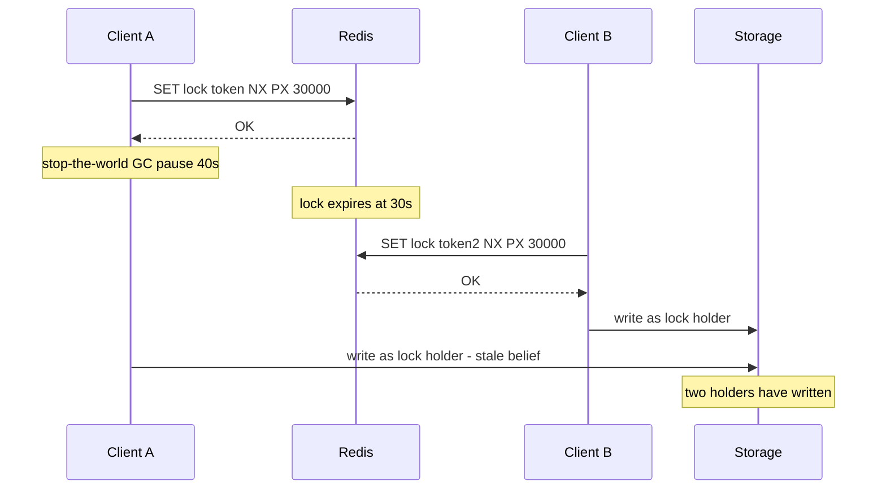

# Distributed Locking

A mutex inside one JVM is easy: `synchronized` and the JVM's memory model do the work. The moment the competing workers live in different processes on different machines, you need a **distributed lock** — and the honest headline of this note is that a distributed lock over an asynchronous network **cannot be made perfectly safe by the lock alone**. Timeouts, process pauses, and failovers conspire so that two holders are occasionally possible. The engineering question is therefore not "which lock library is bulletproof" but "what happens when the lock fails, and does my design survive it" — which splits locks into *efficiency* locks (fine on Redis) and *correctness* locks (need fencing or a different design entirely).

## The problem that created it

A growing system keeps meeting the same shape of problem. First it's a scheduled job: the service gets a second replica, and now the nightly settlement job runs twice. Then it's a resource: two workers pick up the same task; two requests try to update the same account concurrently across services; a migration must run exactly once per deploy. In one process you'd grab a mutex. Across machines there is no shared memory — only messages over a network that delays, drops, and reorders ([[Network Partitions and Timeouts]], [[The Fallacies of Distributed Computing]]). So teams reach for the shared thing they already have — Redis — and write `SETNX lock 1`. That naive version fails in four distinct ways (no expiry → deadlock on holder crash; expiry set non-atomically → deadlock window; no owner token → releasing someone else's lock; even with all fixes → expiry under pause means two holders), and the escalation path through those failures is this note.

## What it solves

- **Mutual exclusion across processes** — one worker at a time on a shared resource (best-effort, see below).
- **Duplicate-work suppression** — cron fleets, [[Cache Stampede and Thundering Herd|stampede]] single-flight, batch jobs on N replicas.
- **Coarse coordination** — leader-ish election for "someone must own this task" where occasional overlap is tolerable.

## How it works

### The single-node Redis lock, done right

Three requirements, each fixing a real failure:

1. **Atomic acquire with TTL:** `SET lock:resource <token> NX PX 30000` — NX (only if absent) and PX (expiry) in *one* command. The TTL guarantees liveness: a crashed holder's lock self-releases. (Pre-2.6.12 recipes that SETNX then EXPIRE had a crash window between the two — a permanent deadlock.)
2. **A unique token per acquisition** (UUID), not `1`: the lock must record *whose* it is.
3. **Release via Lua** — delete only if the token still matches:

```lua
if redis.call("get", KEYS[1]) == ARGV[1] then
    return redis.call("del", KEYS[1])
else
    return 0
end
```

The compare-and-delete must be atomic (Lua executes in one event-loop turn — [[Redis Internals]]; Redis 8.4+ also offers it as one native command, `DELEX key IFEQ <token>`, while Lua remains the portable form). Without it, this interleaving corrupts the system: A's lock expires mid-work → B acquires → A finishes and runs plain `DEL` → A just deleted **B's** lock → C acquires while B still works. Two holders, caused by the *release* path.

### The whole skeleton, so you can audit yours against it

In Spring terms the correct shape is small enough to read in one glance — which is the point, because every deviation below is a real production bug someone has shipped:

```java
String key   = "lock:" + resource;
String token = UUID.randomUUID().toString();   // new token for every acquisition

Boolean acquired = redis.opsForValue()
        .setIfAbsent(key, token, Duration.ofSeconds(30));   // SET key token NX PX 30000

if (!Boolean.TRUE.equals(acquired)) {
    return;                 // someone else owns it: return or retry with jittered backoff
}
try {
    doWork();               // must finish well inside the TTL, or be renewed
} finally {
    redis.execute(RELEASE_SCRIPT, List.of(key), token);   // the Lua above, never DEL
}
```

Four rules are encoded there, each guarding a specific mistake:

1. **A fresh token per acquisition.** Reusing one token per process (or per bean) means a retry can release the lock its own earlier attempt no longer owns.
2. **Acquisition failure returns or backs off with jitter** — it never spins on Redis. A busy-wait loop turns one contended lock into a [[Hot Key Problem|hot key]] and a thundering herd on release.
3. **Release lives in `finally` and goes through the script.** An exception path that skips release leaves the key held for the full remaining TTL even though the work is over — every waiter blocks for nothing; a plain `DEL` in `finally` is the corruption above.
4. **The TTL is an explicit bet that the work finishes in time.** Write the bet down next to the constant, in terms of the work's *tail* duration, not its median.

If the work genuinely cannot be bounded, **extension must be token-checked too** — the same compare, with `PEXPIRE` instead of `DEL`:

```lua
if redis.call("get", KEYS[1]) == ARGV[1] then
    return redis.call("pexpire", KEYS[1], ARGV[2])
else
    return 0
end
```

Renewing without the compare is the release bug wearing a different hat, in two flavours. A bare `EXPIRE key 30` cheerfully extends whoever currently holds the key — including the holder who replaced you while you were paused. `SET key myToken XX PX 30000` is worse: it finds the key present, overwrites the current owner's token with yours, and hands you a lock you have just stolen from someone who is still working.

### The hole no recipe closes: expiry vs. pauses

The TTL that provides liveness is also the safety hole. The client cannot atomically check "do I still hold the lock" and perform its protected action — between check and action lies arbitrary delay:



GC pauses, VM migrations, page faults, long I/O — Kleppmann's point is that a paused process *cannot know it was paused* until too late. Lengthening the TTL only trades safety against liveness (crashed holders block everyone for longer). On top of this, Redis [[Replication]] is async: a failover can **lose** the lock key (new primary never saw it — second acquirer admitted) or effectively **resurrect** ownership state inconsistently ([[Redis Cluster and Sentinel]]). Conclusion: a single-node Redis lock is excellent *most of the time* and cannot be guaranteed exclusive *all of the time*.

### Redlock, and the Kleppmann–antirez debate

**Redlock** (antirez's algorithm) attacks the single-point weakness: run N=5 *independent* Redis instances (no replication); to lock, try all N in parallel (the current redis.io spec; early versions said sequentially) with short per-attempt timeouts; you hold the lock iff you got **a majority (≥3)** within a validity window computed as TTL minus elapsed acquisition time minus clock-drift allowance. Release everywhere. The majority property means one crashed/partitioned Redis doesn't grant two holders.

**Kleppmann's critique** ("How to do distributed locking", February 2016) makes two arguments. The narrow one: Redlock's validity window depends on **bounded clock drift and bounded pauses** — a system-clock jump (NTP step, admin error) or a GC pause can expire a lock the holder still believes in; Redlock is neither a proper asynchronous-model algorithm (like [[Consensus and Raft|Raft/Paxos]]-based locks) nor cheap, landing in an awkward middle. The broad one, which applies to **every** expiring lock including Chubby's and ZooKeeper's: even a perfect lock service cannot stop a *paused holder's delayed write* from landing after the lock moved on. Safety therefore requires cooperation from the **protected resource** — fencing.

**Antirez's reply** ("Is Redlock safe?") defends the clock assumptions as realistic for well-run systems (monotonic-ish clocks, no NTP steps) and observes that Kleppmann's fencing prescription has its own gap in practice: if the storage can check monotonic tokens, it can often enforce the invariant without the lock. The community's settled synthesis: **for efficiency locks Redlock is more machinery than the job needs (single-node + token is fine); for correctness locks Redlock is not enough (nothing TTL-based is) — so Redlock rarely earns its complexity.** That's an honest reading of both sides, and interviewers reward knowing *both* positions rather than a winner.

### Fencing tokens — safety moved to the resource

A **fencing token** is a number that increases monotonically with each lock grant. The holder presents it with every operation on the protected resource, and **the resource rejects tokens older than the newest it has seen**. Now the delayed write from a paused ex-holder (token 33) arrives after the new holder (token 34) has written — and is refused. Safety no longer depends on anyone's clock or timeliness; it depends on one compare at the resource ([[Split Brain and Fencing]]).

The fine print: the token source must itself be strongly consistent and monotonic (ZooKeeper's `zxid`/version numbers qualify; plain Redis counters survive failover no better than the lock did), and — the real constraint — **the resource must be able to check tokens**. A database can (store `last_token`, compare in the write transaction, or use optimistic versioning). A third-party HTTP API usually cannot, which is why fencing often morphs into its close cousin: conditional writes / compare-and-set / [[Idempotency]] keys at the final effect.

### The alternatives that are usually better

- **Database locks:** `SELECT … FOR UPDATE` on the entity row — the lock and the data live in the *same* system, so the transaction's atomicity replaces the dual-system race entirely; it releases on connection death; and it serializes exactly the critical write. Postgres/MySQL advisory locks (and MongoDB's document-level atomicity with findAndModify-style claims) cover "job runner" cases. For minutes-long work, holding transactions is bad — use a claim row with a lease timestamp instead.
- **Design the race away with idempotency:** unique constraint on a natural key (one settlement row per date — second runner gets a duplicate-key error and exits), state-machine transitions as conditional updates (`UPDATE … WHERE status = 'PENDING'` — exactly one wins), [[Idempotency|idempotency keys]] on effects. No lock, no TTL tuning, no fencing — the invariant is enforced where the data lives, deterministically.
- **Unique consumer by partition:** let the messaging layer assign each key to one consumer ([[Consumer Groups and Rebalancing]], [[Message Ordering]]) — exclusivity by routing instead of locking.

## Trade-offs

| Approach | Safety under pause/failover | Liveness | Cost/complexity | Use for |
|---|---|---|---|---|
| Single-node Redis lock + token + Lua | best-effort | TTL auto-release | trivial | efficiency: dedup work, stampede control |
| Redlock (5 nodes) | better vs node loss; still clock/pause-dependent | TTL | 5 instances + client logic | narrow niche; usually skip |
| ZooKeeper/etcd lock (sessions + consensus) | strong lock state; holder-pause hole remains without fencing | session-based | heavy infra | infra coordination, leader election |
| Lock + fencing at resource | **yes** — resource rejects stale writers | TTL | resource must check tokens | correctness-critical with capable storage |
| DB row/advisory lock | yes within DB scope | released with txn/connection | none new | serializing writes on entities you own |
| Idempotent design / unique constraints | **yes** — deterministic | n/a | schema thought | money, exactly-once effects |

## Failure modes

Each of these has a signal that distinguishes it from the others — which matters, because "the job ran twice" is the same symptom for all of them.

- **Expiry under pause → two holders** (the diagram above). *Signal:* two completed runs whose work intervals overlap, where the second one **started after the first one's TTL would have lapsed**. *Confirm:* log the token, acquisition timestamp and TTL on every acquire, and the token plus elapsed time on every completion; then look for completions whose elapsed time exceeds the TTL. On the JVM side, check GC pause records and container CPU throttling (`container_cpu_cfs_throttled_seconds_total`) for the same minute — a pod with a 1-CPU limit being throttled is the most common non-GC cause, and it does not show up in any Redis metric. *Mitigation:* fencing/conditional writes; a watchdog thread extending the TTL (Redisson's pattern) *narrows* it only.
- **Failover drops or forgets locks** — async replication ([[Redis Cluster and Sentinel]]): new primary grants a lock someone holds, or loses one mid-hold. *Signal:* duplicate work clustered tightly around a failover, with **no** corresponding pause or over-TTL run in the logs above — the holder behaved perfectly and the lock moved anyway. *Confirm:* correlate the duplicate's timestamp with Sentinel `+switch-master` events or a role change in `INFO replication`. *Mitigation:* treat Redis lock state as advisory; deterministic backstop downstream.
- **Release-path bugs:** plain DEL without token compare; token compare *then* DEL as two commands; exceptions skipping release (always `finally`); retry wrappers re-acquiring under a new token while the old work continues. *Signal — and this is the single most useful lock metric you can add:* **instrument the release script's return value.** A `0` means "the key was gone or held by someone else when I tried to release" — in other words, this run finished outside its own lease. A steady non-zero rate of 0-returns is a direct, quantitative measurement of how often your TTL is losing its bet, visible long before it causes a visible incident.
- **Clock steps** (Redlock-specific): NTP jumps shrink validity windows. *Signal:* elapsed-time measurements that disagree with wall-clock deltas, or negative durations in logs. *Confirm:* chrony/ntpd step events in the host's syslog. *Mitigation:* monotonic clocks for elapsed-time math (`System.nanoTime`, not `currentTimeMillis`); slew, don't step.
- **Lock server as SPOF/hotspot:** every critical path serializes through one Redis — an outage stops the fleet (fail closed) or unleashes it (fail open). *Signal:* acquisition error rate and acquisition latency are separate metrics and tell different stories — errors mean Redis is unreachable, rising latency with successes means the instance is blocked by someone else's slow command ([[Redis Internals]]). Decide fail-open/fail-closed explicitly, per lock.
- **Herd on release:** N waiters polling one lock key → acquisition stampede. *Signal:* attempts-per-successful-acquisition climbing, and Redis ops/sec on the lock key dwarfing the work rate it protects. Mitigate with backoff + jitter ([[Timeouts Retries and Exponential Backoff]]).

## When NOT to use it

- **When a unique constraint does the job** — most "we need a lock" statements are really "this effect must happen at most once," which the database enforces deterministically. Reach for the schema first.
- **For correctness over money movement with no fencing-capable resource** — if the final effect can't check tokens or be made idempotent, no Redis/ZK lock makes it safe; redesign the flow (single-writer by partition, ledger-style inserts).
- **Long-held locks** (minutes+): TTL tuning becomes a dilemma — short risks expiry-under-work, long risks extended deadlock after crashes. Use lease-with-heartbeat claims in a DB, or job-queue semantics with visibility timeouts ([[SQS and SNS]]).
- **High-contention hot paths:** a lock serializes throughput to one holder at a time ([[Hot Key Problem]] of your own making); partition the work instead.

## Common misconceptions

- **"Redis commands are atomic, so my lock is correct."** Each *command* is atomic; a *lock* is a protocol spanning acquire, work, and release — and the work happens entirely outside Redis. Atomicity closes the gaps between commands; it says nothing about the seconds or minutes your process spends elsewhere believing it still holds the key.
- **"A watchdog that renews the lease fixes the pause problem."** The watchdog is a timer thread **inside the same JVM** as the work. A stop-the-world GC pause, a frozen VM, a `SIGSTOP`, or CPU starvation on an over-committed node pauses the renewer exactly as it pauses the worker — the two share precisely the fate that would have to be independent for renewal to help. Renewal is genuinely useful for work that is *slow but alive*; it is sold as a fix for the case it cannot touch.
- **"A longer TTL is safer."** It swaps one failure for its opposite. Longer shrinks the expiry-under-pause window and lengthens how long a crashed holder blocks everyone; shorter does the reverse. No value eliminates both, because this is the shape of the problem rather than a tuning deficiency — which is the entire reason fencing exists.
- **"ZooKeeper and etcd locks are safe, so fencing is a Redis-only concern."** Their lock *state* is much stronger: a consensus-backed session revoked by the ensemble rather than by a client-side timer, so the "two clients both think they hold it" case is genuinely rare. But the holder-pause hole is about where the **work** happens, not where the lock lives — a paused client's write still lands after its session expired. Chubby shipped sequencers for exactly this reason, in a lock service with real consensus underneath it.
- **"We need a lock because two things might run at once."** Nearly always the actual requirement is "this effect must happen at most once", which is a constraint on the *effect*, not on concurrency. A unique index enforces it deterministically — and keeps enforcing it during the incident where the lock service is the component that failed.
- **"The lock protects the record."** It protects it only against participants who take the lock. A migration script, an admin tool, a different service, or last quarter's deploy that predates the lock all write straight past it. Database constraints bind every writer; a lock binds only the polite ones.

## In your stack

- Audit existing Redis locks against the recipe: `SET NX PX` in one command, UUID token, Lua compare-and-delete release, release in `finally`. Spring/Redisson users: Redisson's RLock automates token + watchdog renewal (Redisson now marks its multi-node `RedLock` object deprecated in favour of `RLock`/`RFencedLock`), but renewal still can't outrun a paused JVM — classify each lock as efficiency or correctness anyway.
- **Services pinned at 1 replica** quietly protect you today — one JVM means in-process locks suffice for many paths. Every scale-out to 2 replicas silently converts those into distributed-locking problems; make that a checklist item on replica-count changes.
- Fintech rule, aligned with the org's working agreements: Redis locks may *reduce* duplicate work on money paths, but the deterministic control is mandatory — unique index on the idempotency key in MongoDB, conditional state transitions, immutable audit rows. "The Redis lock usually prevents it" does not survive an RBI audit; fail closed where value is at stake.
- Scheduled-job dedup (the most common lock at Niyo-shaped shops): prefer a claim document in Mongo (`findOneAndUpdate` with a lease timestamp, unique job+date key) over a Redis lock — same Redis-free determinism, visible in the primary datastore, auditable.
- **Kubernetes does not give you the exclusivity people assume it does.** The Kubernetes documentation itself states that a CronJob may create a Job more than once for a single schedule, and that jobs should therefore be idempotent. `concurrencyPolicy: Forbid` reduces overlap but is not a correctness guarantee; neither is a pod count of 1, since a rolling deploy deliberately runs old and new pods together for the overlap window. Any "it only runs once because there's one pod" assumption is really an assumption about your deployment strategy ([[Graceful Shutdown and Deployment Safety]]).
- **If you need a real fencing token, MongoDB is your most credible source** — not Redis. A `findOneAndUpdate` with `$inc` on a counter document, returning the post-image, at majority write concern, gives a monotonically increasing number that survives a replica-set election (majority-committed writes are not rolled back). Store `lastToken` on the protected document and reject writes carrying anything lower, inside the same update predicate. That is fencing done where the money state already lives ([[Split Brain and Fencing]], [[MongoDB Architecture]]).
- **The planned [[Redis Streams]] move replaces some locks with leases, not with safety.** `XREADGROUP` assigns each entry to one consumer, and `XAUTOCLAIM`/`XCLAIM` reassign pending entries after a minimum idle time — which is a lease with the same expiry-under-pause hole as the lock above, just moved into the broker. SQS's visibility timeout is the identical shape ([[SQS and SNS]]). Exclusivity by assignment removes the lock key and its failure modes; it does not remove the need for [[Idempotency|idempotent effects]].

## Interview angle

The 60-second version: *"Single-node recipe: SET key uuid NX PX in one command, release with a Lua compare-and-delete so you never free someone else's lock. That's correct but not sufficient: the TTL that gives liveness means a GC-paused holder can keep working after expiry while a second holder proceeds — and Redis failover can lose the lock key entirely, since replication is async. Redlock acquires a majority of five independent Redises to fix node loss; Kleppmann's critique is that its validity window still assumes bounded clocks and pauses, and that any expiring lock needs fencing — a monotonic token the protected resource checks, rejecting stale writers. So: efficiency locks, single-node Redis is fine; correctness locks need fencing or, better, idempotent design — unique constraints and conditional updates where the data lives."*

Classic follow-ups: "Why Lua for release?" (atomic get-compare-del; two commands race with expiry+reacquisition). "Where does the fencing counter come from?" (a linearizable source — ZK zxid, DB sequence — not the Redis that just failed over). "Lock vs idempotency — when each?" (lock prevents concurrent *work*; idempotency makes duplicate work harmless — prefer the latter for effects, use both for expensive work). "What would you actually do for exactly-once settlement?" (unique constraint + state machine; any lock is an optimization on top — [[Exactly-Once Delivery Is a Lie]]).

## Check yourself

> [!question]- Q: Explain why the unique token and Lua release are both necessary, with the exact failure each prevents.
> Token: the lock key must record which acquisition owns it. Without it, client A — whose lock expired mid-work and was re-acquired by B — runs DEL on return and silently frees *B's* lock, letting C in alongside B. Lua: the release must check-token-and-delete atomically. As two commands (GET, compare, DEL), A can pass the compare, then stall; the lock expires; B acquires; A's queued DEL now deletes B's lock — the same corruption through a smaller window. One event-loop turn ([[Redis Internals]]) closes it.

> [!question]- Q: Scenario — payment-capture workers use a correct Redis lock (token + Lua + 30 s TTL), yet a capture ran twice: logs show worker 1 completed at t+41 s, worker 2 started at t+31 s. Reconstruct the failure and name the fix.
> Worker 1 acquired at t0 and then stalled (GC pause, CPU starvation, slow downstream call) past the 30 s TTL; the lock expired at t+30; worker 2 legitimately acquired at t+31 and captured; worker 1 resumed and completed its in-flight capture at t+41 — it had no way to learn its lease had lapsed. The lock behaved exactly as designed; TTL-based exclusion cannot survive holder pauses. Fix at the effect: idempotency key on the capture with a unique DB constraint (second insert fails), or a conditional transition `WHERE status = PENDING` so exactly one capture wins — fencing in spirit, enforced where the money state lives.

> [!question]- Q: Present both sides of the Redlock debate in four sentences, then give the practical takeaway.
> Antirez: five independent Redis nodes, majority acquisition, validity window minus drift — node failure can't produce two holders, and with sane clocks (no NTP steps, monotonic elapsed-time) it holds in practice. Kleppmann: the validity window silently assumes bounded pauses and clock behavior, making Redlock's safety timing-dependent — and regardless of algorithm, a paused holder's late write defeats any auto-expiring lock, so true safety needs fencing checks at the resource. Antirez's rejoinder: if your resource can check fencing tokens, you likely didn't need the elaborate lock. Takeaway: single-node Redis for efficiency locks; fencing/idempotency for correctness; Redlock occupies a middle that rarely pays.

> [!question]- Q: Scenario — you instrumented the release script and find it returns 0 on about 3% of releases. Nothing has visibly broken. What is that number telling you, and what do you do about it?
> A `0` means the key was absent or held by a different token at release time: that run **finished outside its own lease**. So 3% of your executions completed with no mutual exclusion at all — the protocol was violated 3% of the time and nothing bad has happened yet only because no second holder happened to overlap destructively in those windows. It is not noise; at any meaningful volume it is a steady stream of unprotected runs. What to do: first compare the *tail* of your work-duration distribution against the TTL — you almost certainly sized the TTL against the median, and p99.9 is what expires. Then decide deliberately: raising the TTL buys fewer violations at the price of longer blocking after a crash, which may be the right trade or may not. Either way, 3% is proof that the lock cannot be the control — put a unique idempotency key or a conditional `WHERE status = PENDING` transition on the effect, and let the lock go back to being an optimisation. Finally, check whether the overruns correlate with GC pauses or CPU throttling rather than genuinely slow work; a throttled 1-CPU pod is cheaper to fix than anything else on this list.

> [!question]- Q: Mini design — nightly interest-accrual job, service at 3 replicas, must run exactly once per day, takes ~10 minutes. Design without a Redis lock.
> Claim row in the primary DB: unique index on (job_name, business_date); each replica attempts `INSERT` or `findOneAndUpdate` upsert of a claim with its instance id and a lease-expiry timestamp (say now+15 min). Exactly one wins (unique constraint — deterministic); losers exit. The winner heartbeats the lease; a crashed winner's stale lease lets a replica re-claim after expiry — and the accrual writes themselves are idempotent (one accrual row per account per date, unique-keyed), so even a pause-then-resume double run cannot double-post. Audit trail lives in the claim and accrual rows. [[Idempotency]] does the correctness; the claim just saves wasted work.

## Sources

- Martin Kleppmann, "How to do distributed locking" (martin.kleppmann.com, Feb 2016) — the critique, fencing tokens, efficiency-vs-correctness framing; expanded in *DDIA* Ch. 8 ("The Truth Is Defined by the Majority", leases and pauses) and Ch. 9.
- Salvatore Sanfilippo (antirez), "Is Redlock safe?" (antirez.com, 2016) — the response; and the Redlock specification, "Distributed Locks with Redis" (redis.io), which as of 2026 shows `DELEX key IFEQ` as the release form (Lua for pre-8.4) and carries a "Disclaimer about consistency" recommending fencing tokens and noting that TTL expiry uses the wall clock, not a monotonic one.
- Redis documentation — SET command (NX/PX semantics), EVAL/scripting atomicity guarantees.
- Burrows, "The Chubby lock service for loosely-coupled distributed systems" (OSDI 2006) — sequencers (fencing tokens) in Google's production lock service.
- Redisson documentation — RLock watchdog mechanics (what auto-renewal does and doesn't protect); the documented default (as of 2026) is a 30 s lease renewed at a third of that interval, applied when `lock()` is called without an explicit lease time.
- Kubernetes documentation — CronJob concept page, which states a Job may be created more than once for a single schedule and that jobs should therefore be idempotent.
- MongoDB documentation — `findOneAndUpdate` single-document atomicity, read/write concern, and the guarantee that majority-committed writes are not rolled back by an election.
